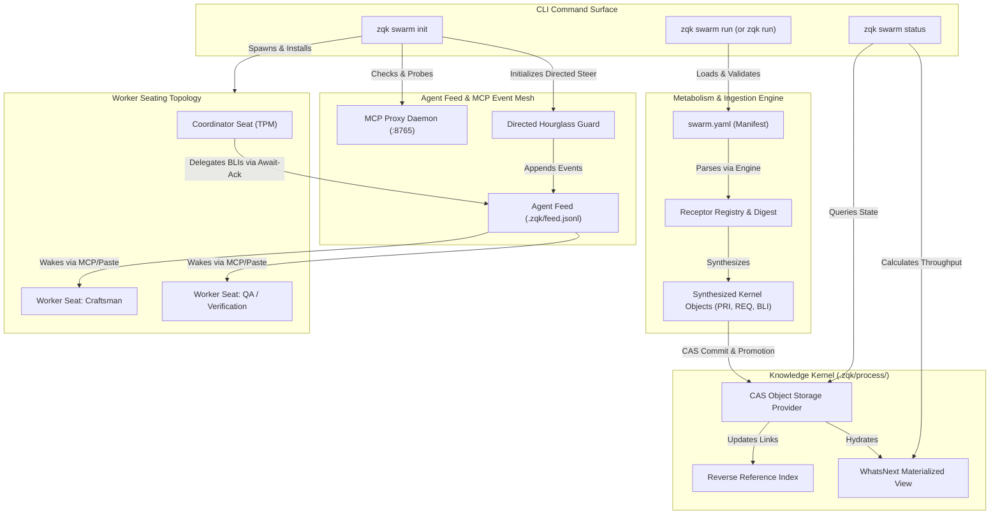

# CLI Swarm Subsystem Architectural Guide

## Overview

The **ZQK CLI Swarm Subsystem** (`cmd/zqk/swarm`) provides the command-line interface, execution engine, and multi-agent coordination layer for autonomous swarm delivery within the Zen Quantum Kernel (ZQK).

Unlike transient prompt-harness frameworks that discard context, lose execution state, and rely on ephemeral chat histories, ZQK roots all multi-agent swarm operations directly in the persistent **Knowledge Kernel**. Swarm packages, declarative pipelines, coordinator identities, worker seats, and telemetry traces are stored as first-class, versioned graph objects in Content Addressable Storage (CAS) under `.zqk/process/`.

The Swarm Subsystem enables teams and automated Technical Program Managers (TPMs) to:
1. Initialize deterministic multi-agent execution pipelines via `zqk swarm init`.
2. Ingest, stage, and execute portable swarm packages via `zqk swarm run` (or top-level `zqk run`).
3. Monitor real-time task throughput, instruction delivery, and worker seating health via `zqk swarm status`.

---

## Architectural Taxonomy & Core File Layout

The swarm subsystem is housed in `cmd/zqk/swarm/` and interacts directly with the storage engine, agent feed mesh, Model Context Protocol (MCP) daemons, and metabolism package ingestion engine:

```
cmd/zqk/swarm/
├── swarm.go              # Root 'zqk swarm' command builder and subcommand aggregation
├── init.go               # 'swarm init' & 'agent swarm-init': pipeline bootstrap, MCP check & chat seating
├── run.go                # 'swarm run' & 'zqk run': manifest ingestion, CAS storage & background launch
├── status.go             # 'swarm status': throughput metrics, task aggregation & skill binding analysis
├── run_test.go           # In-process unit & integration tests for manifest validation and dry runs
├── run_remote_test.go    # Unit tests for remote swarm package resolution and cache mechanics
├── status_test.go        # Unit tests for persona skill reference extraction and aggregation
├── swarm_coverage_elevation_test.go        # Elevation test suite for CLI command builders & execution paths
└── swarm_coverage_elevation_cycle93_test.go # Cycle 93 suite covering storage mocks, edge cases & boundary checks
```

---

## Multi-Agent Coordination Topology

The following diagram illustrates how the CLI Swarm Subsystem coordinates between the human operator/TPM, the coordinator agent, the MCP event mesh, and specialized worker seats:



---

## 1. Swarm Initialization (`zqk swarm init`)

### Purpose & Responsibilities

The `zqk swarm init` command (aliased as `zqk agent swarm-init`) prepares the execution runway for a multi-agent swarm. It performs the following duties:

1. **Pipeline Validation**: Loads the target pipeline (`--pipeline`) or workflow (`--workflow`) from kernel storage, ensuring all declared stages and executor roles exist.
2. **MCP Readiness Check**: Connects to the local MCP proxy daemon (`mcp ensure --tcp <address>`) to verify socket availability and probe active event subscribers.
3. **Seat Worker Installation**: Ensures worker daemons are configured and running for each declared seat slot.
4. **Chat Mesh Bootstrap**: Injects initial bootstrap payloads into worker mailboxes via the peer wake adapter, replacing `{seat_id}` placeholders dynamically.
5. **Directed Steering Verification**: Applies the directed hourglass protocol (`POL-AGENT-ORCH-HOURGLASS-001`) to prevent fire-and-forget idle states when delegating initial instructions.

### Command Usage & Flags

```bash
zqk swarm init [flags]
```

| Flag | Type | Description | Default |
|------|------|-------------|---------|
| `--pipeline` | string | Target pipeline ID to initialize (e.g., `PIP-SWARM-DEMO-001`). | `""` |
| `--workflow` | string | Optional workflow ID associated with the pipeline. | `""` |
| `--plan-id` | string | Priority Plan ID bounding the active execution cycle. | `""` |
| `--from-stage` | string | Specific stage ID from which execution should begin or resume. | `""` |
| `--agent-id` | string | Coordinator agent identifier (defaults to project coordinator seat). | `""` |
| `--persona-ref` | string | Persona reference assigned to coordinator (e.g., `PER-SWARM-COORDINATOR-001`). | `""` |
| `--dry-run` | bool | Validates pipeline topology and worker readiness without persisting state. | `false` |
| `--allow-chat` | bool | Enables bidirectional agent feed chat mesh communication. | `false` |

### Example Invocations

```bash
# Validate pipeline readiness in dry-run mode
zqk swarm init --pipeline PIP-SWARM-DEMO-001 --dry-run

# Live initialization with coordinator identity and chat mesh enabled
zqk swarm init \
  --pipeline PIP-SWARM-DEMO-001 \
  --plan-id PRI-SWARM-DEMO-001 \
  --agent-id coordinator-seat \
  --persona-ref PER-SWARM-COORDINATOR-001 \
  --allow-chat=true
```

---

## 2. Swarm Package Execution (`zqk swarm run` / `zqk run`)

### Purpose & Ingestion Lifecycle

The `zqk swarm run` command (also surfaced at root as `zqk run`) loads declarative swarm package manifests (`swarm.yaml`), resolves remote dependencies, converts the declarative topology into kernel objects, and launches execution.

#### Lifecycle Stages

1. **Manifest Resolution**:
   - Resolves local filesystem paths or remote repository identifiers (e.g., `github.com/organization/swarm-pack`).
   - Verifies Ed25519 cryptographic signatures and integrity seals if present.
2. **Summary Presentation & Dry-Run Gate**:
   - Parses the manifest into a structured `pack.SwarmPackage`.
   - Renders a clean terminal summary displaying the swarm package name, version, agents, tasks, and entrypoint.
   - If `--dry-run` is specified, terminates cleanly after validation.
3. **Storage & Account Resolution**:
   - Resolves the active project root and initializes the `ObjectStorageProvider`.
   - Verifies that a valid active account exists (e.g., `ACC-COMMUNITY-001`), creating a fallback system account if none is active.
4. **Metabolism Ingestion & Object Synthesis**:
   - The `metabolism.MetabolismEngine` parses task configurations, parameter defaults, and membranes into concrete kernel objects:
     - `priority_plan` (`PRI-<NAME>`)
     - `goal` (`GOAL-<NAME>`)
     - `milestone` (`MIL-<NAME>`)
     - `requirement` (`REQ-<NAME>-<TASK>`)
     - `criteria` (`CRIT-<NAME>-<TASK>-...`)
     - `backlog_item` (`BLI-<NAME>-<TASK>`)
     - `prompt_template` (`PROMPT-<NAME>-<TASK>`)
5. **Reverse Reference Linking**:
   - Populates the reverse index linking all synthesized `backlog_item` objects to the newly generated `priority_plan`.
6. **Materialized View & Feed Event Dispatch**:
   - Refreshes the `whatsnext` materialized view cache.
   - Dispatches a `SWARM DISPATCH` event to `.zqk/feed.jsonl` with `FeedEventTypeMeshStatus`.
7. **Execution Dispatch**:
   - If `--stage-only` is set, stops after kernel persistence, printing the CLI launch command (`zqk agent orchestrate <plan-id>`).
   - If interactive or confirmed with `--yes`, spawns a detached background process executing `zqk agent orchestrate <plan-id>` and logs output to `.zqk/logs/swarm-orchestrate-<name>.log`.

### Command Usage & Flags

```bash
zqk swarm run <package-path> [flags]
```

| Flag | Type | Description | Default |
|------|------|-------------|---------|
| `--dry-run` | bool | Validates manifest syntax and agent topology without persisting objects. | `false` |
| `--stage-only` | bool | Ingests and persists kernel objects into CAS without launching execution. | `false` |
| `--yes`, `-y` | bool | Launches background swarm execution without interactive console prompt. | `false` |
| `--entrypoint` | string | Overrides the default entrypoint task or pipeline declared in manifest. | `""` |

### Declarative Swarm Manifest Schema (`swarm.yaml`)

```yaml
schema_version: 1.0.0
name: swarm-demo-feature
version: 1.0.0
description: Autonomous multi-agent implementation and continuous verification swarm
entrypoint: task-implementation

agents:
  - name: craftsman
    role: software_craftsman
    persona_ref: PER-SWARM-CRAFTSMAN-001
  - name: verifier
    role: test_engineer
    persona_ref: PER-SWARM-VERIFIER-001

tasks:
  - id: task-implementation
    title: Implement Subsystem Test Elevation
    role: software_craftsman
    prompt_template: |
      Elevate test coverage for the target subsystem to >= 80%.
      Maintain clean architectural separation and zero regressions.
  - id: task-verification
    title: Execute Verification Suite & Generate Telemetry
    role: test_engineer
    depends_on:
      - task-implementation
```

---

## 3. Swarm Status & Telemetry (`zqk swarm status`)

### Purpose & Observability Architecture

The `zqk swarm status` command aggregates active, executing, and historical swarm workload objects from the Knowledge Kernel, computing real-time throughput metrics.

### Key Metrics & Status Fields

- **Throughput Hint**: A coarse-grained state classification:
  - `executing`: At least one `agent_task` is actively in progress (`in_progress`, `executing`, `pending_verification`, `routed`).
  - `queued`: No tasks are executing, but tasks exist in `proposed` or `approved` states.
  - `instructions_pending`: Tasks are resolved, but `agent_instruction` objects remain in `proposed` state awaiting delivery.
  - `idle`: No active tasks or pending instructions exist across the active workspace.
- **Agent Tasks Partition**: Exact counts partitioned across lifecycle states (`proposed`, `approved`, `in_progress`, `completed`, `failed`).
- **Agent Instructions Partition**: Instruction delivery and acknowledgement statistics.
- **Active Priority Plans**: Count of priority plans currently in `active` state (`objects.ObjectStatusActive`).
- **Persona Skill Binding Health**:
  - `bound`: Personas that declare at least one skill reference via `agent_skill_refs` or `related_object_refs` (e.g. `ASK-COMMUNITY-001`).
  - `unbound`: Personas lacking skill references.
  - `unbound_sample`: Up to 12 sorted persona IDs lacking skill bindings to guide operator remediation.
- **CAP Orchestrator Presence**:
  - Reports whether the continuous autonomous progression job (`objects.JobIDCapOrchestrator`) is registered in storage.
  - Generates command links for inspecting scheduler history (`zqk scheduler history --job-id JOB-CAP-ORCHESTRATOR-001`).

### Command Usage & Output Formats

```bash
zqk swarm status [flags]
```

Supports standard ZQK output formats: `--format table` (default), `--format json`, `--format yaml`.

#### Sample JSON Output

```json
{
  "swarm": {
    "throughput_hint": "executing",
    "executing_agent_tasks": 2,
    "agent_tasks_total": 5,
    "agent_tasks_by_status": {
      "approved": 1,
      "completed": 2,
      "in_progress": 2
    },
    "agent_instructions_total": 4,
    "agent_instructions_by_status": {
      "delivered": 4
    },
    "active_priority_plans": 1,
    "persona_skill_bound": {
      "total": 4,
      "bound": 4,
      "unbound": 0,
      "unbound_sample": []
    },
    "cap_orchestrator_job": {
      "id": "JOB-CAP-ORCHESTRATOR-001",
      "present": true,
      "history": "zqk scheduler history --job-id JOB-CAP-ORCHESTRATOR-001"
    },
    "related_commands": [
      "zqk agent status",
      "zqk feed pending",
      "zqk workflow whats-next --format json",
      "zqk scheduler history --job-id JOB-CAP-ORCHESTRATOR-001"
    ]
  }
}
```

---

## 4. MCP Integration & Event Mesh Topology

ZQK swarms leverage the **Model Context Protocol (MCP)** to establish a unified communication bus across language models, CLI runners, and long-running daemons.

### MCP Components in the Swarm Subsystem

1. **Proxy Daemon Probe (`swarmInitEnsureMCP`)**:
   During `swarm init`, the CLI executes `zqk mcp ensure --tcp <addr>` to ensure the daemon is running. If absent, the daemon is booted transparently.
2. **Subscriber Count Introspection (`swarmInitMCPSubscribers`)**:
   The coordinator queries the proxy daemon (`mcp.ProxyDaemon.QueryEventsSubscriberCount`) to verify that worker clients are listening to the event stream before dispatching tasks.
3. **IPC Wake Mechanism (`agentfeed.WakePeerOpts`)**:
   When a coordinator steers a worker, the message is written to `.zqk/feed.jsonl` and an IPC signal is sent through the MCP proxy, triggering instant wakeups rather than relying on high-latency polling loops.

---

## 5. Worker Seating & Concurrency Protocols

To ensure multi-agent execution remains deterministic, stable, and conflict-free, the Swarm Subsystem enforces strict seating discipline:

1. **Seat Allocation**:
   Worker seats (e.g. `worker-craftsman`, `worker-qa`) run as dedicated sub-processes bound to designated directory workspaces.
2. **Atomic Leases & Task Claiming**:
   Before an agent modifies code or runs verification tests, it must execute `zqk agent claim <bli-id>` to acquire an exclusive CAS lease, preventing two workers from editing the same requirement concurrently.
3. **Directed Hourglass Guarantee (`POL-AGENT-ORCH-HOURGLASS-001`)**:
   Any directed peer-to-peer steer must register an `await_peer_ack` record. Fire-and-forget peer steers are strictly rejected by the kernel check-valves to prevent orphaned tasks and silent deadlocks.

---

## 6. Identifier Standards Reference

All objects minted or referenced within the Swarm Subsystem must conform to human-legible, typed, uppercase identifiers. Nanosecond timestamps and studio hexadecimal strings are strictly prohibited:

| Object Kind | Canonical Prefix | Illustrative Clean Identifier |
|-------------|------------------|--------------------------------|
| Priority Plan | `PRI-` | `PRI-SWARM-DEMO-001` |
| Goal | `GOAL-` | `GOAL-SWARM-DEMO-001` |
| Milestone | `MIL-` | `MIL-SWARM-DEMO-001` |
| Requirement | `REQ-` | `REQ-SWARM-DEMO-TASK-001` |
| Criteria | `CRIT-` | `CRIT-SWARM-DEMO-TASK-001-INV` |
| Backlog Item | `BLI-` | `BLI-SWARM-DEMO-TASK-001` |
| Pipeline | `PIP-` | `PIP-SWARM-DEMO-001` |
| Account | `ACC-` | `ACC-COMMUNITY-001` |
| Persona | `PER-` | `PER-SWARM-COORDINATOR-001` |
| Agent Skill | `ASK-` | `ASK-SWARM-CODE-REVIEW-001` |
| Scheduler Job | `JOB-` | `JOB-CAP-ORCHESTRATOR-001` |
