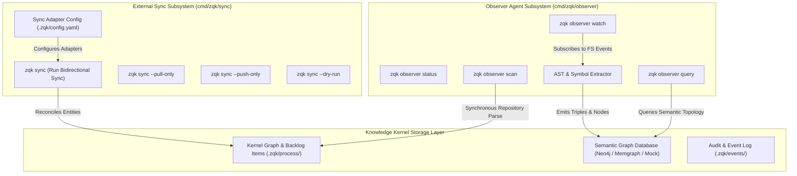

# CLI External Sync & Observer Agent Guide

Comprehensive guide to Knowledge Kernel external tracker synchronization (`zqk sync`) and Observer agent AST extraction, relationship mapping, and semantic graph projection (`zqk observer`) within the **ZQK Knowledge Kernel**.

---

## 1. System Overview & Architecture

The **Sync** and **Observer** CLI subsystems represent two vital sensory and convergence surfaces of the Knowledge Kernel:
- **`zqk sync`**: Bridges external project management platforms (Jira, Linear, GitHub Issues) with the immutable Knowledge Kernel backlog item graph, ensuring bidirectional consistency and schema mapping.
- **`zqk observer`**: Performs continuous AST parsing, semantic symbol extraction, structural graph reasoning, and codebase topology observation to feed active agent contexts.



---

## 2. External Tracker Synchronization (`zqk sync`)

### 2.1 Synchronization Flow & Operational Modes

The `zqk sync` command orchestrates reconciliation between local kernel backlog items and remote project management platforms:

```bash
# Execute standard bidirectional synchronization across configured remote adapters
zqk sync

# Preview synchronization actions without modifying kernel state or remote trackers
zqk sync --dry-run

# Pull remote issue changes into local backlog items only
zqk sync --pull-only

# Push local backlog item mutations and status transitions to remote trackers
zqk sync --push-only

# Target a specific external tracker tracker adapter (e.g. jira, linear, github)
zqk sync --adapter linear
```

### 2.2 Error Handling & Schema Invariants

- **Idempotency**: All entity synchronizations are keyed by deterministic external references (`external_id`). Multiple executions produce no duplicate records.
- **Fail-Closed Gate**: If an external API returns authentication failures (401/403) or rate limits (429), sync terminates cleanly and leaves local graph objects uncorrupted.
- **Structured Output**: Supports `--format json` and `--format yaml` for automated cron triggers and headless orchestrator runs.

---

## 3. Observer Agent Subsystem (`zqk observer`)

### 3.1 Codebase Scanning & Symbol Extraction

The observer inspects the repository AST, extracting packages, interfaces, structs, methods, and functions into structured nodes and edges:

```bash
# Check observer agent status, index health, and connection to graph backend
zqk observer status

# Perform a full AST extraction and graph update
zqk observer scan

# Filter scan to specific package paths or subdirectories
zqk observer scan --path ./pkg/agentfeed

# Inspect semantic query results for a symbol or relationship
zqk observer query --symbol RePrimeAgentContext
```

### 3.2 Continuous File Watcher Mode

In development and swarm orchestration environments, the observer runs as a background watcher:

```bash
# Start the observer daemon to monitor repository filesystem changes
zqk observer watch

# Run watcher with custom debouncing interval
zqk observer watch --debounce 500ms
```

### 3.3 Graph Backend Decoupling & Mock Provider

The observer supports both enterprise graph backends (Neo4j, Memgraph) and an in-memory mock provider for hermetic testing and air-gapped CI environments:

```bash
# Enable mock graph mode for automated test suites
export ZQK_GRAPH_ENABLED=true
export ZQK_MOCK_GRAPH=true
zqk observer status --format json
```

---

## 4. Verification & Testing Discipline

Both `cmd/zqk/sync` and `cmd/zqk/observer` meet strict continuous verification standards ($\ge 80\%$ statement coverage):
1. **Sync Test Suite (`sync_extended_test.go`)**: Validates flags, dry-run simulation, invalid arguments, context timeouts, and format outputs across JSON, YAML, and table representations.
2. **Observer Test Suite (`observer_extended_test.go`)**: Validates root and subcommands (`status`, `scan`, `watch`, `query`), argument edge cases, mock graph activation, and missing repository safety invariants.
