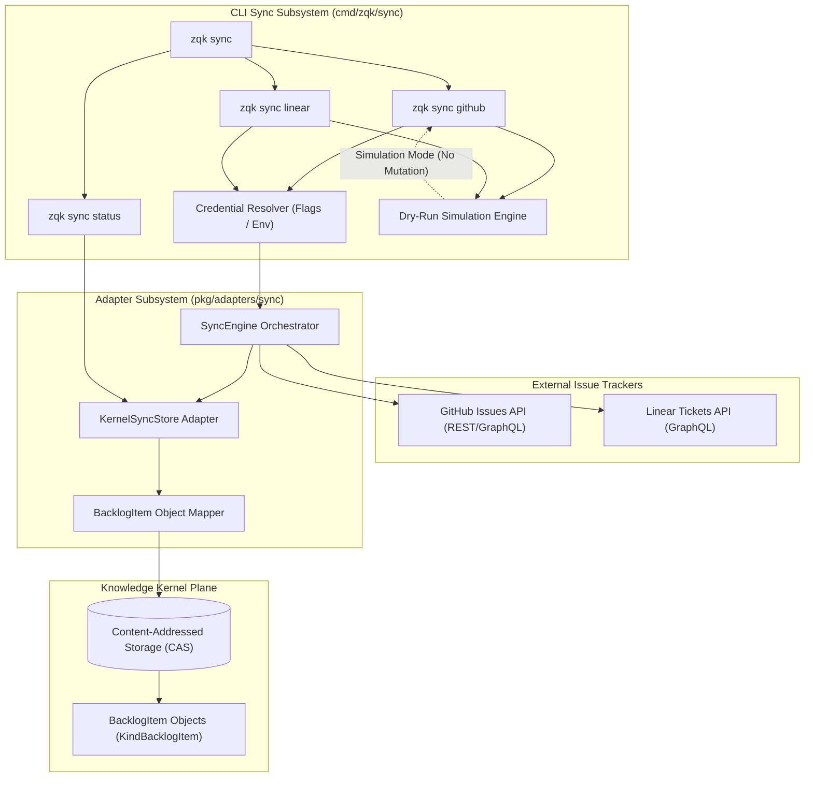
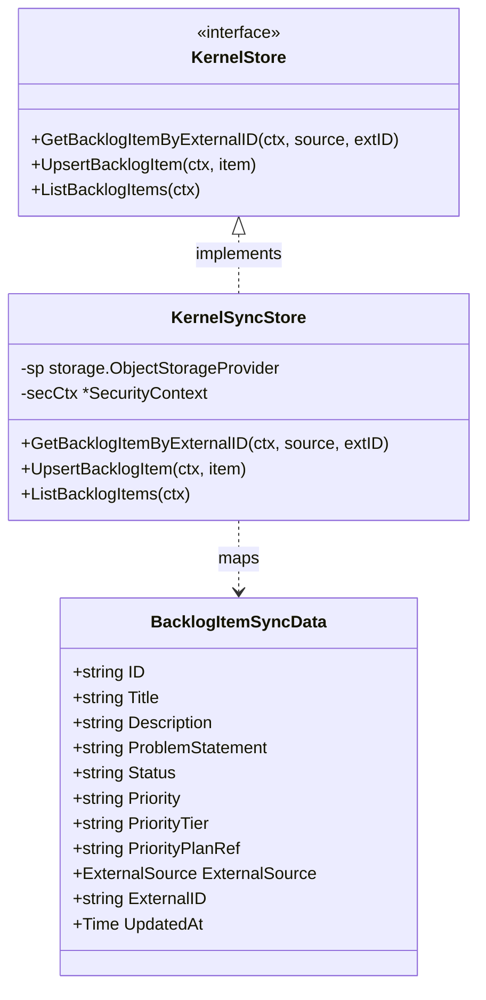
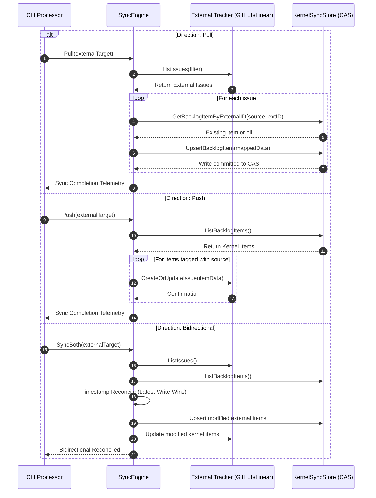
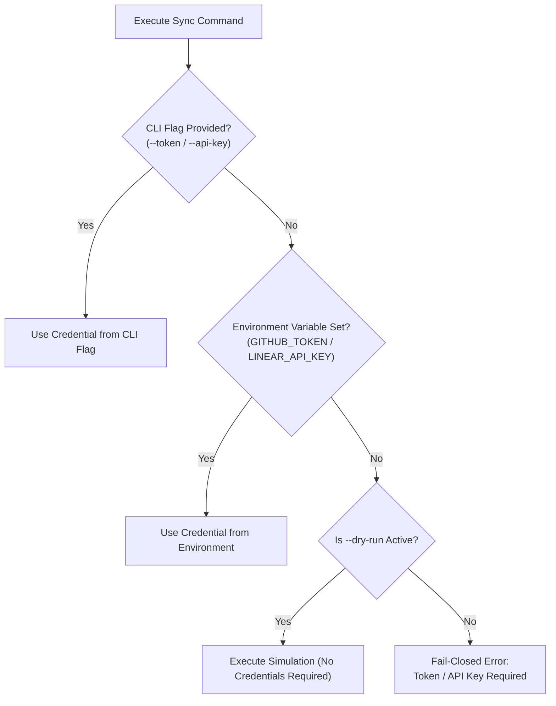

# CLI Sync Subsystem & External Tracker Integration Guide

## Overview

The ZQK CLI Sync subsystem (`cmd/zqk/sync` and `pkg/adapters/sync`) provides bidirectional synchronization between the Knowledge Kernel Content-Addressed Storage (CAS) and external issue tracking platforms, specifically GitHub Issues and Linear Tickets. It bridges distributed issue management systems with the deterministic, verifiable graph architecture of the Knowledge Kernel.



---

## Architectural Taxonomy & Core Components

```
cmd/zqk/sync/
├── constants.go                               # CLI flag definitions, environment variables, format templates
├── sync.go                                    # Cobra CLI command builders, processor injection, and execution dispatch
├── sync_test.go                               # Baseline command structure and dry-run execution tests
├── sync_extended_test.go                      # Credential fallbacks, status empty state, and helper tests
└── sync_coverage_elevation_cycle112_test.go   # Subcommand flag errors, populated status, and storage boundary tests

pkg/adapters/sync/
├── github_linear.go                           # External issue client interfaces, SyncEngine, and bidirectional flow
├── github_linear_test.go                      # SyncEngine unit tests, provider mocking, and conflict checks
├── storage_store.go                           # KernelSyncStore implementing KernelStore on ObjectStorageProvider
└── storage_store_test.go                      # CRUD and mapping tests for KernelSyncStore
```

---

## Command Taxonomy & Ergonomics

The CLI sync interface exposes three primary subcommands under `zqk sync`:

### 1. `zqk sync github`

Synchronizes GitHub issues with the Knowledge Kernel backlog:

```bash
zqk sync github --repo <owner/repo> [flags]
```

**Supported Flags:**
- `--repo` *(required)*: Target GitHub repository in `owner/repo` format (e.g. `zqk-os/zqk`).
- `--token`: GitHub personal access token (PAT) or fine-grained installation token.
- `--direction`: Synchronization direction: `pull` (default), `push`, or `bidirectional`.
- `--dry-run`: Simulates the synchronization, verifies schema compatibility, and validates connection without modifying storage or external issues.

### 2. `zqk sync linear`

Synchronizes Linear tickets with the Knowledge Kernel backlog:

```bash
zqk sync linear --team <team_identifier> [flags]
```

**Supported Flags:**
- `--team` *(required)*: Target Linear team key or identifier (e.g. `ENG`, `PRODUCT`).
- `--api-key`: Linear personal API token.
- `--direction`: Synchronization direction: `pull` (default), `push`, or `bidirectional`.
- `--dry-run`: Simulates the synchronization without mutating local or external state.

### 3. `zqk sync status`

Reports synchronization metrics and telemetry across external providers:

```bash
zqk sync status
```

**Output Telemetry:**
- `GitHub Issues Synchronized`: Total count of backlog items originating from GitHub.
- `Linear Tickets Synchronized`: Total count of backlog items originating from Linear.
- `Total Synced Work Units`: Combined sum of all externally synchronized backlog units.

---

## Adapter Architecture & Knowledge Kernel Mapping

The sync subsystem implements a decoupled adapter architecture using `KernelSyncStore` (`pkg/adapters/sync/storage_store.go`), bridging `storage.ObjectStorageProvider` with the domain model `BacklogItemSyncData`.



### Content-Addressed Storage (CAS) Object Schema

External tickets are transformed into first-class `backlog_item` objects within the Knowledge Kernel:

| Kernel Field | Mapping Rule / Source Value | Example |
| :--- | :--- | :--- |
| `id` | Provider prefix + external ticket number | `BLI-GH-001`, `BLI-LIN-001` |
| `kind` | Always `backlog_item` (`objects.KindBacklogItem`) | `backlog_item` |
| `title` | External issue title | `Fix memory leak in worker pool` |
| `description` | External issue body markdown | `Detailed reproduction steps...` |
| `problem_statement`| Initial paragraph or synthesized intent | `Goroutines leak on worker shutdown` |
| `status` | Normalized lifecycle state | `planned`, `in_progress`, `complete` |
| `priority` | Normalized priority string | `critical`, `high`, `medium`, `low` |
| `priority_tier` | ZQK priority tier | `P0`, `P1`, `P2`, `P3`, `P4` |
| `origin_system` | Origin provider indicator | `github`, `linear` |
| `priority_plan_ref` | Associated Priority Plan reference | `PRI-SYNC-001` |

---

## Bidirectional Synchronization Flow & Conflict Resolution

The sync subsystem supports three directional execution modes:



### Conflict Resolution Strategy:
1. **Timestamp Monotonicity:** When a work item exists in both the Kernel CAS and the external tracker, the subsystem compares `UpdatedAt` timestamps.
2. **Deterministic Precedence:** If external modifications have a newer timestamp, the Kernel CAS is updated via `UpsertBacklogItem`. If local Kernel mutations are newer, the external issue is updated.
3. **Graph Integrity Guarantee:** Synchronized items maintain immutable provenance: external IDs are linked via `origin_system` and ID prefixes, ensuring no duplicate items are created during recurring sync runs.

---

## Dry-Run Simulation Mode

The `--dry-run` flag activates a non-mutating validation pipeline that safeguards both the Knowledge Kernel CAS and external systems:

```bash
zqk sync github --repo zqk-os/zqk --dry-run
```

**Simulation Verification Invariants:**
1. **Zero-Mutation Floor:** No create, update, or delete operations are issued to the Kernel CAS or external APIs.
2. **Schema & Payload Compatibility:** Validates that external labels, priority tiers, and issue states map cleanly to valid ZQK ontology values (`TierP0`–`TierP4`, `StatusPlanned`, `StatusInProgress`, `StatusComplete`).
3. **Connection & Credential Validation:** Verifies that API endpoints are reachable and credentials satisfy minimum authorization scopes.
4. **Deterministic Console Output:**
   ```text
   ⚡ [DRY-RUN] GitHub Issue synchronization simulation for repository: zqk-os/zqk
     Direction: pull | Target: Knowledge Kernel CAS
   ✓ Verified connection and payload schema compatibility (0 conflicts).
   ```

---

## Credential Resolution Hierarchy

To support both interactive developer workflows and unattended CI/CD automation, the sync subsystem enforces a deterministic credential resolution chain:



| Provider | CLI Flag | Environment Variable | Fail-Closed Error Message |
| :--- | :--- | :--- | :--- |
| **GitHub** | `--token` | `GITHUB_TOKEN` | `github token required (pass --token or set GITHUB_TOKEN environment variable)` |
| **Linear** | `--api-key` | `LINEAR_API_KEY` | `linear api-key required (pass --api-key or set LINEAR_API_KEY environment variable)` |

---

## Operational Status Telemetry

The `zqk sync status` command inspects the Knowledge Kernel CAS and classifies backlog items into provider buckets:

```bash
$ zqk sync status
Knowledge Kernel External Issue Sync Status:
  GitHub Issues Synchronized: 14
  Linear Tickets Synchronized: 8
  Total Synced Work Units:    22
```

### Classification Algorithm:
A `backlog_item` is counted toward a provider if either:
1. Its `origin_system` matches the provider name (case-insensitive `github` or `linear`).
2. Its ID begins with the canonical provider prefix (`BLI-GH-` for GitHub, `BLI-LIN-` for Linear).

Items originating from internal creation (e.g. `BLI-COMMUNITY-001`) without external source markers are excluded from provider counts, ensuring accurate telemetry.

---

## Verification & Statement Coverage Invariant

The sync subsystem is strictly governed by automated verification gates across three proof tiers, requiring statement test coverage of `cmd/zqk/sync` to meet or exceed `>= 85.0%` (achieving `97.3%` statement coverage in Cycle 112):

1. **Static Floor Invariant (`CRIT-STATIC-001`):**
   - Statement test coverage for `cmd/zqk/sync` is maintained at `>= 85.0%` (achieved `97.3%`).
   - Zero swallowed errors (`_ = ...` strictly prohibited in all test and implementation code).
   - AST complexity constraints: functions strictly capped under 100 lines.
2. **Operational Dynamic Proof (`CRIT-OPERATIONAL-001`):**
   - Verification of command dispatch, flag parsing, and dry-run execution for GitHub and Linear.
   - Verification of `newSyncStatusCmd` under empty and populated storage topologies.
   - Verification of `executeSyncOperation` across dry-run, missing credential, and successful execution branches.
   - Token and API key precedence verification (flag values override environment variables).
3. **Negative Adversarial Boundaries (`CRIT-BOUNDARY-001`):**
   - Unknown CLI flag rejection across all subcommands.
   - Missing credential fail-closed behavior for unauthenticated sync operations.
   - Nil storage provider and processor error handling in `resolveKernelSyncStore` returning `ErrStorageUnavailable`.
   - Storage provider failure propagation when querying backlog items.
   - Strict open-core compliance: zero studio nanosecond-hex identifiers across documentation and test fixtures.
