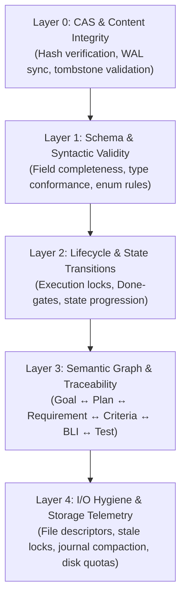

# CLI System Subsystem & Health Operations Guide

## Overview

The ZQK System Subsystem (`cmd/zqk/system`) serves as the operational spine and gatekeeper of the Zen Quantum Kernel. It provides mission-critical tooling for continuous validation, automated remediation, strategic alignment, process lifecycle supervision, resource hygiene, and identity resolution.

Unlike transient chat harnesses that rely on ephemeral prompt context, ZQK models goals, requirements, criteria, test cases, and priority plans as persistent, cryptographically versioned objects within Content Addressable Storage (CAS). The System Subsystem is responsible for ensuring that this multi-tiered knowledge graph remains structurally valid, chronologically consistent, and aligned with organizational objectives.

---

## Subsystem Command Taxonomy

The `zqk system` parent command exposes a structured CLI taxonomy covering inspection, lifecycle management, and remediation:

| Command | Category | Purpose | Primary Flags |
|---|---|---|---|
| `zqk system check` | Verification & Remediation | Multi-layer kernel validation and automated graph healing | `--auto-remedy`, `--auto-fix`, `--refresh-cache`, `--dry-run` |
| `zqk system align` | Strategic Alignment | Quantifies goal-to-work coverage and identifies alignment gaps | `--dashboard`, `--gaps`, `--goal <ID>`, `--score` |
| `zqk system status` | Observability | Displays project status, health state, active priority plan, and storage stats | `--verbose`, `--format json\|yaml` |
| `zqk system service` | Infrastructure Lifecycle | Manages external service backends (e.g., MemGraph) | `start`, `stop`, `status`, `list` |
| `zqk system dashboard` | Strategic Radar | Situational room pulse across PCS, variance, entropy, and synergy | `--watch <duration>` |
| `zqk system metrics` | Command Performance | Aggregates execution timing, frequency, error rates, and timeouts | `--command`, `--filter`, `--summary`, `--all-time` |
| `zqk system whoami` | Identity & Seating | Inspects authenticated account (ACC), lane, roles, and permissions | `--format json\|yaml` |
| `zqk system start-here` | Onboarding | Interactive walkthrough of object-first operational philosophy | None |
| `zqk system resource-hygiene` | Storage & OS Hygiene | Reaps stale locks, orphaned temp files, and expired metric chunks | `--dry-run`, `--reap-processes`, `--reap-locks` |
| `zqk system vet-config` | Configuration Vetting | Asserts project configuration, brand settings, and storage roots | None |

---

## Core Architecture: 5-Layer Validation Model

The ZQK validation engine executes across a strict 5-layer hierarchy to detect structural anomalies, dangling references, lifecycle deviations, and physical storage degradation.



### Layer 0: CAS & Storage Integrity
- Validates SHA-256 hash digests against serialized object content in `.zqk/process/` and `.zqk/cas/`.
- Verifies write-ahead log (WAL) integrity and transactional replay status.
- Reclaims unreferenced blobs and repairs corrupted CAS index pointers.

### Layer 1: Schema & Syntactic Conformance
- Enforces JSON/YAML schema definitions for all core kernel entities (`goal`, `requirement`, `criteria`, `test_case`, `priority_plan`, `backlog_item`, `epic`).
- Asserts mandatory schema fields (e.g., `id`, `kind`, `title`, `status`, `created_at`).
- Rejects undeclared or mutated immutable system fields.

### Layer 2: Lifecycle & State Transitions
- Guards state machine transitions (`draft` → `in_progress` → `complete` / `archived`).
- Enforces execution-lock semantics: once a Priority Plan transitions to `in_progress`, its scope is frozen to prevent creeping scope stacking.
- Verifies Verification Done-Gates (VDS) before backlog items or requirements transition to `complete`.

### Layer 3: Semantic Graph & Strategic Traceability
- Validates 5-layer cascade consistency:
  $$\text{Organization} \rightarrow \text{Mission} \rightarrow \text{Vision} \rightarrow \text{Goal} \rightarrow \text{Priority Plan} \rightarrow \text{Requirement} \rightarrow \text{Criteria} \rightarrow \text{Backlog Item}$$
- Identifies dangling foreign-key references (`goal_refs`, `criteria_refs`, `priority_plan_ref`).
- Asserts the Three-Fold Proof invariant on requirements:
  1. Static Floor Invariant
  2. Operational Dynamic Proof
  3. Negative Adversarial Boundary

### Layer 4: I/O Hygiene & Storage Telemetry
- Inspects open file descriptor counts and system descriptor ceilings.
- Detects orphaned process locks (`.zqk/locks/*.lock`) exceeding timeout thresholds (default: 15 minutes).
- Analyzes disk footprint across WAL, metrics, logs, and telemetry caches.

---

## Automated Remediation Engine (`--auto-remedy` & `--auto-fix`)

The system check engine includes an automated remediation subsystem that repairs safe, deterministic discrepancies without manual intervention:

```bash
# Preview auto-remedy repairs without applying mutations
zqk system check --auto-remedy --dry-run

# Execute safe system remediation
zqk system check --auto-remedy
```

### Remediation Capabilities:
1. **Stale Lock Pruning**: Safely removes abandoned process locks where the holding PID is no longer alive.
2. **Schema Default Injection**: Fills missing optional fields with canonical defaults (e.g., initial revision, zeroed counters).
3. **Orphaned Temp Cleanup**: Reaps abandoned staging files in `.zqk/tmp/` older than the grace period.
4. **CAS Index Resynchronization**: Rebuilds memory and disk index lookup maps from Content Addressable Storage.

---

## Strategic Alignment Scoring (`zqk system align`)

The alignment engine verifies that in-flight execution directly traces to declared strategic compasses:

$$\text{Alignment Score} = \left(\frac{\text{Work Items with Valid Goal References}}{\text{Total Active Work Items}}\right) \times 100$$

### Alignment Dashboard

```bash
zqk system align --dashboard
```

```
SYSTEM ALIGNMENT DASHBOARD
=============================================================================
METRIC                  VALUE           DETAILS
Overall Alignment       94.2 / 100      Aggregate system score
Goal Coverage           94.2%           65 of 69 items aligned
Goals Defined           8               Total active strategic goals
Alignment Gaps          4               Items missing goal alignment
```

### Scripting & Automated Gateways

```bash
# Extract numeric score only for CI gating (e.g. require >= 85.0)
SCORE=$(zqk system align --score)
```

---

## Service Management Subsystem (`zqk system service`)

The `zqk system service` command provides decoupled supervision for external dependencies required by graph analysis engines:

- **MemGraph Backend**: Controls the high-performance property graph database used for topological AST and ontology relationship traversing.
- **Pluggable Adapters**: Supports direct Docker-managed containers and host-native process supervisors via the decoupled `service.Manager` abstraction.

```bash
# Check service health
zqk system service status memgraph

# Start background service container
zqk system service start memgraph

# List registered service adapters
zqk system service list
```

---

## Observability & Command Metrics (`zqk system metrics`)

ZQK continuously tracks CLI command execution telemetry to prevent performance regression and detect transient failures:

- **Baseline Comparison**: Compares live execution against established baseline thresholds.
- **Failure & Timeout Accounting**: Highlights commands exhibiting non-zero exit codes or deadline timeouts.
- **Historical Analysis**: Aggregates trends across daily metric rolling windows.

```bash
# View command execution summary
zqk system metrics --summary

# Inspect slow commands taking > 10 seconds
zqk system metrics --filter slow
```

---

## Verification & Statement Coverage Invariant

The `cmd/zqk/system` package adheres to strict quality and testing invariants:
- **Statement Coverage Target**: Elevated and maintained toward $\ge 80.0\%$.
- **Zero Swallowed Errors**: Error returns are never discarded (`_ = ...` is forbidden); all errors must be checked via `if err != nil` or `require.NoError`.
- **Bounded Function Length**: Test and production helper functions must not exceed 100 lines.
- **Process Isolation**: All unit and integration tests execute against dedicated temporary workspaces created via `t.TempDir()`, preventing cross-test pollution or modification of host configurations.
