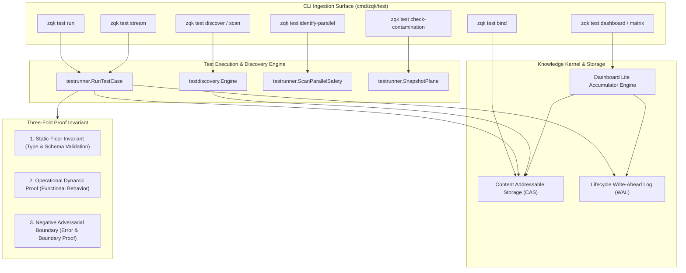

# CLI Test Subsystem Architectural & Operational Guide

## Overview

The **ZQK Test Subsystem** (`cmd/zqk/test`) provides automated test execution, dynamic discovery, test-to-requirement lineage binding, real-time event streaming, parallel safety auditing, and schema plane contamination detection for the **Zen Quantum Kernel**.

Unlike traditional test runners that execute isolated unit suites and report ephemeral console summaries, the ZQK Test Subsystem integrates tests directly with the persistent Knowledge Kernel graph. Test cases (`test_case`) serve as verifiable, unified execution wrappers that satisfy timeless functional contracts (`requirement`) across three rigorous dimensions of proof. Through the Content Addressable Storage (CAS) layer, lifecycle Write-Ahead Log (WAL), and reactive TUI test dashboard, test executions emit shockwave events that automatically transition criteria and parent requirements from originated draft states to verifiable completion.

```bash
zqk test <subcommand> [flags]
```

---

## Subsystem Command Taxonomy

The `zqk test` suite encompasses core verification commands, AST audits, interactive terminal dashboards, and relational repair assistants:

| Command / Invocation | Primary Mode | Description & Operational Behavior |
|---|---|---|
| `zqk test run [tc_ids...]` | Test Execution | Executes one or more specified `test_case` objects or passes `--all` to run the active working set. Evaluates mapped criteria, streams logs, and triggers state transitions. |
| `zqk test discover [paths...]` / `scan` | Dynamic Discovery | Scans Go ASTs, test files, and project directories to identify automated test targets, extracts criteria tags, and optionally synchronizes (`--sync`) them as CAS `test_case` objects. |
| `zqk test dashboard` / `matrix` | TUI Radar & Matrix | Renders an interactive or static criteria radar and test matrix projection. Displays active working sets, intact vs. broken lineage chains, and completion progress bars. |
| `zqk test dashboard --watch` / `watch` | Continuous Watch | Subscribes to the lifecycle WAL (`lifecycle.LifecycleEvent`) and updates the full-screen terminal radar in real time as criteria are satisfied. |
| `zqk test bind [tc_id]` | Lineage Assistant | Inspects broken or orphaned test cases lacking parent requirement or root goal bindings. Offers interactive recommended bindings and automated batch repair (`--auto`). |
| `zqk test check-contamination` | Schema Plane Guard | Executes a test command while snapshotting the schema plane (`.zqk/process`) before and after, asserting zero file modification or contamination during testing. |
| `zqk test identify-parallel` | Concurrency Audit | Analyzes Go AST test functions for parallel execution safety (`t.Parallel()`), detecting shared mutable state, environment manipulation (`Setenv`), or unsafe patterns. |
| `zqk test stream [pkg]` | Real-Time Runner | Runs Go test suites with live JSON/text streaming, sub-process timeout enforcement, and aggregate status reporting. |
| `zqk test flaky` | Flakiness Diagnostic | Inspects test run histories, quarantine statuses, and variance metrics to isolate non-deterministic test failures before release gating. |

### Command Flags & Common Options

The test subsystem provides fine-grained control over execution, filtering, output formatting, and storage synchronization:

| Command | Flag | Short | Default | Description |
|---|---|---|---|---|
| `run` | `--all` | `-a` | `false` | Execute all active and draft test cases discovered in the kernel. |
| `run` | `--dry-run` | `-n` | `false` | Preview test commands and invocation mapping without executing processes. |
| `run` | `--verbose` | `-v` | `false` | Stream full command stdout, stderr, and shockwave transition notices. |
| `run` | `--timeout` | | `0` | Per-test execution timeout duration (e.g. `30s`, `2m`). |
| `run` | `--criteria` | `-c` | `[]` | Filter execution to specific criterion IDs within the test case. |
| `discover` | `--lang` | `-l` | `""` | Comma-separated language filters (e.g. `go,python,ts`). |
| `discover` | `--sync` | `-s` | `false` | Materialize discovered targets as persistent `test_case` objects in CAS. |
| `discover` | `--format` | `-f` | `text` | Output serialization format: `text`, `json`, `yaml`. |
| `dashboard` | `--view` | | `active` | Working set view filter: `active` (in-flight), `regression` (complete), `all`. |
| `dashboard` | `--watch` | `-w` | `""` | Polling/streaming interval for live WAL updates (e.g. `2s`). |
| `dashboard` | `--check-dod` | | `false` | TPM Definition of Done gate: fails closed if any active lineage chain is broken. |
| `dashboard` | `--refresh` | `-r` | `false` | Bypass materialized lite-file cache and perform synchronous storage re-scan. |
| `bind` | `--req` | | `""` | Explicitly bind parent requirement ID to test case. |
| `bind` | `--goal` | | `""` | Explicitly bind root goal ID to parent requirement. |
| `bind` | `--auto` | | `false` | Automatically resolve and bind best-match parent entities across all broken chains. |

---

## Core Architecture & Execution Topology

The Test Subsystem bridges CLI user experience with ontological kernel storage (`pkg/storage`), lifecycle event logging (`pkg/lifecycle`), and AST analysis (`pkg/testrunner`, `pkg/testdiscovery`).



### Architectural Subsystem Components

#### 1. The Three-Fold Proof Model
Every feature delivered within the Zen Quantum Kernel must declare a timeless `requirement` contract backed by at least three verifiable `criteria`:
- **Static Floor Invariant**: Enforces schema conformance, AST static types, AST zero-swallowed-error rules, and architectural boundary constraints.
- **Operational Dynamic Proof**: Validates that positive functional scenarios execute deterministically end-to-end under real conditions.
- **Negative Adversarial Boundary**: Asserts that malformed inputs, missing files, network splits, and boundary edge cases fail closed predictably with structured diagnostic errors.

The `zqk test run` command executes these criteria via unified `test_case` wrappers, capturing stdout, stderr, process exit codes, and execution duration.

#### 2. Test Execution Pipeline (`run.go` & `pkg/testrunner`)
When `zqk test run` executes:
1. **Target Ingestion**: Accepts explicit `test_case` IDs or inspects CAS for all active candidate objects.
2. **Invocation Mapping**: Parses `verification_suites` (e.g. `CRIT-001: go test -run TestFeature`) or maps criterion IDs directly to discovered test routines.
3. **Execution Isolation**: Runs each command in a managed context, capturing execution time, standard output, and process return codes.
4. **State Machine Shockwaves**: Upon passing all criteria, emits `EventTypeCriterionSatisfied` and triggers automatic graduation of the `test_case` and parent `requirement` to `complete`.

#### 3. Test Discovery & Kernel Synchronization (`discover.go`)
The discovery engine parses source trees to locate tests:
1. **AST Inspection**: Traverses Go test files and function declarations, extracting docstring metadata, criterion linkage tags, and execution command hints.
2. **CAS Ingestion**: When invoked with `--sync`, automatically generates versioned `test_case` objects and registers them into Content Addressable Storage, bridging raw code with the Knowledge Graph.

#### 4. AST Contamination Guard (`check_contamination.go`)
Testing must never mutate canonical process assets:
1. **Pre-Run Snapshot**: Calculates a cryptographic snapshot of the `.zqk/process` schema plane before test suite execution.
2. **Sandboxed Command Execution**: Runs the target test suite under audit supervision.
3. **Post-Run Diff**: Asserts zero modification across all `.yaml`, `.yml`, and `.json` schema entities. Any unintended side effect halts execution with a detailed contamination report.

#### 5. Parallel Safety Auditor (`identify_parallel.go`)
Enforces concurrency hygiene across the test suite:
1. **AST AST Traversal**: Scans test functions for calls to `t.Parallel()`, environment mutation (`os.Setenv`, `t.Setenv`), filesystem manipulation, and shared global state.
2. **Classification & Advice**: Labels each routine as `PARALLEL`, `SAFE`, `UNSAFE`, or `REVIEW`, recommending concurrency conversions to optimize CI wall-clock time.

#### 6. Reactive Dashboard & TUI Radar (`dashboard.go`)
Provides real-time visibility into project test health:
1. **Materialized Lite-File Accumulator**: Employs an incremental accumulator (`.zqk/cache/test_dashboard_lite.json`) for sub-millisecond command-line response times.
2. **WAL Streaming**: In `--watch` mode, hooks into the lifecycle event log to reflect criteria updates instantaneously without full storage scans.
3. **Lineage Traceability**: Resolves multi-hop links from `test_case` ➔ `requirement` / `backlog_item` ➔ `goal` / `priority_plan` / `milestone`, visualizing intact vs. broken chains.
4. **TPM Definition of Done (DoD) Guard**: Validates that 100% of active test cases have unbroken traceability to root strategic compass objects and zero unbound test criteria exist.

---

## Operational Workflows & Recipes

### 1. Running Targeted Feature Test Cases

Execute specific test cases with verbose diagnostics:

```bash
# Run a single test case with detailed streaming output
zqk test run TST-001 --verbose

# Run all active test cases across the kernel with timeout guard
zqk test run --all --timeout 60s

# Perform dry-run invocation check without executing processes
zqk test run TST-001 --dry-run
```

### 2. Discovering and Synchronizing Tests to CAS

Scan codebase source files and register them into the Knowledge Kernel:

```bash
# Scan local directory for Go test routines
zqk test discover ./cmd/zqk/test

# Discover and synchronize directly into CAS
zqk test discover --lang go --sync ./pkg/...

# Output discovered test inventory as JSON
zqk test discover --format json .
```

### 3. Auditing Test Concurrency and Parallel Safety

Identify tests ready for `t.Parallel()` acceleration:

```bash
# Audit parallel safety across the command tree
zqk test identify-parallel ./cmd/...

# Filter strictly for safe conversion candidates
zqk test identify-parallel --safe-only ./pkg/storage
```

### 4. Guarding Against Schema Plane Contamination

Ensure test executions do not contaminate authoritative kernel metadata:

```bash
# Validate that a test suite does not modify the process plane
zqk test check-contamination --plane .zqk/process --command "go test ./pkg/storage"
```

### 5. Inspecting Lineage and Repairing Broken Chains

Resolve orphaned test cases with the TPM Binding Assistant:

```bash
# View interactive binding assistant recommendations
zqk test bind

# Explicitly bind a test case to requirement and root goal
zqk test bind TST-001 --req REQ-001 --goal GOAL-001

# Automatically bind all broken chains using heuristic matching
zqk test bind --auto
```

### 6. Continuous TUI Radar Monitoring

Launch the live terminal test matrix during development:

```bash
# Static active working set snapshot
zqk test dashboard

# Live WAL streaming watch mode
zqk test dashboard --watch 2s

# Verify TPM Definition of Done gate in CI
zqk test dashboard --check-dod
```

---

## Verification & Statement Coverage Invariant

To preserve system reliability and prevent regression, the Test Subsystem enforces strict engineering invariants:

1. **>=85.0% Statement Coverage Invariant**:
   All source routines in `cmd/zqk/test` (`bind.go`, `check_contamination.go`, `dashboard.go`, `discover.go`, `identify_parallel.go`, `run.go`, `stream.go`, `test.go`) must maintain statement coverage at or above 85.0%.
   ```bash
   ZQK_ALLOW_FOREGROUND_GO_TEST=1 go test -v -timeout 60s -cover ./cmd/zqk/test
   ```

2. **Deterministic Storage Teardown**:
   Any test initializing a temporary project root or storage provider must register `cli.UnregisterStorageForProjectRoot(tmpDir)` in `t.Cleanup` to eliminate background timer races, lingering goroutines, and file locking flakes.

3. **AST Quality Invariants**:
   - **Zero Swallowed Errors**: Error returns from functions must never be discarded using `_ = ...`. All errors must be explicitly validated with `require.NoError`, `assert.Error`, or descriptive handler branches.
   - **Modular Function Length**: Individual test and production functions must not exceed 100 lines of code.

4. **Open-Core Payload Hygiene**:
   Public release documentation, guides, and example code must never embed private workspace references or nanosecond-timestamped internal IDs. Generic IDs (e.g. `TST-001`, `REQ-001`, `GOAL-001`) must be used exclusively.

---

## Related Documentation & Cross-References

- **[Validation Subsystem Architectural & Operational Guide](./VALIDATION_SUBSYSTEM_GUIDE.md)**: Details the multi-layer validation engine, schema invariants, and automated remediation.
- **[Object Lifecycle, State Machines & CAS Storage Guide](./OBJECT_LIFECYCLE_AND_CAS_STORAGE_GUIDE.md)**: Deep dive into the Content Addressable Storage layer and state machine transitions.
- **[CLI Workflow Subsystem Architectural Guide](./CLI_WORKFLOW_SUBSYSTEM_GUIDE.md)**: Details ambient routing, next-action discovery (`zqk workflow whats-next`), and Definition of Done gates.
- **[Single-Command Execution Loop Guide (`zqk do`)](./SINGLE_COMMAND_EXECUTION_LOOP_GUIDE.md)**: Explains autonomous agent preflight, claim locks, dispatch, and AST verification loops.
