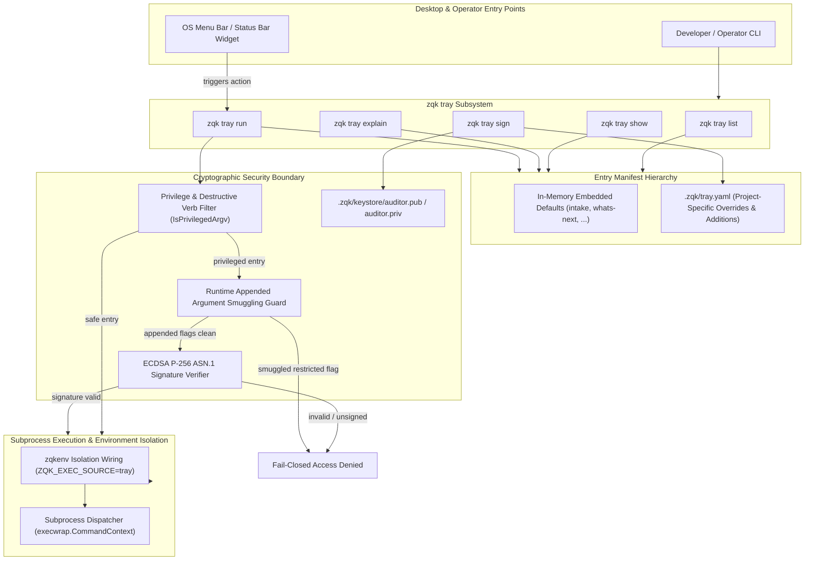
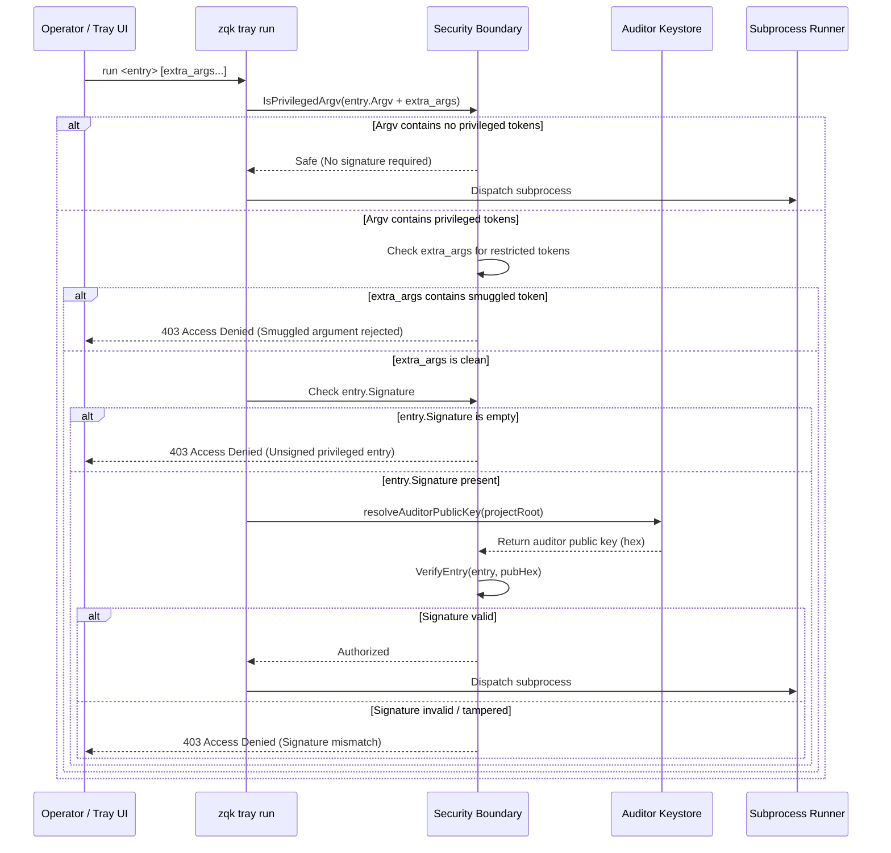

# CLI Tray Subsystem Architectural Guide

Comprehensive architectural, operational, and security guide for the CLI Tray subsystem within the **ZQK Knowledge Kernel**.

---

## 1. Architectural Overview & Design Principles

The **ZQK Tray Subsystem** provides a secure, deterministic veneer layer bridging desktop environments (operating system menu bars, desktop task trays, notification area widgets, and custom developer shortcuts) with ZQK Knowledge Kernel capabilities. Rather than exposing raw shell execution hooks or untracked aliases, the tray subsystem introduces an **objectified, schema-validated command manifest** coupled with **ECDSA P-256 cryptographic signing** and **fail-closed argument authorization**.



### Core Design Principles

1. **Veneer Decoupling**: Tray actions are structured command-line argument lists (`Argv: []string{"workflow", "whats-next"}`) targeting the same binary, ensuring consistent CLI argument parsing and error formatting without bypassing the core CLI router.
2. **Layered Manifest Hierarchy**: Embedded in-memory defaults guarantee operational readiness on zero-configuration installations, while `.zqk/tray.yaml` enables projects to customize or extend the catalog.
3. **Cryptographic Provenance**: Indirect desktop execution of privileged or destructive operations (`system purge`, `object delete`, `--override`, `--force`) is prohibited unless cryptographically signed by an auditor private key.
4. **Smuggling Invariant**: Runtime arguments appended after a tray entry name are evaluated through the privilege filter; appended restricted flags cannot piggyback on a pre-signed safe entry.
5. **Fail-Closed Verification**: Any signature mismatch, missing auditor key, or YAML tampering immediately halts dispatch with an access denial error.

---

## 2. Subsystem Command Taxonomy

The `zqk tray` command group exposes five distinct operations:

| Command | Syntax | Primary Role |
| :--- | :--- | :--- |
| `list` | `zqk tray list [-f table\|json\|yaml]` | Enumerate available tray entries and descriptions. |
| `show` | `zqk tray show <name> [-f table\|json\|yaml]` | Inspect an individual entry's definition and argv array. |
| `explain` | `zqk tray explain <name> [-f table\|json\|yaml]` | Format the shell-escaped command invocation line. |
| `run` | `zqk tray run <name> [args...] [--dry-run]` | Execute or preview the command referenced by the entry. |
| `sign` | `zqk tray sign <name> [--key-path <path>]` | Cryptographically sign a privileged entry in `.zqk/tray.yaml`. |

### 2.1 `zqk tray list`
Queries the merged manifest catalog (embedded defaults plus `.zqk/tray.yaml`) and displays available actions:

```bash
# Human-readable tabular listing
zqk tray list

# Machine-readable JSON output for menu bar widgets
zqk tray list -f json
```

Example JSON output:
```json
{
  "entries": [
    {
      "name": "intake",
      "description": "Interactive workflow intake for new work or inquiries"
    },
    {
      "name": "whats-next",
      "description": "Print next recommended workflow action"
    }
  ],
  "meta": {
    "count": 2,
    "project_root": "/workspace"
  }
}
```

### 2.2 `zqk tray show`
Inspects the raw entry specification, including its resolved argv array:

```bash
zqk tray show whats-next
```

Example output:
```yaml
argv:
  - workflow
  - whats-next
description: Print next recommended workflow action
name: whats-next
project_root: /workspace
```

### 2.3 `zqk tray explain`
Constructs and displays the exact shell invocation string that `run` executes, accounting for binary resolution:

```bash
zqk tray explain intake
```

Output:
```
intake: zqk workflow intake
```

### 2.4 `zqk tray run`
Dispatches execution of the entry's argv through the current executable.

```bash
# Preview execution without spawning subprocess
zqk tray run whats-next --dry-run

# Execute with additional runtime arguments
zqk tray run whats-next -- -f json
```

Dry-run mode outputs diagnostic telemetry:
```json
{
  "argv": ["workflow", "whats-next"],
  "binary": "zqk",
  "command_line": "zqk workflow whats-next",
  "dry_run": true,
  "entry": "whats-next",
  "project_root": "/workspace"
}
```

### 2.5 `zqk tray sign`
Signs an entry inside `.zqk/tray.yaml` using an ECDSA P-256 auditor private key, updating `signature` and `signed_by`:

```bash
# Sign using default project keystore key (.zqk/keystore/auditor.priv)
zqk tray sign purge-cache

# Sign using custom key path
zqk tray sign purge-cache --key-path .zqk/keystore/custom_auditor.priv
```

---

## 3. Entry Manifest Hierarchy & Schema

Tray configuration resolves via a two-layer hierarchy:

```
+-------------------------------------------------------------+
| Layer 1: Embedded Defaults (pkg/tray/embedded.go)          |
| - intake: zqk workflow intake                               |
| - whats-next: zqk workflow whats-next                       |
+-------------------------------------------------------------+
                              |
                              v (overridden and extended by)
+-------------------------------------------------------------+
| Layer 2: Project Manifest (.zqk/tray.yaml)                 |
| - custom-task: zqk test run ...                             |
| - purge-cache: zqk cache clear --force (signed)             |
+-------------------------------------------------------------+
```

### Manifest Schema (`.zqk/tray.yaml`)

```yaml
$schema: "https://zqk.dev/schemas/tray_config.schema.json"
version: 1
entries:
  - name: "custom-verification"
    description: "Run verification test suite"
    argv:
      - "test"
      - "run"
      - "--suite"
      - "hygiene"

  - name: "purge-cache"
    description: "Force clear local build cache"
    argv:
      - "cache"
      - "clear"
      - "--force"
    signed_by: "ACC-COMMUNITY-001"
    signature: "3045022100...0220..."
```

---

## 4. Cryptographic Security Model & Verification Invariants

Desktop tray shortcuts present a unique security challenge: users frequently click menu items expecting routine utility, but actions execute with local user privileges. Malicious repository configurations or compromised settings could define destructive actions disguised as innocuous shortcuts.

### 4.1 Privilege Detection (`IsPrivilegedArgv`)

The subsystem classifies argv slices as **privileged** if they contain:
- **Restricted Flags**: `--override`, `--force`, `--clear-cache`, `--internal`
- **Destructive Verbs**:
  - `object delete`
  - `system shutdown`
  - `system purge`
  - `io reap`

### 4.2 Fail-Closed Authorization Pipeline



### 4.3 Digital Signatures (ECDSA P-256 ASN.1)

1. **Digest Calculation**: A canonical SHA-256 digest is computed across the entry name and each argv element via `traypkg.ComputeArgvDigest(name, argv)`.
2. **Signature Creation**: The digest is signed using `ecdsa.SignASN1` with the auditor's P-256 private key. The resulting ASN.1 DER sequence is hex-encoded into `entry.Signature`.
3. **Attribution**: The signing identity (`qa.AuditorAccountID` or active context security principal) is recorded in `entry.SignedBy`.

### 4.4 Verification Without Private Keys

Production workstations, CI runners, and menu bar harnesses rarely hold private signing keys. The verification logic in `resolveAuditorPublicKey`:
1. Prefers `.zqk/keystore/auditor.pub` (supports both PKIX PEM and raw uncompressed hex strings).
2. Falls back to reading the public component of `.zqk/keystore/auditor.priv` if present on administrative workstations.
3. **Never generates keys during verification**: Verifying signatures is strictly read-only and never writes unauthenticated key material to disk.

### 4.5 Smuggling Prevention Invariant

Even if an entry is signed, operators may pass appended arguments:
```bash
zqk tray run safe-entry -- --override
```
The tray engine independently checks `args[1:]`. If appended runtime arguments introduce restricted flags or destructive verbs, execution halts immediately:
```
access denied: appended arguments to tray entry "safe-entry" contain restricted flag/command (--override)
```

---

## 5. Execution Environment & Process Isolation

When an action is authorized, `zqk tray run` configures and executes the child process:

1. **Binary Continuity**: Spawns `os.Args[0]`, ensuring the child process runs with the identical binary version and build metadata.
2. **Project Isolation**: Invokes `zqkenv.WireExecForIsolatedProject(cmd, projectRoot)` to establish consistent working directories and project settings.
3. **Provenance Tracing**: Appends `ZQK_EXEC_SOURCE=tray` to the environment block, allowing internal observability layers to identify tray-originated invocations.
4. **Standard Stream Coupling**: Transparently connects standard input, output, and error streams for interactive subcommands.
5. **Exit Code Propagation**: Distinguishes process spawn failures from non-zero exit codes returned by the underlying command:
   ```
   tray run: subprocess exited with code 42
   ```

---

## 6. Verification & Statement Coverage Invariant

The CLI tray subsystem is subject to a strict **>=95.0% statement coverage done-gate invariant** across `cmd/zqk/tray`.

### Coverage Breakdown

| Source Component | Statement Coverage | Invariant Standard |
| :--- | :--- | :--- |
| `cmd/zqk/tray/tray.go` (Command & Veneer Layer) | **98.3%** | `>= 95.0%` |
| `pkg/tray` (Core Manifest & Cryptographic Engine) | **96.5%** | `>= 95.0%` |

### Running the Subsystem Test Suite

To verify the tray package and its test coverage:

```bash
# Run tray subsystem tests with coverage profile (bounded 30s timeout)
go test -v -timeout 30s -cover ./cmd/zqk/tray
```

### Verified Failure Modes & Boundary Protections

The comprehensive test suite verifies:
- Context resolution failure when CLI initialization context is omitted.
- Graceful recovery and root discovery when project roots are unresolvable.
- Schema and YAML syntax error propagation on corrupted `.zqk/tray.yaml` manifests.
- Missing entry error reporting with suggested discovery commands (`see: zqk tray list`).
- Type-mismatched flag parsing defense on `--dry-run` and `--key-path`.
- Rejection of tampered signatures where `argv` was altered after signing.
- Rejection of signatures signed by unauthorized or mismatched auditor keys.
- Accurate capture of subprocess exit statuses (`ExitCode()`).
- Generation and persistence of public keys (`auditor.pub`) alongside newly generated private keys.
- Read-only filesystem fail-closed behavior when writing updated signatures.

---

## 7. Illustrative Traceability & Entity Relationship Model

To illustrate proper integration with the Knowledge Kernel while respecting clean, non-prohibited namespace conventions:

| Entity Kind | Clean Illustrative Identifier | Role in Tray Lifecycle |
| :--- | :--- | :--- |
| `requirement` | `REQ-TRAY-001` | Specification for CLI desktop veneer, shortcut discovery, and cryptographic authorization |
| `tray_entry` | `TRY-DEMO-001` | Named shortcut entry (`demo-task`) expanding to `["workflow", "whats-next"]` |
| `account` | `ACC-COMMUNITY-001` | Auditor identity used to sign privileged tray actions (`signed_by`) |
| `criteria` | `CRIT-TRAY-001` | Static statement coverage invariant (`>= 95.0%`) for `cmd/zqk/tray` |
| `test_case` | `TST-TRAY-001` | Unified verification group executing full tray CLI test suite |

