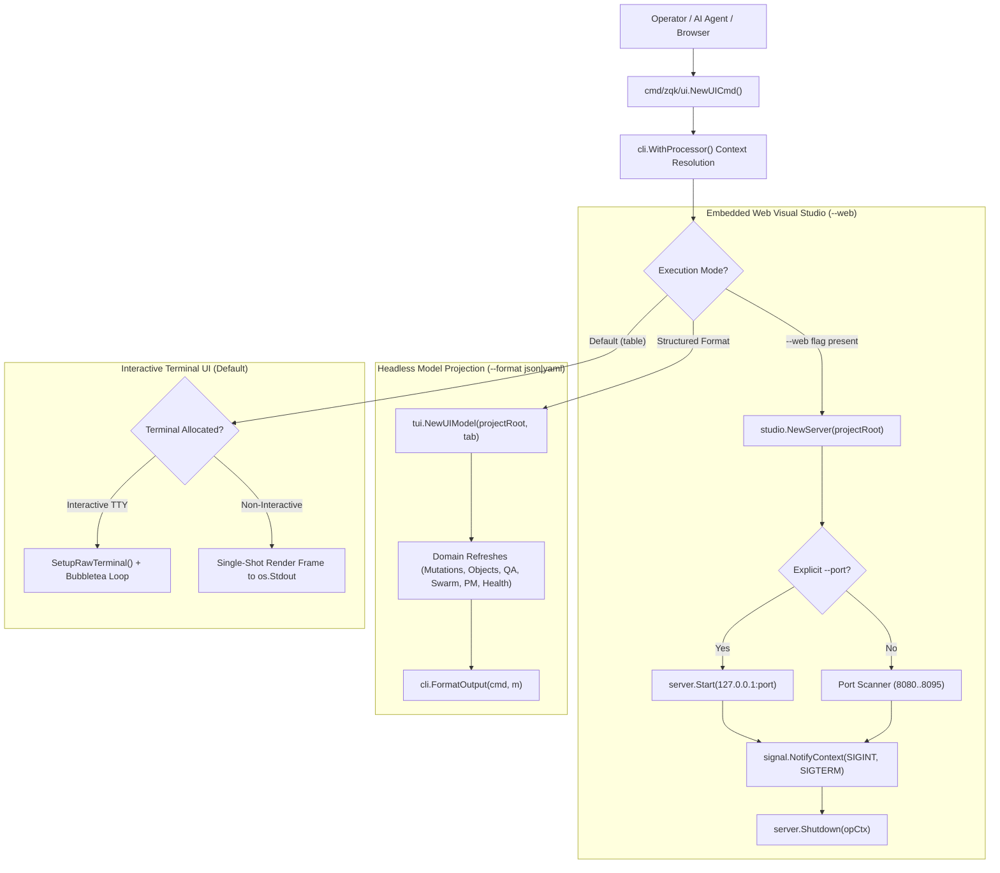

# CLI Visual Studio & Interactive TUI Subsystem Operational Architecture Guide

## Overview

The **CLI Visual Studio & Interactive TUI Subsystem** (`cmd/zqk/ui`) provides the primary real-time operational interface and visual observation membrane for the **ZQK Knowledge Kernel**. It unifies three complementary operational modalities into a single command surface:

1. **Interactive Full-Screen Mission Control Terminal UI (TUI)**: Powered by the terminal engine (`pkg/tui`), providing real-time telemetry, mutation stream visualization (WAL), audit event inspection, swarm coordination telemetry, and system health status.
2. **Headless Model Projection Engine**: Emits instant structured JSON, JSONL, or YAML snapshots of kernel state for programmatic consumption by scripts, CI/CD runners, and autonomous AI agents without allocating terminal file descriptors.
3. **Embedded Web Visual Studio (`--web`)**: Spawns an in-process HTTP dashboard server (`pkg/studio`) featuring dynamic port conflict auto-probing, real-time REST telemetry endpoints, and signal-driven graceful shutdown.

Whether an operator is interactively triaging project state or an autonomous agent is capturing a structured snapshot of system health, the UI subsystem provides consistent, high-performance, and non-blocking access to kernel telemetry.

---

## Subsystem Command Taxonomy

The UI subsystem is exposed through the root `zqk ui` command and two canonical aliases:

```
zqk ui [flags]
zqk dashboard [flags]
zqk console [flags]
```

### Command Flags & Defaults

| Flag | Shorthand | Type | Default | Description |
| :--- | :--- | :--- | :--- | :--- |
| `--web` | `-w` | `bool` | `false` | Launch the embedded Web Visual Studio HTTP server instead of the terminal TUI. |
| `--port` | `-p` | `int` | `8080` | Port for the Web Visual Studio server. Auto-probes `port..port+15` unless explicitly set. |
| `--tab` | `-t` | `string` | `seismograph` | Initial active tab view in the interactive TUI or headless snapshot. |
| `--format` | `-f` | `string` | `table` | Output format: `table` (interactive TUI), `json`, `jsonl`, or `yaml`. |

### Tab View Taxonomy

The UI model exposes 8 specialized observability lenses across the knowledge kernel:

| Tab Identifier | Number | View Title | Telemetry Domain |
| :--- | :--- | :--- | :--- |
| `seismograph` | `1` | **Seismograph** | Real-time state mutation stream (WAL), shockwaves, and drift metrics. |
| `state` | `1` | **State Engine** | In-flight mutations, buffer depth, auto-scroll status, and WAL events. |
| `audit` | `2` | **Audit Stream** | Security audit events, authorization boundaries, and command traces. |
| `swarm` | `3` | **Swarm Mesh** | Active agent seats, claimed tasks, instruction queues, and throughput hints. |
| `pm` | `4` | **Program Management** | Goals, priority plans, workstreams, backlog items, and blockers. |
| `metrics` | `5` | **Metrics & TSDB** | Time-series telemetry, storage volume, file descriptors, and hygiene stats. |
| `scheduler` | `6` | **Scheduler Daemons** | Background daemons (ambient, fswatcher, steward, etc.) and scheduled jobs. |
| `qa` | `7` | **QA & Verification** | Test cases, criteria satisfaction chains, DoD compliance, and regressions. |
| `health` | `8` | **System Health** | Integrity radar, active violations, daemon run-states, and remedy action items. |

---

## Core Architecture

The UI subsystem coordinates interaction between user requests, the active project context, storage providers, and rendering targets:



### 1. Interactive Terminal UI Engine (`pkg/tui`)

When executed in a standard terminal without `--web` or structured formatting, the subsystem invokes `tui.RunTUI`:
- **Terminal Setup**: Detects terminal capabilities via `term.IsTerminal()`. When running interactively, puts the terminal into raw mode (`SetupRawTerminal`) and queries terminal dimensions (`term.GetSize`).
- **Non-Interactive Fallback**: If standard input or output is not a terminal (e.g., inside CI scripts, piped commands, or automated testing harnesses), the engine gracefully falls back to generating a single-shot formatted frame directly to standard output without attempting raw terminal control.
- **Navigation Controls**:
  - `1`-`8` or `Tab`: Switch active lenses (State, Audit, Swarm, PM, Metrics, Sched, QA, Health).
  - `↑` / `↓`: Navigate active lists, mutations, or backlog items.
  - `Enter`: Inspect selected object detail or trigger diagnostic view.
  - `r`: Force instant cache refresh across all kernel telemetry providers.
  - `q` or `Ctrl+C`: Restore terminal state cleanly and exit.

### 2. Web Visual Studio Server (`pkg/studio`)

When invoked with `--web`, the command switches to HTTP daemon mode:
- **Server Construction**: Instantiates an embedded HTTP server bound to the local loopback address (`127.0.0.1`).
- **Port Conflict Scanning**:
  - *Default Port Range*: If no explicit `--port` is supplied, the server attempts port `8080`. If `8080` is occupied, it automatically increments through ports `8081` up to `8095` (`port+15`), logging an advisory notice to the console once bound.
  - *Explicit Port Enforcement*: If `--port` is explicitly set by the operator, automatic fallback is disabled; if the specified port is occupied, the command immediately halts fail-closed with an actionable collision message.
- **Signal Trapping & Graceful Shutdown**: Intercepts `os.Interrupt` (`SIGINT`) and `syscall.SIGTERM` via `signal.NotifyContext`. Upon receipt of a termination signal, the server executes `server.Shutdown(ctx)` with the operation context, releasing socket listeners and flushing background telemetry buffers before exiting cleanly.

### 3. Headless Structured Model Projection

When `--format json`, `--format jsonl`, or `--format yaml` is specified, the subsystem activates the headless pipeline:
- Bypasses terminal allocation and server startup.
- Synthesizes an in-memory `tui.UIModel` seeded with the target project root and tab identifier.
- Executes synchronous domain telemetry refreshes:
  - `RefreshMutations()`: Aggregates real-time write-ahead log entries and mutation rates.
  - `RefreshAuditEvents()`: Loads security and operational audit records.
  - `RefreshObjects()`: Scans object counts and ontological classification totals.
  - `RefreshQA()`: Evaluates requirement-to-criteria chains, DoD gates, and test case pass rates.
  - `RefreshHealth()`: Checks active kernel violations, stale lock counts, and daemon run-states.
  - `RefreshSwarm()`: Summarizes active priority plans, agent instructions, and throughput indicators.
  - `RefreshPM()`: Aggregates backlog status tallies (draft, planned, in-progress, completed, blocked).
  - `RefreshMetrics()`: Collects TSDB time-series points, storage volumes, and file descriptor hygiene.
  - `RefreshScheduler()`: Scans registered background daemons and autonomous jobs.
- Emits the complete synthesized snapshot via `cli.FormatOutput(cmd, m)`.

---

## Operational Workflows & CLI Recipes

### Recipe 1: Launching Interactive Mission Control

Start the interactive full-screen dashboard starting on the default Seismograph view:

```bash
# Standard interactive launch
zqk ui

# Using canonical aliases
zqk dashboard
zqk console
```

### Recipe 2: Launching Directly into a Specific Lens

Open the terminal console directly focused on System Health, Swarm Coordination, or Program Management:

```bash
# Jump directly to system integrity and daemon health
zqk ui --tab health

# Jump directly to swarm mesh and agent instruction status
zqk ui --tab swarm

# Jump directly to program management and backlog breakdown
zqk ui --tab pm
```

### Recipe 3: Starting Web Visual Studio with Automatic Port Resolution

Launch the embedded web dashboard with automatic port fallback across `8080..8095`:

```bash
# Start Web Studio on 127.0.0.1 (auto-scanning from 8080)
zqk ui --web

# If port 8080 is occupied, automatically selects 8081:
# ℹ️  Port 8080 was in use; automatically selected port 8081 (use --port / -p to override)
# ⚡ ZQK Knowledge Kernel Visual Studio running at http://127.0.0.1:8081 (Press Ctrl+C to stop)
```

### Recipe 4: Binding Web Studio to a Dedicated Port

Enforce a specific port with immediate fail-closed error reporting if in use:

```bash
# Bind strictly to port 9090
zqk ui --web --port 9090

# Using shorthands
zqk ui -w -p 9090
```

### Recipe 5: Programmatic State Ingestion for AI Agents & Automation

Capture a structured telemetry snapshot in JSON or YAML for machine parsing:

```bash
# Output full kernel state snapshot as JSON
zqk ui --format json

# Extract health summary and violation counts with jq
zqk ui --format json --tab health | jq '.healthsummary'

# Output snapshot as YAML for human review or CI logging
zqk ui --format yaml --tab qa
```

---

## Verification & Statement Coverage Invariant

The ZQK Knowledge Kernel enforces strict test-driven development (TDD) and verification invariants across all CLI subsystems:

- **Statement Test Coverage Floor**: The `cmd/zqk/ui` package is bounded by a mandatory $\ge 85.0\%$ statement test coverage gate.
- **Current Verification Benchmark**: Elevated to **90.9%** statement test coverage across all execution paths, port collision loops, headless projection routines, and signal handling boundaries.
- **Three-Fold Verification Proof**:
  1. *Static Floor Invariant*: Command construction, aliases (`dashboard`, `console`), flag configurations (`--web`, `--port`, `--tab`, `--format`), and default values are verified structurally.
  2. *Operational Dynamic Proof*: Interactive TUI fallback execution, all 8 tab lens initializations, Web Studio server instantiation, automatic port probing (`8080..8095`), structured format serialization (`json`, `yaml`, `jsonl`), and context format inheritance are verified on hermetic isolated project fixtures.
  3. *Negative Adversarial Boundary*: Port conflict detection on explicit ports, total port exhaustion across the entire fallback range, invalid flag syntax, and graceful context cancellation/SIGTERM termination are verified fail-closed without resource leaks.

---

## Autonomous Agent Integration (`AGENTS.md`)

When autonomous AI agent swarms operate inside a ZQK repository, they are bound by the Universal Agent Directives:

> **Headless Telemetry Rule**: Autonomous agents operating in headless environments MUST NOT invoke `zqk ui` without `--format json` or `--format yaml`. Because agent execution environments lack interactive TTY allocation, running in interactive mode relies on single-shot fallback rendering. For deterministic agent decision-making and telemetry ingestion, agents MUST supply `--format json` to receive strongly typed, parseable kernel state projections.

---

## Related Documentation

- **[CLI Application Subsystem Guide](./CLI_APP_SUBSYSTEM_GUIDE.md)**: Process bootstrap, command tree composition, and execution context propagation.
- **[CLI Workflow Subsystem Guide](./CLI_WORKFLOW_SUBSYSTEM_GUIDE.md)**: Deterministic next-action resolution and autonomous workflow routing.
- **[CLI System Subsystem & Health Operations Guide](./CLI_SYSTEM_SUBSYSTEM_GUIDE.md)**: System verification, integrity scans, and automated remediation.
- **[Validation Subsystem Architectural & Operational Guide](./VALIDATION_SUBSYSTEM_GUIDE.md)**: Multi-layer validation architecture and invariant gate enforcement.
- **[Developer & Agent Guides Directory](./README.md)**: Master index of all operational and architectural guides.
