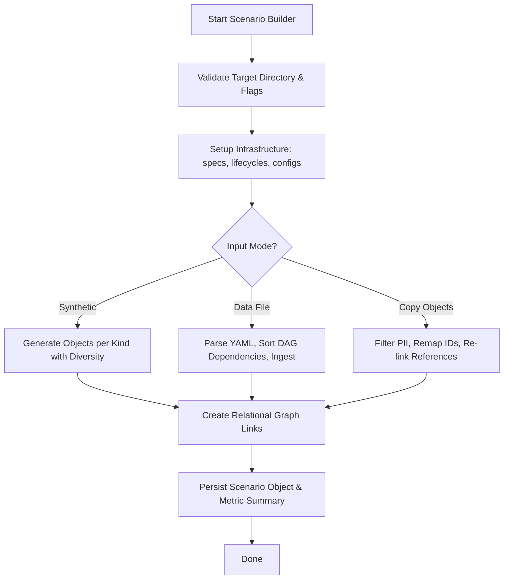

# CLI Utility Engine & Scenario Builder Guide

## Overview

The ZQK CLI Utility Engine (`cmd/zqk/utility`) provides essential operational, maintenance, schema validation, data repair, and synthetic scenario generation tooling for the ZQK Knowledge Kernel. It serves five core engineering domains:
1. **System Versioning & Platform Diagnostics (`zqk version`, `zqk utility version`)**: Reports detailed build metadata, git commits, target architecture, and runtime environments.
2. **Schema & Migration Orchestration (`zqk utility migrate`)**: Validates schema constraints and drives automated migration routines across schema versions.
3. **YAML Schema Validation & Hash Registration (`zqk utility validate-yaml`)**: Recursively scans and parses YAML configuration files and kernel objects, verifying syntax and optionally executing hash registration via system checks.
4. **Knowledge Kernel Integrity & Hash Repair (`zqk utility fix-hashes`, `zqk utility fix-registration`)**: Recomputes cryptographic hashes for untracked or corrupted kernel artifacts and repairs ID prefix registration mappings.
5. **Scenario Builder & Synthetic Fixture Generation (`zqk utility scenario-builder`)**: Multi-phase synthetic test generation engine that provisions isolated scenario environments, creates spec-compliant test objects across all kernel types, sanitizes PII, handles dependency sorting, and copies existing project objects with cryptographic integrity verification.

---

## Architectural Taxonomy & Core Subsystems

```
cmd/zqk/utility/
├── utility.go                                # Root utility command group registration
├── version.go                                # Version inspection & metadata formatting
├── migrate.go                                # Schema migration invocation & constraint validation
├── validate_yaml.go / validate_yaml_helpers.go # YAML file traversal & syntax verification
├── fix_hashes.go / fix_hashes_helpers.go    # Object hash recalculation & audit logging
├── fix_registration.go                       # ID prefix & kind registration remediation
├── config_file_watcher.go                    # Reactive polling watcher with event coordinator
└── scenario_builder_*.go                     # Synthetic scenario creation & fixture generation engine
    ├── scenario_builder_types.go             # Configuration structures, fluent options, & constants
    ├── scenario_builder_commands.go          # Cobra command wiring & flag binding
    ├── scenario_builder_build.go             # Object generation, diversity scaling, & linking
    ├── scenario_builder_infrastructure*.go   # Target workspace bootstrapping & spec copying
    ├── scenario_builder_copy*.go             # Source project object copying, PII filtering & remapping
    ├── scenario_builder_create_helpers.go    # Scenario lifecycle object management
    └── scenario_builder_data_loader*.go      # Multi-stage data file ingestion & DAG sorting
```

---

## 1. Hash Fixing & Registration Remediation Engine

### Hash Verification Mechanics (`fix_hashes.go`)
Artifacts and objects within the knowledge kernel are cryptographically verified to prevent unauthorized or corrupt modifications. `fix-hashes` repairs discrepancies by:
- Scanning primary object directories (`.zqk/process/primary/`) and specs (`.zqk/specs/`).
- Calculating SHA-256 content hashes using canonical serialization.
- Recording state changes in audit events (`KindAuditEvent`) and syncing internal verification tables.
- Supporting kind-specific filtering (`--kind <kind>`) or all-kind reconciliations (`--all-kinds`), dry-run simulation (`--dry-run`), and automated repairs (`--fix`).

```bash
# Dry run inspection of hash discrepancies
zqk utility fix-hashes --dry-run

# Recompute and persist hashes for backlog items
zqk utility fix-hashes --kind backlog_item --fix
```

### Registration Remediation (`fix_registration.go`)
Validates that all object kinds declared across specifications are properly mapped in `.zqk/specs/configs/id_prefixes_config.yaml`.
- Analyzes object identifiers against prefix patterns (`GOAL-`, `REQ-`, `BLI-`, etc.).
- Detects unregistered prefixes and automatically patches `id_prefixes_config.yaml` when `--fix` is passed.

---

## 2. Reactive Config File Watcher (`config_file_watcher.go`)

The `ConfigFileWatcher` implements background file system monitoring for kernel configuration forests:
- **Polling Loop with Clamped Intervals**: Avoids busy loops and handles high-frequency file updates with configurable polling intervals (`DefaultConfigPollInterval = 1s`).
- **Diff & Lifecycle Detection**: Detects file creation, modification, and deletion by comparing timestamps (`mtime`) and byte sizes.
- **Event Coordination Mesh**: Emits strongly-typed event notifications (`configWatcherChangeCreated`, `configWatcherChangeModified`, `configWatcherChangeDeleted`) through the `coordination.EventCoordinator`.
- **Dynamic Reload Handlers**: Automatically triggers registered callback functions (e.g., `ResetGlobalIDPrefixesConfig`, `ResetGlobalPathsConfig`) to refresh runtime state without daemon restarts.

---

## 3. Scenario Builder & Synthetic Fixture Engine (`scenario-builder`)

The Scenario Builder is a multi-phase test data generation framework designed to provision reproducible, isolated project topologies for integration and load testing.

### Execution Modes
1. **Programmatic Generation (`--kinds`, `--count`, `--diversity`)**:
   - Generates synthetic instances of specified object kinds (accounts, goals, milestones, requirements, criteria, backlog items, test cases, audit events, doc entries).
   - Scales diversity across statuses, timelines, priorities, and relational links based on a clamped diversity metric (1–10).
2. **Data File Ingestion (`--data-file <path.yaml>`)**:
   - Loads predefined fixture sets and automatically executes DAG topological sorting across referenced dependencies.
   - Concurrently provisions missing parent objects and creates multi-layer structures.
3. **Project Object Copying & Sanitization (`--object-ids`, `--source-project`)**:
   - Copies real project objects into a synthetic test scenario.
   - Strips PII fields based on spec annotations (`checklist.security: confidential_pii`) and heuristic pattern matching (`email`, `ssn`, `api_key`, `token`).
   - Remaps object IDs and relational references (`owner_ref`, `criteria_refs`, `goal_refs`) to maintain referential integrity.
   - Verifies baseline snapshot hashes with configurable change policies: `reject`, `include`, or `reconstruct`.

### Generation Pipeline Stages



### CLI Command Options

| Flag | Type | Description |
|------|------|-------------|
| `--target` | `string` | Target directory for the generated scenario (required) |
| `--kinds` | `strings` | Comma-separated object kinds to generate (`goal,backlog_item,criteria`) |
| `--count` | `stringToString` | Per-kind object counts (`backlog_item=10,goal=5`) |
| `--default-count` | `int` | Default count for kinds without explicit override (default: 5) |
| `--diversity` | `stringToString` | Per-kind diversity scale 1–10 (`backlog_item=8`) |
| `--link-probability`| `float64` | Probability of establishing relational cross-links (0.0–1.0) |
| `--data-file` | `string` | Path to YAML fixture definition file |
| `--object-ids` | `strings` | Comma-separated IDs to copy from source project |
| `--source-project` | `string` | Root directory of source project for copying |
| `--change-policy` | `string` | Policy on modified snapshot hashes (`include`, `reject`, `reconstruct`) |
| `--dry-run` | `bool` | Simulate generation without persisting to disk |

---

## Testing & Quality Assurance

The `cmd/zqk/utility` package is backed by rigorous unit and integration tests:
- **Statement Test Coverage**: Maintained at $\ge 80.0\%$ statement coverage across all subpackages and helper utilities.
- **Race Condition & Deadlock Safety**: Tested under concurrent worker thread execution using Go's data race detector.
- **Strict Provenance Invariants**: Enforces that system provenance fields (`created_at`, `created_by`, `updated_at`, `updated_by`) remain immutable and are managed strictly by storage abstractions.
- **Filesystem Abstraction (`fileutil`)**: All file operations adhere to the strict `fileutil` abstraction to prevent naked OS calls and ensure cross-platform compatibility.
