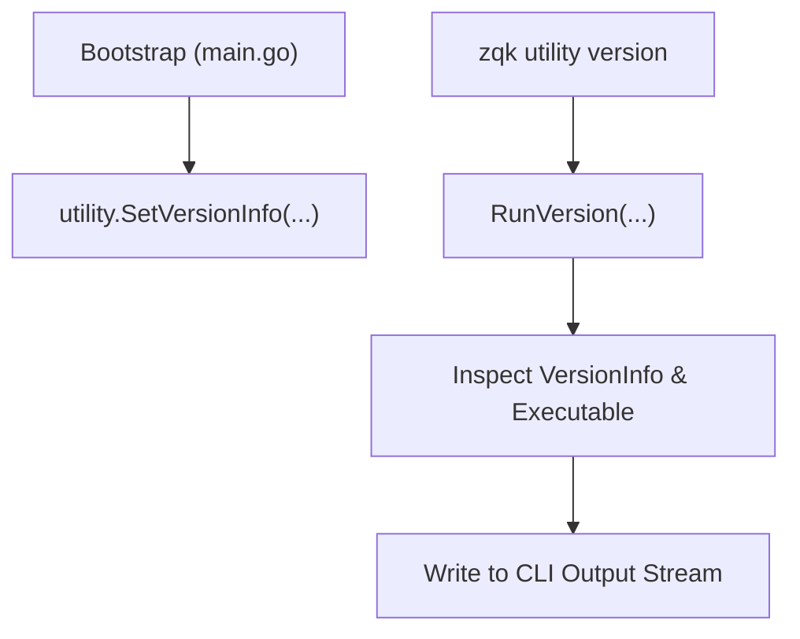
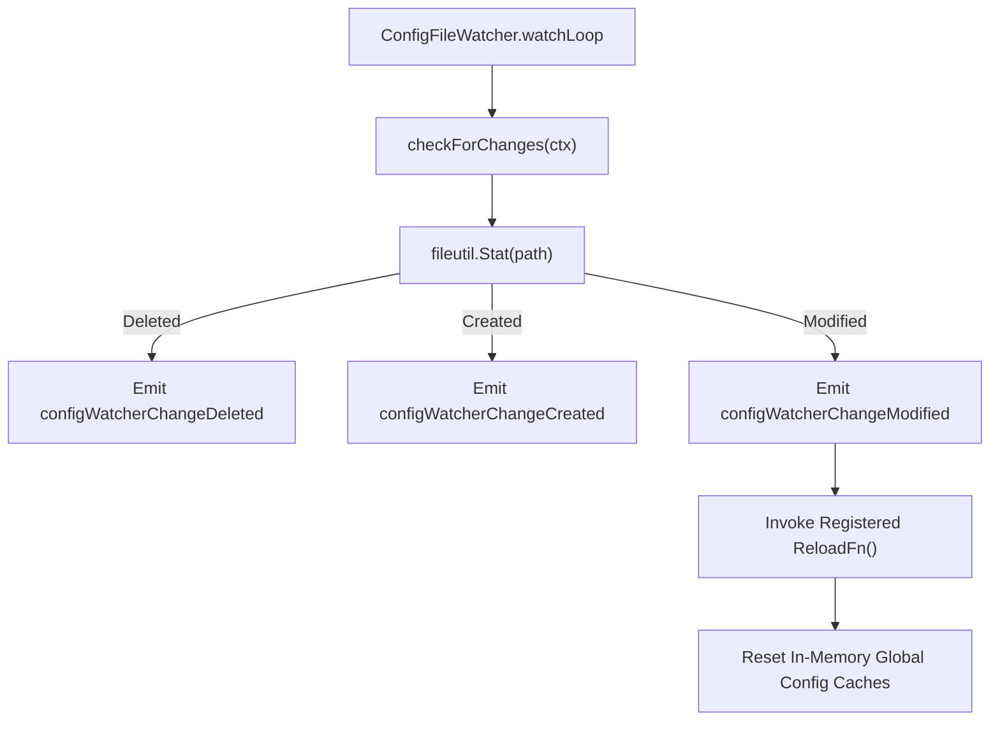
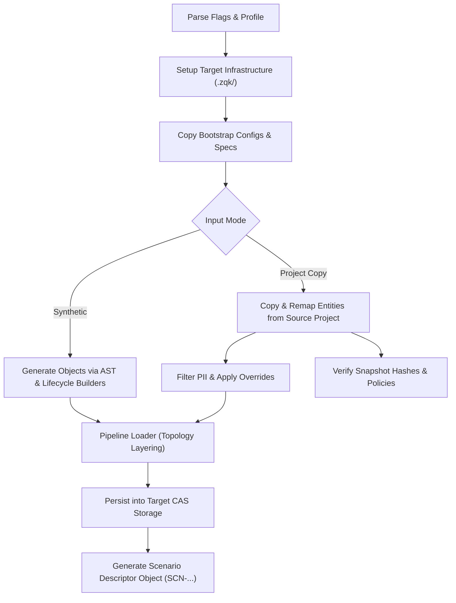

# CLI Utility Subsystem Architectural Guide

## Overview

The ZQK CLI Utility Subsystem (`cmd/zqk/utility`) provides operational plumbing, integrity maintenance, runtime metadata inspection, configuration monitoring, and test scenario generation for the ZQK Knowledge Kernel platform. It hosts administrative commands and support mechanisms that maintain system consistency across file-based and graph-based backends.

The subsystem encapsulates six primary architectural capabilities:
1. **Runtime & Version Inspection (`version`)**: Surfaces canonical binary metadata, build timestamps, and Git commit hashes for both root and utility subtrees.
2. **Dynamic Configuration File Monitoring (`ConfigFileWatcher`)**: Provides event-driven filesystem monitoring for internal kernel configurations, reloading schema caches and ID prefixes upon file mutation.
3. **Storage Backend Migration Engine (`migrate`)**: Bridges external migration binaries (`zqk-migrate`) with verification, capability detection, and safe execution boundaries.
4. **Content-Addressable Integrity Maintenance (`fix-hashes`)**: Scans kernel YAML entities, detects tampering or missing hashes, and reconciles the SHA-256 hash registry.
5. **Ontological Registration & Format Remediation (`fix-registration`)**: Identifies mismatched entity ID formats against registered kind prefixes and updates configuration models.
6. **Syntactic Validation Engine (`validate-yaml`)**: Conducts fast gut-check parsing on YAML structures and integrates with system check for missing hash enrollment.
7. **Synthetic Scenario Generation Engine (`scenario-builder`)**: Synthesizes rich topological test environments, lifecycle graphs, and mocked datasets with PII sanitization.

---

## Architectural Taxonomy & Package Layout

```
cmd/zqk/utility/
├── utility.go                                       # Command group entry point & wiring
├── version.go                                       # Root & utility version command handlers
├── config_file_watcher.go                           # Filesystem watcher & event coordination
├── migrate.go                                       # Backend migration delegator & verifier
├── fix_hashes.go / fix_hashes_helpers.go            # Hash registry reconciliation & validation
├── fix_registration.go                              # Entity ID prefix detection & config updater
├── validate_yaml.go / validate_yaml_helpers.go      # YAML validation & system-check binding
├── scenario_builder*.go                             # Synthetic data generator & scenario pipeline
└── lock_op_names.go                                 # Concurrency lock identifiers
```

---

## 1. Runtime Version Reporting (`version`)

The version reporting mechanism provides dual-entry access through both `zqk version` (root) and `zqk utility version` (subsystem).

### Architectural Mechanics

- **Thread-Safe Metadata Storage**: A package-level `VersionInfo` struct stores build-time information populated during binary bootstrap (`SetVersionInfo(version, buildDate, gitCommit)`).
- **Executable Path Resolution**: Utilizes `fileutil.Executable()` with a safe fallback to `os.Args[0]` to identify the running binary name without risking runtime panics.
- **Output Channel Abstraction**: Emits through the CLI output writer abstraction, enabling capture during automated testing and daemon operation.



---

## 2. Dynamic Configuration File Watcher (`ConfigFileWatcher`)

The `ConfigFileWatcher` implements an event-driven file monitoring loop for internal kernel configurations located in `.zqk/process/internal/`.

### Responsibilities
- **Monitored Targets**:
  - `id_prefixes_config.yaml`: Entity ID prefix rules (`validation.ResetGlobalIDPrefixesConfig()`).
  - `paths_config.yaml`: Filesystem routing rules (`validation.ResetGlobalPathsConfig()`).
  - `kind_mappings_config.yaml`: Object kind mappings (`objects.ResetGlobalKindMappingsConfig()`).
  - `namespaces_config.yaml`: Namespace definitions (`validation.ResetGlobalNamespacesConfig()`).
- **Resilient Polling**: Uses a configurable polling interval (defaulting to 1 second) guarded by concurrency locks (`concurrency.WithLockTimeout`) to eliminate race conditions and ticker panics.
- **Event Coordination**: When file modification, creation, or deletion is detected, emits typed event contexts (`config_id_prefixes_changed`, `config_paths_changed`, etc.) through `coordination.EventCoordinator`.



---

## 3. Storage Backend Migration Engine (`migrate`)

The `migrate` command manages transitioning data between storage engines (such as file-based CAS, Memgraph, or Neo4j).

### Verification & Execution Boundary
1. **Binary Detection**: Employs `detector.BinaryDetector` to locate `zqk-migrate` in `PATH` or configured tool directories.
2. **Version Constraints**: Evaluates optional semantic version constraints (e.g., `>=1.0.0`) against binary capabilities.
3. **Integrity & Code Signing Verification**: Requires code-signed binaries and passes cryptographic integrity checks prior to invocation.
4. **Sandboxed Subprocess Execution**: Configures standard I/O streams and runs migration workflows through `execwrap.Command`.

### Command Syntax

```bash
zqk utility migrate --source . --target memgraph --phase all
```

---

## 4. Integrity Maintenance & Hash Fixing (`fix-hashes`)

The Knowledge Kernel relies on cryptographic content hashes (SHA-256) stored in `.zqk/process/` hash registries for tamper detection and provenance tracking.

### Operational Modes

- **Single File & Recursive Traversal**: Fixes individual entity YAML files or recursively scans entire entity directories (`--recursive`).
- **Kind Filtering**: Scans entities restricted to a specific kind (`--kind backlog_item`) or all internal audit records (`--internal`).
- **Dry-Run Preview**: Simulates repairs and outputs changes without writing to disk (`--dry-run`).
- **Force Override with Auditing**: Modifying files outside the CLI causes hash mismatches. The `--force` flag updates the hash registry while minting an audit event recording the manual intervention.

### Example Illustrative Workflows

```bash
# Preview hash updates for demo items
zqk utility fix-hashes --dry-run --kind backlog_item

# Reconcile hashes across a project directory
zqk utility fix-hashes --recursive .zqk/process/backlog_items/

# Force update a modified item and record audit provenance
zqk utility fix-hashes --force .zqk/process/backlog_items/BLI-001.yaml
```

---

## 5. Ontological Registration & Format Remediation (`fix-registration`)

When entities are created externally or during migrations, their identifiers may diverge from prefix standards defined in `id_prefixes_config.yaml`.

### Mechanics

1. **Scanning**: Scans target objects by ID, kind (`--kind`), or globally (`--all`).
2. **Validation**: Evaluates entity IDs against `validation.IDValidator`.
3. **Recommendation & Remediation**:
   - Recommends either renaming the entity ID to match registered prefixes or updating the configuration.
   - Using the `--fix` flag automatically discovers unregistered prefixes (e.g., `CUSTOM-` for `backlog_item`) and adds them to `id_prefixes_config.yaml` using atomic temp-file replacement.

```bash
# Scan all objects and preview prefix registration updates
zqk utility fix-registration --all --fix --dry-run

# Apply registration fix to accept new prefixes
zqk utility fix-registration --all --fix
```

---

## 6. Syntactic YAML Validation Engine (`validate-yaml`)

The `validate-yaml` utility executes rapid syntax validation without full object schema validation or reference graph resolution (which is handled by `zqk system validate`).

### Feature Matrix

| Feature | Flag | Description |
|---------|------|-------------|
| Recursive Discovery | `--recursive`, `-r` | Traverses directory trees identifying `.yaml` and `.yml` files. |
| Quiet Mode | `--quiet`, `-q` | Suppresses progress messages, emitting only validation errors and summary counts. |
| Hash Enrollment | `--register-hashes` | Automatically enrolls valid entities with missing hashes into the hash registry via `system check --auto-fix`. |

---

## 7. Synthetic Scenario Builder (`scenario-builder`)

The `scenario-builder` utility creates realistic, isolated test environments populated with synthetic or sanitized project data.

### Architectural Pipeline



### Key Components

- **Infrastructure Generator**: Prepares directory trees (`.zqk/process`, `.zqk/specs`, `.zqk/lifecycles`) and bootstraps essential specs and lifecycle definitions.
- **Topological Pipeline Loader**: Analyzes dependencies between kinds (e.g., goals before requirements, requirements before backlog items) and creates objects in topological layers.
- **PII Scrubbing & Overrides**: Filters sensitive attributes matching pattern dictionaries (`email`, `phone`, `password`, `secret`) and applies user-specified field overrides.
- **State Preservation Policies**: Supports `PreserveState` controls, allowing timestamps and audit fields to either be retained or reset to canonical system baselines.

### Example Illustrative Scenario Generation

```bash
# Generate a test scenario with synthetic goals and requirements
zqk utility scenario-builder \
    --target-dir ./test-scenario \
    --kinds goal,requirement,backlog_item \
    --counts goal:3,requirement:9,backlog_item:18

# Copy sanitized objects from an existing workspace into an isolated scenario
zqk utility scenario-builder \
    --target-dir ./demo-sandbox \
    --copy-from . \
    --objects UTIL-DEMO-001,ACC-COMMUNITY-001 \
    --preserve-state=false
```

---

## Best Practices & Guidelines

1. **Clean Identity Invariants**: Always use canonical domain-specific prefixes (`UTIL-`, `ACC-`, `BLI-`, `SCN-`) rather than transient or random identifiers.
2. **Atomic Configuration Updates**: Never write directly to configuration files without verifying YAML validity and employing atomic write-and-rename semantics.
3. **Audit Trail Preservation**: When running hash fixes in forced mode (`--force`), ensure operational context is available so audit records capture the operator identity and reason.
4. **Isolated Test Sandboxes**: When validating migration or scenario generation logic, always execute within isolated temporary project roots using `testkit.PrepareIsolatedTempProject`.

---

## Verification & Statement Coverage Invariant

The Utility Subsystem conforms to strict quality, hygiene, and verification gates:

### Mandatory Statement Coverage Threshold
- **Coverage Floor**: Statement coverage across `cmd/zqk/utility` must remain strictly **>= 85.0%** (target >= 88.0%).
- **Verification Command**:
  ```bash
  ZQK_ALLOW_FOREGROUND_GO_TEST=1 go test -cover ./cmd/zqk/utility/...
  ```

### Three-Fold Proof Conformance
1. **Static Floor Invariant**: Verified statement test coverage on package `cmd/zqk/utility` meeting or exceeding 85.0% across all commands and scenario generators.
2. **Operational Dynamic Proof**: Validated end-to-end execution of migration detection, hash repair, prefix registration fixing, YAML gut-check syntax validation, and scenario synthesis.
3. **Negative Adversarial Boundary**: Confirmed fail-closed rejection of corrupted YAML inputs, invalid version constraints, missing binary paths, mismatched content hashes, and circular dependency graphs.

### Engineering Invariants
1. **Zero Swallowed Errors**: No error return may be discarded with `_ = ...`. All error returns must be checked explicitly (`if err != nil` or `require.NoError`).
2. **Deterministic Storage Teardown**: In all tests initializing temporary kernels, `cli.UnregisterStorageForProjectRoot(proj.Root)` must be registered in `t.Cleanup` to guarantee no open file descriptors or cached storage handles linger.
3. **AST Line-Count Discipline**: Test helper functions and scenarios are kept under 80 lines to satisfy codebase hygiene and avoid cyclomatic complexity traps.

