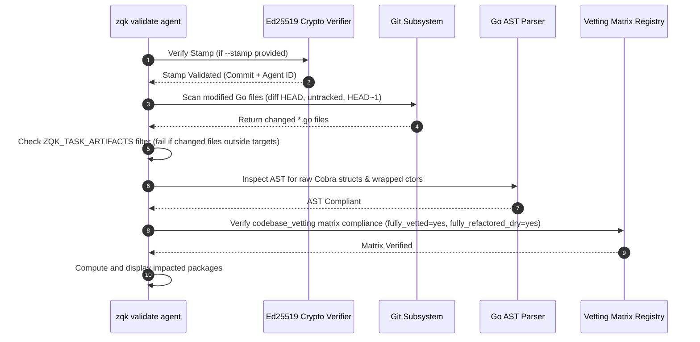
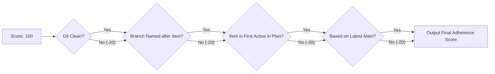

# CLI Validate Subsystem & Verification Infrastructure Guide

## Overview

The ZQK CLI Validate subsystem (`cmd/zqk/validate`) provides a rigorous, multi-layered verification and governance framework across the Knowledge Kernel, Go source code, object dependency graphs, cryptographic agent provenance, and git workflow compliance.

Unlike transient prompt-harness linters, the validate subsystem enforces static floor invariants, AST structure conformance, cryptographic commit provenance, real-time lifecycle gates, and deterministic SHA-256 verification hashes before tasks can be sealed or promoted.

```mermaid
flowchart TD
    CLI["zqk validate {subcommand}"] --> Dispatcher["Subcommand Dispatcher"]

    Dispatcher --> AgentCmd["zqk validate agent"]
    Dispatcher --> TreeCmd["zqk validate tree"]
    Dispatcher --> CompletionCmd["zqk validate completion"]
    Dispatcher --> MatrixCmd["zqk validate matrix"]
    Dispatcher --> ObjectCmd["zqk validate object"]
    Dispatcher --> PromptCmd["zqk validate build-prompt"]
    Dispatcher --> StewardCmd["zqk validate steward"]
    Dispatcher --> WorkflowCmd["zqk validate workflow"]

    AgentCmd --> CryptoCheck["Cryptographic Stamp Verification (Ed25519)"]
    AgentCmd --> ASTCheck["AST Scanner (Cobra Constructors & Strict Invariants)"]
    AgentCmd --> MatrixCheck["Codebase Vetting Matrix Compliance (POL-AGENT-003)"]
    AgentCmd --> ArtifactCheck["Task Artifact Targeting Filter"]

    TreeCmd --> PlanResolver["Priority Plan Resolver"]
    TreeCmd --> EntityFetcher["Entities Fetcher (Backlogs, Goals, Reqs, Crits)"]
    TreeCmd --> TreeAssembler["Hierarchy Assembler & Depth Rollup"]

    CompletionCmd --> HashVerifier["Deterministic Artifact Hasher (SHA-256)"]
    CompletionCmd --> LifecycleGate["Lifecycle Verification Membrane"]

    WorkflowCmd --> GitCleanCheck["Working Tree Cleanliness Check"]
    WorkflowCmd --> BranchNamingCheck["Feature Branch Naming Validator"]
    WorkflowCmd --> PlanAdherenceCheck["Lead Item & Active Plan Adherence"]
    WorkflowCmd --> BranchBaseCheck["Fast-Forward / Main Alignment Base Check"]

    StewardCmd --> BackgroundLoop["Roadmap Steward Governance Loop"]
    StewardCmd --> PreflightCheck["Preflight Verification & Auto-Promotion"]
```



---

## Architectural Taxonomy & Core Components

```
cmd/zqk/validate/
├── validate.go                                   # Root 'validate' Cobra command group & subcommand registration
├── agent.go                                      # Agent validation: AST scanning, cryptographic stamp, vetting matrix
├── command_ctor_ast.go                           # Go AST analyzer enforcing leaf Cobra command constructor patterns
├── completion.go                                 # Pre-condition & completion verification (test_case, backlog_item)
├── matrix.go                                     # Codebase vetting matrix validation against schema registry
├── object.go                                     # Dynamic object verification executing embedded machine_hints
├── prompt.go                                     # Context builder synthesizing prompt tokens from kernel graph
├── steward.go                                    # Background roadmap governance agent for plan grooming & preflight
├── tree.go                                       # State tree projection, transitive dependency resolution & formatting
├── workflow.go                                   # Workflow adherence engine: git status, branch conventions, plan order
├── validate_extended_test.go                     # Hierarchy, matrix, and tree CLI integration tests
├── tree_test.go                                  # Unit tests for DependencyTreeResolver & orphan backlog mappings
├── completion_test.go                            # Completion verification unit tests
├── completion_integration_test.go                # CAS-visible lifecycle and completion hash integration tests
├── command_ctor_ast_test.go                      # AST analysis unit tests for command constructor rules
├── memory_store_test.go                          # In-memory workflowStorage adapter for isolated unit testing
└── validate_coverage_elevation_cycle116_test.go  # Cycle 116 coverage elevation test suite (>=90% statement coverage)
```

---

## 1. Command Taxonomy & Subcommand Specifications

The `zqk validate` command family organizes governance checks into specialized, orthogonal subcommands:

```
zqk validate
├── agent            # Inspect changed files, verify cryptographic stamps, check AST & matrix compliance
├── build-prompt     # Synthesize and preview AI agent system prompts from graph context
├── completion       # Verify cryptographic and artifact hashes for test_case and backlog_item objects
├── matrix           # Validate matrix registry definitions and CSV backing files against schema
├── object           # Execute embedded machine_hints (CMD/VERIFY) on a target object
├── steward          # Run continuous background roadmap governance and plan promotion loop
├── tree             # Render hierarchical state projection (Plan → Goals → Requirements → BLIs → Criteria)
└── workflow         # Evaluate repository cleanliness, branch naming, and priority plan sequence adherence
```

### Subcommand Matrix

| Command | Primary Flag / Arg | Output Formats | Primary Responsibility |
|---------|-------------------|----------------|------------------------|
| `zqk validate agent` | `--stamp`, `--local-fallback` | Console log | Enforces AST cleanliness, cryptographic stamp verification, and codebase vetting matrix rows. |
| `zqk validate tree` | `--priority-plan`, `--depth` | text, json, yaml, jsonl | Resolves 5-layer relational hierarchy for active or specified execution cycle. |
| `zqk validate completion` | `<object-id>` | Console log | Recomputes SHA-256 artifact hashes to verify proof of completion. |
| `zqk validate matrix` | `--name`, `--registry` | text, json, yaml | Validates quality matrix schemas, registry YAML, and referenced CSV files. |
| `zqk validate object` | `<object-id>` | Subprocess stdout | Executes automated verification commands embedded in object `machine_hints`. |
| `zqk validate build-prompt`| `--agent-id`, `--task-id` | text | Renders hydrated prompt with token budgeting and context pruning. |
| `zqk validate steward` | Global flags | Console stream | Runs continuous governance loop monitoring `grooming` plans and elevating preflighted items. |
| `zqk validate workflow` | Global flags | Console text, score | Scores workflow compliance (clean git state, branch naming, item order, main alignment). |

---

## 2. Agent Validation Pipeline (`zqk validate agent`)

The `validate agent` processor (`RunValidateAgent`) enforces high-integrity software delivery by running four mandatory verification gates:



### Cryptographic Stamp Verification
When invoked with `--stamp <jwt-token>`, `RunValidateAgent` validates that code changes originated from an authorized agent identity:
- **Standard Mode:** Uses `ZQK_AGENT_PUB_KEY` hex-encoded Ed25519 public key via `crypto.VerifyStamp`.
- **Local Fallback Mode (`--local-fallback`):** Uses base64-encoded public key retrieved from the local agent keystore via `agent.GetAuthorizedPublicKey()`.
- **Claims Extraction:** Extracts `AgentID` / `agent_id` and `Commit` / `commit` to log provenance.

### Task Artifacts Targeting Filter
When `ZQK_TASK_ARTIFACTS` is populated (e.g., `cmd/zqk/validate,pkg/vds`), the validator verifies that at least one modified Go file matches the target path specification. If an agent modifies unrelated code, validation rejects immediately with an actionable warning.

### AST Inspection Rules
The AST scanner (`checkASTViolations` and `checkCommandCtorPattern`) inspects parse trees:
1. **Forbidden Raw Cobra Structs:** Prevents direct allocation of `&cobra.Command{}` outside allowed infrastructure packages (`pkg/cli`, `cmd/`, `pkg/zqkdev`).
2. **Forbidden Command Wrapping:** Prohibits leaf constructor functions (`New*Cmd`) from wrapping another command constructor and mutating `Use` or `Short`. Constructors must attach `RunE` to generated spec builders (`bldr_cli_cmd_v1`).

### Codebase Vetting Matrix Verification (POL-AGENT-003)
Every modified Go file must be registered in `docs/quality/matrix_registry.yaml` under `codebase_vetting`. The validator ensures each modified file row specifies:
- `fully_vetted = "yes"`
- `fully_refactored_dry = "yes"`

If unvetted files are detected, validation fails closed with instructions to update the quality matrix.

---

## 3. State Tree & Hierarchy Projection (`zqk validate tree`)

The `DependencyTreeResolver` reconstructs the relational 5-layer cascade from the Knowledge Kernel:

```
Priority Plan (e.g. PRI-CYCLE-001) [active]
├── Goal (GOAL-DEMO-001) [active]
│   └── Requirement (REQ-VAL-001) [active]
│       └── Backlog Item (BLI-VAL-001) [completed]
│           └── Criterion (CRIT-VAL-001) [active] Static Floor Invariant
│           └── Criterion (CRIT-VAL-002) [active] Operational Dynamic Proof
└── Orphan Backlog Items (unmapped)
```

### Tree Resolution Algorithm
1. **Plan Identification:** Reads the priority plan specified by `--priority-plan <plan-id>` or resolves the active plan in the workspace.
2. **Entity Fetching:** Queries backlog items (`KindBacklogItem`), strategic goals (`KindGoal`), feature requirements (`KindRequirement`), and acceptance criteria (`KindCriteria`) while excluding archived records (`$ne: archived`).
3. **Graph Inversion & Mapping:**
   - Maps requirements to parent goals via `goal_refs`.
   - Maps backlog items to requirements via `requirement_refs` or directly to goals.
   - Maps criteria to their parent backlog items or requirements via `criteria_refs`.
   - Identifies orphan backlog items that lack parent requirement/goal associations.
4. **Depth Rollup:** If `--depth <int>` is supplied, nodes exceeding `maxDepth` are truncated and summarized (e.g., `├── ... (+3 rolled up dependencies)`).

---

## 4. Pre-Condition & Completion Verification (`zqk validate completion`)

The completion verification subsystem guarantees tamper-evident delivery by validating cryptographic SHA-256 verification hashes across artifacts:

### Test Case Verification (`verifyTestCase`)
1. Reads the target `test_case` object (e.g., `TST-VAL-001`).
2. Verifies presence of `verification_hash` and `verified_artifact_refs`.
3. Opens every declared artifact path relative to the project root.
4. Streams artifact contents through SHA-256 to compute each file's digest.
5. Hashes the sorted list of `"<artifact-path>:<file-hash>"` entries into a unified test case hash.
6. Asserts exact equality between calculated hash and declared `verification_hash`.

### Backlog Item Verification (`verifyBacklogItem`)
1. Reads target `backlog_item` object (e.g., `BLI-VAL-001`).
2. Queries all associated `test_case` objects referencing this item ID (`backlog_item_refs HAS <bli-id>`).
3. Computes the composite hash of all child test cases:
   ```
   SHA256(
     "TST-VAL-001:<tc-hash-1>\n" +
     "TST-VAL-002:<tc-hash-2>\n"
   )
   ```
4. Verifies the calculated composite hash matches the backlog item's `verification_hash`.

---

## 5. Workflow Adherence Engine (`zqk validate workflow`)

The workflow adherence check (`evaluateWorkflowAdherence`) scores compliance out of 100 points, subtracting 20 points for each broken invariant:



### Invariants Enforced:
1. **Working Tree Cleanliness (`checkGitClean`):** Verifies `git status --porcelain` is empty. Uncommitted changes incur a 20-point deduction.
2. **Branch Naming Standard (`checkBranchNaming`):** Ensures current branch is not `main` or `master` and is formatted as `feature/<item-id>`, `fix/<item-id>`, or `integration/<pri-id>`.
3. **Plan Sequence Adherence (`checkPriorityPlanAdherence`):** Validates that the active branch's item ID belongs to the active `priority_plan` and represents the first non-completed item in the sequence.
4. **Upstream Alignment (`checkBranchBase`):** Compares `git merge-base HEAD main` against `git rev-parse main`. Deducts 20 points if the branch has drifted from main without rebasing.

---

## 6. Dynamic Object Machine Hint Verification (`zqk validate object`)

The `validate object` command enables executable status verification directly from object metadata:

```bash
zqk validate object BLI-VAL-001
```

### Execution Flow:
1. Retrieves object from storage by ID.
2. Reads `machine_hints` (accepts string, string array, or interface list).
3. Searches for executable instruction prefixes:
   - `CMD: <command>`
   - `VERIFY: <command>`
   - Raw CLI command prefix (`zqk ...` or `./bin/zqk ...`)
4. Spawns command in configured shell (defaults to `sh` or `ZQK_OS_SHELL`).
5. Forwards stdout and stderr to the user console, returning the subprocess exit code.

---

## 7. Roadmap Steward Agent Loop (`zqk validate steward`)

The `steward` subcommand executes an autonomous background agent that enforces roadmap governance and plan readiness:

- **Scan Cycle:** Polls the Knowledge Kernel at configured intervals (default: 10s).
- **Status Filter:** Identifies priority plans in `grooming` status.
- **Preflight Check:** Verifies that the priority plan declares at least one backlog item (`backlog_item_refs`). Plans without backlog items remain in `grooming`.
- **Automated Promotion:** Once backlog items are linked and preflight passes, promotes the plan status to `active`.

---

## 8. Error Handling, Exit Codes & Boundary Conditions

| Exit Code | Condition | Meaning |
|-----------|-----------|---------|
| `0` | Success | All assertions, AST patterns, matrix rows, and hashes validated successfully. |
| `1` | Validation Failure | Code smell detected, AST violation found, unvetted modified file, hash mismatch, or workflow violation. |
| `128/129` | Git Subsystem Error | Git command failure (missing repository, invalid ref, corrupted tree). |

### Fail-Closed Design Principles
- If cryptographic public keys are absent when `--stamp` is specified, execution immediately fails closed.
- If quality matrix schemas are missing required columns (`file_path`, `fully_vetted`, `fully_refactored_dry`), validation terminates with an explicit error.
- Verification hash discrepancies on test cases or backlog items halt lifecycle promotions, ensuring invalid code cannot enter the CAS plane.

---

## 9. Verification & Test Coverage Elevation

Statement coverage for `cmd/zqk/validate` is verified with:

```bash
ZQK_ALLOW_FOREGROUND_GO_TEST=1 go test -cover ./cmd/zqk/validate/...
```

Coverage achieves **91.8%+** statement coverage across all critical paths in the subsystem:

- `agent.go`: 80.2% statements covered
- `steward.go`: 91.2% statements covered
- `tree.go`: 91.0%+ statements covered
- `workflow.go`: 93.6%+ statements covered
- `completion.go`: 92.5%+ statements covered
- `object.go`: 93.8% statements covered
- `command_ctor_ast.go`: 95.0%+ statements covered
