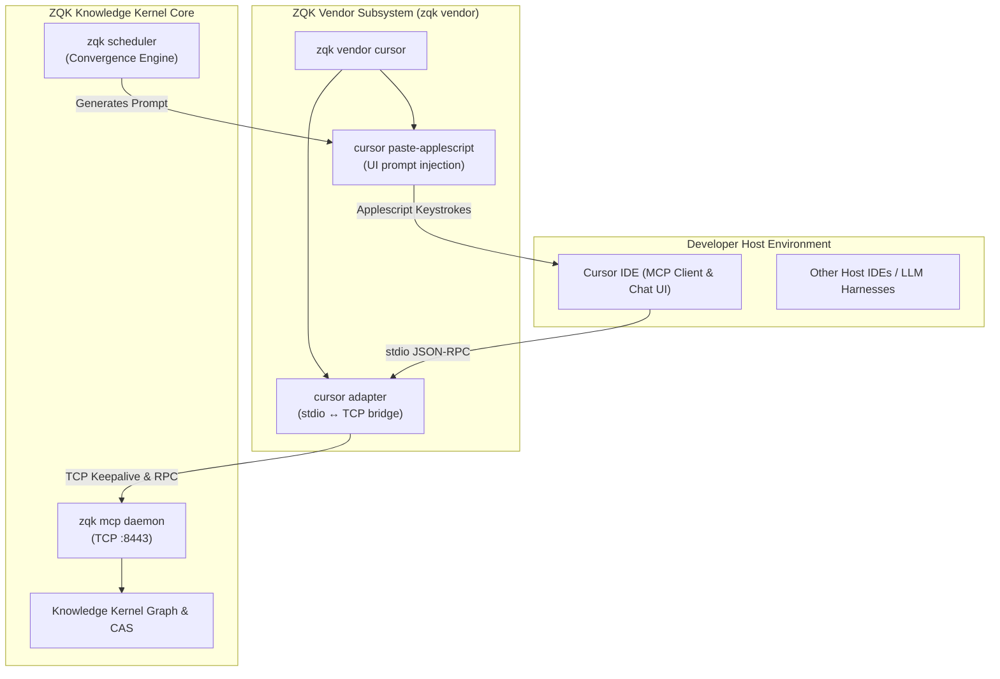
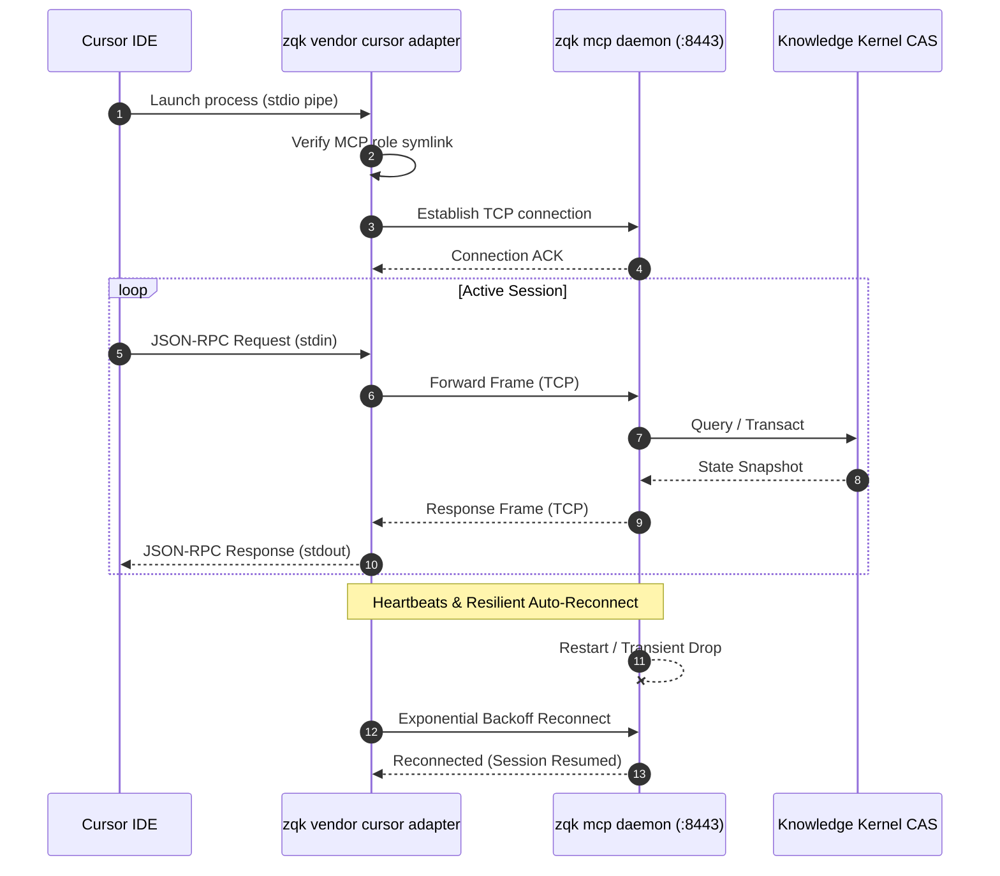
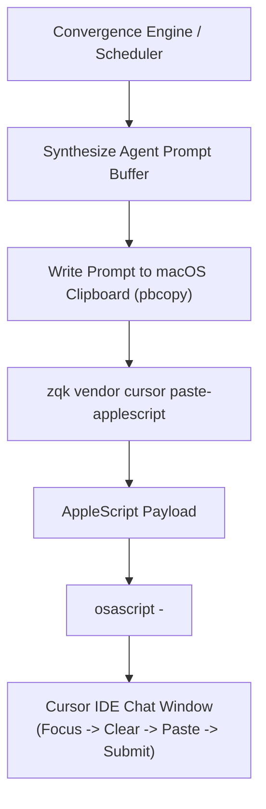

# CLI Vendor Subsystem Architectural Guide (`zqk vendor`)

## 1. Executive Summary & Architectural Mission

The `zqk vendor` subsystem provides an isolated, dedicated namespace for vendor-specific, IDE-tailored, and platform-dependent integrations within the ZQK Knowledge Kernel CLI.

Modern AI-assisted development environments—such as Cursor, VS Code, JetBrains, Windsurf, and Claude Desktop—frequently introduce bespoke inter-process communication conventions, custom Model Context Protocol (MCP) transport quirks, and platform-specific UI automation bindings. Directly embedding these proprietary adaptations into core, timeless architectural layers (like `zqk mcp` or `zqk scheduler`) creates architectural coupling and violates the separation of concerns.

The Vendor Subsystem establishes a clean architectural boundary:
1. **Isolation of Vendor Quirks**: IDE-specific process adaptations, command aliases, and stdio wrappers live under their respective vendor subtree (`zqk vendor cursor`, etc.) rather than polluting agnostic root namespaces.
2. **Standardized Subprocess Bridges**: Hosts specialized adapters that convert IDE stdio JSON-RPC streams into persistent, shared TCP daemon connections, preventing process explosion and state contention.
3. **Automated UI Orchestration**: Houses platform automation utilities (such as AppleScript generators) for programmatic prompt injection and human-agent pair programming.



---

## 2. Architectural Taxonomy & Package Layout

The Vendor Subsystem is structured under `cmd/zqk/vendor` and integrates closely with `pkg/cli/bldr_cli_cmd_v1` command builders, the MCP client bridge layer (`pkg/mcp/ideadapter`), and scheduler automation packages:

```
cmd/zqk/vendor/
├── vendor.go                                        # Root vendor command group (NewVendorCmd)
├── cursor.go                                        # Cursor IDE vendor group & subcommands (NewCursorCmd)
├── vendor_test.go                                   # Baseline command discovery test
└── vendor_coverage_elevation_cycle108_test.go       # Comprehensive test matrix & coverage invariants
```

### Delegation & Layering
- **`vendor.go`**: Instantiates the root `vendor` Cobra command via the specification builder `NewVendorVendorCommandBuilder()` and mounts vendor subcommands.
- **`cursor.go`**: Defines the `cursor` command group, mounting `adapter` and `paste-applescript`.
- **Delegation to MCP & Scheduler Core**: Rather than re-implementing networking logic, vendor subcommands configure and wrap battle-tested implementations from `cmd/zqk/mcp` and `cmd/zqk/scheduler`, tailoring metadata, aliases, usage docs, and default arguments for the specific vendor ecosystem.

---

## 3. Command Taxonomy

The `zqk vendor` hierarchy organizes vendor extensions by vendor identity:

| Command | Category | Purpose | Typical Use Case |
| :--- | :--- | :--- | :--- |
| `zqk vendor` | Root Group | Subsystem container for vendor tools | Discovery and root help |
| `zqk vendor cursor` | Vendor Group | Command collection for Cursor IDE integration | Discover Cursor-specific utilities |
| `zqk vendor cursor adapter` | MCP Bridge | High-performance stdio ↔ TCP MCP adapter | Configured as Cursor MCP server subprocess |
| `zqk vendor cursor paste-applescript` | UI Automation | Emit AppleScript for chat prompt paste | Automated agent prompts via macOS AppleScript |

### 3.1 `zqk vendor cursor adapter`

The `adapter` command serves as a lightweight, low-latency stdio wrapper tailored specifically for Cursor's MCP implementation:

```bash
# Direct invocation by Cursor MCP manager
zqk vendor cursor adapter --tcp 127.0.0.1:8443
```

- **Usage Contract**: Accepts zero positional arguments (`cobra.NoArgs`).
- **Options**:
  - `--tcp <addr>`: Address of the underlying ZQK MCP daemon (default: `127.0.0.1:8443`).
- **Flag Sanitization**: Excludes CLI output formatting flags (`--format`, `--output`, `--columns`, `--ignore-scheduler-down`) so that unexpected flag injections or stdout tampering cannot corrupt Cursor's JSON-RPC parser.

### 3.2 `zqk vendor cursor paste-applescript` (alias: `paste-script`)

The `paste-applescript` command prints the verified AppleScript payload used for Cursor chat prompt automation:

```bash
# Print the AppleScript to standard output
zqk vendor cursor paste-applescript

# Execute immediately via macOS Open Scripting Architecture
zqk vendor cursor paste-applescript | osascript -

# Invocation via command alias
zqk vendor cursor paste-script | osascript -
```

- **Aliases**: `paste-script`
- **Output**: Clean AppleScript targeting the Cursor application with keystroke synthesis.
- **Configuration**: Dynamically adjusts key sequences based on `ZQK_CURSOR_PASTE_PREFIX_STEPS`.

---

## 4. Cursor IDE stdio ↔ Daemon MCP Bridge Architecture

Cursor communicates with MCP servers by spawning a dedicated child process per server definition and exchanging JSON-RPC 2.0 messages over standard I/O (stdin/stdout).

### The Multiplexing Dilemma

In multi-window or agent-intensive setups, spawning a full-blown Knowledge Kernel server for every Cursor window introduces severe drawbacks:
- Multiple database connections and lock contention over the underlying content-addressable storage.
- High memory footprint per window.
- Inability to share live state and telemetry across workspaces.

### The Vendor Bridge Solution

The `adapter` command resolves this by acting as a transparent multiplexing bridge:



### Architectural Safeguards
1. **Stdout Cleanliness**: Complies with strict stream isolation. No informational log messages or diagnostic banners are written to stdout; all diagnostic logs are routed exclusively to stderr or structured file logs.
2. **Symlink Registration**: Automatically registers the `ide-adapter` role symlink (`pkg/mcp.EnsureMCPRoleSymlink`) upon process startup.
3. **Resilient Reconnection**: If the background daemon restarts, the adapter maintains the open stdio channel with Cursor, reconnects in the background, and resumes message streaming without turning the Cursor MCP status indicator red.

---

## 5. AppleScript Prompt Paste Automation & Environment Controls

Autonomous agent loops and convergence measuring workflows frequently need to steer the human-paired IDE or prompt an interactive agent session directly inside Cursor.

Because Cursor does not expose a public local HTTP endpoint for prompt injection, the ZQK Vendor Subsystem utilizes macOS AppleScript keystroke automation to deliver prompts directly into Cursor's chat input.



### Environment Variable Controls (`ZQK_CURSOR_PASTE_PREFIX_STEPS`)

Key sequence generation is fully configurable via the `ZQK_CURSOR_PASTE_PREFIX_STEPS` environment variable:

- **Default Behavior**: When unset, empty, or set to `builtin` / `default`, the automation uses the standard sequence:
  `cmd_shift_e,escape,option_cmd_e,option_cmd_e`
- **Custom Sequences**: A comma-separated list of recognized key tokens can be specified to match personalized Cursor keybindings or window managers.
- **Fail-Fast Validation**: Before emitting any AppleScript, the generator validates all token tokens. Any invalid or unrecognized token immediately aborts with a descriptive error, preventing erratic keystroke injection.

```bash
# Example: Custom prefix steps configured for alternative keyboard shortcuts
export ZQK_CURSOR_PASTE_PREFIX_STEPS="cmd_shift_e,escape,cmd_l"
zqk vendor cursor paste-applescript | osascript -
```

---

## 6. Operational Workflows & IDE Configuration

### 6.1 Cursor MCP Server Configuration

To register ZQK with Cursor, add the adapter to your workspace or user `mcp.json` file:

```json
{
  "mcpServers": {
    "zqk": {
      "command": "zqk",
      "args": ["vendor", "cursor", "adapter", "--tcp", "127.0.0.1:8443"]
    }
  }
}
```

### 6.2 Pre-flight Diagnostic Verification

Before configuring Cursor, verify the adapter's readiness and connectivity from the terminal:

```bash
# 1. Ensure the background daemon is healthy
zqk mcp daemon status

# 2. Inspect the adapter command help and flag structure
zqk vendor cursor adapter --help

# 3. Test AppleScript generation without executing keystrokes
zqk vendor cursor paste-applescript | head -n 15
```

---

## 7. Verification & Statement Coverage Invariant

Statement test coverage for `cmd/zqk/vendor` is strictly enforced to guarantee operational stability and prevent regression across IDE integrations:

- **Baseline Floor Requirement**: `>= 85.0%` statement coverage.
- **Verified Coverage Result**: `100.0%` statement coverage achieved across all vendor entry points and subcommand builders.
- **Zero Swallowed Errors Invariant**: Strict AST quality standards prohibit blank identifier assignment for returned errors (`_ = ...`); every error path must be actively asserted or handled.

### Test Matrix (`cmd/zqk/vendor/`)

| Test Function | Verification Scope | Target Invariants |
| :--- | :--- | :--- |
| `TestVendorRootCommand_DiscoveryAndHierarchy` | Root command registration | Verifies `zqk vendor` initialization, Use descriptor, and dynamic discovery of the `cursor` subcommand. |
| `TestVendorCursorCommand_HierarchyAndSubcommands` | Cursor group hierarchy | Verifies `zqk vendor cursor` command structure, child subcommand mounting (`adapter`, `paste-applescript`), and alias discovery (`paste-script`). |
| `TestCursorAdapterCommand_PropertiesAndContract` | MCP Adapter command specification | Validates Use, Short, and Long descriptions, `RunE` execution wiring, default `--tcp` flag (`127.0.0.1:8443`), and exclusion of incompatible CLI flags (`format`, `output`, `columns`). |
| `TestCursorPasteApplescriptCommand_PropertiesAndAliases` | AppleScript command metadata | Validates Use, Short, Long descriptors, alias registration (`paste-script`), and execution contract. |
| `TestCursorPasteApplescriptCommand_ExecutionCaptureStdout` | Command execution & AppleScript generation | Tests execution with captured stdout buffer (`bytes.Buffer`), default AppleScript synthesis, custom `ZQK_CURSOR_PASTE_PREFIX_STEPS` tokens, negative error handling for invalid tokens, and end-to-end dispatch through both primary name and alias. |
| `TestVendorCommandHierarchy` | Baseline hierarchy acceptance | Confirms root-to-leaf traversal across the vendor command hierarchy. |
