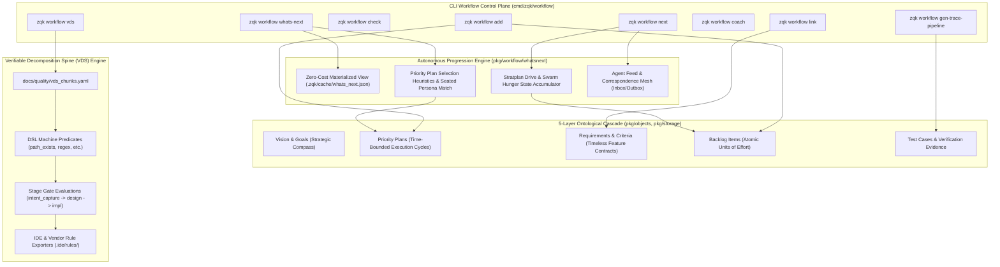

# CLI Workflow Execution & Autonomous Progression Engine Guide

## Executive Summary

The ZQK CLI Workflow subsystem (`zqk workflow`) coordinates autonomous progression, deterministic task selection, prescriptive lifecycle execution, and verifiable decomposition across the Knowledge Kernel.

- **Autonomous Progression Engine (`zqk workflow whats-next | next`)**: Computes the deterministic next strategic and tactical actions for agents and swarms using sub-5ms materialized view caching, seated persona heuristics, hunger cues, and convergence session context.
- **5-Layer Relational Cascade (`zqk workflow add | link | gen-trace-pipeline`)**: Enforces ontological graph integrity and unbroken traceability from high-level intent down to atomic backlog items and automated test suites.
- **Verifiable Decomposition Spine (`zqk workflow vds init | checklist | evaluate | project`)**: Enforces POL-WORKFLOW-VDS gate contracts across intent capture, design, implementation, and verification stages with executable machine predicates and independent verification.
- **Workflow Adherence & Gatekeeper (`zqk workflow check | coach`)**: Evaluates git repository hygiene, branch naming adherence, priority plan alignment, and dynamically surfaces context-aware observer coaching tips.

---

## 1. System Architecture & Topology



---

## 2. The 5-Layer Relational Cascade

The Knowledge Kernel strictly distinguishes between **timeless strategic contracts** and **time-bounded chronological execution cycles**:

```
Layer 1: Vision / Mission  ───► Timeless High-Level Purpose
   │
Layer 2: Goal              ───► Timeless Strategic Anchor (Decomposes into 3-5 Requirements)
   │
Layer 3: Priority Plan     ───► Time-Bounded Batch (1 Sprint/Kanban cycle, 2-5 BLIs)
   │
Layer 4: Requirement       ───► Timeless Functional Contract (Declares >=3 Criteria)
   │        │
   │        ├──► Test Case ───► 1:1 Unified Verification Group
   │
Layer 5: Backlog Item      ───► Atomic Unit of Effort (Satisfies 1-3 Criteria)
```

### Relational Model Invariants
1. **`goal` (Timeless Strategic Compass)**:
   - Must decompose into 3–5 `requirement` contracts (`requirement.goal_refs`).
   - Strictly NO `criteria_refs` or `priority_plan_refs` on `goal`.
2. **`requirement` (Timeless Whole Feature Contract)**:
   - Owns `criteria_refs`.
   - Must declare at least 3 criteria satisfying the **Three-Fold Proof**:
     - *Static Floor Invariant* (e.g., schema, AST structure, types).
     - *Operational Dynamic Proof* (e.g., execution, latency, happy path).
     - *Negative Adversarial Boundary* (e.g., bad inputs, errors, idempotence).
   - Requirements exist outside of time and MUST NOT declare `priority_plan_ref` or `priority_plan_refs`.
3. **`test_case` (Unified Verification Group)**:
   - Linked 1:1 to a `requirement` via `requirement_refs`.
   - Wraps and verifies all criteria for that requirement in a single execution (`zqk test run <tst_id>`).
4. **`priority_plan` (Time-Bounded Execution Cycle)**:
   - Groups exactly **1 cycle of work** (sprint/kanban batch, 2–5 BLIs) aiming toward a `milestone`.
   - Scope-locked upon entering `in_progress` to guarantee completion.
5. **`backlog_item` (Atomic Unit of Effort)**:
   - Satisfies 1 to 3 specific criteria (`criteria_refs`).
   - Links to exactly one active `priority_plan` (`priority_plan_ref`).

---

## 3. Deterministic Autonomous Progression (`whats-next` & `next`)

The workflow engine delivers predictable next-step orchestration for both human operators and autonomous swarms.

### Hot Path & Materialized View (<5ms SLA)
- `zqk workflow whats-next` defaults to querying the cached zero-cost projection generated during storage mutations.
- When staleness is detected, it non-blockingly triggers re-computation while immediately serving current state with a degraded status notice.
- Passing `--sync-sweep` forces an in-line synchronous graph crawl and storage re-indexing.

### Priority Plan Selection Hierarchy
When resolving the active priority plan:
1. **Explicit Request**: `--priority-plan <id>` flag always takes immediate precedence.
2. **Seated Persona Alignment**: If the invoking agent has a specific persona (e.g. software engineer vs. QA auditor), plans seated for that persona with available work are prioritized.
3. **Execution Status Bonus**:
   - `in_progress` (+1000 weight)
   - `active` (+500 weight)
   - `grooming` / `planned` (+100 weight)
4. **Active Order Penalty**: Lower active orders receive preferential precedence (`-10 * activeOrder`).

### Continuous Autonomous Loop Discipline
In the autonomous CAP loop, reaching a summary, merging a PR, or passing all tests is a **milestone transition**, not a stopping condition:
1. Fast-forward local `main` to `origin/main`.
2. Rebuild product binary & update MCP mesh (`go build -o bin/zqk ./cmd/zqk && ./bin/zqk mcp ensure`).
3. Query `zqk workflow whats-next`.
4. Create/checkout the next integration branch (`integration/<pri-id>`).
5. Claim the lead BLI and proceed immediately into execution.

---

## 4. Verifiable Decomposition Spine (VDS)

The VDS engine (`zqk workflow vds`) guarantees that speed comes from small, honest chunks with re-runnable evidence rather than subjective narrative claims.

### VDS Chunks Contract
Every verified chunk in `docs/quality/vds_chunks.yaml` adheres to a strict schema:
```yaml
chunks:
  - chunk_id: CHK-001
    stage: intent_capture
    claim: Core capability and functional delivery
    rubric_ref: docs/rubric.md
    dsl_checks:
      - path_exists:cmd/zqk/workflow/whats_next.go
      - git_clean:true
    evidence_refs:
      - BLI-1792053999992462500-162ed0ce
    independent_verify: yes
```

### Stage Gates
1. **`intent_capture`**: Confirms durable persistence of vision, goals, and priority plans in the kernel graph.
2. **`design`**: Confirms requirements, rubrics, and criteria decomposition before code authoring.
3. **`implementation`**: Confirms source code mutation, AST hygiene, and unit test pass rates.
4. **`verification`**: Executes three-fold proof test cases and VDS done-gate assertions.

---

## 5. Command Reference & Operator Runbook

| Command | Primary Use Case | Output Formats |
|---|---|---|
| `zqk workflow whats-next` | Identify lead priority plan, open BLIs, hunger cues, and remedies | Table (default), JSON, YAML |
| `zqk workflow next` | Evaluate policy-driven next action, active tasks, or unsealed items | Table, JSON |
| `zqk workflow check` | Validate git branch name, status cleanliness, and plan alignment | Formatted text report |
| `zqk workflow vds evaluate` | Verify all machine predicates and stage gates in `vds_chunks.yaml` | JSON, agent-prompt |
| `zqk workflow vds checklist` | Inspect active stages, chunk contracts, and VDS culture | Text, JSON |
| `zqk workflow add <BLI-ID> [PLAN-ID]` | Associate backlog items with a priority plan and milestone | Formatted text |
| `zqk workflow link <OBJ-ID> <TARGET-ID>`| Link loosely attached orphan items into the criteria graph | Formatted text |
| `zqk workflow coach [--update-tips]` | Surface real-time observer tips and recommendations | JSON, text |
| `zqk workflow gen-trace-pipeline <REQ-ID>`| Scaffold missing criteria, test cases, and BLIs automatically | Formatted text |
