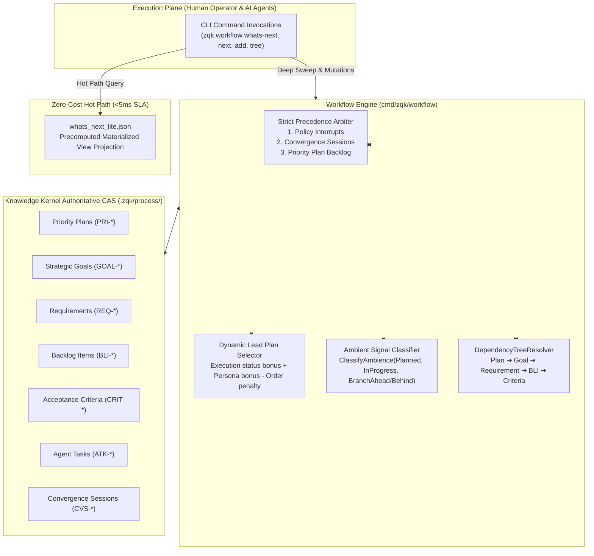

# CLI Workflow Subsystem Operational & Architectural Guide

## Overview

The ZQK Workflow Subsystem (`cmd/zqk/workflow`) serves as the central command-line engine driving continuous autonomous progression (CAP), intent orchestration, work slicing, verification cascades, and real-time coaching within the **Zen Quantum Kernel**.

In conventional AI coding environments (e.g., transient chat assistants, prompt-promiscuous wrappers), work state, task hierarchies, and verification decisions exist only as ephemeral conversational tokens that evaporate across sessions. In contrast, ZQK anchors work progression in a persistent, content-addressed Knowledge Kernel. Every goal, priority plan, backlog item, requirement, criterion, and test case is a durable graph object tracked by formal state machines.

The Workflow Subsystem bridges human engineering intent with autonomous AI swarms by answering the core operational questions:
1. **What is next?** (`zqk workflow whats-next`, `zqk workflow next`) — Evaluates graph state, precedence rules, and ambient signals to compute the optimal next action without human intervention.
2. **How is work scoped and linked?** (`zqk workflow add`, `zqk workflow link`, `zqk workflow gen-trace-pipeline`) — Slices features into atomic, token-budgeted backlog items satisfying the Three-Fold Verification Proof.
3. **Is execution adhering to process?** (`zqk workflow check`, `zqk workflow vds`) — Verifies git branch topology, commit state, and Verifiable Decomposition Spine (VDS) compliance.
4. **What does the full graph look like?** (`zqk workflow tree`) — Visualizes hierarchical dependencies from strategic compass down to atomic criteria.
5. **How can agents self-correct?** (`zqk workflow coach`) — Synthesizes real-time system state tips for human and AI pair programmers.

---

## Subsystem Command Taxonomy

The `zqk workflow` command group provides a cohesive operational toolkit:

| Command | Category | Purpose | Primary Flags & Arguments |
|---|---|---|---|
| `zqk workflow whats-next` | Autonomous Navigation | Computes hot-path ambient signals, active plan status, strategic runway depth, and next CAP stage | `--sync-sweep`, `--priority-plan`, `--session-id`, `--persona-id`, `--agent-id`, `--skip-measure`, `--format` |
| `zqk workflow next` | Deterministic Guidance | Recommends specific commands based on strict precedence: Critical Policy Interrupt > Active Convergence > Backlog Item | `--format json\|yaml\|table` |
| `zqk workflow add <bli-id...> [order\|plan]` | Work Ingestion | Attaches backlog items to priority plans and milestones; auto-scaffolds plan/milestone/goal resources if absent | `--milestone`, `--priority`, `--override`, `--reason-code` |
| `zqk workflow check` | Adherence Verification | Validates working copy clean status, branch naming conventions, plan alignment, and base commit synchronization | None |
| `zqk workflow coach` | Real-time Guidance | Generates dynamic observer tips by evaluating active plans, scheduler status, and swarm parallelism | `--update-tips`, `--format json\|yaml` |
| `zqk workflow gen-trace-pipeline <id>` | Slicing & Synthesis | Generates complete verification cascades (criteria, test cases, atomic backlog items) for requirements, goals, or milestones | `--criteria-count`, `--format` |
| `zqk workflow link <obj-id> <target-ref>` | Graph Binding | Attaches arbitrary kernel objects to traceability pipelines via criteria references | None |
| `zqk workflow tree` | Graph Visualization | Resolves and prints hierarchical dependency DAGs from priority plans down to atomic acceptance criteria | `--priority-plan`, `--depth`, `--format json\|yaml` |
| `zqk workflow vds <subcommand>` | Spine Verification | Manages Verifiable Decomposition Spine operations (`checklist`, `evaluate`, `project`, `init`) and hard-gate reviews | `--file`, `--persist`, `--apply-verify`, `--provider`, `--all`, `--write`, `--check` |

---

## Core Architecture



### 1. The 5-Stage Continuous Autonomous Progression (CAP) Loop

The Workflow Subsystem drives autonomous agent swarms through the 5 canonical CAP stages without manual human steering:

1. **Stage 1: Intent & Preflight (`whats-next`)**
   The agent checks `zqk workflow whats-next` to determine current ambient conditions. If runway depth is depleted ($\Delta_{\text{runway}} \le 1$), strategic replenishment cues prompt grooming or plan activation.
2. **Stage 2: Deterministic Action Resolution (`next`)**
   The agent queries `zqk workflow next`. Strict precedence guarantees that critical governance interruptions take absolute priority over active convergence sessions, which in turn precede standard backlog claiming.
3. **Stage 3: Work Locking & Claiming (`add` / `agent claim`)**
   Items are attached to the active priority plan cycle. Status moves from `exploring` or `draft` to `planned`, locking in scope and synchronizing `priority_tier` (P0–P3).
4. **Stage 4: AST-Verified Implementation & TDD**
   The worker executes test-driven implementation. Tests must fulfill the Three-Fold Verification Proof: Static Floor Invariant, Operational Dynamic Proof, and Negative Adversarial Boundary.
5. **Stage 5: Verification & Promotion (`vds` / `check`)**
   Before PR creation or completion, `zqk workflow check` verifies branch clean state and adherence. `zqk workflow vds evaluate` executes independent verification hard-gates.

---

### 2. Hot-Path Zero-Cost Materialized View (`whats_next_lite.json`)

To prevent agent swarms from triggering expensive graph traversals on every invocation, the workflow subsystem maintains a materialized projection at `.zqk/state/whats_next_lite.json`.

- **<5ms Latency SLA**: Normal `zqk workflow whats-next` reads precomputed lead plans, backlog counts, active tasks, and runway watermarks directly from the lite payload.
- **Deep Re-synchronization (`--sync-sweep`)**: When `--sync-sweep` is passed, the engine bypasses the cache, runs live CAS graph queries across priority plans, convergence sessions, and agent tasks, and atomically refreshes `whats_next_lite.json`.
- **Degraded State Recovery**: If the materialized view file is missing or stale beyond `DefaultStalenessTolerance` (2 minutes), the subsystem falls back gracefully to live CAS resolution without failing closed.

---

### 3. Dynamic Lead Plan Selection & Ambient Scoring

When multiple priority plans exist in active execution, the subsystem uses deterministic multi-factor scoring to identify the lead plan:

$$\text{Score} = \text{OpenBLIs} + \text{StatusBonus} + \text{PersonaBonus} + \text{KindBonus} - \text{ActiveOrderPenalty}$$

Where:
- **`OpenBLIs`**: Count of non-terminal backlog items assigned to the plan.
- **`StatusBonus`**: `in_progress` ($+10,000$) $\gg$ `active` ($+5,000$) $\gg$ `paused` ($+1,000$).
- **`PersonaBonus`**: Bonus points when the plan explicitly references the seated agent persona.
- **`KindBonus`**: $+1,000,000$ for `priority_plan` over generic `strategic_plan`.
- **`ActiveOrderPenalty`**: Penalizes higher order indices ($\text{order} \times 100$) so lower active orders win ties.

---

### 4. Deterministic Precedence Arbiter (`zqk workflow next`)

The `workflow next` command enforces a strict 3-tier hierarchy:

```
┌─────────────────────────────────────────────────────────────┐
│ 1. Critical Policy Interrupt (POL-*)                        │
│    Unacknowledged blocking check-valves or safety faults    │
└──────────────────────────────┬──────────────────────────────┘
                               │ (if none)
                               ▼
┌─────────────────────────────────────────────────────────────┐
│ 2. Active Convergence Session (CVS-*)                       │
│    In-process multi-agent convergence cycles                │
└──────────────────────────────┬──────────────────────────────┘
                               │ (if none)
                               ▼
┌─────────────────────────────────────────────────────────────┐
│ 3. Priority Plan Backlog Item (BLI-*)                       │
│    Ranked by priority tier: P0 > P1 > P2 > P3               │
└─────────────────────────────────────────────────────────────┘
```

When work context is resolved, `zqk workflow next` enriches the response with plan summaries, backlog item summaries, goal references, and convergence session profiles to provide the agent with adequate execution context.

---

### 5. Verifiable Decomposition Spine (VDS) Integration

`zqk workflow vds` manages the quality contract throughout feature construction:

- **Checklist Generation (`zqk workflow vds checklist`)**: Resolves spine profiles, customization files, and glossaries into an actionable verification checklist.
- **Automated Chunk Evaluation (`zqk workflow vds evaluate`)**: Evaluates verification chunks against declared DSL checks, code artifacts, and test pass assertions. Supporting flags include `--persist` (writes `last_evaluate.json`) and `--apply-verify` (marks passed chunks with `independent_verify: "yes"`).
- **Multi-Vendor Projection (`zqk workflow vds project`)**: Compiles declarative VDS instructions into vendor-native rule files (Cursor `.cursorrules`, Claude `.clauderules`, Copilot instructions).

---

## Operational Workflows & CLI Recipes

### Recipe 1: Discovering Next Action on Session Start

Autonomous agents run `whats-next` immediately upon boot to detect active priorities:

```bash
# Query hot-path ambient status
zqk workflow whats-next

# Output JSON for programmatic parsing
zqk workflow whats-next --format json --skip-measure

# Force deep CAS graph synchronization sweep
zqk workflow whats-next --sync-sweep --format yaml
```

### Recipe 2: Claiming and Slicing Features with Traceability

Generate a Three-Fold proof cascade for a requirement and attach it to a priority plan:

```bash
# Synthesize criteria, test cases, and atomic BLIs
zqk workflow gen-trace-pipeline REQ-SAMPLE-001 --criteria-count 3

# Attach the generated backlog items to an active cycle
zqk workflow add BLI-SAMPLE-001 1 --milestone MIL-SAMPLE-001 --priority high

# Inspect full relational dependency tree
zqk workflow tree --priority-plan PRI-STARTER-COMMUNITY-001 --depth 3
```

### Recipe 3: Pre-PR Adherence Verification & VDS Evaluation

Before opening a pull request or declaring milestone completion:

```bash
# Validate working tree cleanliness and branch adherence
zqk workflow check

# Run VDS evaluate with report persistence
zqk workflow vds evaluate --file docs/quality/vds_chunks.yaml --persist --apply-verify
```

---

## Verification & Statement Coverage Invariant

The Workflow Subsystem is governed by the Knowledge Kernel's strict quality standards:

> [!IMPORTANT]
> **Subsystem Statement Coverage Invariant ($\ge 85.0\%$)**:
> Every package within `cmd/zqk/workflow` must maintain statement coverage of at least **85.0%**. Any modification or extension that drops coverage below this floor is blocked by CI check-valves.

### AST Quality & Architectural Constraints

1. **Zero Swallowed Errors**: Under no circumstances may code ignore or discard error returns via blank identifier assignments (`_ = ...`). All error returns must be checked with `if err != nil` or verified via `require.NoError`.
2. **Modular Function Bounds**: Functions must remain lean and must not exceed **100 lines** of code. Complex branching must be factored into cohesive private helper functions.
3. **Hermetic Test Isolation**: All tests must execute in isolated temporary environments using `t.TempDir()`, `testkit.PrepareIsolatedTempProject(t, ...)`, and environment scoping (`zqkenv.ProjectRoot()`, `zqkenv.TestRoot()`).
4. **Deterministic Execution Bounds**: Test suites targeting the subsystem must execute within an explicit 30-second timeout ceiling to prevent deadlock and resource exhaustion.

### Verification Command

```bash
# Verify coverage and execute unit test suite under explicit 30s timeout
ZQK_ALLOW_FOREGROUND_GO_TEST=1 go test -v -timeout 30s -cover ./cmd/zqk/workflow
```

---

## Related Documentation

- **[Knowledge Kernel Object Model & Usage Guide](./KERNEL_OBJECT_USAGE_GUIDE.md)**: Object envelopes, kind definitions, and schema specifications.
- **[Validation Subsystem Guide](./VALIDATION_SUBSYSTEM_GUIDE.md)**: Multi-layer validation architecture and AST invariants.
- **[Single-Command Execution Loop Guide (`zqk do`)](./SINGLE_COMMAND_EXECUTION_LOOP_GUIDE.md)**: Execution dispatch, atomic locks, and verification membranes.
- **[Multi-Agent Swarm Orchestration Guide](./AGENT_ORCHESTRATION_AND_SWARM_COLLABORATION_GUIDE.md)**: Agent seating, feed correspondence, and conflict-free work claiming.
- **[Documentation Index](../INDEX.md)**: Complete hierarchical site map of all ZQK documentation.
