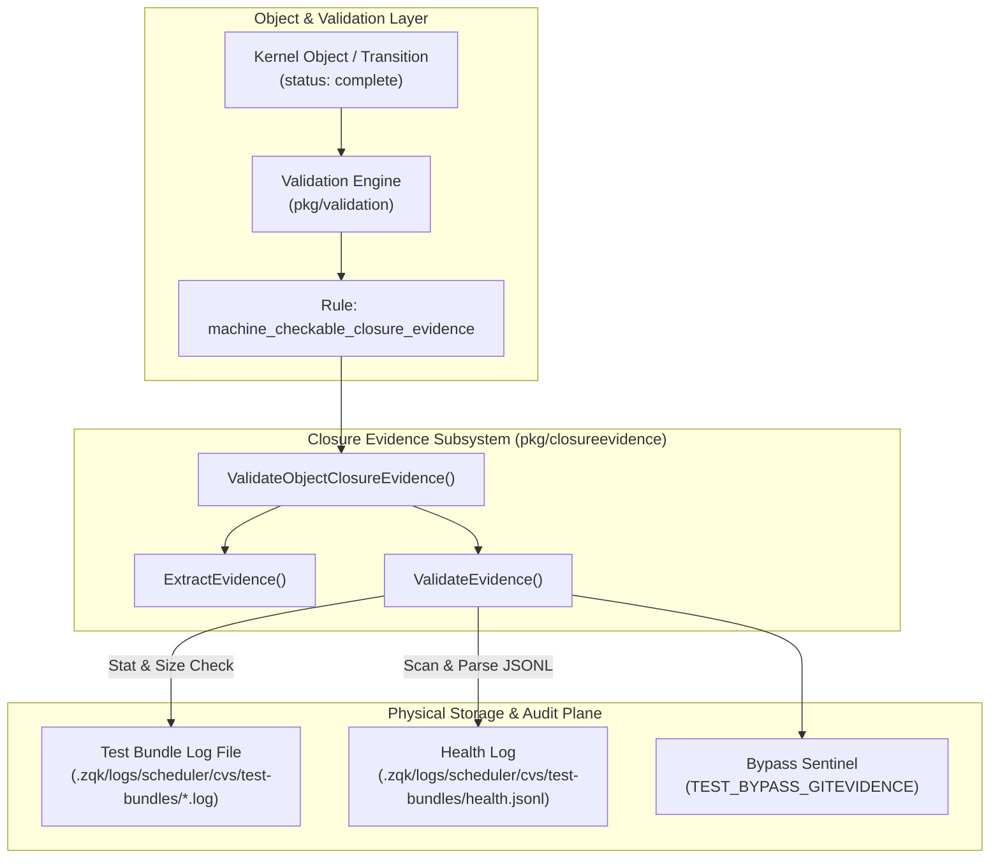
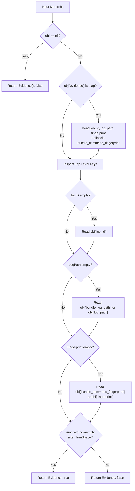
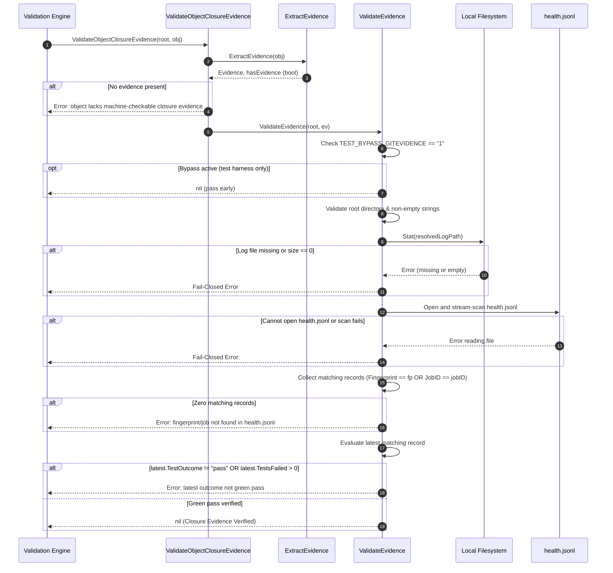

# Object Closure Gate, Machine-Checkable Evidence Validation & Scheduler Health Fingerprinting Subsystem Operational Architecture Guide

## 1. Executive Architectural Summary

The **Closure Evidence Gate & Machine-Checkable Evidence Validation Subsystem** (`pkg/closureevidence`) provides the deterministic, fail-closed verification membrane governing object completion and status transitions within the **ZQK Knowledge Kernel**.

In multi-agent collaborative workflows and automated delivery pipelines, asserting that work is "complete" cannot rely upon subjective narrative, unverified claims, or LLM hallucination. Under core governance policies and the Verifiable Delivery Standard:

> *"Done requires machine-checkable evidence; narrative is never a gate."*

The `pkg/closureevidence` subsystem enforces this principle at the data and validation planes. Whenever an object (such as a backlog item or execution task) attempts to transition into `status: complete`, the validation engine invokes the closure evidence gate (`machine_checkable_closure_evidence`). Transition is rejected unless the object presents immutable, verifiable proof consisting of:
1. A valid, non-empty **Scheduler Job Identifier** (`job_id`).
2. An existing, non-empty **Test Bundle Execution Log** (`log_path`) persisted on disk.
3. A matching **Bundle Command Fingerprint** recorded in the append-only scheduler health log (`health.jsonl`) whose latest run attests to a green outcome (`test_outcome == "pass"` and `tests_failed == 0`).

### Core Architectural Invariants

- **Fail-Closed Gate:** Missing fields, missing log files, empty logs, unreadable health logs, missing records, or non-zero failure counts cause immediate, fail-closed validation rejection.
- **Three-Fold Proof of Closure:** Completion requires co-verifying the job execution identity, physical log persistence, and audit log health ledger.
- **Latest Record Authoritative:** In the presence of flakes or retries, the final chronological entry for a given fingerprint or job identifier in `health.jsonl` dictates the gate verdict.
- **Safe Grandfathering:** Pre-existing objects already marked `complete` remain valid to preserve historical audit trees, while any dynamic transition into `complete` is strictly enforced.
- **Complete Test Coverage:** The subsystem maintains a static floor invariant of $\ge 85.0\%$ statement coverage, verified at $100.0\%$ statement coverage across all error branches, edge cases, and parsing paths.

---

## 2. Component Topology & Subsystem Architecture

The closure evidence subsystem bridges object state transitions in the validation plane with physical test artifacts and scheduler health telemetry:



### Data Structures & Schema Contracts

The subsystem defines two primary data contracts:

#### 1. `Evidence`
Represents the machine-checkable verification pointers bound to an object payload:
```go
type Evidence struct {
    JobID       string `json:"job_id,omitempty"`
    LogPath     string `json:"log_path,omitempty"`
    Fingerprint string `json:"fingerprint,omitempty"`
}
```

#### 2. `HealthRecord`
Represents an immutable execution record emitted by the scheduler to `.zqk/logs/scheduler/cvs/test-bundles/health.jsonl`:
```go
type HealthRecord struct {
    BundleCommandFingerprint string `json:"bundle_command_fingerprint"`
    EventType                string `json:"event_type"`
    JobID                    string `json:"job_id"`
    LogPath                  string `json:"log_path"`
    Package                  string `json:"package"`
    TestOutcome              string `json:"test_outcome"`
    TestsFailed              int    `json:"tests_failed"`
    Timestamp                string `json:"timestamp"`
}
```

---

## 3. Evidence Extraction and Resolution Cascades

Objects may structure closure evidence in nested or top-level representations. `ExtractEvidence(obj map[string]any)` normalizes these variations with deterministic fallback precedence:



---

## 4. Verification Lifecycles & State Transitions

When an object transitions to `status: complete`, the validation pipeline executes the sequence below:



---

## 5. Verification Invariants & Edge Case Handling

The subsystem handles all operational failure modes and boundary conditions:

### 1. Relative vs. Absolute Log Paths
Bundle log paths may be relative to the workspace root or absolute paths (e.g., when executed in ephemeral runners). The gate normalizes relative paths via `filepath.Join(repoRoot, resolvedLogPath)` while preserving absolute paths as-is.

### 2. Append-Only Log Noise Tolerance
In active swarms, `health.jsonl` may contain interleaved blank lines or malformed lines from aborted processes. The scanner safely skips blank lines and unmarshaling errors, focusing strictly on valid JSON records matching the candidate job or fingerprint.

### 3. Oversized Token Defense
The file scanner operates over line-delimited records. Lines exceeding standard scanner token limits fail closed via `scanner.Err()`, preventing unbounded buffer expansion or silent truncation.

### 4. Dual-Key Correlation
Verification matches on either `BundleCommandFingerprint == fingerprint` or `JobID == jobID`. This allows re-runs with identical command fingerprints or targeted job runs to be reconciled accurately without lock-in.

### 5. Multi-Run Retries & Flake Recovery
If an earlier test bundle run failed but was subsequently re-executed and passed, `health.jsonl` will contain multiple entries. The subsystem inspects `matchingRecords[len(matchingRecords)-1]`—the latest record is strictly authoritative. If the latest record is green with zero failures, the gate passes.

---

## 6. Production Configuration & Operational Patterns

### Environment Variables

| Variable | Description | Safe Setting | Production Invariant |
| :--- | :--- | :--- | :--- |
| `TEST_BYPASS_GITEVIDENCE` | Bypasses closure evidence validation when set to `"1"`. | Unset or `"0"` | **Strictly prohibited in production.** Only permitted in isolated unit tests where filesystem fixtures are mock-isolated. |

### Operational CLI Commands

When developing or executing tasks, closure evidence is produced automatically by the test runner and scheduler:

```bash
# Execute test bundles and record fingerprints in health.jsonl
zqk test run <test-case-id>

# Run scheduler daemon to process and record verification bundles
zqk scheduler status

# Validate object closure evidence directly via validation engine
zqk system check
```

---

## 7. Troubleshooting Matrix

| Symptom / Error | Root Cause | Remediation Procedure |
| :--- | :--- | :--- |
| `object lacks machine-checkable closure evidence` | The object lacks `job_id`, `bundle_log_path`, or `bundle_command_fingerprint` in either nested or top-level form. | Ensure the task was executed through the runner/scheduler. Attach the generated `evidence` block containing `job_id`, `log_path`, and `fingerprint`. |
| `bundle log "..." not found on disk` | The test bundle log path referenced does not exist in the working directory. | Check path relative to repository root. Ensure test execution output was preserved and not cleaned up prematurely. |
| `bundle log "..." is empty` | The test bundle log exists but has a file size of 0 bytes. | Re-run the test suite to generate complete test output. Zero-length logs are rejected as non-verifiable. |
| `cannot read health.jsonl at ...` | The scheduler health log file `.zqk/logs/scheduler/cvs/test-bundles/health.jsonl` is missing. | Run `zqk scheduler health-check` or execute a test bundle to initialize the health log directory and stream. |
| `fingerprint "..." (job "...") not found in health.jsonl` | Neither the command fingerprint nor the scheduler job ID appears in `health.jsonl`. | Verify that the tests were run under the scheduler/runner harness that emits health telemetry. Check for typos in the fingerprint. |
| `fingerprint "..." latest outcome is "fail" with N failed tests` | The latest execution recorded in `health.jsonl` resulted in a test failure or non-zero failed test count. | Fix the failing test cases and re-run the bundle. The latest record must have `test_outcome: "pass"` and `tests_failed: 0`. |
| `error reading health.jsonl: bufio.Scanner: token too long` | A single line in `health.jsonl` exceeds the 64KB token buffer limit. | Inspect `health.jsonl` for corrupted runaway lines. Truncate or rotate the log file to restore valid JSON lines. |
