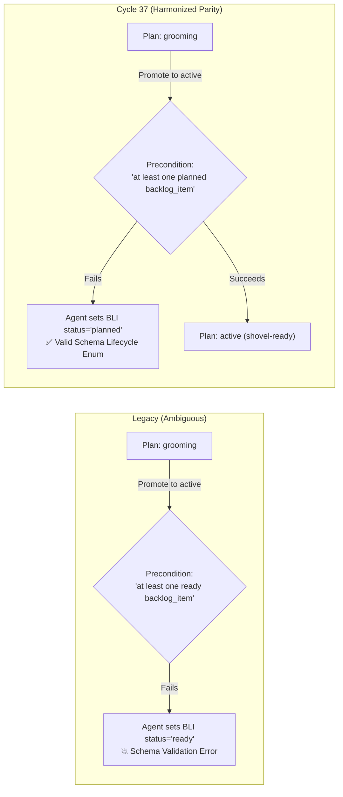
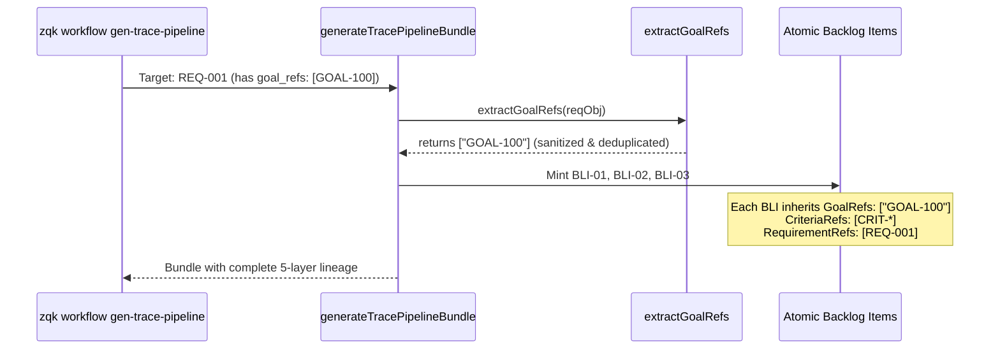

# Community Kernel Defect Remediation & Engine Hardening 

## 1. Executive Summary

During operational usage of the ZQK Knowledge Kernel, community contributors and autonomous agents identified critical edge defects and semantic vocabulary divergences in priority plan promotion validation and automated trace-pipeline generation:

1. **GH-921 (Schema Vocabulary Parity: `planned` vs. `ready`)**: A semantic mismatch existed where the priority plan lifecycle precondition string referenced conversational vocabulary (`at least one ready backlog_item`) instead of the canonical schema lifecycle status (`planned`). Autonomous agents and developers encountering promotion rejection attempted to mutate backlog items to `status: ready`, tripping schema validation errors because `ready` is a lifecycle role, not an allowed status value.
2. **GH-913 (Trace Pipeline Goal Reference Inheritance)**: When generating child backlog items and verification assets from an existing requirement via `zqk workflow gen-trace-pipeline`, the requirement's `goal_refs` were not consistently inherited by newly minted atomic backlog items. This severed downward strategic lineage between the root `goal` compass and execution-plane `backlog_item` units of effort.

This architectural guide documents the root cause analysis, structural resolutions, architectural invariants, Three-Fold Verification Proof, and operational guidance delivered in Cycle 37 under **REQ-001** and **PRI-001**.

---

## 2. Root Cause Analysis & Architectural Remediation

## 2.1 GH-921: Schema Vocabulary Parity (`planned` vs. `ready`)

#### Root Cause
In the ZQK Knowledge Kernel ontology, `backlog_item` objects traverse strict lifecycle statuses:
- `conceptual` (preliminary draft plane)
- `originated` (CAS membrane crossed)
- `planned` (shovel-ready / grooming completed, ready for assignment)
- `in_progress` (execution-locked)
- `complete` / `archived` / `rejected` (terminal)

While "shovel-ready" or "ready" is the conversational persona shorthand for items eligible for execution pickup, `ready` is **not** a valid enum value in `backlog_item_lifecycle.yaml`.

However, the lifecycle definition in `packs/work/lifecycles/priority_plan_lifecycle.yaml` and the Go validator constant previously declared:
```yaml
preconditions:
  - at least one ready backlog_item references this plan via priority_plan_ref
```
When a priority plan failed to promote from `grooming` to `active`, the engine emitted the error message citing the precondition string. Autonomous agents consuming this failure attempted `zqk object update <bli-id> --field status="ready"`, triggering immediate schema rejection (`status 'ready' is not in allowed enum list`).

#### Architectural Resolution
1. **Schema Vocabulary Alignment**: Updated `packs/work/lifecycles/priority_plan_lifecycle.yaml` and `packs/work/bldr_lifecycle_v1/priority_plan_builder.go` to explicitly enforce:
   ```yaml
   preconditions:
     - at least one planned backlog_item references this plan via priority_plan_ref
   ```
2. **Constant Modernization**: Updated `validation.PrecondReadyBacklogReferencesPlan` to `"at least one planned backlog_item references this plan via priority_plan_ref"`.
3. **Dual-Vocabulary Compatibility**: Updated `pkg/predicate/dsl.go` and `pkg/validation/go_validator_precondition_pipeline.go` to accept both the canonical `planned` token and the legacy `ready` token, ensuring zero breaking changes across historical specs while presenting clean, unambiguous guidance in compiler outputs and CLI error messages.



---

## 2.2 GH-913: Trace Pipeline `goal_refs` Lineage Inheritance

#### Root Cause
When executing `zqk workflow gen-trace-pipeline` against a requirement target (`REQ-*`), the pipeline generator (`generateTracePipelineBundle`) is responsible for establishing a 3-facet verification spine:
- 3 orthogonal criteria (`Functional Acceptance`, `Boundary & Error Handling`, `Documentation Verification`)
- 1 unified test case
- 3 atomic backlog items satisfying each criterion

Historically, `generateAtomicBacklogItems` only extracted `goal_refs` when `targetID` started with `"GOAL-"`. For requirements, `obj[FieldKeyGoalRefs]` was ignored or failed to handle heterogeneous serialization types (e.g. `[]string`, `[]any` from YAML decoding, comma-delimited string annotations, or singular `goal_ref` attributes). Consequently, the newly synthesized `backlog_item` objects were minted with empty `goal_refs: []`, severing the 5-layer cascade (Vision → Goal → Priority Plan → Requirement/Criteria → Backlog Item).

#### Architectural Resolution
Cycle 37 introduced `extractGoalRefs(obj map[string]any) []string` into `cmd/zqk/workflow/gen_trace_pipeline.go`:
- **Heterogeneous Type Ingestion**: Dynamically unpacks `[]string`, `[]any`, and comma-separated string scalar fields (`goal_refs` or singular `goal_ref`).
- **Whitespace Sanitization & Deduplication**: Trims leading/trailing whitespace, rejects nil/empty/`<nil>` tokens, and ensures unique ID entries.
- **Neighbor Fallback**: If the requirement object payload in memory omits `goal_refs`, the pipeline resolves incoming neighbors in `criteriaNeighbors` without triggering repo write guards during hermetic test execution.
- **Lineage Preservation**: Every generated atomic backlog item now explicitly carries the inherited `goal_refs` of its parent requirement.



---

## 3. Architectural Invariants

Cycle 37 enforces four non-negotiable architectural invariants:

1. **Schema Vocabulary Invariant**: All lifecycle preconditions, state machine descriptions, and validation rules must use exact schema status enums (`planned`, `in_progress`, `complete`). Semantic roles (`shovel_ready`, `execution_locked`) remain metadata and must not be used as literal status constraints in error messages.
2. **Lineage Cascade Invariant**: Downward-generated execution objects (BLIs) must preserve transitive references to root strategic anchors (`goal_refs`) declared on their parent requirements.
3. **Hermetic Test Isolation Invariant (POL-CODE-007 & Repo Write Guard)**: File system inspections and mutations during test suites must exclusively use `pkg/utils/fileutil` with zero raw `os.*` filesystem calls, and memory generators must never initialize live disk WAL storage (`storage.GetFileObjectStorage`) inside unit test runners without isolated testroots.
4. **Concurrency Safety Invariant (POL-CONCURRENCY)**: All background tasks, verifiers, and test workers must be supervised by `goroutinelabels.NewGoroutine` with explicit names and descriptions. Zero unmanaged goroutines are permitted.

---

## 4. Three-Fold Verification Proof

Verification of Cycle 37 is formalized in `pkg/community/defect_remediation_cycle37_test.go` conforming to the Three-Fold Verification standard:

| Verification Facet | Test Identifier | Target Invariant & Coverage |
| :--- | :--- | :--- |
| **Static Floor Invariant** | `TestDefectRemediationCycle37_StaticFloorInvariant` | Validates that `priority_plan_lifecycle.yaml`, `priority_plan_builder.go`, and `validation.PrecondReadyBacklogReferencesPlan` explicitly specify `planned`. Verifies predicate DSL compilation and `GoValidator` token recognition for both `planned` and backwards-compatible `ready`. |
| **Operational Dynamic Proof** | `TestDefectRemediationCycle37_OperationalDynamicProof` | Dynamically executes `workflow.GenerateTracePipelineBundle` across `[]string`, `[]any`, comma-delimited string, and singular `goal_ref` inputs. Confirms all generated BLIs inherit parent goal references. Proves thread safety under concurrent worker load using `goroutinelabels`. |
| **Negative Adversarial Boundary** | `TestDefectRemediationCycle37_NegativeAdversarialBoundary` | Evaluates adversarial goal reference inputs (corrupt nil values, empty strings, type mismatches, untrimmed duplicates). Verifies that priority plan promotion strictly rejects plans with 0 planned children, in-progress children, or conversational `status: "ready"` children. |

---

## 5. Operational Guidance & Runbook

### 5.1 Sealing Priority Plans for Execution
To transition a priority plan from `grooming` to `active` (shovel-ready):
1. Ensure all child backlog items have crossed into the CAS membrane and hold `status: planned`.
2. Ensure at least one persona (`PER-*`) or team configuration (`TEAM-*`) is attached.
3. Promote the plan:
   ```bash
   ./bin/zqk object promote <PRI-ID>
   ```
   > [!NOTE]
   > If the plan promotion fails with `precondition failed: at least one planned backlog_item references this plan`, inspect your backlog items and ensure their status is `planned`. Do NOT set status to `ready`.

### 5.2 Scaffolding Traceability with Goal Preservation
When creating or generating traceability for an existing requirement:
```bash
./bin/zqk workflow gen-trace-pipeline --id <REQ-ID>
```
The command automatically inherits the requirement's `goal_refs` onto the generated backlog items, links the unified test case, and binds the three canonical criteria facets.

### 5.3 Test Suite Execution
Execute the dedicated Cycle 37 test suite with race detection enabled:
```bash
go test -v -race ./pkg/community -run TestDefectRemediationCycle37
```
