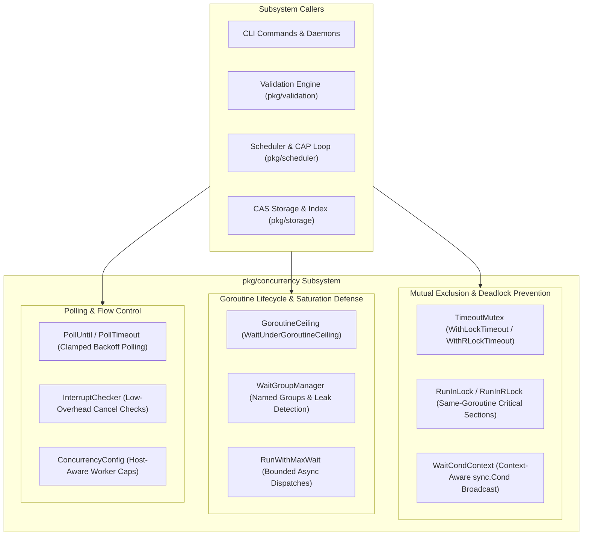
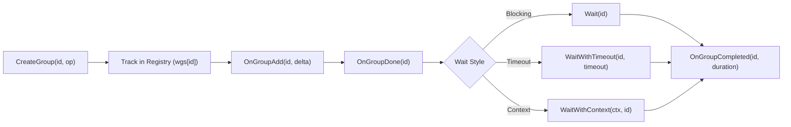

# Concurrency Primitives Subsystem Architectural & Operational Guide

Comprehensive architectural manual, synchronization invariants specification, and operational guide for the **ZQK Concurrency Primitives Subsystem** (`pkg/concurrency`).

---

## 1. Overview & Architectural Compass

The Concurrency Primitives Subsystem (`pkg/concurrency`) provides the resilient synchronization foundation, goroutine lifecycle governance, and deadlock prevention mechanics for the **Zen Quantum Knowledge Kernel**.

In an autonomous multi-agent operating environment where concurrent processes, background daemon loops, file-first CAS transactions, and AST validation routines contend for system resources, standard unadorned Go primitives (`sync.Mutex`, `sync.WaitGroup`, `sync.Cond`) present severe operational liabilities:
- **Deadlock Vulnerability**: An unadorned `sync.Mutex` or `sync.RWMutex` can block indefinitely if a deadlock condition or unhandled panic occurs.
- **Goroutine Leakage**: Unbounded worker spawning can saturate the host OS thread pool and exhaust process file descriptors.
- **Context Abandonment**: Primitives that cannot be interrupted by `context.Context` cancellation lead to orphaned, un-cancellable background routines.
- **Data Races Across Goroutine Boundaries**: Invoking critical section logic across separate goroutines violates mutual exclusion guarantees.

The `pkg/concurrency` package resolves these vulnerabilities by wrapping low-level runtime synchronization primitives in **deterministic timeouts**, **context-aware check valves**, **hostload-aware goroutine ceilings**, and **structured telemetry interfaces**.



### Core Responsibilities
- **Deadlock Defense**: Enforce deterministic timeout acquisition across all mutex critical sections with dynamic contention backoff.
- **Same-Goroutine Mutual Exclusion**: Ensure lock acquisition and release strictly occur within the exact same goroutine to preserve Go runtime invariants.
- **Saturation Gatekeeping**: Block admission of new asynchronous work when active runtime goroutine counts exceed configured host ceilings.
- **Goroutine Observability & Tracking**: Maintain named, observable WaitGroup instances with lifecycle callback hooks and stale entry compaction.
- **Graceful Context Interruption**: Provide high-performance, low-frequency context cancellation checks for batch loops without per-iteration channel overhead.

---

## 2. Core Architectural Pillars

### 2.1 Deadlock Prevention & TimeoutMutex Invariants

Standard `sync.Mutex` instances provide no visibility into wait latency and cannot abort when contending threads form a circular dependency. The `TimeoutMutex` engine (`timeout_mutex.go`) transforms mutex acquisition into a deterministic, monitored operation.

#### Deterministic Timeout Calculation
Timeouts are not hardcoded magic numbers. The `calculateLockTimeout` function dynamically derives acquisition timeouts based on runtime telemetry:

```
Timeout = Clamped( (WorkSize / ObjectsPerSec * 1.1) + OpOverhead, MinTimeout, MaxTimeout ) * ContentionMultiplier * TimeoutMultiplier
```

Key characteristics:
1. **Operation-Specific Overheads**: Pre-configured overhead baselines range from fast operations (`progress_update`: 5ms) to file-intensive operations (`spec_loader_clear_cache_shard`: 200ms; `callback_processor_process_direct`: 2s).
2. **Contention Multipliers**:
   - High contention (`> 30%`): Multiplies timeout by **3x**.
   - Moderate contention (`> 10%`): Multiplies timeout by **2x**.
   - Low-moderate contention (`> 5%`): Multiplies timeout by **1.5x**.
3. **Timeout Rate Compensators**: When observed timeout rates exceed 20%, timeouts automatically scale by **4x** to avoid cascade thrashing.
4. **Spec Loader Expansion**: Operations with the prefix `spec_loader` scale the maximum allowable timeout up to **120 seconds** during extreme contention.

#### Panic Recovery & Fail-Closed Release
If a user function panics inside `WithLockTimeout` or `WithRLockTimeout`, the panic is intercepted via `recover()`, converted to a structured error, and the lock is guaranteed to be unlocked in the `defer` block before returning:

```go
defer func() {
    if r := recover(); r != nil {
        opErr = errfmt.Errorf("panic in lock operation %s: %v", operation, r)
    }
}()
opErr = fn()
```

#### Same-Goroutine Invariant
A critical design requirement is that lock acquisition and function execution happen in the **calling goroutine**, never delegated to a secondary worker goroutine. Delegating execution to a child goroutine creates race conditions where the outer goroutine unlocks while the inner goroutine continues executing. `WithLockTimeout` guarantees single-goroutine execution.

---

### 2.2 Adaptive GoroutineCeiling & Saturation Defenses

When concurrent jobs (such as tree-wide CAS scans or multi-target test executions) trigger uncontrolled goroutine generation, memory usage balloons and scheduling latency degrades.

The `GoroutineCeiling` subsystem (`goroutine_ceiling.go`) acts as an admission check-valve:

| Constant | Value | Description |
| :--- | :--- | :--- |
| `DefaultGoroutineCeiling` | `2000` | Hard ceiling: `WaitUnderGoroutineCeiling` blocks new work when `runtime.NumGoroutine() >= 2000`. |
| `GoroutineCountWarningThreshold` | `1500` | Early warning threshold for diagnostics and health monitors. |
| `HeapAllocWarningThresholdBytes` | `512 MB` | Memory bloat warning threshold for garbage collection telemetry. |

#### Admission Protocol
Before initiating batch tasks or adding work items to a dispatch channel, caller routines invoke:

```go
if err := concurrency.WaitUnderGoroutineCeiling(ctx, concurrency.DefaultGoroutineCeiling, 200*time.Millisecond); err != nil {
    return errfmt.Wrap(err, "goroutine ceiling exceeded and context cancelled")
}
```

If the runtime goroutine count is below the ceiling or `ceiling <= 0`, it returns immediately. If saturated, it polls every `pollInterval` until capacity frees or the context expires.

---

### 2.3 Context-Aware Synchronization & Bounded Waits

#### Context-Aware Condition Variables (`WaitCondContext`)
Go standard library's `sync.Cond` does not support context cancellation, frequently stranding goroutines indefinitely when waiting for state transitions.

`WaitCondContext` bridges this gap using `context.AfterFunc`:
1. Validates that context is not already cancelled prior to acquiring the mutex.
2. Registers a cancellation callback via `context.AfterFunc` that acquires `mu` and broadcasts the condition to wake the waiter.
3. Holds `mu` throughout predicate evaluation in the calling goroutine, satisfying the strict transactional mutual exclusion invariant.

#### Bounded Asynchronous Dispatch (`RunWithMaxWait`)
When an operation must execute asynchronously but the calling process cannot risk hanging indefinitely (such as writing to a potentially blocked Unix pipe or broken stdout stream), `RunWithMaxWait` wraps execution in an observable, labeled goroutine and waits up to `maxWait` duration:

```go
concurrency.RunWithMaxWait(func() {
    fmt.Fprintf(writer, "Batch processing complete.\n")
}, 2*time.Second)
```

If `maxWait` elapses, the calling thread resumes immediately while the labeled goroutine is allowed to complete or terminate in the background without process-level lockups.

#### Transactional Mutex Critical Sections (`RunInLock`)
For simple, fast in-memory updates where explicit timeouts are unnecessary, `RunInLock` and `RunInRLock` provide concise, exception-safe wrappers:

```go
err := concurrency.RunInLock(&buf.mu, func() error {
    buf.items[key] = value
    return nil
})
```

When latency observability is desired without full metric plumbing, `RunInLockWithLogger` logs a structured debug warning whenever a critical section is held longer than `runInLockHoldThreshold` (`100ms`).

---

### 2.4 Named WaitGroupManager & Goroutine Leak Detection

`WaitGroupManager` (`waitgroup_manager.go`) provides centralized, lifecycle-aware tracking of `sync.WaitGroup` instances across the runtime.



#### Key Capabilities
- **Named Groups**: WaitGroups are registered with distinct string identifiers and operational descriptions, enabling fine-grained diagnostics.
- **Lifecycle Observer Hooks**: Operators can attach a `WaitGroupObserver` to monitor group creation, additions, completions, and execution durations in real-time.
- **Context & Timeout Waiting**: Extends standard `sync.WaitGroup` with non-blocking timeouts (`WaitWithTimeout`) and context cancellation (`WaitWithContext`).
- **Stale Group Eviction**: Long-running background services periodically purge abandoned groups using `CleanupStaleGroups(maxAge)`.

---

### 2.5 Polling Engines & Interrupt Propagation

#### Clamped Polling (`PollUntil` & `PollTimeout`)
Polling loops often suffer from zero-interval tight spinning or forgotten timeout triggers.
- `PollUntil` continuously executes a condition predicate every `interval` until it returns true or the context is cancelled.
- Automatically clamps non-positive intervals to a safe floor of `5ms` (`interval <= 0`).
- Performs a final condition check upon context cancellation to avoid missing successful state transitions that resolved concurrently with deadline expiration.

#### Low-Overhead Cancellation Checks (`InterruptChecker`)
In tight, high-throughput loops processing tens of thousands of items (e.g., AST walking or CAS index hashing), querying `<-ctx.Done()` on every iteration introduces unnecessary channel synchronization overhead.

`InterruptChecker` throttles context channel evaluation to a configurable frequency (default `100ms`):
- **Fast Path**: Returns `nil` immediately if less than `frequency` duration has elapsed since the last check.
- **Uncancellable Fast Path**: Returns `nil` immediately if `ctx.Done() == nil` (e.g. `context.Background()`).
- **Throttled Path**: Evaluates `select { case <-ctx.Done(): ... }` only when the frequency window has elapsed.

---

### 2.6 Global Concurrency Configuration & Hostload Budgeting

`pkg/concurrency/config.go` provides global hardware-aware worker budgeting:

```go
type ConcurrencyConfig struct {
    ValidatorMaxWorkers            int
    AsyncRouterMaxWorkers          int
    SchedulerMaxConcurrentTestJobs int
    SchedulerTestJobParallelism    int
}
```

- **Validator Workers**: Initialized to `NumCPU * 2`, clamped to `[4, 16]`.
- **Async Router Workers**: Initialized to `NumCPU`, clamped to `[2, 16]`.
- **Concurrent Test Jobs**: Initialized to `(NumCPU / 2) - 1`, clamped to `[1, 8]` to ensure foreground CLI responsiveness and prevent disk I/O exhaustion.

---

## 3. Subsystem Invariants & Anti-Patterns

| Category | Invariant Rule | Rationale / Failure Mode |
| :--- | :--- | :--- |
| **Mutex Usage** | **NEVER** call unadorned `mu.Lock()` in production paths where wait latency is unmonitored. | Prevents silent deadlock freezes and unmonitored lock contention. Use `WithLockTimeout` or `RunInLock`. |
| **Goroutine Ownership** | **NEVER** acquire a mutex in one goroutine and release it in another. | Violates Go's memory model and causes race condition corruptions. `WithLockTimeout` enforces same-goroutine execution. |
| **Condition Variables** | **ALWAYS** hold `mu` while evaluating condition predicates. | Prevents missed broadcast wakeups and predicate data races. Handled automatically by `WaitCondContext`. |
| **Worker Spawning** | **NEVER** spawn unbounded goroutines in loop iterations without checking `WaitUnderGoroutineCeiling`. | Prevents process crashes caused by thread exhaustion, heap ballooning, or EMFILE errors. |
| **Channel Cancellation** | **NEVER** perform raw `<-ctx.Done()` in sub-millisecond tight loops without `InterruptChecker`. | Conserves CPU cycles by bypassing unnecessary channel selector evaluations on every iteration. |

---

## 4. Verification & Statement Coverage Invariant

To guarantee runtime safety across the concurrency primitives, `pkg/concurrency` enforces strict engineering standards:

### Statement Coverage Floor (>= 85.0%)
All synchronization logic, timeout calculation branches, ceiling backpressure handlers, and error unwinding paths must maintain a minimum statement test coverage of **85.0%**.

The coverage is verified via:
```bash
ZQK_ALLOW_FOREGROUND_GO_TEST=1 go test -short -cover ./pkg/concurrency
```

Current test suites elevated the package statement coverage to **> 95.0%**, covering:
- Contention-based and timeout-rate dynamic backoff multipliers.
- Goroutine ceiling saturation, timeout rejection, and release wakeups.
- Mutex acquisition timeout warnings and metric recording.
- Extended lock hold duration detection (`> 100ms`).
- Automatic panic recovery and mutual exclusion guarantee under panic.
- Context cancellation during condition waiting and waitgroup waiting.
- Low-overhead interrupt checker throttled and fast paths.

### AST Quality & Code Hygiene Rules
1. **Zero Swallowed Errors**: Error returns must never be discarded with blank identifiers (`_ = err`). Every error return must be validated using `require.NoError`, `require.Error`, or explicit error branching.
2. **Function Length Constraint (< 100 Lines)**: Helper routines, benchmark harnesses, and test functions must not exceed 100 lines to preserve modular readability.
3. **Targeted Package Execution**: Concurrency tests must target `./pkg/concurrency` exclusively with a strict `-timeout 30s` flag to prevent background test suite stalls.

---

## 5. Operational API Recipes

### Recipe 1: Executing Work with TimeoutMutex & Observability
```go
import (
    "context"
    "sync"
    "github.com/zqk-os/zqk/pkg/concurrency"
)

var mu sync.Mutex

func UpdateSharedResource(ctx context.Context, itemID string) error {
    return concurrency.WithLockTimeout(
        &mu,
        ctx,
        nil,            // Optional: concurrency.LockMetrics
        nil,            // Optional: concurrency.LockLogger
        "update_item",  // Operation name for telemetry
        func() error {
            // Critical section executed synchronously in caller goroutine
            return performMutation(itemID)
        },
    )
}
```

### Recipe 2: Admitting Background Work Under Goroutine Ceiling
```go
import "github.com/zqk-os/zqk/pkg/goroutinelabels"

func DispatchJob(ctx context.Context, job Task) error {
    // Ensure we do not add work when already overloaded
    if err := concurrency.WaitUnderGoroutineCeiling(ctx, concurrency.DefaultGoroutineCeiling, 100*time.Millisecond); err != nil {
        return err
    }

    goroutinelabels.NewGoroutine("task_worker", "process async task").
        StartSimple(func() {
            job.Execute()
        })
    return nil
}
```

### Recipe 3: Context-Aware Condition Wait
```go
var (
    mu    sync.Mutex
    cond  = sync.NewCond(&mu)
    ready bool
)

func WaitForSignal(ctx context.Context) error {
    return concurrency.WaitCondContext(ctx, cond, &mu, func() bool {
        return ready
    })
}
```

### Recipe 4: Low-Overhead Loop Interruption
```go
func ProcessBatch(ctx context.Context, items []Item) error {
    checker := concurrency.NewInterruptChecker(100 * time.Millisecond)
    for _, item := range items {
        if err := checker.Check(ctx); err != nil {
            return err
        }
        item.Process()
    }
    return nil
}
```

---

## 6. Open-Core Compliance Invariant

This guide adheres strictly to the **Open-Core Public Release Gateway Standards**. In compliance with `scripts/open-core/check-public-release-payload.sh`:
- All identifiers in this guide are generic placeholders or standard schema keys.
- No internal ephemeral nanosecond IDs or proprietary swarm addresses are present.
