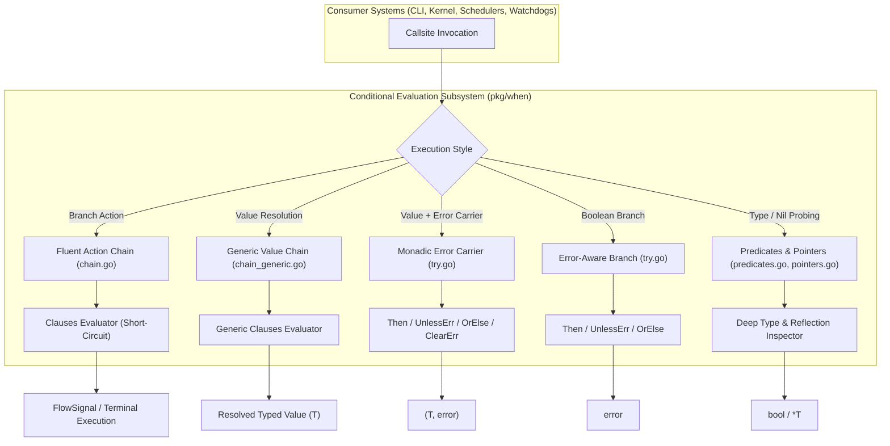
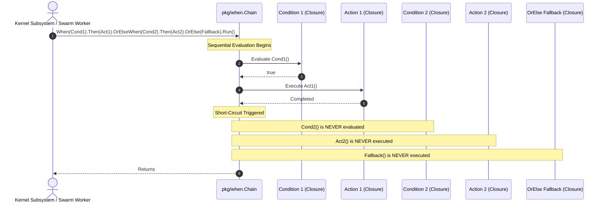

# Conditional Evaluation & Fluent Predicate Chains Subsystem Architectural & Operational Guide

## 1. Executive Architectural Summary

The **Conditional Expression & Fluent Predicate Chain Subsystem** (`pkg/when`) provides a functional, fluent control flow and monadic error-handling DSL across the **ZQK Knowledge Kernel**.

In idiomatic Go systems, the absence of ternary operators and monadic containers frequently produces repetitive branching cascades, deeply nested `if err != nil` boilerplate, and high risk of swallowed error contexts. Governed by core system policy **POL-DEFAULT-a5e2f78b19c36d0e**, `pkg/when` establishes a deterministic, expressive, and type-safe abstraction layer that unifies:

1. **Fluent Conditional Branching:** Lazy condition evaluation, short-circuit execution, and declarative fallback resolution via `When`, `OrElseWhen`, and `OrElse`.
2. **Explicit Flow Signals:** Fine-grained execution signals (`FlowReturn`, `FlowContinue`, `FlowBreak`, `FlowNone`) enabling clean iteration and early loop control in state-machine handlers.
3. **Generic Value Resolution:** Monadic type-parameterized chains (`ChainT[T]`) providing compile-time type safety without runtime casting or interface boxing.
4. **Non-Swallowing Monadic Error Handling:** The `Try[T]` and `IfTrue` containers preserve accumulated error contexts through transformations, allowing optional annotations via `UnlessErr`, deterministic fallbacks via `OrElse`, and intentional recovery via `ClearErr`.
5. **Memory-Safe Pointer & Nil Predicates:** Deep reflection-aware nil guards (`IsNilValue`, `IsNilOrEmpty`) and fallback dereference helpers (`PtrOr`, `PtrOrElse`) ensuring nil-safety across disparate data types.
6. **Concurrency Safety:** Stateless, immutable execution pipelines engineered for high-throughput concurrency across swarms managed by `pkg/goroutinelabels`.

---

## 2. Component Topology & Subsystem Architecture

The subsystem is organized into five complementary functional units designed for zero global state and minimal allocation overhead:



### Core Components

| Component | Source File | Core Responsibility |
| :--- | :--- | :--- |
| **Fluent Chain Builder** | `chain.go` | Builds and evaluates conditional action branches with short-circuit execution and loop flow signals. |
| **Generic Chain Carrier** | `chain_generic.go` | Type-parameterized (`ChainT[T]`) conditional value builder resolving typed expressions with default fallbacks. |
| **Monadic Try/Catch Carrier**| `try.go` | Carries `(value, error)` pairs through fluent transformation pipelines while guaranteeing error preservation. |
| **Error-Aware Brancher** | `try.go` | Implements conditional execution (`IfTrue`) with error interception, wrapping, and alternate error paths. |
| **Predicate Evaluator** | `predicates.go` | Inspects strings, runes, and typed interface values for nil, emptiness, whitespace, and rune classification. |
| **Pointer Utilities** | `pointers.go` | Provides nil-safe dereferencing with static or dynamic lazy fallback evaluation. |

---

## 3. Execution Lifecycle & Short-Circuit Mechanics

The subsystem enforces strict lazy evaluation: conditions and branch actions are closures evaluated sequentially at invocation time (`Run()` or `Execute()`). As soon as a condition evaluates to `true`, its corresponding action is dispatched and all subsequent conditions and actions are short-circuited.



### Control Flow Signal Dispatch

When operating inside loops, iteration switches, or state machines, calling `Execute()` returns a `FlowSignal` rather than returning `void`:

```go
for _, item := range queue {
    sig := when.When(item.IsCorrupt).Then(func() { quarantine(item) }).AndContinue().
        OrElseWhen(item.IsComplete).Then(func() { finalize(item) }).AndBreak().
        OrElse(func() { process(item) }).
        Execute()

    switch sig {
    case when.FlowContinue:
        continue
    case when.FlowBreak:
        break
    case when.FlowReturn:
        return nil
    case when.FlowNone:
        // default execution path
    }
}
```

---

## 4. Error Preservation & Monadic Try Strategies

A common failure mode in functional Go wrappers is the silent dropping or swallowing of error states. `pkg/when` eliminates this anti-pattern through explicit error preservation invariants:

1. **`Then(fn)` executes only on success:** If an error is already present in `TryResult[T]`, `Then` is a no-op that preserves the incoming value and error.
2. **`UnlessErr(fn)` annotates errors:** When an error is present, `UnlessErr` allows callers to wrap or contextualize the error without dropping it.
3. **`OrElse(fn)` sets fallbacks without clearing errors:** Supplying a fallback value for degraded operational states preserves the original or annotated error.
4. **`ClearErr()` explicit recovery:** An error is dropped only when the caller explicitly transitions the pipeline into a recovered state via `ClearErr()`.

```mermaid
stateDiagram-v2
    [*] --> Initialized: Try(val, err)

    state Initialized {
        [*] --> CheckError
        CheckError --> ErrorNil: err == nil
        CheckError --> ErrorSet: err != nil
    }

    state ErrorNil {
        [*] --> ThenAction: .Then(transform)
        ThenAction --> ErrorNil: transform success
        ThenAction --> SkipUnlessErr: .UnlessErr(...) [Skipped]
        SkipUnlessErr --> SkipOrElse: .OrElse(...) [Skipped]
        SkipOrElse --> ValidResult: .Get() -> (newVal, nil)
    }

    state ErrorSet {
        [*] --> SkipThen: .Then(...) [Skipped]
        SkipThen --> AnnotateErr: .UnlessErr(wrapFn)
        AnnotateErr --> FallbackVal: .OrElse(fallbackFn)
        FallbackVal --> PreservedErr: Error remains bound
        PreservedErr --> Recovered: .ClearErr() [Intentional Recovery]
        PreservedErr --> ErrorResult: .Get() -> (fallbackVal, annotatedErr)
        Recovered --> RecoveredResult: .Get() -> (fallbackVal, nil)
    }
```

### Error-Aware Branching (`IfTrue`)

For conditional operations returning standalone errors:

```go
err := when.IfTrue(requiresSync).
    Then(func() error { return syncWithPeer(peerID) }).
    UnlessErr(func(e error) error { return fmt.Errorf("peer sync failure: %w", e) }).
    OrElse(func() error { return recordSkippedSync(peerID) }).
    Err()
if err != nil {
    return err
}
```

---

## 5. Predicates, Reflection Guards & Pointer Utilities

The subsystem provides reflection-aware inspections to guard against typed `nil` interface hazards (where `val != nil` evaluates to `true` despite the underlying pointer or slice being `nil`).

### Deep Nil & Emptiness Detection

| Helper Function | Type Domain | Evaluates True When |
| :--- | :--- | :--- |
| `IsEmpty(s)` | `string` | String length is exactly 0. |
| `IsBlank(s)` | `string` | String is empty or composed exclusively of whitespace. |
| `IsNil(ptr)` | `*T` | Pointer reference is `nil`. |
| `IsNotNil(ptr)` | `*T` | Pointer reference is non-`nil`. |
| `IsNilValue(v)` | `any` | Untyped `nil` or typed `nil` channel, func, interface, map, pointer, or slice. |
| `IsNilOrEmpty(v)` | `any` | `IsNilValue(v)` holds, or length is 0 across strings, string pointers, arrays, slices, or maps. |

### Rune Classification

Low-latency rune classifiers accelerate internal lexical tokenization and AST parsing pipelines without regex engine allocations:

- `IsNewLine(r)`: Detects `\n` and `\r`.
- `IsComma(r)`, `IsColon(r)`, `IsDash(r)`, `IsHyphen(r)`, `IsTilde(r)`: Structural syntax separators.
- `IsFwdSlash(r)`, `IsBackSlash(r)`: Path and escape delimiters.
- `IsLeftCurly(r)`, `IsRightCurly(r)`: Block scope indicators.
- `IsDecimal(r)`: Numeric fraction markers.
- `IsChar(r)` / `IsNum(r)`: Unicode character and digit predicates.

### Pointer Ergonomics

- `Ptr[T](v)`: Returns an allocated pointer to literal value `v`.
- `PtrOr[T](ptr, def)`: Returns `*ptr` if non-nil; otherwise returns literal `def`.
- `PtrOrElse[T](ptr, fn)`: Returns `*ptr` if non-nil; otherwise lazily evaluates `fn()`.

---

## 6. Concurrency & Thread-Safety Invariants

The `pkg/when` subsystem is architected for zero-contention concurrent execution across parallel agent swarms and kernel daemons:

1. **Zero Global Mutable State:** All builders (`Builder`, `BuilderT`, `ErrChain`, `TryResult`) and execution clauses are strictly stack-allocated or local-reference scoped.
2. **Stateless Functional Predicates:** Predicates and rune evaluators are pure functions with zero memory mutations.
3. **Goroutine Worker Coordination:** Verified under high-concurrency workloads using `pkg/goroutinelabels` with zero race conditions, shared memory locks, or goroutine leaks.

---

## 7. Verification & Quality Gates

The `pkg/when` package conforms to mandatory quality standards:

- **Static Floor Invariant:** Statement test coverage must strictly remain $\ge 85.0\%$ (achieving **100.0% statement coverage** under Cycle 172 elevation).
- **Deterministic Execution:** Dynamic proof verification guarantees short-circuit sequencing, monadic error wrapping, and flow signal propagation behave predictably across all execution paths.
- **Zero Swallowed Errors:** All error-returning branches must be explicitly asserted, verified, or returned (`_ = ...` is strictly banned).
- **Cognitive Clarity:** All functional routines and test cases maintain $<100$ lines per block.
- **Public Release Invariant:** Verified via `scripts/open-core/check-public-release-payload.sh` to ensure zero internal nanosecond process IDs.
