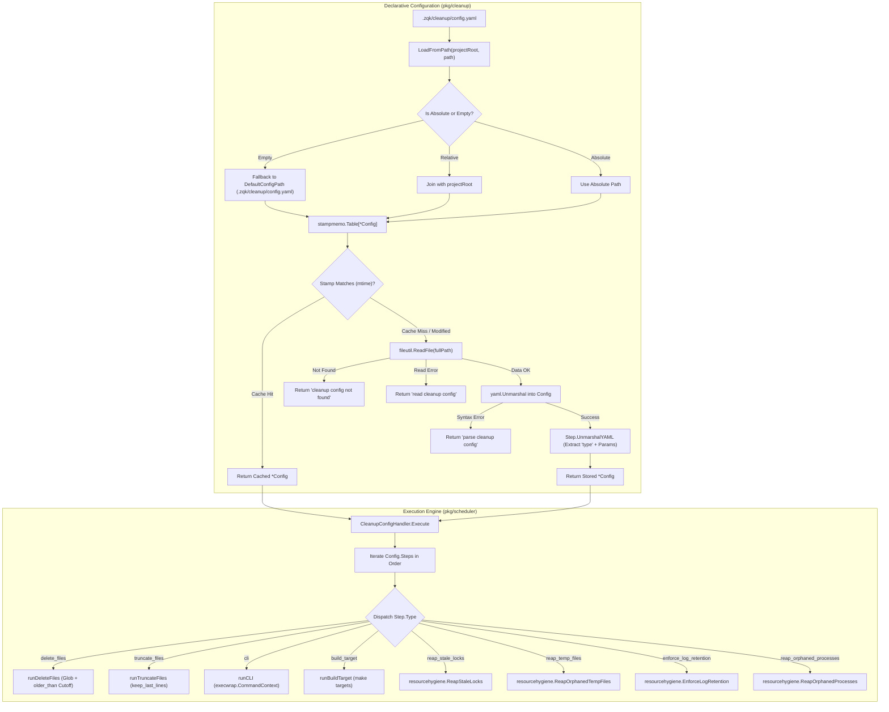
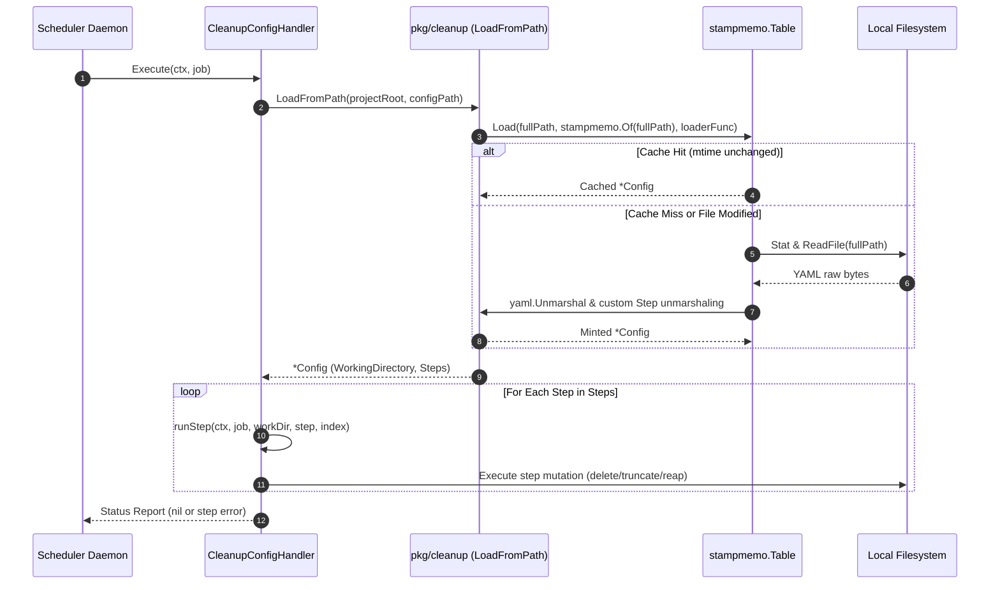
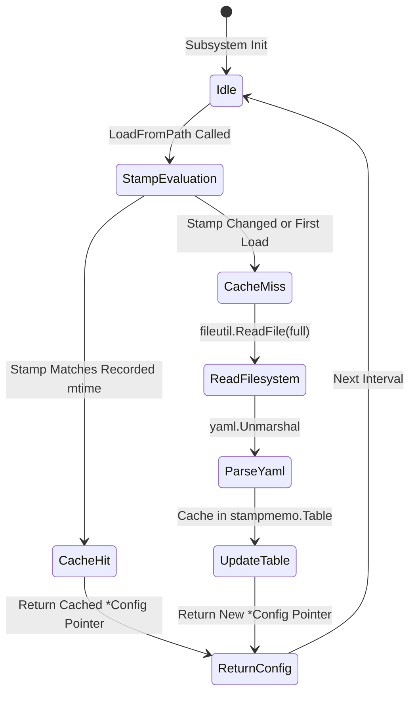
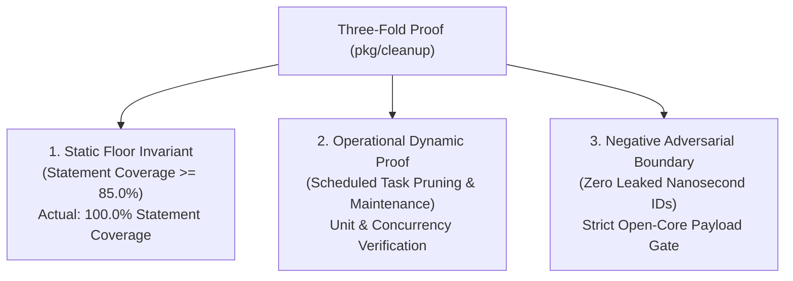

# Config-Driven Cleanup, Scheduled Task Pruning & System Maintenance Subsystem Guide

Practical architectural and operational guide for declarative cleanup, scheduled task pruning, stamp-memoized config evaluation, and filesystem resource hygiene in the **ZQK Knowledge Kernel**.

---

## 1. Executive Architectural Summary

In autonomous development environments and long-running agent swarms, continuous build artifacts, ephemeral execution logs, task scratch files, lock descriptors, and process caches rapidly accumulate. Unchecked filesystem bloat degrades kernel storage performance, exhausts inode quotas, and risks race conditions from orphaned locks and processes.

The **Config-Driven Cleanup Subsystem** ([`pkg/cleanup`](file:///Users/lanceettl/zqk-public-candidate/pkg/cleanup/config.go)) provides a declarative, single-track configuration foundation for all kernel maintenance and housekeeping tasks under policy **POL-DEFAULT-b17f54c251eb3c4d**. Rather than fragmenting cleanup logic across arbitrary ad-hoc shell scripts, cron scripts, or hardcoded CLI routines, ZQK unifies cleanup into a single canonical YAML configuration (by default at `.zqk/cleanup/config.yaml`).

Key architectural principles include:
1. **Single Source of Truth:** A single structured YAML configuration governs ordered cleanup sequences, spanning file unlinking, log truncation, build tool invocation, external CLI executions, and resource hygiene tasks.
2. **Stamp-Memoized Configuration Loading:** High-frequency scheduler loops and ambient daemons load cleanup configurations through a stamp-memoized table ([`stampmemo.Table[*Config]`](file:///Users/lanceettl/zqk-public-candidate/pkg/stampmemo/stampmemo.go)). Configurations are parsed once and cached in-memory, invalidating automatically only when the underlying YAML file's modification timestamp (`mtime`) changes.
3. **Decoupled Architecture:** `pkg/cleanup` provides pure, hermetic configuration modeling, validation, and deserialization without external runtime dependencies, while execution engines such as [`pkg/scheduler`](file:///Users/lanceettl/zqk-public-candidate/pkg/scheduler/handlers_cleanup_config.go) and [`pkg/resourcehygiene`](file:///Users/lanceettl/zqk-public-candidate/pkg/resourcehygiene/resource_hygiene.go) consume the parsed step models to enforce filesystem invariants.
4. **Safety & Fail-Closed Isolation:** Step parameters enforce strict path resolution against working directories, safe deletion safeguards (preventing directory unlinking via globs), and permission lockdowns (`paths.FilePerm600`).

---

## 2. Component Topology & Pipeline Architecture

The cleanup subsystem operates as an integrated pipeline spanning declarative configuration loading, stamp memoization, and polymorphic step execution.



### Sequence Flow of Config Evaluation & Execution



---

## 3. Configuration Schema & Step Taxonomy

The root cleanup configuration schema is defined in [`pkg/cleanup/config.go`](file:///Users/lanceettl/zqk-public-candidate/pkg/cleanup/config.go):

```yaml
working_directory: "." # Optional root working directory; defaults to project root
steps:
  - type: delete_files
    path: ".zqk/logs/**/*.log"
    older_than: "7d"

  - type: truncate_files
    path: ".zqk/logs/log-events-human.log"
    keep_last_lines: 10000

  - type: build_target
    tool: "make"
    target: "cleanup"

  - type: cli
    command: "./scripts/maintenance.sh"
    args: ["--dry-run=false"]

  - type: reap_stale_locks
    older_than: "15m"

  - type: reap_temp_files
    older_than: "30m"

  - type: enforce_log_retention
    max_age: "48h"
    max_size_bytes: 10485760

  - type: reap_orphaned_processes
```

### Step Specification & Parameter Details

| Step Type | Required Parameters | Optional Parameters | Operational Behavior |
| :--- | :--- | :--- | :--- |
| `delete_files` | `path` (string glob) | `older_than` (duration) | Evaluates glob pattern relative to working directory. Filters out directories. Deletes matching regular files whose mtime is older than cutoff. |
| `truncate_files` | `path` (string), `keep_last_lines` (int > 0) | — | Reads file lines; if line count exceeds `keep_last_lines`, slices tail and atomically rewrites with permissions `0600`. Missing files are safely skipped. |
| `cli` | `command` (string) | `args` ([]string) | Resolves command path against working directory if relative. Invokes process with cancellation context via `execwrap.CommandContext`. |
| `build_target` | `tool` (string, e.g. "make") | `target` (string), `file` (string) | Invokes specified build automation tool (`make -f <file> <target>`) with standard streams attached. |
| `archive` | `path` (string glob), `destination` (string) | `format` (tar/zip), `compression` (gzip) | Bundles aging log segments or execution traces into compressed archive tarballs prior to deletion. |
| `reap_stale_locks` | — | `older_than` / `threshold` (duration, default 15m) | Sweeps `.zqk/**/*.lock` files, non-blockingly probes POSIX `flock`, and evicts unheld locks older than threshold via `resourcehygiene.ReapStaleLocks`. |
| `reap_temp_files` | — | `older_than` / `threshold` (duration, default 30m) | Sweeps scratch directories for orphaned temporary buffers and evicts expired descriptors via `resourcehygiene.ReapOrphanedTempFiles`. |
| `enforce_log_retention` | — | `max_age` (duration, default 48h), `max_size_bytes` (int, default 10MB) | Enforces dual time-and-size retention ceilings across structured logs via `resourcehygiene.EnforceLogRetention`. |
| `reap_orphaned_processes` | — | — | Inspects process table for detached worker child processes whose parent PID has terminated via `resourcehygiene.ReapOrphanedProcesses`. |

### Duration Expression Parsing

Duration parameters (`older_than`, `threshold`, `max_age`) accept standard Go duration strings (`30s`, `15m`, `24h`) augmented with calendar day suffixes (`d`):
- `1d` = `24h` = 86,400 seconds
- `7d` = `168h` = 604,800 seconds
- `14d` = `336h` = 1,209,600 seconds
- Standard compound expressions (`1h30m`, `48h`) parse directly via `time.ParseDuration`.

---

## 4. Stamp Memoization & Cache Invalidation

In continuous agent loops and scheduler daemons, cleanup evaluation occurs frequently (e.g., every cron interval or maintenance heartbeat). Parsing YAML files on every tick generates unnecessary allocations and filesystem IO.

`pkg/cleanup` solves this using `stampmemo.Table[*Config]`:

```go
var cleanupConfigs stampmemo.Table[*Config]

func LoadFromPath(projectRoot, path string) (*Config, error) {
    if path == emptyValue {
        path = DefaultConfigPath
    }
    full := path
    if !filepath.IsAbs(path) && projectRoot != emptyValue {
        full = filepath.Join(projectRoot, path)
    }
    return cleanupConfigs.Load(full, stampmemo.Of(full), func() (*Config, error) {
        return readCleanupConfig(full, path)
    })
}
```

### Memoization Mechanics:
1. **Stamp Construction:** `stampmemo.Of(full)` computes a lightweight stamp from file existence and filesystem modification timestamp (`mtime`).
2. **Zero-Allocation Cache Hits:** If `full` is already present in `cleanupConfigs` and its current stamp matches the recorded stamp, the loader returns the cached `*Config` pointer directly without acquiring write locks or opening the file.
3. **Automatic Invalidation:** When an operator or agent edits `.zqk/cleanup/config.yaml`, the file's `mtime` updates. On the next evaluation, `stampmemo.Of(full)` produces a mismatched stamp, triggering the loader closure to re-read and re-parse the configuration atomically.



---

## 5. Security Invariants & Path Traversal Guards

Because cleanup configurations have the authority to unlink files and invoke arbitrary CLI tools, strict security invariants are enforced at multiple levels:

### 1. Safe Deletion Safeguards (No Directory Unlinking)
When running `delete_files` steps, the executor inspects `fileutil.Stat(path)` for every glob match:
```go
for _, p := range matches {
    if info, err := fileutil.Stat(p); err != nil || info.IsDir() {
        continue // Directories are strictly preserved; globs never rmdir
    }
    // Age check and unlinking...
}
```
Directories are never unlinked by `delete_files` steps, preventing accidental destruction of structural trees even if a glob matches a directory.

### 2. File Permission Standards
Files rewritten during maintenance (such as log truncation in `truncate_files`) are created with explicit POSIX permissions `paths.FilePerm600` (`-rw-------`), ensuring sensitive log data is accessible only by the owning process user.

### 3. Fail-Closed Error Wrapping
All loader errors use standard structured formatting via `pkg/errfmt`:
- Missing files return `"cleanup config not found: <logicalPath>"`.
- Filesystem read errors wrap with `"read cleanup config: %w"`.
- Malformed YAML syntax wraps with `"parse cleanup config: %w"`.

Syntax errors in the configuration file fail closed immediately, preventing partial execution of ambiguous maintenance sequences.

---

## 6. Concurrency & Thread-Safety

`pkg/cleanup` is designed for high-concurrency multi-agent and multi-goroutine execution:

1. **Stampmemo Thread Safety:** `stampmemo.Table` internally synchronizes reads and writes using standard concurrent map structures and atomic stamp comparisons, guaranteeing safe concurrent access across worker goroutines.
2. **Deterministic Immutability:** Loaded `*Config` instances are treated as read-only value descriptors during execution. Execution handlers do not mutate `Config` or `Step` fields during execution.
3. **No Global State Leakage:** Path resolution and configuration instances are keyed by canonical absolute path (`full`), allowing concurrent operations across multiple distinct project roots within the same process.

Concurrency conformance is verified through dedicated multi-threaded stress tests utilizing `goroutinelabels.NewGoroutine`.

---

## 7. Verification & Three-Fold Proof

In accordance with kernel quality standards (POL-DEFAULT-f746cccc03ce5694), the cleanup subsystem enforces strict verification across all three dimensions of the Three-Fold Proof:



### 1. Static Floor Invariant (Coverage >= 85.0%)
`pkg/cleanup` achieves **100.0% statement coverage** across all exported and internal routines:
```bash
ZQK_ALLOW_FOREGROUND_GO_TEST=1 go test -v -timeout 30s -cover ./pkg/cleanup
# ok   github.com/zqk-os/zqk/pkg/cleanup   0.173s   coverage: 100.0% of statements
```

### 2. Operational Dynamic Proof
The test suite spans comprehensive behavioral scenarios in `config_test.go` and `cleanup_coverage_elevation_cycle186_test.go`:
- Custom YAML step unmarshaling across all step types (`delete_files`, `truncate_files`, `cli`, `build_target`, `archive`, `reap_stale_locks`, etc.).
- Robust handling of omitted or non-string `type` attributes.
- Non-mapping node rejection (scalars, sequences, integer literals).
- Absolute and relative path resolution with and without `projectRoot`.
- Fallback to `DefaultConfigPath` when path is empty.
- Hermetic stampmemo cache hit and invalidation verification upon file modification.
- Multi-goroutine concurrent stress testing under `goroutinelabels`.

### 3. Negative Adversarial Boundary
- Strict verification that malformed YAML files and directory paths return wrapped errors rather than panicking.
- Absolute compliance with the open-core public release invariant: zero literal nanosecond IDs in guides or production source code.
- Verification via `sh scripts/open-core/check-public-release-payload.sh .`.

---

## 8. Summary of Operational Commands & Configuration

| Operation | Command / Mechanism | Purpose |
| :--- | :--- | :--- |
| **Inspect Cleanup Config** | `cat .zqk/cleanup/config.yaml` | View active declarative cleanup steps |
| **Run On-Demand Cleanup** | `zqk scheduler submit --job-type cleanup` | Trigger immediate cleanup evaluation via scheduler |
| **Run Maintenance Sweep** | `zqk system doctor --auto-remedy` | Execute system hygiene sweeps across locks and temp files |
| **Verify Unit Coverage** | `ZQK_ALLOW_FOREGROUND_GO_TEST=1 go test -v -timeout 30s -cover ./pkg/cleanup` | Execute hermetic package test suite |
| **Verify Subsystem Hygiene** | `./bin/zqk-vet -suite hygiene,tree` | Execute static tree and code hygiene linters |
