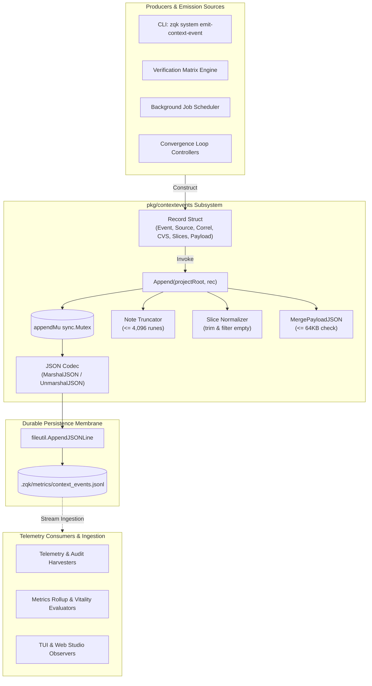
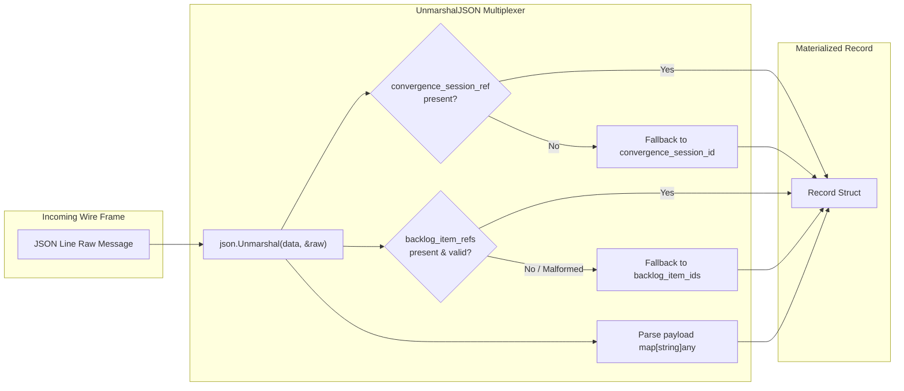
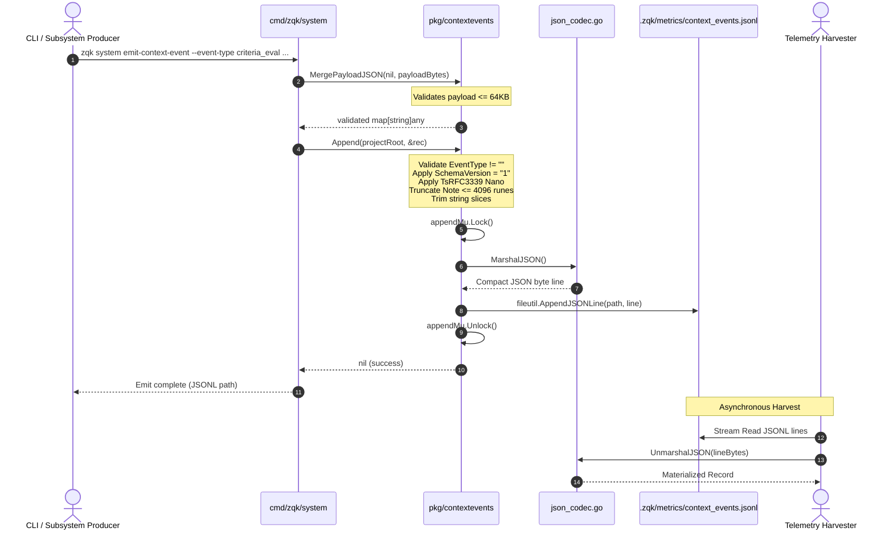

# Context Events Pipeline, Wire Event Serialization & JSON Codec Multiplexing Subsystem Operational Architecture Guide

## 1. Executive Architectural Summary

The **Context Events Pipeline and Wire Codec Subsystem** (`pkg/contextevents`) provides append-only, line-delimited JSON (JSONL) durable signaling across the ZQK Knowledge Kernel execution plane (POL-OBS-001). While transient, high-frequency in-process pub/sub event fan-out is delegated to `pkg/coordination` and `pkg/events`, `pkg/contextevents` represents the canonical **durable evidence pathway** persisted under `.zqk/metrics/context_events.jsonl`.

This subsystem captures lightweight inter-subsystem context signals—including verification matrix outcomes, criteria assertions, convergence session snapshots, job scheduler telemetry, and operator diagnostic notes. By coupling strict schema validation, defensive rune/byte sizing bounds (4,096-rune note truncation, 64KB payload ceiling), thread-safe serialized write operations, and backwards-compatible JSON codec multiplexing, `pkg/contextevents` ensures resilient, uncorrupted, and auditable event streams across multi-agent swarms and CLI execution harnesses.

---

## 2. Component Topology & Subsystem Architecture

The subsystem spans core primitives within `pkg/contextevents` and interfaces directly with the CLI system commands:

1. **Storage Membrane & Path Resolver (`ContextEventsJSONLPath`):** Encapsulates the canonical filesystem path resolution for `.zqk/metrics/context_events.jsonl` within the project root.
2. **Append-Only Pipeline Core (`Append`):** Enforces static floor invariants, normalizes slice collections, truncates diagnostic notes, applies UTC RFC3339 timestamps, and serializes concurrent appends via package-level mutex locking.
3. **Payload Merger & Memory Boundary (`MergePayloadJSON`):** Validates raw JSON byte slices against a strict 64KB capacity ceiling (`payloadJSONMaxBytes = 65536`), merging object keys into existing destination maps safely.
4. **Wire Serialization & Demultiplexing Codec (`MarshalJSON` / `UnmarshalJSON`):** Aligns JSON object keys with canonical domain ontology field constants (`objects.FieldKey*`) while transparently decoding legacy wire keys (`backlog_item_ids`, `convergence_session_id`).



---

## 3. Interface & Contract Specifications

The subsystem exports a minimal, highly robust functional API:

```go
// Path and Default Constants
const (
    SchemaVersionV1  = "1"
    DefaultSourceCLI = "cli"
)

// Sentinel Error Indicators
var (
    ErrPayloadTooLarge = errors.New("payload: JSON exceeds max size")
    ErrEmptyEventType  = errors.New("event_type: required")
)

// Canonical Context Event Record
type Record struct {
    TsRFC3339             string
    SchemaVersion         string
    EventType             string
    Source                string
    CorrelationID         string
    JobID                 string
    Note                  string
    CriteriaRefs          []string
    BacklogItemRefs       []string
    ConvergenceSessionRef string
    Payload               map[string]any
}

// Subsystem API Primitives
func ContextEventsJSONLPath(projectRoot string) string
func Append(projectRoot string, rec *Record) error
func MergePayloadJSON(dst map[string]any, raw []byte) (map[string]any, error)
```

### Key Behavioral Contracts

1. **`ContextEventsJSONLPath(projectRoot)`**:
   - Returns empty string `""` when `projectRoot` is empty.
   - Resolves to `<projectRoot>/.zqk/metrics/context_events.jsonl` utilizing standardized paths from `pkg/paths`.
2. **`Append(projectRoot, rec)`**:
   - Graceful No-Op: Returns `nil` immediately when `projectRoot == ""` or `rec == nil`.
   - Invariant Gate: Fails closed returning `ErrEmptyEventType` when `EventType` is empty or composed exclusively of whitespace.
   - Defaults Seeding: Automatically applies `SchemaVersionV1` if unpopulated, and assigns current UTC timestamp in `time.RFC3339Nano` format if `TsRFC3339` is absent.
   - Memory & String Boundaries: Truncates `Note` to a maximum of 4,096 Unicode runes.
   - Slice Hygiene: Cleanses leading/trailing whitespace from slice elements (`CriteriaRefs`, `BacklogItemRefs`) and strips empty strings. If all entries are empty, normalizes slice reference to `nil`.
   - Concurrency Serialization: Guards target file writes using package-level `sync.Mutex` (`appendMu`) to prevent interleaved line fragments.
3. **`MergePayloadJSON(dst, raw)`**:
   - Returns existing `dst` unmodified when `len(raw) == 0` or input consists purely of whitespace.
   - Enforces a strict 64KB boundary (`payloadJSONMaxBytes = 65536`), returning `ErrPayloadTooLarge` without mutating `dst`.
   - Deserializes into a newly allocated map when `dst == nil`.
   - Overwrites existing keys with incoming JSON keys idempotently.

---

## 4. Wire Format & JSON Codec Multiplexing Invariants

The wire protocol enforces rigorous alignment between runtime structs and the persistent JSONL representation.

### Field Key Mapping Matrix

| Record Struct Field | Wire JSON Key Constant | Source Origin | Omission Invariant |
| :--- | :--- | :--- | :--- |
| `TsRFC3339` | `"ts_rfc3339"` | `WireTsRFC3339` (POL-OBS-001) | Mandatory in wire output |
| `SchemaVersion` | `"schema_version"` | `objects.FieldKeySchemaVersion` | Mandatory in wire output (`"1"`) |
| `EventType` | `"event_type"` | `objects.FieldKeyEventType` | Mandatory in wire output |
| `Source` | `"source"` | `objects.FieldKeySource` | Omitted if empty |
| `CorrelationID` | `"correlation_id"` | `WireCorrelationID` | Omitted if empty |
| `JobID` | `"job_id"` | `WireJobID` | Omitted if empty |
| `Note` | `"note"` | `objects.FieldKeyNote` | Omitted if empty |
| `CriteriaRefs` | `"criteria_refs"` | `objects.FieldKeyCriteriaRefs` | Omitted if empty or nil |
| `BacklogItemRefs` | `"backlog_item_refs"` | `objects.FieldKeyBacklogItemRefs` | Omitted if empty or nil |
| `ConvergenceSessionRef` | `"convergence_session_ref"` | `objects.FieldKeyConvergenceSessionRef` | Omitted if empty |
| `Payload` | `"payload"` | `objects.FieldKeyPayload` | Omitted if empty or nil |

### Backwards-Compatible Multiplexing & Legacy Demultiplexing

To guarantee continuous telemetry ingestion during rolling upgrades across different versions of ZQK agents and tools, `UnmarshalJSON` implements fault-tolerant multiplexing:

- **Convergence Session Reference:** Reads `"convergence_session_ref"`; if empty or missing, falls back to legacy `"convergence_session_id"`.
- **Backlog Item References:** Evaluates `"backlog_item_refs"`; if missing or malformed, falls back to legacy `"backlog_item_ids"`.
- **Null Safety:** Safely consumes explicit JSON `null` values across string, slice, and object fields without panic or type conversion exceptions.



---

## 5. Event Publishing & Subscriber Ingestion Dynamics

The following sequence details an operational context event being emitted via the CLI, marshaled through `pkg/contextevents`, written to disk, and consumed by audit observers.



---

## 6. CLI Ergonomics & Operational Recipes

Operators and autonomous subagents can emit and inspect context events using standard CLI invocations.

### Emitting Context Events via CLI

```bash
# 1. Emit a basic criteria evaluation signal with correlation
zqk system emit-context-event \
  --event-type criteria_verified \
  --source "qa_runner" \
  --corr "run-9842" \
  --criteria "crit-perf-floor,crit-zero-leak" \
  --note "Automated static verification passed with zero leaks"

# 2. Emit an event bound to a convergence session and backlog item
zqk system emit-context-event \
  --event-type iteration_checkpoint \
  --source "tpm_orchestrator" \
  --cvs "cvs-session-42" \
  --bli "bli-refactor-worker" \
  --payload-json '{"iteration": 3, "remaining_tasks": 0, "status": "nominal"}'

# 3. Emit a job scheduler diagnostic event
zqk system emit-context-event \
  --event-type scheduler_job_completed \
  --job "job-nightly-vet" \
  --source "scheduler" \
  --payload-json '{"duration_ms": 1420, "exit_code": 0}'
```

### Inspecting Context Events

```bash
# Tail the active context events stream
tail -n 20 .zqk/metrics/context_events.jsonl | jq .

# Filter events by event type
jq 'select(.event_type == "criteria_verified")' .zqk/metrics/context_events.jsonl

# Correlate events belonging to a specific session
jq 'select(.convergence_session_ref == "cvs-session-42")' .zqk/metrics/context_events.jsonl
```

---

## 7. Operational Troubleshooting Matrix

| Symptom / Error | Root Cause | Impact | Recommended Remediation |
| :--- | :--- | :--- | :--- |
| `event_type: required` | Invocations provided an empty string or whitespace only for `EventType`. | Call fails closed without appending. | Ensure `--event-type` is supplied and contains non-whitespace identifiers. |
| `payload: JSON exceeds max size` | Supplied payload exceeds `payloadJSONMaxBytes` (64KB). | Mutation rejected without altering state. | Compress payload, strip binary blobs, or log summarized metrics rather than raw outputs. |
| Malformed JSON error on merge | Input to `MergePayloadJSON` contains unparseable syntax. | Parse error propagated to caller. | Validate JSON formatting prior to invocation using `jq` or schema linters. |
| Notes truncated unexpectedly | Note parameter exceeded 4,096 Unicode runes. | Data beyond 4,096 runes discarded gracefully. | Store verbose output in dedicated artifact files and record relative file path in the note or payload. |
| Concurrency lock delays on append | Extremely high emission contention on `.zqk/metrics/context_events.jsonl`. | Minor latency in thread serialization. | Expected behavior under `appendMu` to prevent interleaved line corruption; use asynchronous workers if non-blocking operation is required. |
| Unrecognized legacy fields | Ingestion from older writers containing `backlog_item_ids`. | None (automatically demultiplexed). | Verify consumer unmarshals through `pkg/contextevents.Record` which natively supports legacy fallbacks. |

---

## 8. Verification & Continuous Testing Invariants

The `pkg/contextevents` package is maintained under strict continuous verification invariants:

- **100.0% Statement Coverage Floor:** All conditional branches, fallback unmarshaling paths, string slice trimmers, note rune truncations, and boundary limits are verified.
- **Race Condition Immunity:** Verified under high concurrency using `go test -race` across concurrent worker pools.
- **Open-Core Payload Integrity:** Strictly free of literal nanosecond kernel IDs, maintaining full compliance with open-core redistribution standards.
