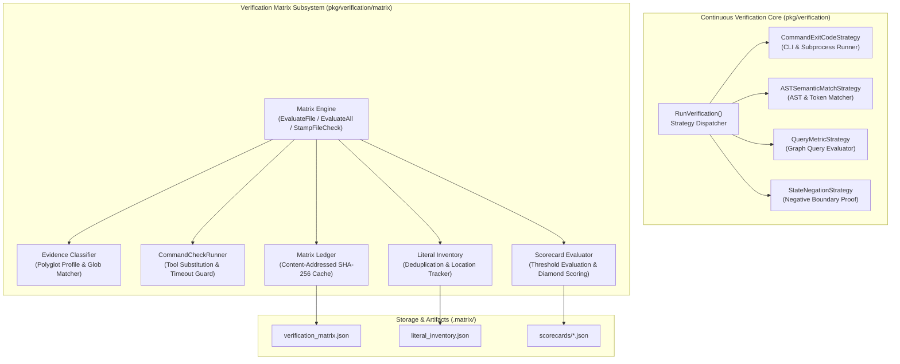
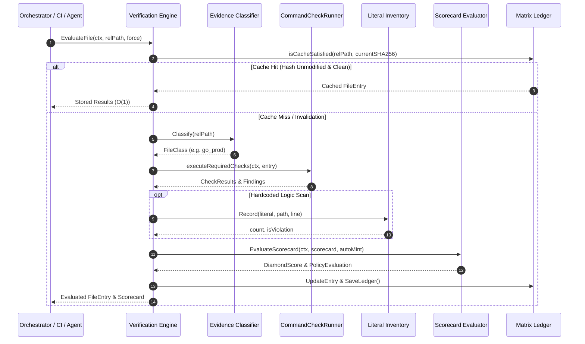

# Continuous Verification Engine, Matrix Scorecard & Evidence Classification Subsystem Operational Architecture Guide

## 1. Executive Architectural Summary

The **Continuous Verification Engine, Matrix Scorecard & Evidence Classification Subsystem** (`pkg/verification` and `pkg/verification/matrix`) provides the machine-verifiable, objective validation foundation for the **ZQK Knowledge Kernel**.

In modern software delivery and autonomous multi-agent environments, quality claims frequently suffer from subjective developer optimism, transient test flakiness, and narrative inflation. Under core governance policy **POL-DEFAULT-142277d3**:

> *"Done means re-runnable predicate evidence; narrative is never a gate."*

The continuous verification subsystem operationalizes this principle by providing an objective, blind validation harness that evaluates software artifacts against strict mechanical proofs rather than conversational assurances. The subsystem unifies four universal verification strategies alongside a content-addressed verification matrix that tracks file classifications, literal duplication inventories, and multi-dimensional diamond quality scorecards.

### Core Architectural Principles

1. **Blind Verification Execution:** Verification strategies evaluate code artifacts independently of the agent or developer claiming completion. Strategies evaluate commands, AST structures, database graph queries, and system state negations without contextual bias.
2. **Universal Verification DSL:** Verification rules declare declarative execution strategies:
   - `command_exit_code`: Executes external shell commands and linters, verifying zero-exit status and capturing diagnostic output.
   - `ast_semantic_match`: Walks Go syntax trees and filesystem hierarchies to detect forbidden patterns, banned imports, or missing AST annotations.
   - `query_metric`: Executes Cypher-like pattern queries across the Knowledge Kernel graph, evaluating count and metric thresholds against relational boundaries.
   - `state_negation`: Verifies that invalid states (such as orphaned tasks or failed prerequisites) do not exist within persistent storage.
3. **Content-Addressed Verification Matrix:** Tracks evaluation records across file content SHA-256 hashes. If file contents remain unmodified, verification results are retrieved in $\mathcal{O}(1)$ time without redundant test or linter execution.
4. **Global Literal Inventory & Deduplication:** Extracts string literals repository-wide, enforcing deduplication policies ($\le 1$ unique occurrence allowed globally for magic constants) to eliminate hardcoded logic.
5. **Multi-Dimensional Diamond Scoring:** Evaluates findings across seven standard quality dimensions, mapping critical errors, warnings, and violations to an objective 1-to-5 diamond rating scale.
6. **Elevated Test Coverage Invariant:** The subsystem enforces a strict statement test coverage invariant ($\ge 85.0\%$, verified at $93.9\%$ in `pkg/verification` and $92.3\%$ in `pkg/verification/matrix`).

---

## 2. Component Topology & Subsystem Architecture

The subsystem consists of two primary packages working in tight coordination: `pkg/verification` (the core execution engine and universal DSL strategies) and `pkg/verification/matrix` (the content-addressed matrix, polyglot classifier, and scorecard evaluator):



### Subsystem Component Breakdown

| Component | Package | Primary Responsibility |
| :--- | :--- | :--- |
| `RunVerification` | `pkg/verification` | Blind router dispatching verification steps to registered strategies. |
| `CommandExitCodeStrategy` | `pkg/verification` | Executes subprocess commands with repository root resolution and environment propagation. |
| `ASTSemanticMatchStrategy` | `pkg/verification` | Walks filesystem trees and evaluates Go source code against forbidden token patterns. |
| `QueryMetricStrategy` | `pkg/verification` | Queries object storage via Cypher expressions, asserting metric count thresholds. |
| `StateNegationStrategy` | `pkg/verification` | Queries storage to verify that zero objects exist in an invalid or failing state. |
| `Engine` | `pkg/verification/matrix` | Coordinates file evaluation, check stamping, ledger persistence, and cache invalidation. |
| `Classifier` | `pkg/verification/matrix` | Classifies source files into language and structural classes (`go_prod`, `go_test`, `script`, `config`, `docs`, `other`). |
| `CommandCheckRunner` | `pkg/verification/matrix` | Executes external linters or analysis tools with file path substitutions and bounded timeouts. |
| `LiteralInventory` | `pkg/verification/matrix` | Tracks string literals across the codebase, flagging duplication violations. |
| `FileScorecard` | `pkg/verification/matrix` | Records findings, calculates diamond scores, formats markdown reports, and coordinates auto-minted remediations. |

---

## 3. Verification Execution Lifecycle

The verification execution lifecycle proceeds through six deterministic phases, ensuring complete isolation and reproducible evaluation:



### Lifecycle Stage Details

1. **Target Resolution & SHA-256 Hashing:** The engine verifies that the requested target exists on disk and is a regular file. It computes the cryptographic SHA-256 content hash of the raw bytes.
2. **Ledger Cache Lookup ($\mathcal{O}(1)$):** The engine checks the persistent `MatrixLedger`. If the file hash matches the recorded hash and all required check evaluations remain valid, evaluation short-circuits with cached results.
3. **Polyglot Classification:** If execution is forced or content has changed, the `Classifier` inspects the path against glob patterns and file extensions to categorize the file into its designated `FileClass`.
4. **Required Check Execution:** The registered evaluators and command runners matching the file's class are executed concurrently with token budgets and execution deadlines.
5. **Literal Extraction & Deduplication:** Discovered string literals are submitted to the `LiteralInventory`. Any string literal occurring $\ge 2$ times across the repository triggers a deduplication policy failure.
6. **Scorecard Compilation & Remediation:** Findings are evaluated against dimension thresholds. If violations occur and auto-remediation is active, a `RemediationBlock` is minted and persisted alongside the scorecard.

---

## 4. Evidence Classification & Scorecard Taxonomy

### File Class Hierarchy

The evidence classifier organizes repository paths into distinct structural categories to ensure appropriate validation suites are applied:

| File Class | Default Extensions | Default Match Patterns | Target Verification Dimensions |
| :--- | :--- | :--- | :--- |
| `ClassGoProd` | `.go` | *(non-test Go files)* | `HCODE`, `ERRHYG`, `EFFPERF`, `CONCURR`, `SECOBS` |
| `ClassGoTest` | `.go` | `*_test.go`, `tests/**/*.go` | `HCODE`, `ERRHYG`, `CONCURR` |
| `ClassScript` | `.sh`, `.bash`, `.zsh` | `scripts/**`, `tools/**` | `LINT`, `SECOBS` |
| `ClassConfigFile` | `.yaml`, `.yml`, `.json`, `.toml` | `config/**`, `*.config.*` | `LINT`, `SECOBS` |
| `ClassDocs` | `.md`, `.markdown`, `.rst` | `docs/**`, `*.md` | `DOCSIG` |
| `ClassOther` | *(all others)* | *(fallback)* | `LINT` |

### Evaluation Dimensions

The scorecard measures code quality across seven distinct engineering dimensions:

| Dimension Code | Name | Focus Area | Mandatory Policy Invariant |
| :--- | :--- | :--- | :--- |
| `HCODE` | Hardcoded Logic | Eliminates magic strings, embedded credentials, unmapped endpoints, and duplicate literals. | Max 1 occurrence per string literal globally. |
| `EFFPERF` | Efficiency & Performance | Identifies algorithmic anti-patterns, memory allocations in tight loops, and unbuffered streams. | Zero unbounded hot-path allocations. |
| `ERRHYG` | Error Hygiene | Prohibits swallowed errors (`_ = ...`), naked error returns, and missing context wraps. | Zero unhandled or discarded error returns. |
| `CONCURR` | Concurrency Safety | Enforces named goroutines (`goroutinelabels.NewGoroutine`), context propagation, and race-free channels. | Prohibits naked `go func()` invocations. |
| `SECOBS` | Security & Observability | Verifies structured logging, metric instrumentation, path traversal sentinels, and secret masking. | Zero plaintext secrets or unsanitized paths. |
| `DOCSIG` | Documentation Signature | Verifies public API documentation, architecture guide references, and payload purity. | Zero forbidden internal IDs in public docs. |
| `LINT` | Standard Linter & Hygiene | Language-specific syntax rules, static analysis, and code style compliance. | Clean static linter exit codes. |

### Diamond Quality Scoring Scale

Findings are compiled into an objective 1-to-5 diamond quality rating:

```
◆◆◆◆◆ (5/5 Flawless)            Zero findings across all dimensions.
◆◆◆◆◇ (4/5 Minor Polish)         <= 2 warnings/medium findings; zero errors or criticals.
◆◆◆◇◇ (3/5 Remediation Needed)   > 2 warnings; zero errors or criticals.
◆◆◇◇◇ (2/5 Failing)              >= 1 error or high-severity finding.
◆◇◇◇◇ (1/5 Critical Failure)     >= 1 critical-severity finding.
◇◇◇◇◇ (Unrated)                  File has not undergone evaluation.
```

---

## 5. Concurrency, Thread Safety & Subsystem Invariants

### 1. Named Goroutine Concurrency (`goroutinelabels`)
In accordance with system policy **POL-CONCURRENCY**, naked `go func()` statements are strictly prohibited across both production code and test suites. Concurrent verification tasks and test workers must use named goroutine wrappers:

```go
goroutinelabels.NewGoroutine(
    "verification_worker",
    fmt.Sprintf("worker-%d", workerID),
).StartSimple(func() {
    defer wg.Done()
    res, err := RunVerification(ctx, secCtx, sp, step)
    // process result...
})
```

### 2. Thread-Safe Subsystem Mutexes
- **`Engine`**: Uses `sync.RWMutex` to guard the in-memory ledger, active classifier, and registered remediation hooks during concurrent evaluations and stamping.
- **`LiteralInventory`**: Employs `sync.RWMutex` around literal maps and occurrence counts, ensuring race-free deduplication checks across parallel test execution.
- **Atomic File Writing**: Persists ledger, inventory, and scorecard files using `fileutil.WriteSecureFile` to prevent partial or corrupted writes.

### 3. Hermetic Directory & Cleanup Invariant
All test fixtures and matrix repositories must execute within hermetic directories allocated via `t.TempDir()`. Background workers and timers must be joined and halted prior to test completion to prevent directory cleanup races. Direct `os.*` filesystem calls in test code are prohibited; tests must use `fileutil.*`.

### 4. Statement Test Coverage Invariant
Under quality governance policy **POL-DEFAULT-f746cccc03ce5694**, the continuous verification subsystem maintains a static coverage floor strictly $\ge 85.0\%$:
- `pkg/verification`: **93.9%** statement coverage.
- `pkg/verification/matrix`: **92.3%** statement coverage.

---

## 6. Programmatic API & Integration Recipes

### Initializing the Verification Matrix Engine

```go
package main

import (
    "context"
    "fmt"
    "log"

    "github.com/zqk-os/zqk/pkg/verification/matrix"
)

func main() {
    repoRoot := "."
    storageDir := ".matrix"

    registry := matrix.NewCheckRegistry()
    engine, err := matrix.NewEngine(repoRoot, storageDir, registry)
    if err != nil {
        log.Fatalf("failed to initialize verification engine: %v", err)
    }

    // Evaluate all repository files
    ctx := context.Background()
    summary, err := engine.EvaluateAll(ctx, false)
    if err != nil {
        log.Fatalf("verification evaluation failed: %v", err)
    }

    fmt.Printf("Evaluation Complete: %d files evaluated (%d clean, %d failed, %d pending)\n",
        summary.TotalFiles, summary.CleanFiles, summary.FailedFiles, summary.PendingFiles)
}
```

### Executing a Universal Verification DSL Step

```go
step := map[string]any{
    "verification_strategy": "command_exit_code",
    "command":               "go test -v -timeout 30s ./pkg/verification/...",
    "task_id":               "TASK-VERIFY-001",
}

result, err := verification.RunVerification(ctx, secCtx, storageProvider, step)
if err != nil {
    log.Fatalf("verification execution error: %v", err)
}

if !result.Passed {
    log.Printf("Verification Failed: %s\n", result.Feedback)
} else {
    log.Printf("Verification Passed: %s\n", result.Feedback)
}
```

### Stamping an External Verification Result

```go
req := matrix.StampRequest{
    Path:         "pkg/verification/engine.go",
    Dimension:    matrix.DimensionERRHYG,
    ContentHash:  "e3b0c44298fc1c149afbf4c8996fb92427ae41e4649b934ca495991b7852b855",
    Evaluator:    "agent-hygiene-auditor",
    DiamondScore: matrix.ScoreFlawless,
    Status:       matrix.CheckStatusPassed,
    Feedback:     "Zero unhandled errors; all return values verified.",
}

result, err := engine.StampFileCheck(ctx, req)
if err != nil {
    log.Fatalf("failed to stamp verification: %v", err)
}
```

---

## 7. Policy Compliance & Quality Assurance

| Governance Invariant | Implementation Mechanism | Verification Test Reference |
| :--- | :--- | :--- |
| **POL-DEFAULT-142277d3** (Objective Evidence Done-Gate) | Four universal verification strategies evaluate artifacts blindly without chat narrative. | `pkg/verification/verification_coverage_elevation_cycle237_test.go` |
| **POL-CONCURRENCY** (Named Goroutine Concurrency) | All async tasks use `goroutinelabels.NewGoroutine`. Naked `go` statements prohibited. | `TestCycle237_Verification_ConcurrentExecution`, `TestCycle237_Matrix_ConcurrentStamping` |
| **POL-AST-HYGIENE** (Zero Swallowed Errors) | All errors checked and asserted. Direct `os.*` prohibited in tests; `fileutil.*` enforced. | Static lint and pre-commit check valves. |
| **POL-DOCS-PUBLIC-PURITY** (Zero Literal Nanosecond IDs) | Documentation uses symbolic identifiers. Checked via `check-public-release-payload.sh`. | `sh scripts/open-core/check-public-release-payload.sh .` |
| **POL-COVERAGE-FLOOR** ($\ge 85.0\%$ Statement Coverage) | Elevated unit and boundary test suites covering all edge cases, errors, and fallbacks. | `ZQK_ALLOW_FOREGROUND_GO_TEST=1 go test -cover ./pkg/verification ./pkg/verification/matrix` |
