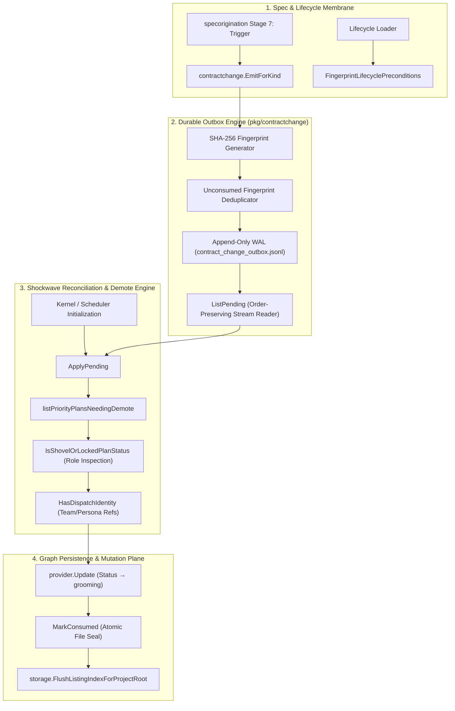
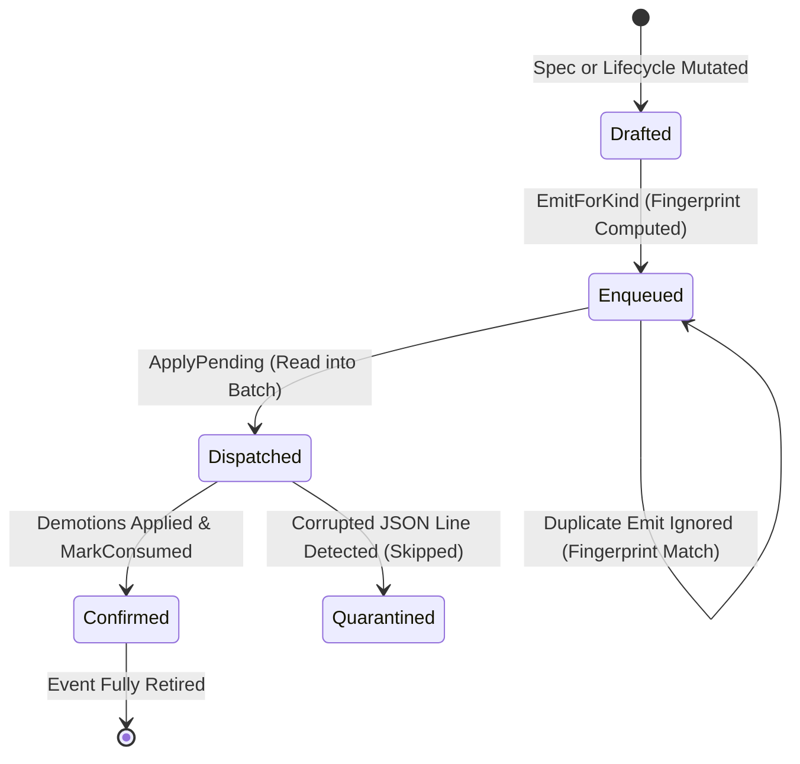
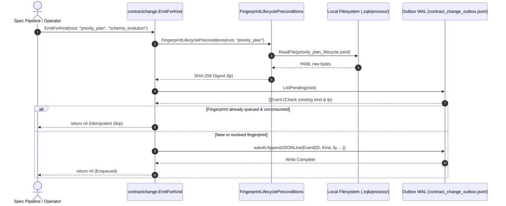
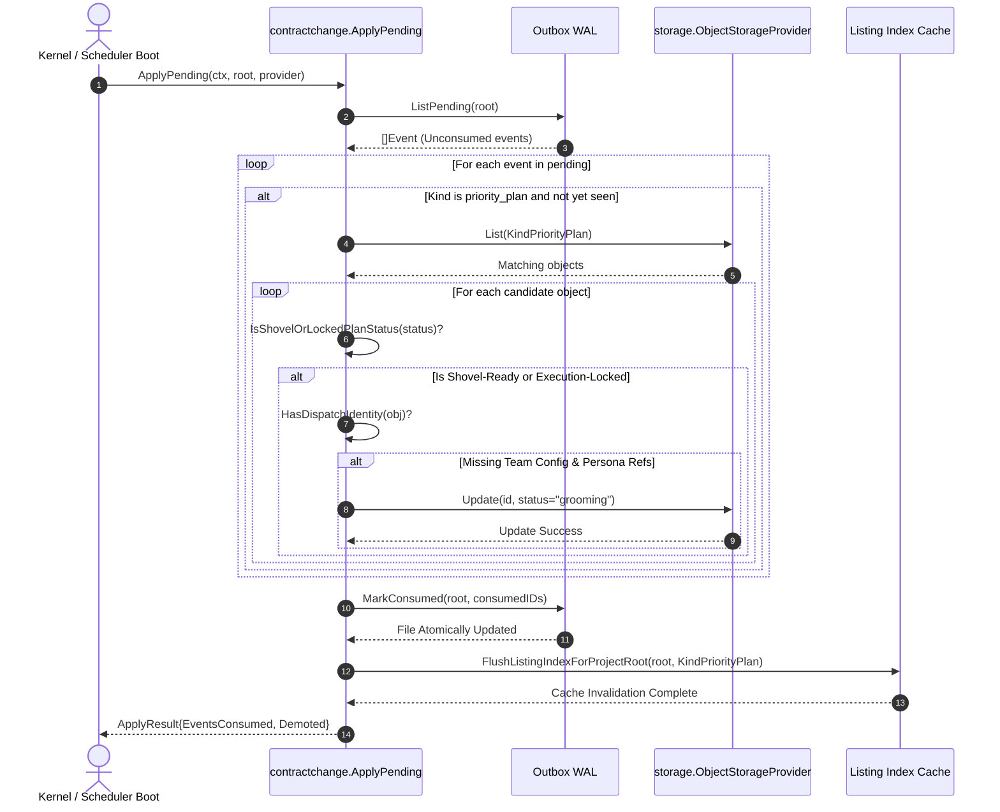

# Contract Change, Outbox Dispatch & Mutation Lifecycle Subsystem Operational Architecture Guide

## Overview

The **Contract Change and Outbox Dispatch Subsystem** (`pkg/contractchange`) provides an asynchronous, durable event outbox and reconciliation pipeline within the **Zen Quantum Kernel (ZQK)** platform. It bridges schema and lifecycle mutations (such as `SPEC_ORIGIN_TRIGGER` changes to object specifications or lifecycle contracts) to live execution instances across the kernel graph.

In a distributed, multi-agent Knowledge Kernel, ontological contracts and status invariants are versioned and mutable. When a lifecycle definition or validation precondition changes (for example, tightening stay-in-status criteria for execution-locked priority plans), existing instances sealed under the previous contract cannot silently proceed without verifying compliance.

The `pkg/contractchange` package implements the **Async Shockwave Membrane**:
1. When lifecycle definitions mutate, durable kind-scoped outbox events are emitted to an append-only JSONL log.
2. During kernel or scheduler boot, pending contract-change events are drained and evaluated.
3. Instances occupying `shovel_ready` or `execution_locked` roles that violate updated stay-in-status invariants are systematically demoted (e.g., `priority_plan` demoted to `grooming` if missing dispatch identity).
4. Events are marked consumed idempotently, guaranteeing replay safety and fail-closed state consistency.

---

## Architectural Purpose & Delivery Guarantees

The subsystem enforces four core architectural invariants across the ZQK execution lifecycle:

1. **Durable Transactional Outbox**: Lifecycle mutation signals are appended to `.zqk/state/contract_change/contract_change_outbox.jsonl` using write-ahead logging primitives (`walutil.AppendJSONLine`). Emitted events persist across unexpected agent crashes, kernel restarts, or offline worker states.
2. **At-Least-Once Delivery with Idempotent Deduplication**: Events are fingerprinted using SHA-256 hashes of the underlying lifecycle preconditions. Duplicate emissions matching the active unconsumed fingerprint for a kind are suppressed at emission time, preventing duplicate queue bloat.
3. **Decoupled Shockwave Execution**: Contract updates do not synchronously block live agent operations. The outbox decouples spec authoring and migration from the runtime graph reconciliation performed by `ApplyPending`.
4. **Fail-Closed Demotion Semantics**: Ineligible instances are transitioned backward to intake/grooming rather than causing catastrophic runtime panic or silently failing down-stream task execution.

---

## Subsystem Component Topology

The subsystem is partitioned into modular, collaborating components:



### Component Roles & Responsibilities

1. **Precondition Fingerprinter (`FingerprintLifecyclePreconditions`)**:
   - Resolves `<kind>_lifecycle.yaml` directly from `.zqk/process/internal/lifecycles/` or searches nested pack directories via `filepath.WalkDir`.
   - Computes a deterministic SHA-256 digest of the lifecycle definition, truncated to a 32-character hex representation.
2. **Event Emitter (`EmitForKind`)**:
   - Compares the active fingerprint with unconsumed entries in the outbox.
   - Generates a canonical event identifier: `CCE-<fingerprint[:12]>-<kind>`.
   - Appends the outbox record with UTC RFC3339 timestamps.
3. **Stream Reader & Marker (`ListPending`, `MarkConsumed`)**:
   - Scans the outbox file line-by-line, filtering out corrupted entries and previously consumed events.
   - Atomically updates matching records with `consumed_at` timestamps using `fileutil.WriteSecureFile`.
4. **Reconciliation Engine (`ApplyPending`)**:
   - Coordinates graph demotions for pending events across all detected kinds.
   - Dispatches demotions specifically for `priority_plan` instances that lack required team configurations or persona bindings.
   - Flushes listing indexes upon mutation completion.

---

## Outbox State Machine Lifecycle

Events in the outbox transition through well-defined lifecycle states:



### State Definitions

- **Drafted**: An upstream spec origination or lifecycle editor prepares a contract change.
- **Enqueued**: The event is validated, formatted as an `Event` struct, and appended to `contract_change_outbox.jsonl`.
- **Dispatched**: The event is read into memory during `ApplyPending` and its target kinds are evaluated against the current graph.
- **Confirmed**: Graph mutations succeed and `MarkConsumed` seals the event with a `consumed_at` timestamp.
- **Quarantined / Ignored**: Corrupted or unparseable lines in the outbox file are gracefully ignored during stream decoding, preventing scheduler crash loops.

---

## Sequence Diagrams

### 1. Mutation Event Capture & Outbox Persistence

The following diagram illustrates how spec origination triggers dispatch a durable contract change event:



### 2. Shockwave Drain & Transactional Dispatch

The following sequence details how `ApplyPending` reconciles the graph on startup:



---

## Delivery Guarantees & Replay Safety

### Idempotent Event Deduplication
If an operator runs multiple spec origination runs without modifying the underlying lifecycle YAML, `EmitForKind` computes the identical SHA-256 fingerprint. The deduplication loop in `EmitForKind` inspects existing pending events from newest to oldest:
```go
for i := len(pending) - 1; i >= 0; i-- {
    if pending[i].Kind == kind {
        if pending[i].Fingerprint == fp {
            return nil // already queued for this contract shape
        }
        break
    }
}
```
This guarantees that an outbox cannot be spammed with duplicate signals for the same contract version.

### Atomic Consumption Marking
`MarkConsumed` does not truncate or discard history unsafely. It reads the full log, appends `consumed_at: <timestamp>` to matching IDs, and writes the entire payload atomically via `fileutil.WriteSecureFile` (write to temp file, flush buffers, atomic rename).

### Safe Invariant Checking (`HasDispatchIdentity`)
A priority plan satisfies dispatch identity if:
1. `team_configuration_ref` is populated and non-empty.
2. `persona_refs` is a slice of strings or any values containing at least one non-whitespace string.

If neither is present, the plan cannot safely be dispatched to agents and is demoted back to `grooming`.

---

## Production Configurations & Filesystem Layout

### Filesystem Topology

```
<projectRoot>/
  ├── .zqk/
  │    ├── process/
  │    │    └── internal/
  │    │         └── lifecycles/
  │    │              ├── priority_plan_lifecycle.yaml
  │    │              └── ...
  │    └── state/
  │         └── contract_change/
  │              └── contract_change_outbox.jsonl
  └── packs/
       └── ...
```

### Event Data Schema (`Event`)

```json
{
  "schema_version": "1",
  "id": "CCE-a1b2c3d4e5f6-priority_plan",
  "kind": "priority_plan",
  "fingerprint": "a1b2c3d4e5f67890123456789abcdef0",
  "reason": "spec_origin_trigger",
  "created_at": "2026-10-30T12:00:00Z",
  "consumed_at": "2026-10-30T12:05:00Z"
}
```

---

## Operational Recipes & Troubleshooting Matrix

### Recipe 1: Inspecting the Pending Outbox

Inspect unconsumed contract change events directly from the CLI or filesystem:

```bash
# View all lines in the outbox
cat .zqk/state/contract_change/contract_change_outbox.jsonl

# Filter unconsumed events using jq
cat .zqk/state/contract_change/contract_change_outbox.jsonl | jq -c 'select(.consumed_at == null)'
```

### Recipe 2: Triggering Contract Change Re-evaluation

When testing custom lifecycle policies or verifying automated demotions in test environments:

```go
// 1. Emit an event for a modified lifecycle
err := contractchange.EmitForKind(projectRoot, "priority_plan", "manual_reindex")
if err != nil {
    log.Fatalf("failed to emit: %v", err)
}

// 2. Drain pending events and observe demoted items
res, err := contractchange.ApplyPending(ctx, projectRoot, storageProvider)
if err != nil {
    log.Fatalf("apply failed: %v", err)
}
fmt.Printf("Consumed %d events; Demoted %d plans: %v\n",
    res.EventsConsumed, len(res.Demoted), res.Demoted)
```

### Troubleshooting Matrix

| Symptom / Error | Root Cause | Remediation Protocol |
| :--- | :--- | :--- |
| `contractchange: project root and kind required` | `projectRoot` or `kind` was passed as empty string. | Ensure the caller initializes the context with the discovered repository root via `paths.FindProjectRoot()`. |
| Outbox event emitted, but no demotions take place | Target objects either have `team_configuration_ref` / `persona_refs` set, or do not occupy `shovel_ready` or `execution_locked` status roles. | Check object statuses with `zqk object inspect <id>`. If status role is already `grooming` or `conceptual`, demotion is a no-op. |
| Corrupted JSON line warning in outbox log | Non-JSON text or interrupted write in `contract_change_outbox.jsonl`. | The reader ignores invalid lines automatically. If cleanup is desired, inspect the file and remove partial lines. |
| Outbox file cannot be read or written (`permission denied`) | Directory or file permissions modified unexpectedly in `.zqk/state/contract_change/`. | Run `chmod 755 .zqk/state/contract_change` and `chmod 644 .zqk/state/contract_change/contract_change_outbox.jsonl`. |
| High rate of concurrent emits | Multiple swarm agents editing specs in parallel. | The subsystem uses `walutil.AppendJSONLine` and atomic writes; operations are safe under high concurrency. |
