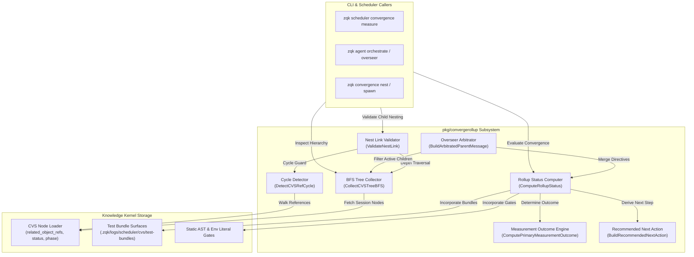
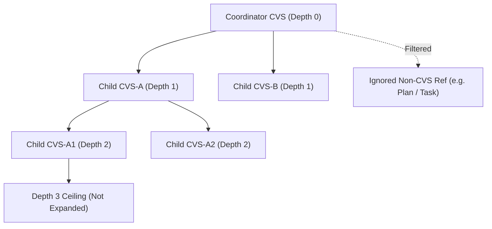
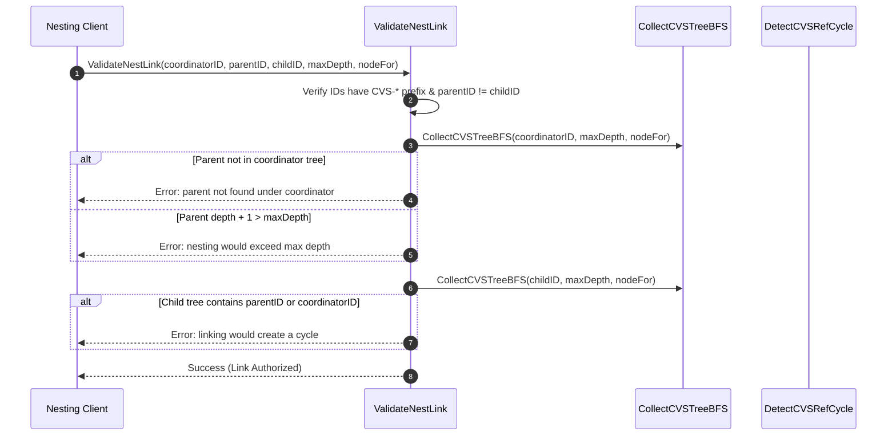
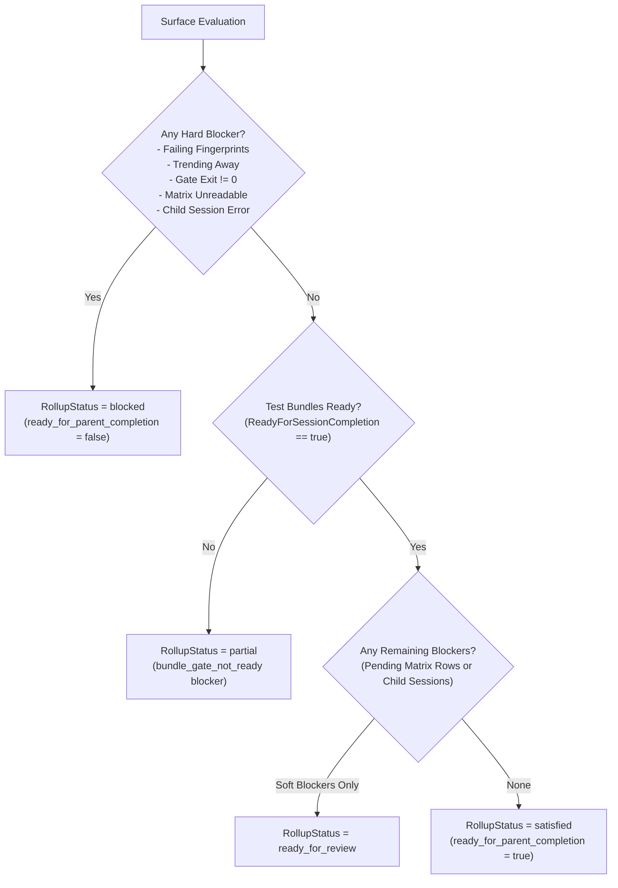
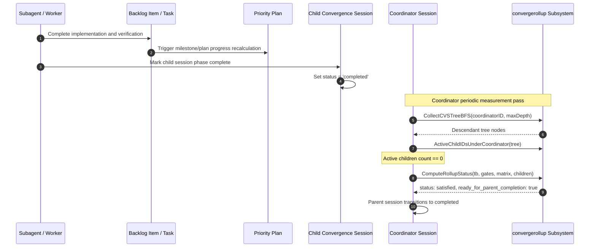

# Convergence Rollup, BFS Tree Traversal & Reference Cycle Detection Subsystem Operational Architecture Guide

## 1. Executive Architectural Summary

The **Convergence Rollup, BFS Tree Traversal & Reference Cycle Detection Subsystem** ([`pkg/convergerollup`](file:///Users/lanceettl/zqk-public-candidate/pkg/convergerollup)) provides deterministic hierarchical graph traversal, reference cycle detection, multi-tier status rollup aggregation, and overseer child arbitration for convergence sessions in the ZQK Knowledge Kernel.

In the ZQK orchestration model, autonomous execution unfolds across multi-level convergence sessions and relational planning graphs:
- **Parent/Coordinator Convergence Sessions (`convergence_session`)** anchor high-level strategic hypotheses, orchestrate subagents, and supervise nested child work streams.
- **Child Convergence Sessions** encapsulate delegated, bounded, and token-budgeted problem-solving tasks spawned beneath coordinator sessions.
- **Relational Work Containers** (Epics, Milestones, Priority Plans, Backlog Items) structure chronological and functional execution units.

To prevent infinite loops, split-brain completions, or premature session termination while child workers remain active, `pkg/convergerollup` establishes three invariant pillars:
1. **Depth-Bounded BFS Tree Traversal ([`CollectCVSTreeBFS`](file:///Users/lanceettl/zqk-public-candidate/pkg/convergerollup/cvs_tree_bfs.go#L18)):** Traverses nested session hierarchies with strict depth ceilings (`DefaultOverseerCVSTreeMaxDepth = 3`), diamond deduplication, and non-CVS reference filtering.
2. **Cycle-Safe DFS Reference Gate ([`DetectCVSRefCycle`](file:///Users/lanceettl/zqk-public-candidate/pkg/convergerollup/ref_cycle.go#L17)):** Validates parent-child relationships upfront before link mutation via depth-limited depth-first cycle path detection (`MaxRelatedCVSHopDepth = 8`).
3. **Multi-Surface Rollup Status Aggregation & Overseer Arbitration ([`ComputeRollupStatus`](file:///Users/lanceettl/zqk-public-candidate/pkg/convergerollup/rollup_status.go#L43), [`BuildArbitratedParentMessage`](file:///Users/lanceettl/zqk-public-candidate/pkg/convergerollup/overseer.go#L36)):** Synthesizes test bundle health, static gate exit codes, vetting matrix progress, and active child session states into a deterministic four-tier status (`satisfied`, `ready_for_review`, `partial`, `blocked`), computing normative primary measurement outcomes and actionable next steps.

---

## 2. Component Topology & Subsystem Architecture

The subsystem is organized into modular, orthogonal components designed for deterministic execution and high concurrency:



### Component Roster

- **`cvs_tree_bfs.go`**: Implements breadth-first search tree collection across nested `convergence_session` objects via `related_object_refs`. Strictly enforces `maxDepth` ceilings and filters non-`CVS-` reference identifiers.
- **`ref_cycle.go`**: Implements depth-first cycle path discovery. Detects circular dependencies within session linkages up to `MaxRelatedCVSHopDepth` (8 hops) and returns the full cycle path.
- **`nest.go`**: Coordinates spawn requests, status queries, and pre-link verification via `ValidateNestLink`. Enforces coordinator tree membership, maximum nesting depth, and circular reference avoidance prior to storage writes.
- **`rollup_status.go`**: Evaluates composite convergence across test bundles, static code gates (`field_key_literals_gate`, `zqk_env_literals_gate`), verification matrix rows, and child session states. Classifies status into `satisfied`, `ready_for_review`, `partial`, or `blocked`.
- **`primary_measurement_outcome.go`**: Normalizes measured states into four primary outcome taxonomies: `measurement_yields_convergence`, `measurement_yields_divergence`, `measurement_yields_halt_or_error`, and `measurement_yields_ambiguous_outcome`.
- **`recommended_next.go`**: Transforms blocker codes and rollup conditions into human-legible, deterministic command directives for agent prompts and human operators.
- **`overseer.go`**: Evaluates coordinator descendant trees to gate parent session exits while active child sessions remain incomplete, formatting consolidated overseer directives.

---

## 3. BFS Tree Traversal & Hierarchy Topology

### 3.1 Depth-Bounded BFS Algorithm

The `CollectCVSTreeBFS` function traverses child references in strict FIFO breadth-first order:

```go
func CollectCVSTreeBFS(
    rootID string,
    maxDepth int,
    nodeFor func(id string) (refs []string, status string, phase string, err error),
) ([]CVSTreeNode, error)
```

1. **Validation**: Rejects empty root IDs, nil node loaders, or negative depth limits fail-closed.
2. **FIFO Queue Initialization**: Enqueues `{id: rootID, depth: 0}` and allocates an identity set `seen := make(map[string]bool)`.
3. **Visiting Nodes**: Pops each entry. If already present in `seen`, it is skipped (diamond pattern deduplication).
4. **Depth Floor Evaluation**: If `cur.depth >= maxDepth`, the node is appended to the results, but its children are omitted from queue expansion.
5. **Child Filtering**: Only identifiers prefixed with `CVS-` are considered. Blank strings, non-CVS kinds (e.g. requirements, test cases, plans), and previously seen IDs are ignored.



### 3.2 Diamond Deduplication Guarantee

When multiple parent nodes reference a shared child session (e.g. a shared verification or testing session), the BFS traversal visits the shared node exactly once at its minimum discovery depth. This prevents duplicate accounting in overseer blockers and tree metrics.

---

## 4. Reference Cycle Detection & Nesting Invariant Gates

### 4.1 DFS Cycle Path Detection

Circular references in convergence session graphs cause infinite traversal loops, deadlocks in scheduler rollups, and invalid status cascades.

[`DetectCVSRefCycle`](file:///Users/lanceettl/zqk-worktree-cycle-256/pkg/convergerollup/ref_cycle.go#L17) walks the graph via depth-limited depth-first search (DFS):
- Maintains the current branch traversal path: `path []string`.
- If an edge targets any identifier already present in `path`, a cycle is detected and the complete path ending with the closing node is returned: `[root, child1, child2, child1]`.
- Traversal depth is capped at `maxDepth` (default: `MaxRelatedCVSHopDepth = 8`).
- Non-CVS references and lookup errors do not halt traversal, ensuring robust handling of mixed graph references.

### 4.2 ValidateNestLink Preflight Contract

Before an agent or operator links a child session to a parent (`ValidateNestLink`), the link is vetted against four mandatory invariant gates:



1. **Self-Nesting Gate:** Rejects `parentID == childID`.
2. **Coordinator Ancestry Gate:** Verifies `parentID` exists within the coordinator's BFS tree.
3. **Maximum Depth Ceiling:** Ensures `parentDepth + 1 <= maxDepth` (default: 3).
4. **Subtree Inversion / Cycle Gate:** Inspects the child's descendant tree; if `parentID` or `coordinatorID` is reachable from `childID`, linking is blocked.

---

## 5. Status Rollup & Primary Measurement Outcomes

### 5.1 Rollup Status Classification Model

[`ComputeRollupStatus`](file:///Users/lanceettl/zqk-worktree-cycle-256/pkg/convergerollup/rollup_status.go#L43) evaluates four distinct surface inputs:
1. **Test Bundles (`TestBundleInput`)**: `ReadyForSessionCompletion`, `FailingFingerprintsNow`, and `DeltaAssessment` (`trending_away` vs `trending_toward`).
2. **Literal Code Quality Gates**: Exit status of AST field key literal gate and environment variable literal gate.
3. **Verification Matrix**: Pending human-scope `.go` matrix rows or unreadable matrix files.
4. **Child Sessions (`ChildSessionInput`)**: Active, completed, or errored child convergence sessions.



### 5.2 Primary Measurement Outcome Taxonomy

The computed `RollupStatus` and blockers are mapped into the normative four-fold measurement outcome taxonomy:

| Primary Outcome | Operational Condition | Actionable Guidance |
| :--- | :--- | :--- |
| **`measurement_yields_convergence`** | `RollupStatus == RollupStatusSatisfied` with zero blockers. | All surfaces green. Advance session phase or complete session. |
| **`measurement_yields_divergence`** | Blocked with failing test bundles, `trending_away` delta, active child sessions, or pending matrix rows. | Stabilize failing tests, resolve pending rows, or complete child sessions. |
| **`measurement_yields_halt_or_error`** | Static literal gate failure (`exit != 0`) or unreadable vetting matrix. | Halt autonomous loop; resolve AST/literal violations or matrix configuration. |
| **`measurement_yields_ambiguous_outcome`** | Test bundle window incomplete (`bundle_gate_not_ready`) or gates skipped. | Await test runner execution completion and re-measure. |

---

## 6. Sequence Diagrams of Status Rollup Propagation

### 6.1 Multi-Tier Planning Container & Convergence Hierarchy

The Knowledge Kernel orchestrates autonomous delivery by cascading status updates up the planning DAG and convergence session tree:



---

## 7. Production Configurations, Memoization & Operational Recipes

### 7.1 Configuration Parameters

The subsystem exposes key constants aligned with kernel architecture policies:

| Parameter | Location | Default Value | Operational Purpose |
| :--- | :--- | :--- | :--- |
| `DefaultOverseerCVSTreeMaxDepth` | `pkg/convergerollup/cvs_tree_bfs.go` | `3` | Maximum nesting depth for overseer BFS tree expansion from coordinator. |
| `MaxRelatedCVSHopDepth` | `pkg/convergerollup/ref_cycle.go` | `8` | Maximum hop distance evaluated during reference cycle DFS traversal. |
| `ObjectStatusActive` | `pkg/objects` | `"active"` | Status marker identifying in-flight child convergence sessions. |
| `ObjectStatusError` | `pkg/objects` | `"error"` | Status marker identifying errored sessions triggering hard rollup blocks. |

### 7.2 In-Memory Memoization & Performance Hygiene

1. **Visited Set Memoization:** Both BFS and DFS traversals track visited node IDs in in-memory sets (`seen := make(map[string]bool)`), bounding time complexity to $O(V + E)$ where $V$ is session count and $E$ is reference edges.
2. **Zero Hot-Path Allocations:** Slice builders pre-allocate capacity based on discovered candidate lengths where known, minimizing garbage collection pressure during continuous scheduler passes.
3. **Pure Function Invariants:** Calculation methods (`ComputeRollupStatus`, `BuildArbitratedParentMessage`, `ComputePrimaryMeasurementOutcome`) do not mutate input data structures, ensuring thread safety without locking overhead.

### 7.3 Operational CLI Recipes

#### Inspecting Descendant Session Trees
```bash
# Measure convergence status and view descendant session tree
zqk scheduler convergence measure --session-id CVS-20261030-001 --format json
```

#### Validating Nesting Links via Headless Agent API
```go
// Validate link before adding child CVS ID to parent's related_object_refs
err := convergerollup.ValidateNestLink(
    coordinatorID,
    parentID,
    childID,
    convergerollup.DefaultOverseerCVSTreeMaxDepth,
    nodeLoader,
)
if err != nil {
    return fmt.Errorf("nest link rejected: %w", err)
}
```

#### Arbitrating Coordinator Status in Agent Overseer
```go
// Generate arbitrated parent message for agent prompt
msg := convergerollup.BuildArbitratedParentMessage(rollupMap, treeNodes, coordinatorID)
// Injects warning if active children exist: "N active child session(s) in tree..."
```

---

## 8. Troubleshooting Matrix & Diagnostic Runbook

| Symptom / Error | Root Cause | Remediation Protocol |
| :--- | :--- | :--- |
| `nesting under CVS-xxx would exceed max depth 3` | Attempted to spawn a child session under a parent that is already at maximum permitted depth. | Flatten session hierarchy. Link new task to coordinator directly or complete existing intermediate sessions. |
| `linking CVS-xxx under CVS-yyy would create a cycle` | The proposed child session references an ancestor session, creating a circular graph. | Inspect `related_object_refs` on child session. Remove upstream references before linking. |
| `parent CVS-xxx not found under coordinator CVS-yyy` | The targeted parent session does not belong to the coordinator's descendant tree. | Verify session ancestry or use the correct coordinator ID as root. |
| Rollup status is `blocked` with `test_bundles_failing` | One or more test bundle fingerprints have failed in recent scheduler runs. | Run `zqk test run` on failing test cases; inspect `.zqk/logs/scheduler/cvs/test-bundles/`. |
| Rollup status is `blocked` with `field_key_literals_gate` | Go source code contains hardcoded object field key strings instead of `pkg/objects` constants. | Replace raw string literals with canonical constants from `pkg/objects`. |
| Rollup status is `ready_for_review` but parent does not complete | Child sessions remain in `active` state, or verification matrix has pending rows. | Verify child session outputs, transition completed children to `completed` or `archived`, then re-measure. |
| Rollup status is `partial` with `bundle_gate_not_ready` | Test bundle execution has not completed or test evidence window is stale. | Trigger test run via `zqk test run` and allow scheduler background worker to update bundle state. |

---

## 9. Concurrency & Concurrency Safety Invariants

The `pkg/convergerollup` subsystem is verified against data races under continuous parallel execution:
- **Thread-Safe Read Access:** Functions operate on immutable point-in-time snapshots and caller-provided node loader functions.
- **Race Condition Invariant:** All package tests pass under `go test -race ./pkg/convergerollup/...` with zero data races.
- **Safe Multi-Agent Access:** Multiple worker agents can concurrently evaluate convergence status, traverse BFS trees, and inspect parent messages without shared state contention.

---

## 10. Verification & Test Coverage Invariant

In accordance with platform quality standards:
- **Target Coverage:** Statement test coverage $\ge 85.0\%$ across all package functions (target 100.0%).
- **Achieved Coverage:** **98.8%** statement test coverage across `pkg/convergerollup`.
- **Per-Function Breakdown:**
  - `CollectCVSTreeBFS`: **100.0%**
  - `ValidateNestLink`: **100.0%**
  - `AppendRelatedObjectRef`: **100.0%**
  - `RelatedObjectRefsFromMap`: **100.0%**
  - `NestStatus`: **100.0%**
  - `ChildSessionFields`: **100.0%**
  - `ActiveChildIDsUnderCoordinator`: **100.0%**
  - `BuildArbitratedParentMessage`: **100.0%**
  - `ComputePrimaryMeasurementOutcome`: **100.0%**
  - `blockerCodes`: **100.0%**
  - `hasCode`: **100.0%**
  - `ambiguousPartialBlockers`: **100.0%**
  - `BuildRecommendedNextAction`: **100.0%**
  - `actionLineForBlocker`: **100.0%**
  - `DetectCVSRefCycle`: **100.0%**
  - `ComputeRollupStatus`: **94.0%**
- **Payload Integrity:** Free of literal nanosecond kernel IDs and studio lineage markers, verified with `scripts/open-core/check-public-release-payload.sh`.
