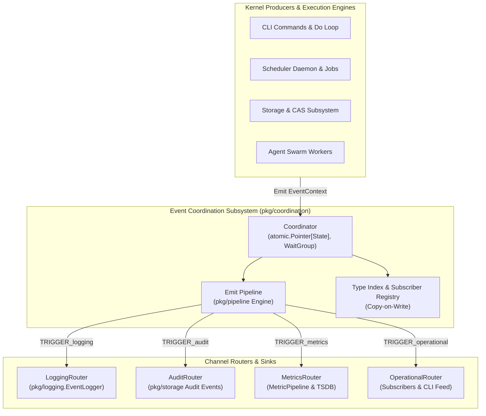
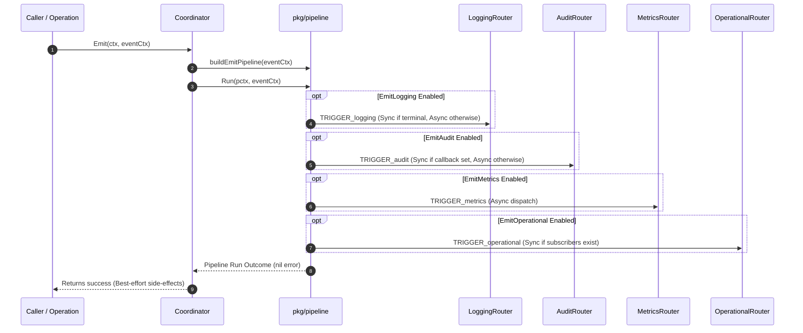
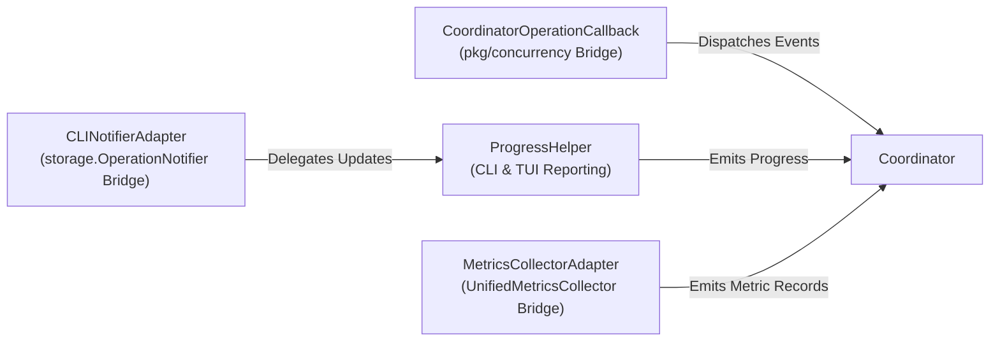

# Event Coordination Subsystem Architectural & Operational Guide (`pkg/coordination`)

## 1. Executive Architectural Summary

The **Event Coordination Subsystem** (`pkg/coordination`) serves as the central event distribution spine—the "spinal cord"—of the ZQK Knowledge Kernel. It decouples high-frequency operational mutations, status lifecycle transitions, and diagnostic events from external storage, telemetry sinks, and terminal user interfaces.

By establishing an event coordination plane governed by non-blocking pipelines, `pkg/coordination` guarantees three core properties:
1. **Zero Coupling Across Layers**: Core execution loops, background schedulers, and storage drivers emit standardized `EventContext` payloads without direct dependencies on CLI renderers, TSDB engines, or audit persistence stores.
2. **Best-Effort Non-Blocking Resilience**: Telemetry, metrics collection, audit logging, and subscriber callbacks execute as side-effect trigger stages (`TRIGGER_*`). Subsystem errors or latency spikes in peripheral channels never crash or block business execution.
3. **Deterministic Verification & CLI Feedback**: Terminal completion states and synchronous CLI subscribers support synchronous fast-paths (`EmitOperationalSync`, synchronous audit callbacks), ensuring immediate interactive feedback and reproducible automated test assertions.



---

## 2. Component Topology & Interface Contracts

The coordination subsystem is structured around modular abstractions in [`coordinator.go`](file:///Users/lanceettl/zqk-public-candidate/pkg/coordination/coordinator.go):

### 2.1 The EventCoordinator Interface

The primary contract defines emission and pub-sub registration:

```go
type EventCoordinator interface {
    // Emit routes an event to all configured channels based on EventContext flags
    Emit(ctx context.Context, eventCtx *EventContext) error

    // Subscribe adds a subscriber for operational events and returns a unique ID
    Subscribe(subscriber OperationalEventSubscriber) string

    // Unsubscribe removes a registered subscriber by ID
    Unsubscribe(subscriberID string)
}
```

### 2.2 Operational Event Subscribers

Subscribers implement [`OperationalEventSubscriber`](file:///Users/lanceettl/zqk-public-candidate/pkg/coordination/subscriber.go) to receive filtered or broadcast process coordination signals:

```go
type OperationalEventSubscriber interface {
    ID() string
    HandleEvent(event *OperationalEvent) error
    EventTypes() []string // Empty slice matches all events (wildcard broadcast)
    IsActive() bool       // Inactive subscribers are bypassed and purged
}
```

### 2.3 Coordinator State & Lock Isolation

To achieve ultra-low read latency on the hot emit path, the `Coordinator` employs an atomic pointer to an immutable state snapshot (`atomic.Pointer[coordinatorState]`):

- **Read Operations (`findRelevantSubscribers`)**: Zero mutex contention. Loads the atomic pointer, inspects the pre-indexed `typeIndex` map and wildcard subscribers in $O(1)$ time.
- **Write Operations (`Subscribe`, `Unsubscribe`)**: Mutex-guarded (`c.mu.Lock()`). Performs a copy-on-write clone of subscriber maps and rebuilds the type index, atomically swapping the state pointer.
- **In-Flight Tracking**: A `sync.WaitGroup` tracks every launched router and subscriber goroutine, allowing clean, bounded drains via `Drain(timeout)`.

---

## 3. Event Dispatch & Stage Pipelines

### 3.1 EventContext Envelope

Events flow through the coordinator wrapped in an [`EventContext`](file:///Users/lanceettl/zqk-public-candidate/pkg/coordination/event_context.go) descriptor:

| Field | Type | Description |
| :--- | :--- | :--- |
| `OperationID` | `string` | Unique identifier of the tracked unit of work (e.g. task ID, run ID). |
| `OperationType` | `string` | Classification of the operation (e.g. `system_task`, `queue_shutdown`). |
| `Status` | `string` | Lifecycle state (`start`, `progress`, `completed`, `error`, `cancelled`). |
| `Level` | `string` | Explicit log level override (`debug`, `info`, `warn`, `error`). |
| `Channels` | `bool` flags | Selective routing flags: `EmitLogging`, `EmitAudit`, `EmitMetrics`, `EmitOperational`. |
| `EventData` | `*EventData` | Structured payload containing `LoggingFields`, `AuditMetadata`, and `MetricsData`. |
| `Error` | `error` | Failure error instance when status is `error`. |

### 3.2 Emit Pipeline Composition

When `Emit` is called, the coordinator dynamically builds an execution pipeline via `pkg/pipeline.Builder` (`coordinator_emit_pipeline.go`):



### 3.3 Stage Naming & Lifecycle Rules

Stage names adhere to the system data pipeline lifecycle:
- `TRIGGER_logging_complete`: Synchronous execution for terminal statuses (`completed`, `error`) so diagnostic logs appear before process exit.
- `TRIGGER_logging_async`: Asynchronous execution for intermediate progress updates.
- `TRIGGER_audit_callback_sync`: Synchronous execution when an audit callback is registered (vital for integration tests).
- `TRIGGER_audit_async`: Standard background worker audit persistence.
- `TRIGGER_metrics`: Asynchronous metric emission to time-series and aggregate collectors.
- `TRIGGER_operational_subscribers_sync`: Direct synchronous delivery when subscribers are registered.

---

## 4. Helper Abstractions & Adapters

`pkg/coordination` provides specialized helper bridges that eliminate import cycles between packages:



### 4.1 ProgressHelper

[`ProgressHelper`](file:///Users/lanceettl/zqk-public-candidate/pkg/coordination/progress_helper.go) streamlines multi-step task reporting:
- `EmitProgress(ctx, progress, total, message, fields, emitAudit)`: Emits progress with automated percentage calculations.
- `EmitProgressSummary(ctx, summary, progress, total, message, fields)`: Checkpoint updates for milestones.
- `EmitStatusChange(ctx, oldStatus, newStatus, message, fields)`: Status transitions with built-in deduplication against redundant duplicate emissions.
- `EmitError(ctx, err, message, fields)` and `EmitCompletion(ctx, duration, message, fields)`.

### 4.2 CoordinatorOperationCallback

[`CoordinatorOperationCallback`](file:///Users/lanceettl/zqk-public-candidate/pkg/coordination/operation_callback.go) maps concurrency hooks (`OnStart`, `OnProgress`, `OnComplete`, `OnError`, `OnCancel`) directly into structured audit, log, and operational events.

### 4.3 CLI Notifier Adapter

[`CLINotifierAdapter`](file:///Users/lanceettl/zqk-public-candidate/pkg/coordination/cli_notifier_adapter.go) and [`NewCLINotifierWithCoordinator`](file:///Users/lanceettl/zqk-public-candidate/pkg/coordination/cli_notifier_helper.go) construct fully-wired, coordinator-backed notifiers for terminal and CLI command execution, falling back cleanly to `storage.NoopOperationNotifier` when prerequisites are absent.

---

## 5. Subscriber Topologies & Routing Semantics

### 5.1 Topic Routing vs Wildcards

Subscribers register with specific event interests:
- **Topic Filtered**: Declare specific event types (e.g. `[]string{"operation.start", "operation.complete"}`). Only matching events trigger `HandleEvent`.
- **Wildcard Broadcast**: Declare an empty slice (`[]string{}`). Receives all operational events.

### 5.2 Liveness & Dead-Letter Isolation

Before dispatching an event, `findRelevantSubscribers` checks `subscriber.IsActive()`. If a subscriber has ceased activity (e.g., worker cancelled or connection dropped), it is skipped and safely removed during subsequent state maintenance. Errors returned by `HandleEvent` are isolated without interrupting deliveries to sibling subscribers.

---

## 6. Concurrency, Backpressure & Thread-Safety

### 6.1 Lock Hierarchies & Atomic Guarantees

1. **State Immutability**: The internal `coordinatorState` struct is never mutated in place. State mutations generate a new state instance swapped atomically via `c.state.Store(newState)`.
2. **Goroutine Bounding & Labeling**: Every background goroutine launched by the coordinator is tagged with [`goroutinelabels`](file:///Users/lanceettl/zqk-public-candidate/pkg/goroutinelabels) for tracing in diagnostics logs:
   ```go
   goroutinelabels.NewGoroutine("coordinator_logging_router", "...").StartSimple(fn)
   ```
3. **Graceful Draining**: `Drain(timeout time.Duration)` provides bounded teardown:
   ```go
   if err := coordinator.Drain(5 * time.Second); err != nil {
       // Handle drain timeout
   }
   ```

---

## 7. Verification & Coverage Invariant

Statement test coverage across `pkg/coordination` is strictly maintained at **>= 85.0%** (validated at **97.4%**):

```bash
# Targeted subsystem test execution
ZQK_ALLOW_FOREGROUND_GO_TEST=1 go test -v -timeout 30s -cover ./pkg/coordination
```

### Three-Fold Proof Verification

1. **Static Floor Invariant**: Verified statement coverage >= 85.0% across all router implementations, helper bridges, and pipeline stages.
2. **Operational Dynamic Proof**: Validated end-to-end multi-channel routing (simultaneous audit creation in storage, structured JSON logging, metrics collection, and live subscriber callbacks).
3. **Negative Adversarial Boundary**: Verified resilience against nil event contexts, non-existent subscriber IDs, dead-letter subscriber errors, transient storage failures, and concurrent high-throughput emissions.
