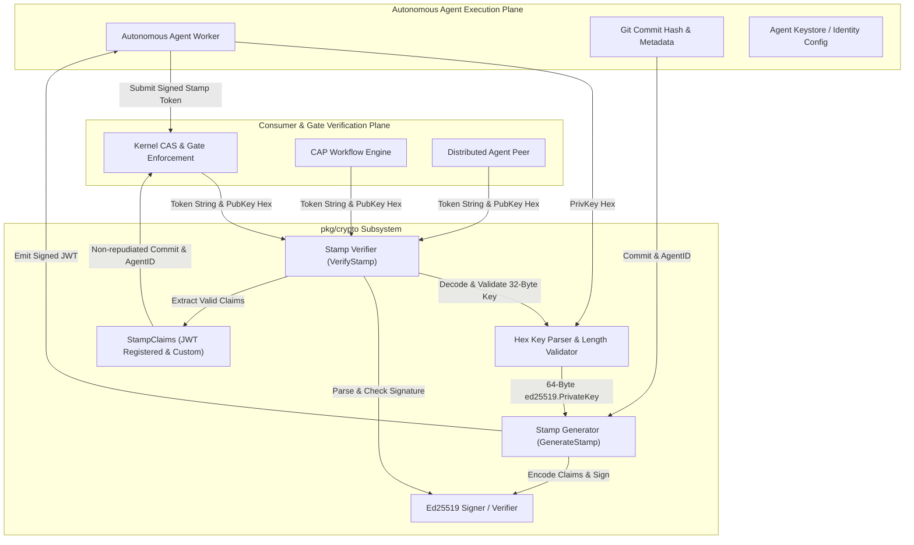
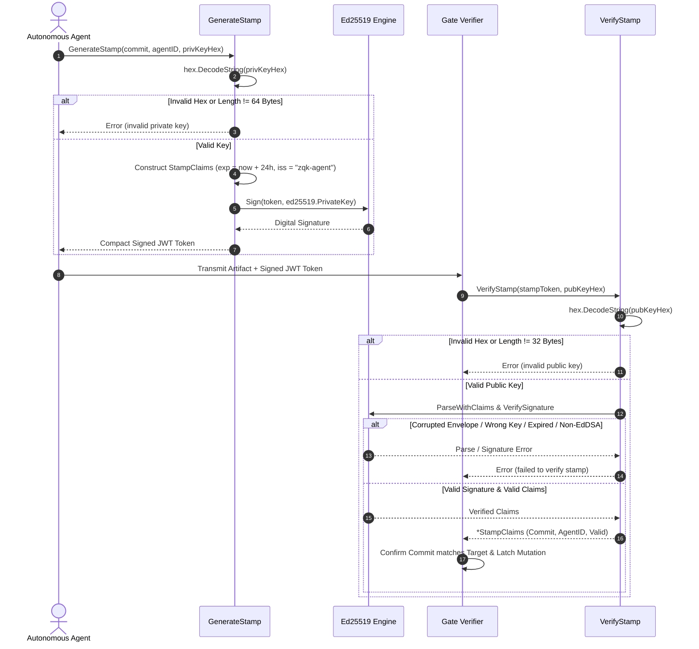
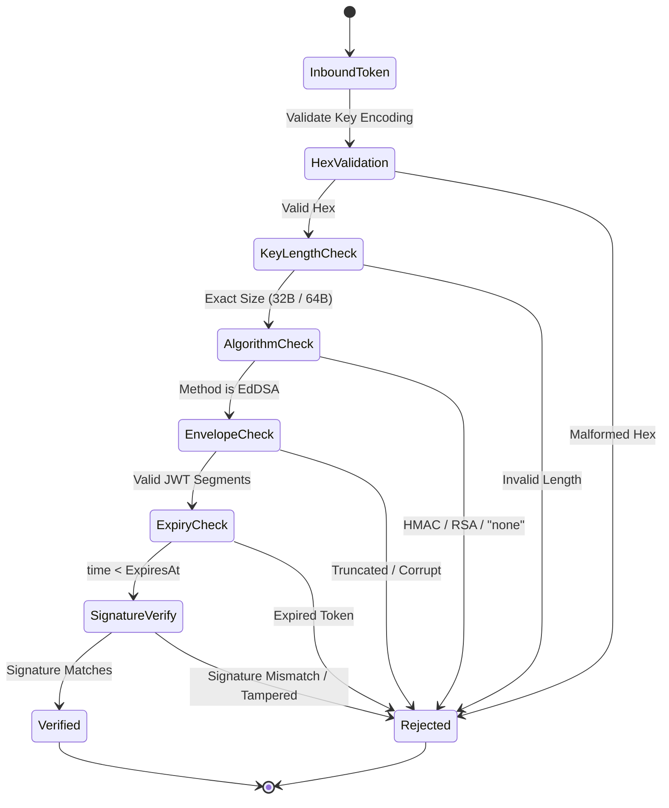

# Cryptographic Primitives & Key Management Subsystem Operational & Architectural Guide

## 1. Executive Architectural Summary

The **Cryptographic Primitives & Key Management Subsystem** (`pkg/crypto`) provides the foundational cryptographic stamping, digital signature, and identity attestation infrastructure for the **ZQK Knowledge Kernel**. In distributed, multi-agent autonomous engineering environments, operations such as code commits, CAS (Content-Addressable Storage) mutations, and artifact latching require non-repudiation, tamper-evidence, and strict provenance.

Rather than relying on vulnerable symmetric secrets, shared API tokens, or complex centralized Public Key Infrastructure (PKI) daemons, `pkg/crypto` anchors identity and attribution using **Ed25519 Edwards-curve Digital Signature Algorithm (EdDSA)** signatures embedded within compact **JSON Web Tokens (JWT)**.

Key subsystem design principles include:
- **Asymmetric Non-Repudiation:** Autonomous agents sign provenance claims using their private Ed25519 key (`ed25519.PrivateKey`, 64 bytes). Verification requires only the corresponding public key (`ed25519.PublicKey`, 32 bytes), enabling secure decentralized validation across workers and orchestrators without exposing signing credentials.
- **Strict Cryptographic Invariants:** Key representations must strictly adhere to hex-encoded string representations of standard Ed25519 byte lengths (64 bytes for private keys, 32 bytes for public keys). Any deviation, truncation, or malformed input immediately triggers fail-closed errors.
- **Algorithm Confusion Immunity:** Explicit enforcement of the `EdDSA` signing method ensures that tokens cannot be forged through algorithm-switching attacks (e.g., substituting HMAC-SHA256 or "none" algorithms).
- **Time-Bounded Replay Defense:** Each stamp encapsulates standard JWT numeric date claims (`iat` for issuance, `exp` for 24-hour expiration), mitigating unauthorized reuse and replay of historical stamps across stale execution cycles.
- **Zero-Allocation Hot Path Verification:** Fast parsing and lightweight claims structures permit verification overhead to remain minimal even under high-throughput concurrent agent loops.

---

## 2. Component Topology & Structural Model

The cryptographic subsystem comprises modular components dedicated to key parsing, stamp generation, claims projection, and signature verification:



### Component Breakdown

1. **`StampClaims` (`stamp.go`):** The structured data payload of a cryptographic stamp. Embeds the commit hash (`Commit`), the unique agent identifier (`AgentID`), and standard `jwt.RegisteredClaims` including:
   - `Issuer`: Fixed to `"zqk-agent"` for kernel authority attribution.
   - `IssuedAt`: Timestamp of creation, set to current system time.
   - `ExpiresAt`: Explicit validity ceiling, set to `IssuedAt + 24 * time.Hour`.
2. **`GenerateStamp` (`stamp.go`):** Assembles and signs the JWT stamp. Decodes the hex-encoded Ed25519 private key, validates its exact 64-byte size, constructs the `StampClaims`, and signs the envelope using `jwt.SigningMethodEdDSA`.
3. **`VerifyStamp` (`stamp.go`):** Verifies the digital signature and claims integrity of an incoming stamp string against a provided hex-encoded public key. Decodes the 32-byte public key, validates token structure, enforces `EdDSA` algorithm constraints, verifies the Edwards-curve signature, and returns the validated `*StampClaims`.
4. **`HexDecoder & Key Validator`:** Enforces boundary checks on key strings, rejecting malformed hex encodings and non-conforming byte lengths prior to cryptographic processing.

---

## 3. Stamp Signing & Verification Lifecycle

The end-to-end lifecycle ensures that agent actions are cryptographically sealed before mutations are accepted into the kernel state.



### Detailed Lifecycle Phases:

1. **Identity & Key Instantiation:** The agent loads its identity credentials. In local test environments, keys can be generated via `ed25519.GenerateKey(nil)`. In production, the private key resides in the agent's isolated credential store.
2. **Attestation Drafting:** The agent creates a cryptographic stamp specifying the targeted git commit hash and its own canonical Agent ID.
3. **Envelope Construction & Signing:** `GenerateStamp` builds the JWT header (`{"alg": "EdDSA", "typ": "JWT"}`), encodes claims in base64 URL format, and signs using the 64-byte Ed25519 private key.
4. **Decentralized Verification:** Any gate verifier, swarm peer, or CI process holding the agent's public key invokes `VerifyStamp`. The Edwards-curve signature is mathematically verified against the signed payload.
5. **State Commitment:** Once verified, the commit hash inside the claims is matched against the working tree, guaranteeing that the recorded work was performed by the authorized agent without tampering.

---

## 4. Security Boundaries & Attack Defense

Cryptographic security in `pkg/crypto` is designed around strict fail-closed security invariants:



### Attack Vectors & Mitigations:

- **Algorithm Confusion Attacks:**
  - *Threat:* An attacker modifies the JWT header from `EdDSA` to `HS256` (HMAC-SHA256) and signs the token with the public key treated as an HMAC symmetric secret.
  - *Defense:* `VerifyStamp` utilizes `jwt.WithValidMethods([]string{jwt.SigningMethodEdDSA.Alg()})` and inspects `token.Method.(*jwt.SigningMethodEd25519)`. Any non-EdDSA algorithm is rejected immediately without parsing or verifying signatures.
- **"none" Algorithm Injection:**
  - *Threat:* An attacker submits an unsigned token with `"alg": "none"`.
  - *Defense:* The signing method whitelist rejects `"none"` algorithm tokens.
- **Key Truncation & Buffer Overflows:**
  - *Threat:* Supplying arbitrary-length byte buffers could lead to panics or partial key validations.
  - *Defense:* Strict length checks enforce `len(keyBytes) == ed25519.PrivateKeySize` (64 bytes) for private keys and `len(keyBytes) == ed25519.PublicKeySize` (32 bytes) for public keys.
- **Payload & Signature Tampering:**
  - *Threat:* Man-in-the-middle alteration of the commit hash, agent identity, or signature segment.
  - *Defense:* Edwards-curve digital signatures cover both header and payload. Any bit flip in the base64 URL encoded segments renders the signature invalid.
- **Token Replay Across Long Horizons:**
  - *Threat:* Storing a valid stamp and replaying it months later to authorize unauthorized mutations.
  - *Defense:* Standard numeric expiration (`exp`) enforces a 24-hour validity horizon. Expired stamps are rejected automatically by the claims validator.

---

## 5. Verification & Coverage Invariant

The `pkg/crypto` package enforces rigorous verification standards:
- **Statement Test Coverage Floor:** Strict minimum statement test coverage of **>= 85.0%** across the entire package.
- **Boundary Test Suites:** Exhaustive test cases covering malformed hex strings, invalid key byte lengths, corrupted JWT envelopes, tampered payloads and signatures, expired tokens, and algorithm confusion injections.
- **Concurrent Stress Verification:** Concurrency safety verified under multi-worker parallel execution via `goroutinelabels.NewGoroutine`.

### Verification Commands:

```bash
# Execute isolated package test suite with statement coverage report
ZQK_ALLOW_FOREGROUND_GO_TEST=1 go test -v -timeout 30s -cover ./pkg/crypto

# Format package source code
gofmt -w pkg/crypto/

# Run repository tree and hygiene checks
./bin/zqk-vet -suite hygiene,tree

# Verify open-core public release payload integrity
sh scripts/open-core/check-public-release-payload.sh .
```
