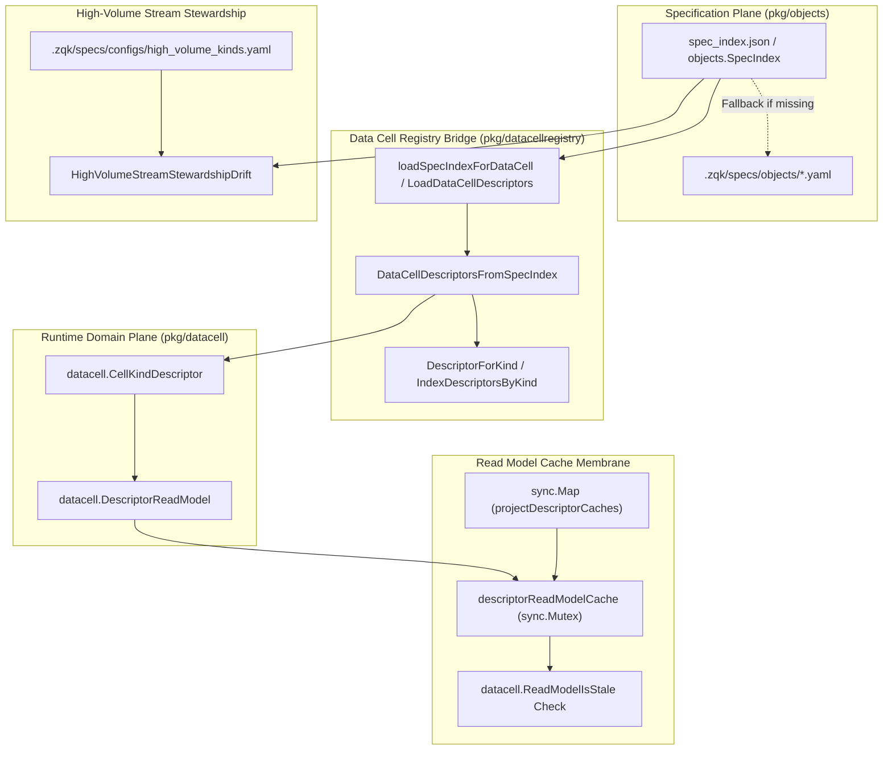
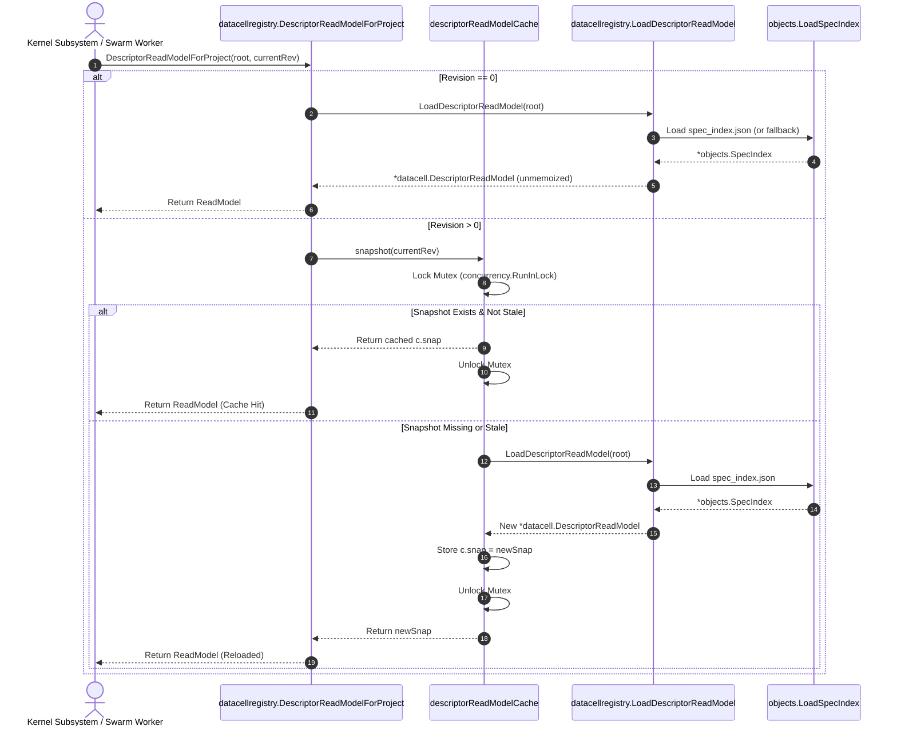
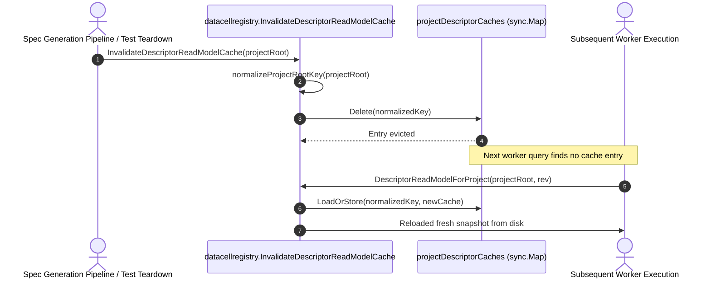

# Data Cell Registry & Read Model Cache Operational Architecture Guide

## Overview

The **Data Cell Registry & Read Model Cache Subsystem** (`pkg/datacellregistry`) serves as the architectural bridge between the Zen Quantum Kernel (ZQK) specification plane (`pkg/objects.SpecIndex`) and runtime data cell execution primitives (`pkg/datacell`).

In the ZQK architecture, a **Data Cell** represents the fundamental unit of state storage, lifecycle governance, and persistence profile assignment. Every ontological entity kind defined within the system (e.g., strategic artifacts, execution contracts, telemetry feeds) maps directly to a backing data cell descriptor. These descriptors govern how objects of that kind are stored (such as Content-Addressed Storage entities, lightweight filesystem records, or high-throughput append-only streams), validated, and accessed across CLI invocations, daemon processes, and multi-agent coordination swarms.

To achieve sub-millisecond descriptor resolution without inducing Go import cycles between the specification plane and runtime data layer, `pkg/datacellregistry` decouples the spec loader from the data cell domain model, providing thread-safe in-memory read model memoization, cache revision tracking, and high-volume stream configuration stewardship.

---

## Architectural Purpose & System Invariants

### 1. Import Cycle Decoupling
The foundational data cell types in `pkg/datacell` are referenced by `pkg/objects` for schema validation. Consequently, `pkg/objects` cannot import high-level data cell registry logic without creating an import cycle. `pkg/datacellregistry` cleanly isolates this dependency boundary by consuming `*objects.SpecIndex` as an input and projecting it into `[]datacell.CellKindDescriptor` and `*datacell.DescriptorReadModel`.

### 2. Core System Invariants

- **V1 Identity Invariant**: For all version 1 (V1) data cell kinds, `CellID` is strictly identical to the ontology `Kind` string. A descriptor is considered invalid and rejected if `Kind` is empty or if `CellID != Kind`.
- **Zero-Staleness Spec Revision Invariant**: Cached descriptor read models are indexed against the highest monotonically increasing cache generation (`MaxSpecRevision(BuilderSpecCacheRevision, GlobalSpecCacheRevision)`). When a spec re-index or modification occurs on disk, queries passing the updated spec cache revision automatically trigger an atomic disk reload under lock.
- **Project Root Normalization Invariant**: All in-process cache lookups and invalidations normalize the repository root via absolute path canonicalization (`normalizeProjectRootKey`). Syntactically distinct project root strings resolving to the same physical directory (e.g., `/repo` vs `/repo/.`) always address the identical in-process cache entry.
- **Fail-Closed Fallback Invariant**: When querying descriptors, the registry attempts to load the fast materialized `.zqk/specs/spec_index.json`. If absent (e.g., during clean checkout or dynamic testing), the registry falls back to building the index directly from the raw YAML definitions in `.zqk/specs/objects/`. If both fail, execution fails closed with a structured error.
- **High-Volume Stream Consistency Invariant**: Kinds configured as append-only streams in `.zqk/specs/configs/high_volume_kinds.yaml` must strictly match the `storage_profile: stream` declaration in their canonical object specs. Any discrepancy is flagged as architectural stewardship drift.

---

## Subsystem Component Topology

The subsystem is partitioned into modular functional layers:



### Component Breakdown:

1. **Descriptor Parser & Factory (`DataCellDescriptorsFromSpecIndex`)**:
   - Iterates through all kind summaries present in an `objects.SpecIndex`.
   - Parses the wire format `storage_profile` into strongly-typed `datacell.StorageProfile` (`cas_entity`, `light_file`, or `stream`).
   - Validates V1 identity invariants for every descriptor before returning.

2. **Index & Resolution Engine (`DescriptorForKind`, `IndexDescriptorsByKind`)**:
   - `DescriptorForKind`: Provides linear descriptor scans suitable for small sets or single lookups.
   - `IndexDescriptorsByKind`: Generates an $O(1)$ hash map mapping ontology kind names to their descriptors, with duplicate kind resolution semantics (last entry wins).

3. **In-Process Cache Membrane (`descriptorReadModelCache`, `sync.Map`)**:
   - Manages a thread-safe `sync.Map` of per-project cache entries.
   - Protects snapshot reload operations with `concurrency.RunInLock` to avoid thundering herd queries when the spec cache advances.
   - Bypasses caching entirely when `currentSpecCacheRevision == 0`, ensuring transient tests or bootstrapping tools observe fresh state without polluting global cache.

4. **Stream Stewardship Sentinel (`HighVolumeStreamStewardshipDrift`)**:
   - Reads `.zqk/specs/configs/high_volume_kinds.yaml`.
   - Compares declared stream configurations against the materialized spec index.
   - Identifies unregistered kinds or profile mismatches before runtime streams are opened.

---

## Data Cell Descriptor Lifecycle & Workflows

### 1. Descriptor Resolution & Cache Hit/Miss Flow

When a consumer (e.g., storage router, CLI command handler, or kernel daemon) requests a data cell read model:



### 2. Cache Invalidation Flow

When spec definitions are modified or re-indexed (such as via `zqk system generate-spec-index` or spec origination pipeline execution):



---

## Storage Profiles Supported

Every data cell descriptor exposes a parsed storage profile governing physical storage mechanics:

| Storage Profile Wire Value | `datacell.StorageProfile` Enum | Target Storage Engine | Characteristics & Invariants |
| :--- | :--- | :--- | :--- |
| `cas_entity` | `datacell.ProfileCASEntity` | CAS Content Addressed Storage (`.zqk/cas`) | Immutable, SHA-256 addressed blobs; versioned state; two-phase draft/promoted boundary. |
| `light_file` | `datacell.ProfileLightFile` | Direct File System Records (`.zqk/light`) | Low-overhead hierarchical disk storage for small, frequently updated metadata. |
| `stream` | `datacell.ProfileStream` | Append-Only Stream / WAL (`.zqk/stream`) | High-volume sequential event logs; monotonic sequence indexing; optimized for stream ingestion. |
| `""` (unspecified) | `datacell.ProfileUnknown` | Default Kernel Plane | Fallback default behavior according to system-wide object storage rules. |

---

## Production Configurations & Memory Hygiene

### In-Process Cache Concurrency & Memory Footprint

1. **Singleton Map Footprint**:
   - The package-level `projectDescriptorCaches` `sync.Map` holds exactly one entry per active repository root. In production CLI runs and long-lived server daemons, this typically consumes less than 150 KB of memory for 70+ object kinds.
2. **Reentrancy & Deadlock Prevention**:
   - Cache snapshot retrieval locks a single entry-scoped `sync.Mutex` using `concurrency.RunInLock`. The critical section performs disk I/O only on cache miss or cache staleness.
   - In-memory lookups during steady-state execution take the read path and complete in sub-microsecond time.
3. **Equivalence & Symlink Handling**:
   - Always supply clean project roots. Because `normalizeProjectRootKey` applies `filepath.Abs`, passing relative paths (`.`) or trailing slashes will safely map to the canonical entry.

---

## Operational Recipes

### Recipe 1: Resolving a Data Cell Descriptor for a Kind

```go
package main

import (
	"fmt"
	"log"

	"github.com/zqk-os/zqk/pkg/datacellregistry"
)

func main() {
	projectRoot := "/path/to/project"

	// 1. Load descriptors from projectRoot
	descriptors, err := datacellregistry.LoadDataCellDescriptors(projectRoot)
	if err != nil {
		log.Fatalf("failed to load descriptors: %v", err)
	}

	// 2. Lookup a specific kind
	desc, ok := datacellregistry.DescriptorForKind(descriptors, "goal")
	if !ok {
		log.Fatal("kind 'goal' not found in registry")
	}

	fmt.Printf("Kind: %s, Profile: %s\n", desc.Kind, desc.ParsedProfile)
}
```

### Recipe 2: Using the Cached Read Model in a Long-Lived Service

```go
package main

import (
	"log"

	"github.com/zqk-os/zqk/pkg/datacellregistry"
)

func ProcessEvent(projectRoot string, currentSpecRevision uint64) error {
	// Query descriptor read model using the current known spec revision
	readModel, err := datacellregistry.DescriptorReadModelForProject(projectRoot, currentSpecRevision)
	if err != nil {
		return err
	}

	// Fast O(1) in-memory map lookup
	descMap := readModel.DescriptorMap()
	if desc, found := descMap["audit_event"]; found {
		if desc.ParsedProfile.IsStream() {
			log.Println("Handling stream-backed audit_event")
		}
	}
	return nil
}
```

### Recipe 3: Checking High-Volume Stream Configuration Alignment

```go
package main

import (
	"fmt"
	"log"

	"github.com/zqk-os/zqk/pkg/datacellregistry"
)

func CheckStreamStewardship(projectRoot string) {
	drift, err := datacellregistry.HighVolumeStreamStewardshipDrift(projectRoot)
	if err != nil {
		log.Fatalf("error checking stream stewardship: %v", err)
	}
	if len(drift) > 0 {
		fmt.Println("Detected stream configuration drift:")
		for _, issue := range drift {
			fmt.Printf(" - %s\n", issue)
		}
	} else {
		fmt.Println("Stream configurations are fully aligned with object specifications.")
	}
}
```

---

## Troubleshooting Matrix

| Symptom | Probable Cause | Remediation Step |
| :--- | :--- | :--- |
| `project root is required` error | An empty string `""` was passed as `projectRoot` to registry lookup or cache functions. | Ensure project root resolution (via `paths.FindProjectRoot()` or equivalent) succeeds before invoking registry APIs. |
| Stale descriptor values after editing an object spec YAML | In-process cache still holds the snapshot built at the prior spec revision. | Trigger `datacellregistry.InvalidateDescriptorReadModelCache(projectRoot)` or supply the updated `specCacheRevision` to `DescriptorReadModelForProject`. |
| `kind "X" storage_profile: unknown profile "Y"` | An object spec YAML declared an unsupported or misspelled `storage_profile` value. | Verify that the spec YAML specifies one of the standard profiles: `cas_entity`, `light_file`, or `stream`. |
| `high_volume_kinds.yaml` stream drift error | A kind is declared with `storage: stream` in `high_volume_kinds.yaml` but is missing from the spec index or declares a different profile. | Run `zqk system generate-spec-index` to refresh index, and verify consistency between `high_volume_kinds.yaml` and the kind's spec YAML. |
| Test collision across parallel test executions | Multiple test cases sharing the default root or modifying spec index concurrently. | Use `t.TempDir()` with distinct synthetic project roots; each temporary root receives an isolated cache entry. |
