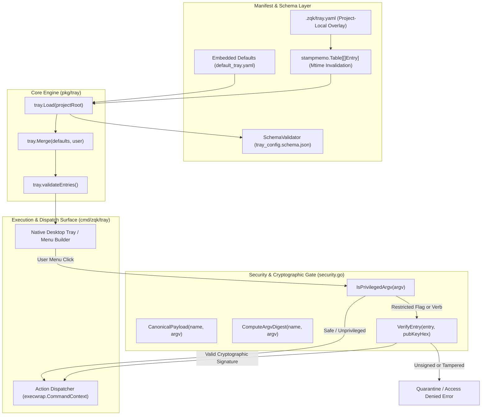
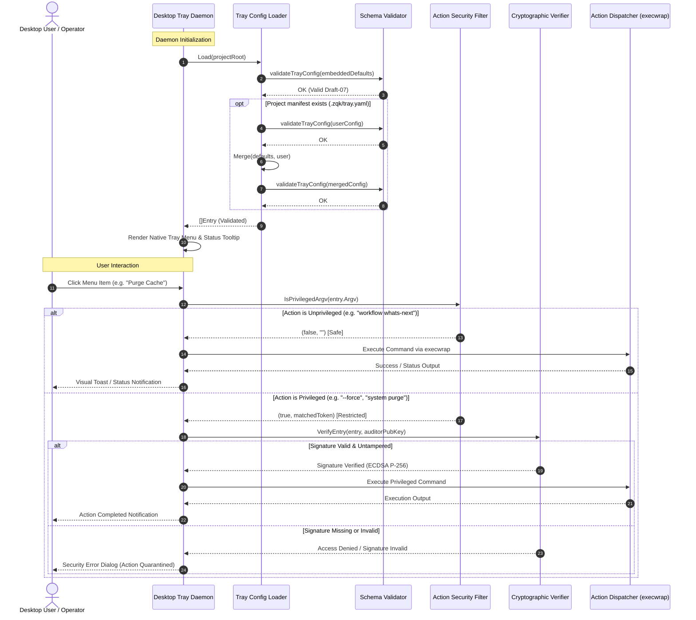
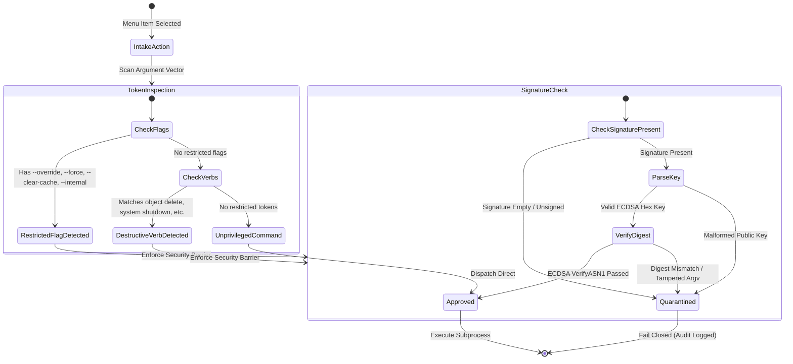

# Desktop System Tray, Menu Schema Validation & Action Security Subsystem Guide

## Overview

The **Desktop System Tray, Menu Schema Validation & Action Security Subsystem** (`pkg/tray`, `cmd/zqk/tray`) provides the native desktop and shell integration surface for the **ZQK Knowledge Kernel**. It enables operating systems (macOS Menu Bar, Windows Notification Area, Linux System Tray) and local desktop automation harnesses to present an interactive menu of verified shortcuts, trigger kernel workflows, observe ambient daemon status, and safely dispatch command actions.

System tray commands bridge interactive user intent with the underlying CLI execution engine. Because desktop shortcuts can execute command lines with full process authority, the subsystem enforces a strict security envelope:
1. **Embedded Defaults & User Manifest Merging**: Ship with built-in, immutable diagnostic shortcuts while permitting project-level personalization via `.zqk/tray.yaml`.
2. **Deterministic JSON Schema Validation**: Validate manifest integrity against an embedded JSON Schema Draft-07 specification prior to menu construction.
3. **Defense-in-Depth Action Security Membrane**: Inspect command verbs and arguments against a restricted token list, requiring cryptographic ECDSA signatures for any privileged or destructive operations.
4. **Hermetic Concurrency & Event Safety**: Execute background status updates, schema validations, and action dispatching asynchronously under supervised goroutine monitoring (`goroutinelabels.NewGoroutine`).

---

## Subsystem Architecture & Component Topology

The subsystem operates through five cooperating components that isolate untrusted manifest data from OS execution surfaces:



### 1. TrayManager & Configuration Loader (`tray.go`)
- **Dual Configuration Sources**: Loads embedded baseline entries from `default_tray.yaml` and overlays optional project-local entries from `.zqk/tray.yaml`.
- **Stamp Memoization**: Leverages `stampmemo.Table[[]Entry]` keyed by project root and tracked by modification timestamp (`mtime`), ensuring zero disk I/O on hot lookup paths while dynamically reloading when the on-disk file changes.
- **Entry Merging**: Performs deterministic overlay (`Merge`). Entries sharing a name with a default entry replace that entry's description and argv; newly declared entries are appended in declaration order. Default entries retain their precedence and are flagged with `IsDefault = true`.

### 2. SchemaValidator (`schema.go`)
- **JSON Schema Draft-07 Enforcement**: All tray configurations (embedded defaults, project overrides, and merged composites) are validated against `tray_config.schema.json`.
- **Structural Constraints**:
  - `version`: Integer `>= 1`.
  - `entries`: Array of objects with mandatory `name` and `argv` fields.
  - `name`: Lowercase hyphen-separated identifier matching `^[a-z0-9][-a-z0-9]*$`.
  - `argv`: Non-empty array of strings specifying subcommands and arguments (excluding the `zqk` binary name).
  - Optional fields: `description`, `signed_by` (Kernel Account ID), and `signature` (hex-encoded ASN.1 ECDSA signature).
  - Closed schema: `additionalProperties: false` rejects unmapped or extraneous fields.

### 3. SecurityFilter & Cryptographic Verifier (`security.go`)
- **Privilege Boundary Enforcement**: Inspects full argument vectors before dispatch to detect restricted flags (`--override`, `--force`, `--clear-cache`, `--internal`) and destructive command verbs (`object delete`, `system shutdown`, `system purge`, `io reap`, `delete`).
- **Cryptographic Authorization**: Privileged commands cannot execute via the system tray unless signed by an authorized auditor key using ECDSA on curve P-256.
- **Canonical Payload & SHA-256 Digest**: Serializes `{"argv": [...], "name": "..."}` deterministically before computing SHA-256 digests and evaluating ASN.1 ECDSA signatures.

### 4. MenuBuilder & UI Representation
- **Native OS Tray Adapters**: Translates validated `Entry` lists into native macOS NSStatusItem, Windows NotifyIcon, or Linux StatusNotifierItem menus.
- **Format Explanation**: Provides human-readable command previews via `FormatExplainLine`, properly quoting arguments containing whitespace or shell metacharacters.

### 5. ActionDispatcher
- **Process Isolation**: Dispatches approved actions through `execwrap.CommandContext`, inheriting execution timeout contexts, telemetry spans, and environment variables.
- **Provenance Annotation**: Injects execution source environment markers (`ZQK_EXEC_SOURCE=tray`) to ensure audit traceability.

---

## System Tray Execution Lifecycle

The following sequence diagram outlines the entire lifecycle from daemon boot to user interaction and secure dispatch:



---

## Security Filter Specification & Defense-in-Depth

The subsystem enforces defense-in-depth against malicious configuration injection, untrusted project repository checkouts, and accidental destructive actions:



### Restricted Tokens Matrix

| Category | Token Pattern | Security Rationale |
| :--- | :--- | :--- |
| **Bypass Flag** | `--override`, `--override=*` | Bypasses kernel check-valves and policy gates; requires explicit human or auditor signoff. |
| **Destructive Flag** | `--force`, `--force=*` | Overrides safety prompts and integrity validations. |
| **Cache Manipulation** | `--clear-cache` | Invalidates build or verification state, potentially triggering stale execution. |
| **Internal Access** | `--internal` | Exposes private kernel diagnostics and unverified internal subcommands. |
| **Object Deletion** | `object delete`, `delete` | Permanent pruning of knowledge kernel entities (goals, requirements, backlog items). |
| **System Termination** | `system shutdown` | Forceful shutdown of background scheduler and daemon processes. |
| **State Purging** | `system purge` | Wipes runtime databases, caches, and working directories. |
| **Resource Reaping** | `io reap` | Force-terminates orphaned processes and reclaims locked file descriptors. |

---

## Concurrency & Thread-Safety Guarantees

Desktop tray interactions occur on UI event threads, while background monitoring, status polling, and command dispatch operate asynchronously. The subsystem maintains strict thread safety:

1. **Stamp Memoization Synchronization**:
   `trayEntries` is an instance of `stampmemo.Table[[]Entry]`, which employs internal read-write mutex locks (`sync.RWMutex`) around the generation stamp and cached entries. Multiple concurrent goroutines calling `Load` simultaneously do not race or corrupt memory.
2. **Schema Compilation Once**:
   The embedded JSON Schema is compiled lazily via `sync.Once` in `compiledTraySchema()`. Subsequent validations read the pre-compiled immutable AST without recompilation overhead.
3. **Isolated Action Execution**:
   Command dispatching runs in dedicated goroutines supervised through `goroutinelabels.NewGoroutine`. This prevents desktop UI hangs if an invoked subprocess stalls on I/O.
4. **Pure Functional Transformations**:
   `Merge`, `Find`, `FormatExplainLine`, `CanonicalPayload`, and `ComputeArgvDigest` are purely functional and operate on cloned slices, ensuring zero shared-memory mutation.

---

## Verification & Coverage Invariant

The subsystem enforces a strict verification invariant across all build pipelines and continuous integration gates:

- **Static Floor Invariant**: Statement test coverage for `pkg/tray` must strictly meet or exceed **85.0%** (target >=95-100%).
- **Automated Verification Command**:
  ```bash
  ZQK_ALLOW_FOREGROUND_GO_TEST=1 go test -v -timeout 30s -cover ./pkg/tray
  ```
- **AST Hygiene Checks**:
  - Zero swallowed errors (`_ = ...` strictly eradicated; all error returns verified).
  - Test functions kept modular and under 100 lines.
  - Safe filesystem manipulation using `fileutil.*` in hermetic temporary directories (`t.TempDir()`).
  - No naked goroutines; all asynchronous background routines use `goroutinelabels.NewGoroutine`.

---

## Related Documentation

- **[CLI Visual Studio & Interactive TUI Subsystem Guide](./CLI_UI_SUBSYSTEM_GUIDE.md)**: Mission control interface and terminal telemetry views.
- **[TUI Engine & Terminal Interface Subsystem Guide](./TUI_SUBSYSTEM_GUIDE.md)**: Elm architecture (Model-Update-View) terminal engine.
- **[Shell Command Parsing & Cross-Platform Execution Guide](./SHELL_COMMAND_EXECUTION_AND_ARGV_GUIDE.md)**: Hardened process execution and argv sanitization.
- **[Cryptographic Primitives & Key Management Guide](./CRYPTOGRAPHIC_PRIMITIVES_AND_KEY_MANAGEMENT_GUIDE.md)**: Digital signatures, keys, and security envelopes.
