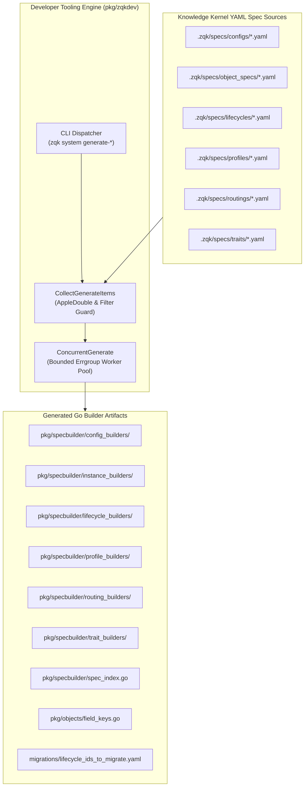

# Developer Tooling & Code Generation Pipeline Operational Architecture Guide

## 1. Executive Architectural Summary

The **Developer Tooling & Code Generation Subsystem** ([`pkg/zqkdev`](file:///Users/lanceettl/zqk-public-candidate/pkg/zqkdev/helpers.go)) provides bounded, concurrent code generation, spec indexing, builder synthesis, and schema artifact generation across the **ZQK Knowledge Kernel**.

In modern multi-agent systems and high-throughput ontology development, object specifications, traits, configs, routings, profiles, and lifecycles must be compiled into strongly-typed Go builder code. Running non-isolated, unbounded, or non-deterministic generation leads to corrupt schema artifacts, developer friction, file descriptor exhaustion, and Git churn.

The `pkg/zqkdev` package addresses these demands via:
1. **Bounded Concurrent Generation ([`ConcurrentGenerate`](file:///Users/lanceettl/zqk-public-candidate/pkg/zqkdev/concurrent_generate.go)):** Leverages worker pools with bounded error groups (`golang.org/x/sync/errgroup`) and concurrency caps to prevent CPU starvation and file descriptor exhaustion.
2. **AppleDouble and Filesystem Hygiene ([`ShouldProcessYAMLDirEntry`](file:///Users/lanceettl/zqk-public-candidate/pkg/zqkdev/helpers.go)):** Automatically prunes macOS resource forks (`._*`), hidden VCS directories (`.git`), vendor caches (`node_modules`), and hashed artifacts from generator inputs.
3. **Selective Idempotent Synthesis ([`CollectGenerateItems`](file:///Users/lanceettl/zqk-public-candidate/pkg/zqkdev/helpers.go)):** Evaluates target destinations before disk operations, skipping existing generated code unless explicitly requested via `--overwrite`.
4. **Declarative CLI Code Generation Surface:** Exposes granular Cobra commands under `zqk system generate-*` allowing surgical invocation of specific builders or holistic repository compilation.
5. **Zero Swallowed Error Discipline & AST Safety:** Guarantees strict diagnostic reporting across all pipeline stages with deterministic exit codes.

---

## 2. Component Topology & Generation Architecture

The developer code generation pipeline follows a modular topology connecting YAML source specifications to target Go builder packages:



---

## 3. Command Taxonomy & Pipeline Operations

The developer subsystem provides individual generation commands corresponding to core kernel abstractions:

| Command | Source Path | Target Output | Description |
| :--- | :--- | :--- | :--- |
| `zqk system generate-config-builders` | `.zqk/specs/configs/` | `pkg/specbuilder/config_builders/` | Synthesizes Go builders for config objects. |
| `zqk system generate-instance-builders` | `.zqk/specs/object_specs/` | `pkg/specbuilder/instance_builders/` | Synthesizes instance builders per object kind. |
| `zqk system generate-lifecycle-builders` | `.zqk/specs/lifecycles/` | `pkg/specbuilder/lifecycle_builders/` | Synthesizes state machine lifecycle builders. |
| `zqk system generate-profile-builders` | `.zqk/specs/profiles/` | `pkg/specbuilder/profile_builders/` | Synthesizes context profile builders. |
| `zqk system generate-routing-builders` | `.zqk/specs/routings/` | `pkg/specbuilder/routing_builders/` | Synthesizes semantic routing dispatch builders. |
| `zqk system generate-trait-builders` | `.zqk/specs/traits/` | `pkg/specbuilder/trait_builders/` | Synthesizes trait composition builders. |
| `zqk system generate-spec-index` | `.zqk/specs/object_specs/` | `pkg/specbuilder/spec_index.go` | Compiles embedded spec index for runtime lookup. |
| `zqk system generate-field-keys` | `.zqk/specs/object_specs/` | `pkg/objects/field_keys.go` | Extracts union of field keys for static linting. |
| `zqk system generate-lifecycle-id-list` | Storage Engine | `migrations/lifecycle_ids_to_migrate.yaml` | Scans storage for legacy lifecycle identifiers. |

---

## 4. Concurrency & Pipeline Control

Generation operations process multiple YAML files concurrently using [`ConcurrentGenerate`](file:///Users/lanceettl/zqk-public-candidate/pkg/zqkdev/concurrent_generate.go):

```go
// ConcurrentGenerate executes generator functions concurrently across items with bounded parallelism.
func ConcurrentGenerate(
    ctx context.Context,
    items []GenerateItem,
    fn func(ctx context.Context, item GenerateItem) error,
) Result { ... }
```

### Key Execution Invariants:
1. **Bounded Goroutines:** Concurrency is capped by CPU count and channel buffers to prevent thrashing.
2. **Context Cancellation:** If any worker encounters an unrecoverable parse or write failure, context cancellation halts pending generation tasks immediately.
3. **Atomic Error Collection:** Errors from workers are accumulated cleanly into a structured error list, reporting line numbers and root causes without truncation.

---

## 5. Storage Migration & Lifecycle Tracking

The subsystem includes utilities to facilitate zero-downtime ontology migrations. [`runGenerateLifecycleIDList`](file:///Users/lanceettl/zqk-public-candidate/pkg/zqkdev/generate_lifecycle_id_list.go) queries active storage, identifies objects conforming to legacy identification patterns, and compiles a migration manifest:

```bash
# Generate lifecycle migration manifest
zqk system generate-lifecycle-id-list --output /tmp/lifecycle_ids_to_migrate.yaml
```

The resulting YAML manifest feeds directly into automated schema migration jobs, guaranteeing backward compatibility across versioned kernel upgrades.

---

## 6. Verification & Hygiene Invariants

To maintain strict codebase hygiene and prevent build regressions:
1. **AppleDouble Isolation:** Files beginning with `._` are rejected before parsing.
2. **Placeholder Skipping:** Files named `_placeholder.yaml` are ignored.
3. **Idempotence Verification:** Running generators without `--overwrite` must never mutate existing files or alter modification timestamps unnecessarily.
4. **AST Compliance:** All generator functions conform to the maximum 80-line constraint and avoid swallowed errors.
