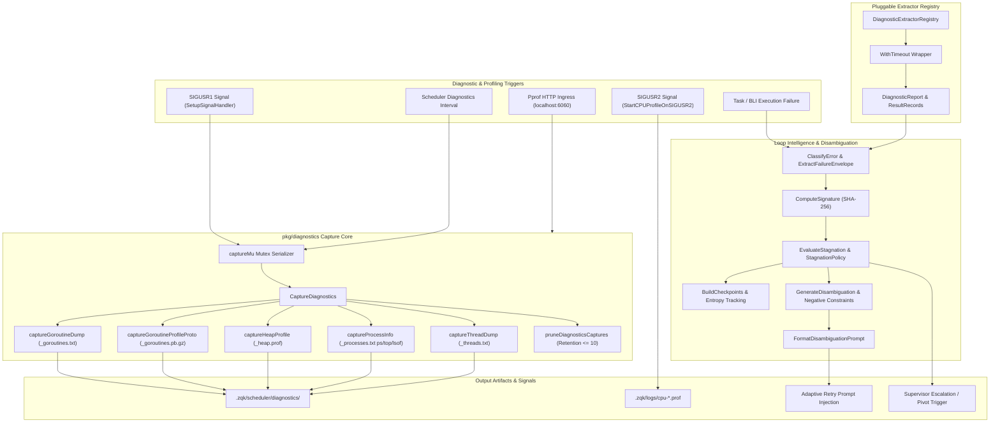
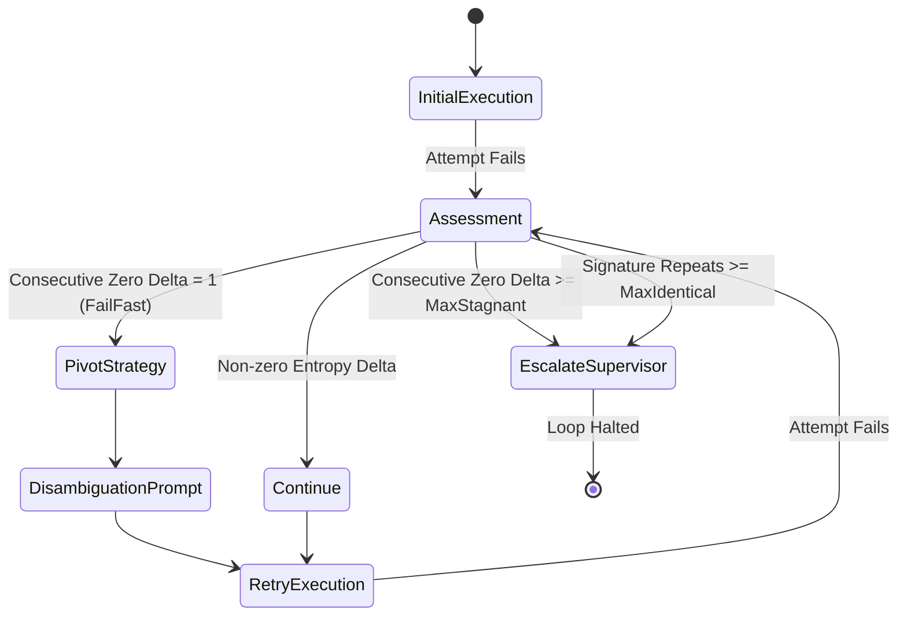
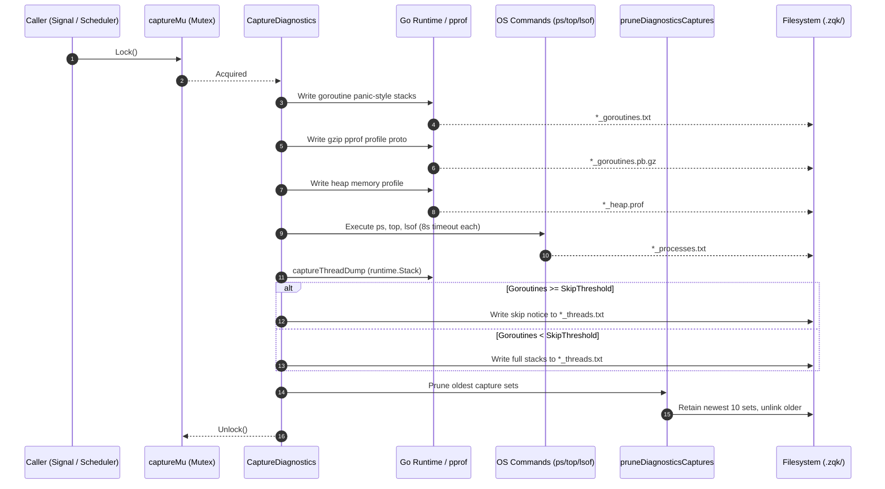

# Diagnostic Capture, Stagnation Detection & Runtime Profile Subsystem Architectural & Operational Guide

## 1. Executive Summary & Design Philosophy

The **Diagnostic Capture, Stagnation Detection & Runtime Profile Subsystem** ([`pkg/diagnostics`](file:///Users/lanceettl/zqk-public-candidate/pkg/diagnostics)) delivers deterministic failure introspection, non-blocking runtime state extraction, automated stagnation loop prevention, and signal-driven profiling across the ZQK Knowledge Kernel and daemon services.

When distributed processes, worker swarms, or background schedulers stall, loop endlessly, or encounter hard errors, naive retry harnesses waste computational budgets, mask root causes, and produce catastrophic cascade failures. The diagnostics subsystem addresses this through four core design pillars:

1. **Deterministic Structural Failure Attribution:** Every execution failure is classified into standard, project-agnostic categories (`success`, `timeout`, `execution_failure`, `constraint_violation`, `context_cancelled`, `verification_failed`, `unknown`) and fingerprinted with a cryptographically deterministic SHA-256 signature invariant to timestamps.
2. **Entropy-Driven Stagnation Detection:** Sequential retry attempts are evaluated for diagnostic delta. If successive failures produce zero entropy (identical failure signatures or repeated failing constraint patterns), the loop is immediately flagged as stagnant to trigger strategy pivoting or supervisor escalation rather than blind looping.
3. **Pluggable & Fail-Closed Diagnostic Extractors:** Subsystems register isolated diagnostic extractors with a thread-safe registry. Extractors run sequentially with strict timeout bounds; a failure in any individual extractor never halts the report run.
4. **Non-Blocking Runtime Profiling & Signal Handling:** Low-overhead Unix signal listeners (`SIGUSR1` for diagnostic snapshots, `SIGUSR2` for 30-second CPU profiling) and an embedded, localhost-bound `pprof` HTTP server provide instant operational observability into live production binaries without restarts.

---

## 2. Subsystem Architectural Overview

The diagnostics subsystem bridges runtime OS telemetry, memory and thread profiling, failure classification, and retry feedback.



---

## 3. Core Component Deep Dive

### 3.1 Failure Envelopes & Deterministic Signatures

The **`FailureEnvelope`** ([`pkg/diagnostics/envelope.go`](file:///Users/lanceettl/zqk-public-candidate/pkg/diagnostics/envelope.go)) encapsulates execution outcomes across attempts:

```go
type FailureEnvelope struct {
	Attempt            int                  `json:"attempt"`
	ExitCode           int                  `json:"exit_code"`
	ErrorMessage       string               `json:"error_message"`
	Category           string               `json:"category"`
	FailingConstraints []string             `json:"failing_constraints,omitempty"`
	ExecutedActions    []string             `json:"executed_actions,omitempty"`
	DiagnosticReports  []DiagnosticArtifact `json:"diagnostic_artifacts,omitempty"`
	Signature          string               `json:"signature"`
	Timestamp          time.Time            `json:"timestamp"`
}
```

#### Deterministic Cryptographic Fingerprint (`ComputeSignature`)
Failure signatures are calculated using SHA-256 over normalized structural characteristics:
- Failure category
- Numerical exit code
- Trimmed and bounded error message (capped at `DefaultMaxErrorLength = 4096` bytes)
- Alphabetically sorted constraints
- Ordered executed actions sequence

Because timestamp is intentionally excluded, two execution attempts that encounter the identical structural root cause produce byte-for-byte identical signatures.

#### Error Classification Categories
The `ClassifyError` function parses error texts and exit codes into unambiguous taxonomy:
- **`CategorySuccess`:** `err == nil`, `exitCode == 0`, and zero failing constraints.
- **`CategoryConstraintViolation`:** One or more invariant or criteria constraints failed.
- **`CategoryTimeout`:** Deadlines exceeded or timed-out context errors.
- **`CategoryContextCancelled`:** Explicit caller or worker cancellation.
- **`CategoryVerificationFailed`:** Automated verifier or test assertion rejection.
- **`CategoryExecutionFailure`:** Process exited with non-zero exit code.
- **`CategoryUnknown`:** Unclassified fallbacks.

---

### 3.2 Loop Stagnation Detection & Adaptive Disambiguation

Retrying failed operations blindly when the underlying state has not changed burns token budgets and wastes compute. The stagnation detector ([`pkg/diagnostics/stagnation.go`](file:///Users/lanceettl/zqk-public-candidate/pkg/diagnostics/stagnation.go)) and disambiguation engine ([`pkg/diagnostics/disambiguation.go`](file:///Users/lanceettl/zqk-public-candidate/pkg/diagnostics/disambiguation.go)) implement fail-fast feedback.

#### Stagnation Policy & Assessment Rules
A `StagnationPolicy` defines loop boundaries:
- `MaxStagnantAttempts`: Consecutive zero-entropy retry attempts before escalating (default: 2).
- `MaxIdenticalSignatures`: Cumulative count of identical signatures across full history before escalating (default: 2).
- `ZeroDeltaFailFast`: When `true`, any consecutive identical failure triggers an immediate `pivot_strategy` recommendation.



#### Adaptive Disambiguation Prompts
When a retry is necessary, `GenerateDisambiguation` synthesizes actionable guidance:
1. **Negative Constraints:** Extracts failing action patterns, ranking them by violation frequency to explicitly instruct the agent: `AVOID repeating action "X": <reason>`.
2. **Diagnostic Differential:** Contrasts attempt $N-1$ and $N$, documenting category or exit code shifts or highlighting zero-delta stagnation.
3. **Actionable Guidance:** Synthesizes unsatisfied constraints and remediation steps, strictly bounded to `MaxPromptBytes` (default: 2048 bytes).

---

### 3.3 Diagnostic Capture Pipeline (`CaptureDiagnostics`)

The `CaptureDiagnostics` function ([`pkg/diagnostics/capture.go`](file:///Users/lanceettl/zqk-public-candidate/pkg/diagnostics/capture.go)) executes a comprehensive system dump:



#### Goroutine Skip Threshold Invariant
Under heavy scheduler load, running `runtime.Stack` on thousands of active goroutines can allocate 30MB+ buffers and stall execution.
- If the active goroutine count exceeds `threadDumpSkipRuntimeStackMinGoroutines` (default: 5000, configurable via `ZQK_DIAGNOSTICS_THREAD_STACK_SKIP_MIN_GOROUTINES`), the thread dump body is safely skipped with a logged notice.
- Complete goroutine stack traces remain available in the accompanying `*_goroutines.txt` and `*_goroutines.pb.gz` artifacts.

#### Retention Pruning Invariant
Each capture invocation calls `pruneDiagnosticsCaptures` ([`pkg/diagnostics/capture_prune.go`](file:///Users/lanceettl/zqk-public-candidate/pkg/diagnostics/capture_prune.go)):
- Keeps the newest 10 capture sets (`diagnosticsRetentionMaxCaptureSets`).
- Unmatched or non-diagnostic files are left completely untouched.
- Cleanups are fail-safe: I/O errors during pruning never fail the diagnostic capture call.

---

### 3.4 Runtime Profiling & Embedded Pprof Server

#### SIGUSR1 Signal Handler (`SetupSignalHandler`)
Registers a background listener for `syscall.SIGUSR1`. Upon receipt, it spawns an asynchronous, bounded goroutine to invoke `CaptureDiagnostics`, writing artifacts to `<projectRoot>/.zqk/diagnostics/<prefix>/`. The main listener continues monitoring for subsequent signals.

#### SIGUSR2 CPU Profiler (`StartCPUProfileOnSIGUSR2`)
Registers a background listener for `syscall.SIGUSR2`. On trigger:
- Checks `cpuProfileActive` mutex to prevent concurrent overlapping dumps.
- Spawns a 30-second `pprof.StartCPUProfile` writing to `<logsDir>/cpu-<timestamp>.prof`.
- Flushes and halts profiling cleanly upon duration expiry.

#### Embedded Localhost Pprof Server (`StartPprofServerIfEnabled`)
When enabled via environment variables, starts an HTTP server serving standard Go `/debug/pprof/` routes:
- Binds strictly to `localhost:<port>` (never public interfaces).
- Built with `BuildPprofServer` configuring timeouts: `ReadHeaderTimeout = 5s`, `ReadTimeout = 30s`, `WriteTimeout = 60s`, `IdleTimeout = 60s`.

---

## 4. Configuration & Environment Variables

| Variable | Fallback Keys | Default | Description |
| :--- | :--- | :--- | :--- |
| `ZQK_DIAGNOSTICS_THREAD_STACK_SKIP_MIN_GOROUTINES` | None | `5000` | Minimum goroutine count at which `runtime.Stack` is skipped in `_threads.txt`. Set to `0` or negative to disable threshold skipping. |
| `ZQK_PPROF` | `ZQK_SCHEDULER_PPROF`, `ZQK_STABLE_PPROF` | unset (`false`) | Set to `1`, `true`, or `TRUE` to start the embedded pprof HTTP server on bootstrap. |
| `ZQK_PPROF_PORT` | `ZQK_SCHEDULER_PPROF_PORT`, `ZQK_STABLE_PPROF_PORT` | `6060` | TCP port for embedded pprof HTTP server (valid range 1–65535). |

---

## 5. Operational Runbooks

### Runbook 1: On-Demand Diagnostic Snapshot via Signal
When a scheduler daemon or CLI process appears unresponsive:

```bash
# 1. Identify target process PID
PID=$(pgrep -f "zqk-scheduler" || pgrep -f "zqk")

# 2. Trigger diagnostic capture
kill -USR1 "$PID"

# 3. Inspect generated files
ls -lt .zqk/scheduler/diagnostics/
# Output includes:
#   scheduler_daemon_<timestamp>_goroutines.txt
#   scheduler_daemon_<timestamp>_goroutines.pb.gz
#   scheduler_daemon_<timestamp>_heap.prof
#   scheduler_daemon_<timestamp>_processes.txt
#   scheduler_daemon_<timestamp>_threads.txt
```

### Runbook 2: 30-Second On-Demand CPU Profile
To profile CPU bottlenecks without restarting the process:

```bash
# 1. Send SIGUSR2 to active daemon
kill -USR2 "$PID"

# 2. Wait 30 seconds for sampling duration to conclude
sleep 31

# 3. Analyze profile using standard go pprof
LATEST_PROF=$(ls -t .zqk/logs/cpu-*.prof | head -n 1)
go tool pprof -http=:8080 "$LATEST_PROF"
```

### Runbook 3: Interactive Pprof HTTP Inspection
When `ZQK_PPROF=1` is configured:

```bash
# 1. Check live goroutine counts
curl -s http://localhost:6060/debug/pprof/goroutine?debug=1 | head -n 20

# 2. Download 30-second CPU trace
curl -o trace.out http://localhost:6060/debug/pprof/trace?seconds=30
go tool trace trace.out

# 3. Analyze heap memory allocation in browser
go tool pprof -http=:8081 http://localhost:6060/debug/pprof/heap
```

### Runbook 4: Resolving Stagnant Retry Loops
When an agent or task repeatedly hits `loop stagnation detected`:
1. Check the failure envelope signature:
   ```json
   { "is_stagnant": true, "consecutive_zero_delta": 2, "recommendation": "escalate_to_supervisor" }
   ```
2. Inspect `failing_constraints` in the envelope to determine which precondition or postcondition is failing.
3. Review the generated `Negative Constraints` in the prompt injection to ensure the agent is not repeating prohibited commands or file mutations.
4. If the failure is non-transient, halt the execution cycle and route to an operator.

---

## 6. Verification & Invariants

| Invariant ID | Subsystem Invariant | Verification Mechanism |
| :--- | :--- | :--- |
| **INV-DIAG-001** | Capture serialization: at most one `CaptureDiagnostics` runs concurrently. | Mutex lock `captureMu` validated in unit tests. |
| **INV-DIAG-002** | Goroutine stack skip threshold prevents out-of-memory under high concurrency. | `threadStackSkipThresholdFromEnv` tested with custom thresholds. |
| **INV-DIAG-003** | Artifact pruning limits directory growth to newest 10 capture sets. | `pruneDiagnosticsCaptures` validated with mock datasets. |
| **INV-DIAG-004** | Pluggable extractors fail-closed; single extractor failure never aborts run. | `DiagnosticExtractorRegistry.Run` tested with failing extractors. |
| **INV-DIAG-005** | Cryptographic failure signatures are deterministic and invariant to timestamp. | `ComputeSignature` tested with identical parameters and varying times. |
| **INV-DIAG-006** | Statement test coverage across `pkg/diagnostics` strictly satisfies $\ge 85.0\%$. | Automated CI gate: `go test -race -coverprofile=coverage.out ./pkg/diagnostics/...`. |
