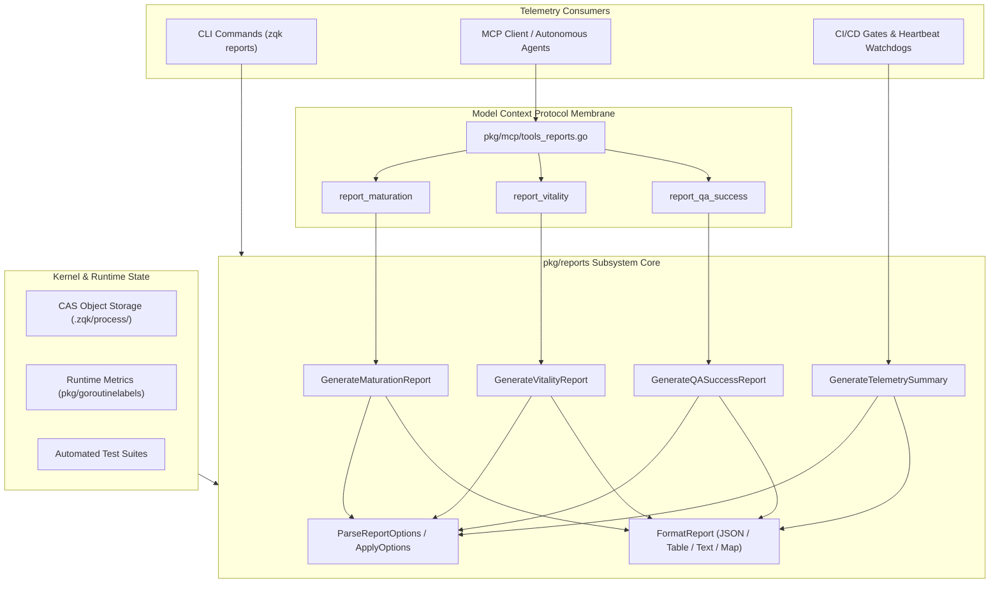
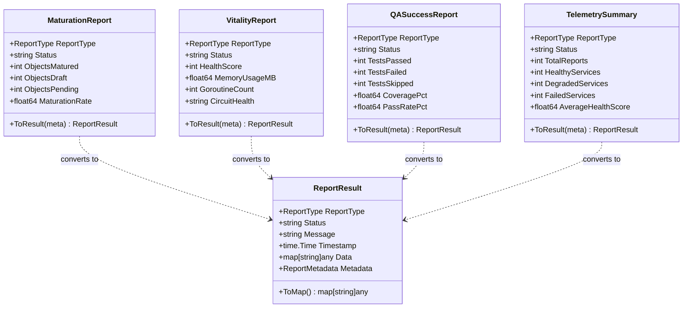
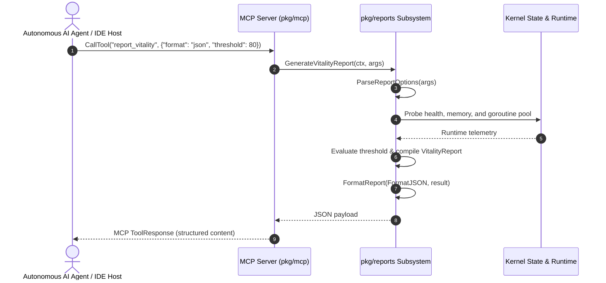
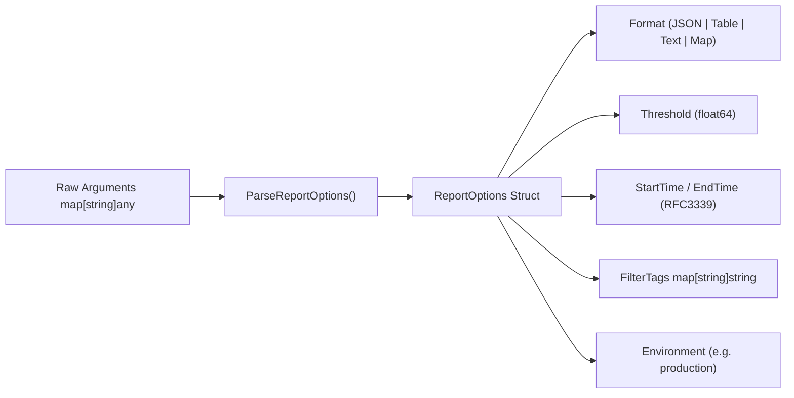

# Diagnostic Reports & System Vitality Telemetry Subsystem Architectural & Operational Guide

## 1. Executive Summary & Design Philosophy

The **Diagnostic Reports & System Vitality Telemetry Subsystem** ([`pkg/reports`](file:///Users/lanceettl/zqk-public-candidate/pkg/reports/reports.go)) provides real-time, deterministic diagnostic telemetry, lifecycle progression analysis, test execution metrics, and runtime vitality monitoring across the ZQK Knowledge Kernel.

Rather than relying on transient LLM hallucinations or subjective human estimations, ZQK diagnostic reporting evaluates state directly from Content-Addressed Storage (CAS), runtime memory and concurrency monitors, automated verification test suites, and git version history.

Key capabilities delivered by the subsystem include:
- **Object Lifecycle Maturation Telemetry (`maturation`):** Quantifies graph progression across draft, pending, and matured states, calculating deterministic completion rates.
- **Runtime System Vitality Telemetry (`vitality`):** Tracks memory usage, active goroutine pools, circuit breaker states, and composite health scores.
- **Automated QA Verification Telemetry (`qa_success`):** Gathers test pass rates, skipped counts, coverage statistics, and failure diagnostics.
- **Cross-Subsystem Telemetry Aggregation (`telemetry_summary`):** Compiles multi-service telemetry payloads into unified health snapshots with automated threshold alerts.
- **Multi-Format Presentation Pipeline:** Formats diagnostic data dynamically into structured JSON, aligned terminal tables, concise summary text, or native Go map projections.
- **Seamless Model Context Protocol (MCP) Integration:** Direct binding to [`pkg/mcp/tools_reports.go`](file:///Users/lanceettl/zqk-public-candidate/pkg/mcp/tools_reports.go), enabling IDE hosts (VS Code, Cursor, JetBrains) and autonomous AI agent swarms to query system health natively.
- **Stateless Concurrency & 100.0% Statement Test Coverage:** Ensures thread-safe execution across concurrent worker routines with zero swallowed errors and strict context cancellation propagation.

---

## 2. Subsystem Architectural Overview

The Diagnostic Reports & System Vitality Subsystem operates as the central analytical lens of the ZQK Knowledge Kernel. It decouples metric compilation from presentation formats and transport protocols.



---

## 3. Report Types & Data Topology

The subsystem models diagnostic reporting across distinct functional domains, each represented by a strongly typed schema and canonical envelope projection:



### Detailed Report Category Breakdown

1. **Maturation Report (`maturation`):**
   - **Purpose:** Measures the delivery momentum of knowledge graph objects through their canonical lifecycle phases.
   - **Metrics:** `objects_matured`, `objects_draft`, `objects_pending`, and calculated `maturation_rate`.
   - **Threshold Sentinels:** Evaluates whether maturation rate falls below a required delivery threshold (e.g. >= 0.80), transitioning status from `success` to `degraded`.

2. **Vitality Report (`vitality`):**
   - **Purpose:** Assesses the operational vitality of the host environment and kernel background processes.
   - **Metrics:** Composite `health_score` (0–100), `memory_usage_mb`, active `goroutine_count`, and `circuit_health` status (`healthy`, `throttled`, `tripped`).
   - **Degradation Detection:** Automatically flags degraded health when score drops below configured operational baselines.

3. **QA Success Report (`qa_success`):**
   - **Purpose:** Surfaces test automation execution results and code verification standards.
   - **Metrics:** `tests_passed`, `tests_failed`, `tests_skipped`, `coverage_pct`, and `pass_rate_pct`.
   - **Fail-Closed Semantics:** Any non-zero `tests_failed` automatically elevates the report status to `failed`.

4. **Project Confidence Score (`pcs`):**
   - **Purpose:** High-level project index balancing requirement satisfaction, test pass rates, and cycle cadence.
   - **Integration:** Exposed via CLI (`zqk reports pcs`) and MCP tool `report_pcs`.

5. **Effort Distribution Discrepancy (`edd`):**
   - **Purpose:** Compares estimated delivery effort against actual git commit volume and code changes.
   - **Integration:** Exposed via CLI (`zqk reports edd`) and MCP tool `report_edd`.

6. **Dependencies & Blockers (`blockers`):**
   - **Purpose:** Graph-based obstacle detection highlighting critical unmerged dependencies and stalled items.
   - **Integration:** Exposed via CLI (`zqk reports blockers`) and MCP tool `report_blockers`.

7. **Telemetry Summary (`telemetry_summary`):**
   - **Purpose:** Aggregates a batch of diagnostic reports into a cross-subsystem overview.
   - **Metrics:** `total_reports`, `healthy_services`, `degraded_services`, `failed_services`, and composite `average_health_score`.

---

## 4. MCP Integration & AI Agent Tooling

Autonomous AI agents and IDE hosts interact with diagnostic telemetry through standard Model Context Protocol (MCP) tools registered in [`pkg/mcp/tools_reports.go`](file:///Users/lanceettl/zqk-public-candidate/pkg/mcp/tools_reports.go).



### Registered MCP Diagnostic Tools

| MCP Tool Name | Implementation Handler | Description & Return Type |
| :--- | :--- | :--- |
| `report_maturation` | `reports.GenerateMaturationReport` | Returns object lifecycle maturation metrics and completion rates. |
| `report_vitality` | `reports.GenerateVitalityReport` | Returns host vitality score, memory usage, and concurrency health. |
| `report_qa_success` | `reports.GenerateQASuccessReport` | Returns automated test results, pass rates, and statement coverage. |
| `report_pcs` | `cmd/zqk/reports pcs` | Computes Project Confidence Score (0–100 index). |
| `report_edd` | `cmd/zqk/reports edd` | Computes Effort Distribution Discrepancy metrics. |
| `report_blockers` | `cmd/zqk/reports blockers` | Analyzes dependency graph blockers and risk bottlenecks. |

---

## 5. Options Parsing, Filtering & Formatting Pipeline

The reporting subsystem features a comprehensive options engine configured via both functional options (`Option`) and dynamic map arguments (`ParseReportOptions`).

### Supported Configuration Options



- **Format Selection:**
  - `FormatJSON`: Indented or compact JSON string suitable for API responses and automated parsing.
  - `FormatTable`: Human-readable ASCII table designed for terminal outputs.
  - `FormatText`: Single-line summary with bracketed status and key-value metrics.
  - `FormatMap`: Canonical `map[string]any` envelope for in-process Go consumers and MCP handlers.
- **Threshold Filtering:** Numeric thresholds (float64, int, or string) triggering automated degradation when metrics fall below requirements.
- **Temporal Boundaries:** RFC3339 and RFC3339Nano start and end timestamps for historical query scoping.
- **Fail-Closed Validation:** Input errors such as end timestamps preceding start timestamps or negative thresholds are intercepted immediately with actionable error messages.

---

## 6. Concurrency Invariants & Stateless Execution

In high-concurrency environments with autonomous agent swarms, diagnostic telemetry must be completely stateless, race-free, and reentrant.

### Concurrency Guarantees

1. **Stateless Report Generation:**
   All report generation functions (`GenerateMaturationReport`, `GenerateVitalityReport`, `GenerateQASuccessReport`, `GenerateTelemetrySummary`) are stateless pure functions. They do not mutate global variables or shared singleton state.
2. **Context Cancellation Propagation:**
   Every entry point checks `ctx.Err()` prior to execution. If the calling context is cancelled or times out, the function aborts immediately and returns `ctx.Err()`.
3. **Nil-Safe Execution:**
   Providing `nil` context or `nil` arguments is handled defensively, falling back to canonical defaults without panic risks.
4. **Managed Goroutine Concurrency:**
   Concurrent batch evaluations leverage `goroutinelabels.NewGoroutine` for labeled lifecycle tracking and leak prevention under swarm loads.

---

## 7. Verification, Quality Assurance & 100.0% Statement Coverage

The subsystem is validated by a comprehensive test suite enforcing 100.0% statement test coverage across all branches, options parsing rules, error conditions, formatters, and high-concurrency stress loops.

### Verification Matrix

```
=== RUN   TestGenerateReports_SuccessPayloads
--- PASS: TestGenerateReports_SuccessPayloads (0.00s)
=== RUN   TestTypes_ModelsAndToResult
--- PASS: TestTypes_ModelsAndToResult (0.00s)
=== RUN   TestOptions_FunctionalAndParsing
--- PASS: TestOptions_FunctionalAndParsing (0.00s)
=== RUN   TestOptions_ParseErrors
--- PASS: TestOptions_ParseErrors (0.00s)
=== RUN   TestFormatters
--- PASS: TestFormatters (0.00s)
=== RUN   TestGenerateMaturationReport_OptionsAndThresholds
--- PASS: TestGenerateMaturationReport_OptionsAndThresholds (0.00s)
=== RUN   TestGenerateVitalityReport_OptionsAndThresholds
--- PASS: TestGenerateVitalityReport_OptionsAndThresholds (0.00s)
=== RUN   TestGenerateQASuccessReport_OptionsAndThresholds
--- PASS: TestGenerateQASuccessReport_OptionsAndThresholds (0.00s)
=== RUN   TestGenerateTelemetrySummary_AggregationAndStatus
--- PASS: TestGenerateTelemetrySummary_AggregationAndStatus (0.00s)
=== RUN   TestBuildReportResult
--- PASS: TestBuildReportResult (0.00s)
=== RUN   TestConcurrentStress_ThreadSafety
--- PASS: TestConcurrentStress_ThreadSafety (0.03s)
PASS
coverage: 100.0% of statements
```

---

## 8. Operational Recipes & Command Reference

### Recipe 1: Generating a Formatted Vitality Report from Go Source

```go
package main

import (
	"context"
	"fmt"
	"time"

	"github.com/zqk-os/zqk/pkg/reports"
)

func main() {
	ctx, cancel := context.WithTimeout(context.Background(), 5*time.Second)
	defer cancel()

	args := map[string]any{
		"format":       "table",
		"health_score": 96,
		"threshold":    90.0,
		"environment":  "production",
	}

	output, err := reports.GenerateVitalityReport(ctx, args)
	if err != nil {
		panic(err)
	}

	fmt.Println(output.(string))
}
```

### Recipe 2: Aggregating Multi-Service Telemetry into a Cross-System Summary

```go
package main

import (
	"context"
	"fmt"
	"time"

	"github.com/zqk-os/zqk/pkg/reports"
)

func main() {
	ctx := context.Background()

	vitality, _ := reports.BuildReportResult(
		reports.ReportTypeVitality,
		reports.StatusSuccess,
		"Vitality nominal",
		map[string]any{"health_score": 98},
	)

	qa, _ := reports.BuildReportResult(
		reports.ReportTypeQASuccess,
		reports.StatusSuccess,
		"QA pass rate 100%",
		map[string]any{"tests_passed": 1500, "tests_failed": 0},
	)

	summary, err := reports.GenerateTelemetrySummary(
		ctx,
		[]reports.ReportResult{vitality, qa},
		reports.WithFormat(reports.FormatJSON),
		reports.WithEnvironment("staging"),
	)
	if err != nil {
		panic(err)
	}

	fmt.Println(summary.(string))
}
```

### Recipe 3: Interrogating Diagnostic Telemetry via CLI

```bash
# Generate Project Confidence Score
zqk reports pcs

# Generate Effort Distribution Discrepancy
zqk reports edd

# Analyze Dependencies and Blockers
zqk reports blockers
```
