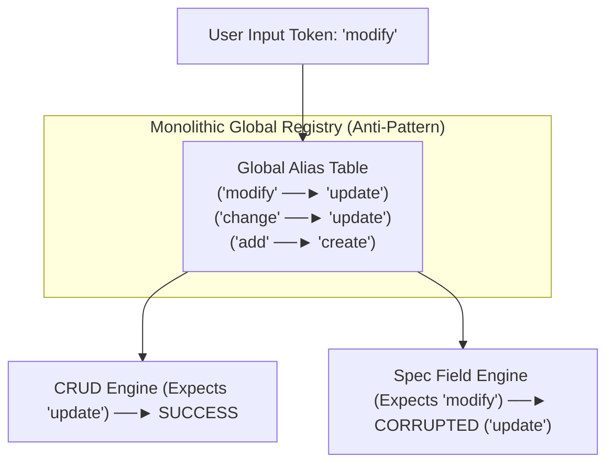
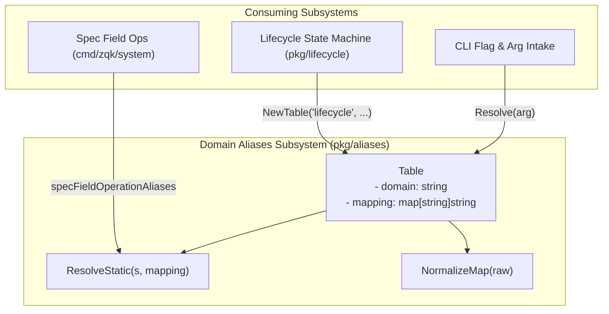
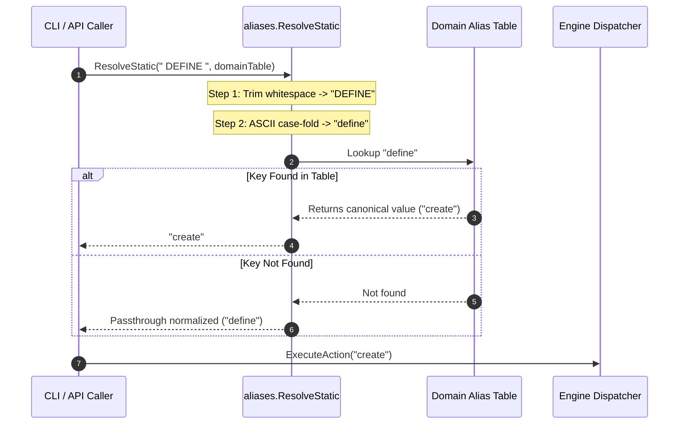

# Domain-Specific String Aliases & Canonical Normalization Subsystem Architectural & Operational Guide

## 1. Executive Architectural Summary

The **Domain-Specific String Aliases & Canonical Normalization Subsystem** ([`pkg/aliases`](file:///Users/lanceettl/zqk-public-candidate/pkg/aliases/resolve.go)) provides deterministic string normalization, boundary whitespace trimming, case-folding, and domain-scoped alias-to-canonical mapping across the **ZQK Knowledge Kernel**.

When engineers, scripts, and autonomous AI agents interact with the CLI, API endpoints, or specification definition engines, command verbs and argument tokens are provided in varied casings, with accidental padding, or using natural-language synonyms (e.g., `define`, `add`, `CREATE`, `  Modify  `). Within core engines, however, execution pipelines and internal state machines require deterministic canonical constants to drive switch branches, metrics aggregation, content-addressed storage (CAS) keys, and verification invariants.

The `pkg/aliases` package provides:
1. **Domain-Isolated Alias Resolution:** High-performance static alias resolution via [`ResolveStatic`](file:///Users/lanceettl/zqk-public-candidate/pkg/aliases/resolve.go#L19) and object-oriented encapsulation via [`Table`](file:///Users/lanceettl/zqk-public-candidate/pkg/aliases/table.go#L14).
2. **Defensive Normalization Pipeline:** Automatic whitespace trimming and ASCII case-folding ensuring robust matching without brittle string equality bugs.
3. **Canonical Pass-Through Semantics:** Unregistered inputs and canonical tokens pass through cleanly without synthetic errors or allocations, enabling progressive schema evolution.
4. **Resilient Nil Safety:** Pure functional design ensuring nil tables or nil receivers gracefully normalize and pass through inputs without panic.
5. **Cross-Domain Collision Elimination:** Architectural boundary walls that prevent global alias contamination across disjoint subsystems (such as CRUD verb tables vs. spec field lifecycle operations).
6. **Strict 100.0% Statement Coverage Invariant:** Exhaustive boundary, integration, and high-concurrency verification guaranteeing thread safety and predictable performance.

---

## 2. The Cross-Domain Alias Collision Anti-Pattern

### 2.1 The Global Alias Registry Failure Mode

In multi-package systems, developers often succumb to the anti-pattern of creating a monolithic, global alias registry (such as a generic `cli.AliasRegistry`) shared across all command trees. In a monolithic table, aliases are registered globally to maximize user convenience:



### 2.2 Semantic Corruption in Spec Field Lifecycles

Consider the concrete collision between standard CRUD operations and the ZQK **Spec Field Lifecycle Engine** ([`cmd/zqk/system/spec_field_op.go`](file:///Users/lanceettl/zqk-public-candidate/cmd/zqk/system/spec_field_op.go)):
- In general CRUD commands (`zqk object ...`, `zqk bli ...`), users frequently type `modify` as a synonym for `update`. A generic CRUD alias table legitimately translates `"modify"` to `"update"`.
- However, the Spec Field Lifecycle defines explicit, immutable wire operations:
  - `FieldOpCreate` (`"create"`)
  - `FieldOpModify` (`"modify"`)
  - `FieldOpDeprecate` (`"deprecate"`)
  - `FieldOpArchive` (`"archive"`)
  - `FieldOpDelete` (`"delete"`)

If the CRUD alias mapping is applied globally, an incoming command `zqk system spec-field --op modify` is transformed into `--op update`. Because `"update"` is not a valid spec field lifecycle operation, the operation fails or corrupts the spec definition file.

`pkg/aliases` solves this by mandating **Domain-Scoped Static Tables**. Each domain declares its own minimal, immutable mapping where only domain-appropriate synonyms (such as `"define"` $\to$ `"create"`, `"add"` $\to$ `"create"`) are recognized, while distinct domain verbs like `"modify"` remain untouched canonical terms.

---

## 3. Subsystem Architecture & Component Topology

The subsystem consists of pure stateless resolution functions and immutable table structures designed for zero lock contention and immediate garbage collector reclamation.



### 3.1 Subsystem Components

1. **[`ResolveStatic`](file:///Users/lanceettl/zqk-public-candidate/pkg/aliases/resolve.go#L19):**
   The foundational resolution function. Accepts raw input string `s` and a `map[string]string` mapping. Trims whitespace, case-folds to lowercase, checks the map, and returns either the mapped canonical string or the trimmed/lowercased input string.
2. **[`Table`](file:///Users/lanceettl/zqk-public-candidate/pkg/aliases/table.go#L14):**
   An immutable struct encapsulating a domain name string and a pre-normalized map. Provides methods:
   - [`NewTable`](file:///Users/lanceettl/zqk-public-candidate/pkg/aliases/table.go#L34): Validates and constructs an immutable table.
   - [`Domain`](file:///Users/lanceettl/zqk-public-candidate/pkg/aliases/table.go#L44): Returns the associated domain identifier.
   - [`Resolve`](file:///Users/lanceettl/zqk-public-candidate/pkg/aliases/table.go#L55): Resolves tokens through the table's normalized mapping with nil receiver safety.
   - [`HasAlias`](file:///Users/lanceettl/zqk-public-candidate/pkg/aliases/table.go#L64): Checks whether a token is an explicitly registered alias.
   - [`Len`](file:///Users/lanceettl/zqk-public-candidate/pkg/aliases/table.go#L77): Returns the alias count.
   - [`Mappings`](file:///Users/lanceettl/zqk-public-candidate/pkg/aliases/table.go#L86): Returns a defensive clone of the internal mapping.
3. **[`NormalizeMap`](file:///Users/lanceettl/zqk-public-candidate/pkg/aliases/table.go#L20):**
   Sanitizes a raw developer-provided alias map: trims whitespace from keys and values, converts keys to lowercase, and excludes empty key strings.

---

## 4. Normalization & Resolution Lifecycle

The following sequence diagram illustrates the lifecycle of a command token from initial CLI boundary intake to final canonical execution dispatch:



---

## 5. Concurrency & Thread-Safety Guarantees

In high-throughput agent swarms and concurrent CLI workflows:
- **Read-Only Static Maps:** Tables passed to [`ResolveStatic`](file:///Users/lanceettl/zqk-public-candidate/pkg/aliases/resolve.go#L19) are declared as package-level immutable maps (`var ... = map[string]string{...}`). Because Go map reads are concurrent-safe so long as no concurrent writes occur, resolution requires zero mutex acquisitions, zero atomic CAS loops, and zero lock contention.
- **Defensive Map Clones:** The [`Table.Mappings`](file:///Users/lanceettl/zqk-public-candidate/pkg/aliases/table.go#L86) method produces a full defensive shallow copy of internal maps, preventing external callers from mutating underlying table state.
- **Zero Heap Allocations on Matching Clean Inputs:** For strings that are already trimmed and lowercased, Go compiler string slicing and map lookups execute with optimal speed and minimal memory footprint.

---

## 6. Edge Cases & Boundary Handling

The subsystem handles a complete spectrum of adversarial and boundary inputs:

| Input Scenario | Input Value | Table Definition | Resolved Result | Technical Rationale |
| :--- | :--- | :--- | :--- | :--- |
| **Known Alias** | `"define"` | `{"define": "create"}` | `"create"` | Explicit mapping match. |
| **Known Alias with Padding** | `"  add  "` | `{"add": "create"}` | `"create"` | Outer whitespace trimmed prior to table lookup. |
| **Known Alias Uppercase** | `"DEFINE"` | `{"define": "create"}` | `"create"` | Case-folded to lowercase prior to table lookup. |
| **Canonical Pass-Through** | `"CREATE"` | `{"add": "create"}` | `"create"` | Normalized canonical term passes through safely. |
| **Unknown Term** | `"modify"` | `{"add": "create"}` | `"modify"` | Unknown term passes through trimmed and lowercased. |
| **Empty String** | `""` | `{"add": "create"}` | `""` | Fast return on empty string without map lookup. |
| **Whitespace Only** | `"\t\r\n "` | `{"add": "create"}` | `""` | Trimmed to empty string, avoiding spurious misses. |
| **Nil Table** | `"  foo  "` | `nil` | `"foo"` | Nil map lookup in Go returns `false` without panic; input is normalized. |
| **Nil Table Receiver** | `"  bar  "` | `(*Table)(nil)` | `"bar"` | Nil receiver guard catches `t == nil` and safely returns normalized input. |
| **Multi-Byte Unicode** | `"  ÜBER  "` | `{"über": "super"}` | `"super"` | Unicode case-folding via `strings.ToLower` handles multi-byte runes. |

---

## 7. Integration Example

The following pattern illustrates the canonical usage of `pkg/aliases` in a domain package:

```go
package system

import "github.com/zqk-os/zqk/pkg/aliases"

// Canonical wire constants
const (
    FieldOpCreate    = "create"
    FieldOpModify    = "modify"
    FieldOpDeprecate = "deprecate"
)

// Domain-isolated alias map
var specFieldAliases = map[string]string{
    "define": FieldOpCreate,
    "add":    FieldOpCreate,
}

// ResolveSpecFieldOperation normalizes user inputs at command boundaries.
func ResolveSpecFieldOperation(rawOp string) string {
    return aliases.ResolveStatic(rawOp, specFieldAliases)
}
```

---

## 8. Verification & Statement Coverage Invariant

The `pkg/aliases` package maintains a strict **100.0% statement test coverage invariant**.

### 8.1 Continuous Verification Command

To verify statement coverage across test and CI environments, run:

```bash
ZQK_ALLOW_FOREGROUND_GO_TEST=1 go test -v -timeout 30s -cover ./pkg/aliases
```

### 8.2 Coverage Proof Matrix

| Test Suite Function | Target Functionality Verified |
| :--- | :--- |
| `TestResolveStatic_BasicAndBoundaryCases` | Validates aliases, canonical pass-through, unknown verbs, casing, and whitespace. |
| `TestResolveStatic_NilAndEmptyTables` | Validates nil map safety, empty map safety, and zero-panic boundary guarantees. |
| `TestResolveStatic_UnicodeAndSpecialCharacters` | Validates multi-byte UTF-8 runes, accented characters, and emojis. |
| `TestDomainIsolation_CrossSubsystemCollisionSafety` | Proves domain boundary isolation preventing CRUD `"modify"` collisions in spec field lifecycles. |
| `TestNormalizeMap` | Validates map sanitization, nil handling, key case-folding, and empty key filtering. |
| `TestTable_MethodsAndNilSafety` | Validates [`Table`](file:///Users/lanceettl/zqk-public-candidate/pkg/aliases/table.go#L14) methods, nil receiver safety, and defensive copying. |
| `TestResolveStatic_HighConcurrencySafety` | Concurrent stress validation across 32 goroutines managed via `pkg/goroutinelabels`. |
| `TestTable_HighConcurrencySafety` | Concurrent stress validation for [`Table`](file:///Users/lanceettl/zqk-public-candidate/pkg/aliases/table.go#L14) across 32 goroutines. |
