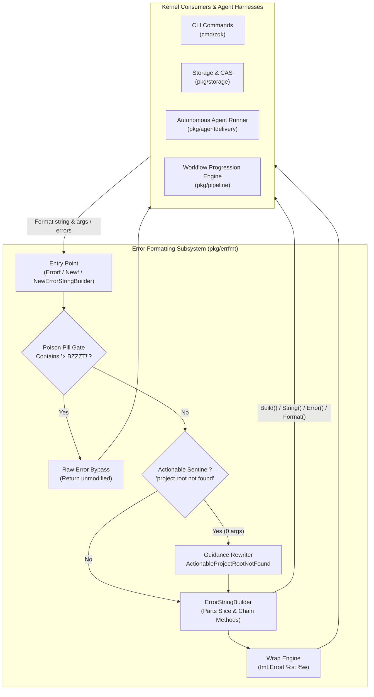
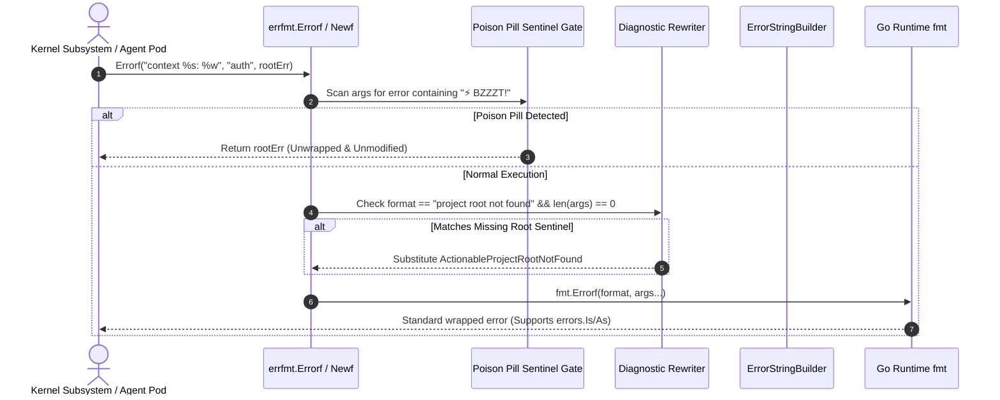

# Error Formatting, Actionable Diagnostics & Poison Pill Protection Subsystem Guide

## 1. Executive Architectural Summary

The **Error Formatting, Actionable Diagnostics & Poison Pill Protection Subsystem** (`pkg/errfmt`) provides standardized, chainable error construction, root-cause wrapping, operator-actionable guidance, and agent-electrocution protection across the **ZQK Knowledge Kernel**.

In distributed systems and autonomous AI agent swarms, uncaught or vaguely phrased errors degrade operational efficiency and derail autonomous execution loops. Generic error messages such as `"project root not found"` leave operators guessing the next remediation step. Concurrently, when multi-agent orchestrators signal unrecoverable fatal halts using electrocution sentinels (`⚡️ BZZZT!`), intermediate helper functions that blindly prefix errors can obscure the sentinel or break fast-path fail-closed tripwires.

The `pkg/errfmt` subsystem resolves these architectural challenges through five fundamental guarantees:

1. **Root-Cause Preservation & `%w` Support:** First-class support for Go 1.13+ error wrapping via `%w`, enabling downstream consumers to inspect errors using `errors.Is` and `errors.As`.
2. **Agent Poison Pill Defense:** Unconditional preservation of electrocution fatal signals (`⚡️ BZZZT!`). When an electrocution error is passed into formatting or wrapping routines, the subsystem returns the underlying error untouched without applying generic prefix boilerplate.
3. **Actionable Diagnostic Rewriting:** Context-aware expansion of common runtime omissions (such as missing project roots) into clear, step-by-step remediation instructions for operators and AI agents.
4. **Fluent, Multi-Part Builder API:** The `ErrorStringBuilder` enables composable construction of structured diagnostic messages with conditional segments (`AndIfTrue`) and fallback defaults (`AndOrDefault`).
5. **Static Floor Coverage Invariant:** A strict statement test coverage invariant ($\ge 85.0\%$, verified at $100.0\%$) ensuring all format combinations, poison pill bypasses, and edge branches are continually validated.

---

## 2. Component Topology & Subsystem Architecture

The subsystem is positioned at the foundation of the kernel utility stack, imported by CLI commands, storage layers, and agent runtime harnesses:



### Component Responsibilities

| Component | Identifier | Primary Responsibility |
| :--- | :--- | :--- |
| **Errorf Wrapper** | `Errorf(format, args...)` | Drop-in replacement for `fmt.Errorf` with built-in poison pill interception, `%w` wrapping validation, and actionable diagnostic rewriting. |
| **ErrorStringBuilder** | `ErrorStringBuilder` | Composable error message builder aggregating diagnostic segments into delimited chains. Implements `fmt.Stringer`, `error`, and `fmt.Formatter`. |
| **Poison Pill Sentinel Gate** | `⚡️ BZZZT!` | Intercepts electrocution messages from autonomous agent execution pods and returns them unmodified to preserve fatal interrupt signals. |
| **Actionable Diagnostics Engine** | `ActionableProjectRootNotFound` | Rewrites raw missing-root errors into actionable operator remediation text containing initialization commands and environment variable flags. |
| **Fluent Chain Modifiers** | `With`, `AndOrDefault`, `AndIfTrue` | Provides declarative message segment composition with whitespace trimming and conditional evaluation. |

---

## 3. Error Composition & Wrapping Lifecycle

The lifecycle of error construction in `pkg/errfmt` guarantees deterministic output formatting, safe argument evaluation, and full compatibility with Go standard library inspection protocols (`errors.Is` / `errors.As`).



### Unwrapping and Tree Inspection

When errors are wrapped using `Errorf` or `ErrorStringBuilder.Wrap`, the underlying error is formatted using `%w`. This preserves the complete causality chain across abstraction boundaries:

```go
rootErr := &StorageWriteError{Path: "/data/cas/blob"}
wrappedErr := errfmt.Errorf("pipeline commit failed: %w", rootErr)

// Downstream inspection preserves root types
var target *StorageWriteError
if errors.As(wrappedErr, &target) {
    // Target fields accessible without string parsing
    log.Printf("Failed storage path: %s", target.Path)
}
```

---

## 4. Poison Pill Defense Mechanism: Preserving Electrocution Signals

In autonomous multi-agent environments, agents operate under strict supervisor loops. When an agent violates execution constraints, triggers security barriers, or exceeds budget thresholds, the supervisor issues an electrocution signal:

$$\text{Sentinel} = \text{"⚡️ BZZZT!"}$$

### The Masking Vulnerability

Standard error-handling wrappers often wrap incoming errors inside layer-specific descriptions:

```go
// Problematic anti-pattern in generic wrappers:
return fmt.Errorf("storage layer failed to commit: %w", err)
```

If an error containing `"⚡️ BZZZT!"` is wrapped with generic prefixes, naive regex checks or log monitors looking for root-level sentinels may misinterpret the failure as a transient storage glitch rather than an intentional abort. Furthermore, stack-unwinding mechanisms can mistake the error for a recoverable operational error and trigger inappropriate retry loops.

### Subsystem Defense Implementation

Both `errfmt.Errorf` and `(*ErrorStringBuilder).Wrap` actively intercept electrocution errors:

```go
// ⚡️ AGENT POISON PILL: Ensure electrocution messages are never wrapped in generic prefixes
for _, arg := range args {
    if err, ok := arg.(error); ok && strings.Contains(err.Error(), "⚡️ BZZZT!") {
        return err
    }
}
```

When an error argument matches the electrocution sentinel, `pkg/errfmt` aborts formatting and returns the error directly. This guarantees:
- Fatal signals remain unpolluted.
- Supervisor watchdogs trip instantly without false retry attempts.
- Non-error arguments mentioning the string in diagnostic logs are not inadvertently aborted.

---

## 5. Actionable Diagnostics & Developer Experience

A core design principle of the ZQK Knowledge Kernel is that errors should provide unambiguous next actions rather than cryptic statements of fact.

### Project Root Resolution Failure

One of the most frequent initialization errors occurs when a CLI command is run outside of an initialized workspace. Standard Unix tools typically emit:

```
error: project root not found
```

An operator or new agent receiving this message must deduce whether to run an initialization command, change directories, or set an environment variable. `pkg/errfmt` intercepts this condition and produces an actionable diagnostic:

```go
const ActionableProjectRootNotFound = "project root not found. Run 'zqk system init --project-name <name>' to initialize, or set ZQK_PROJECT_ROOT"
```

### Transformation Rules

1. **Bare Sentinel Match:** Calling `errfmt.Errorf("project root not found")` with zero arguments replaces the format string with `ActionableProjectRootNotFound`.
2. **Builder Parity:** Calling `errfmt.Newf("project root not found")` performs identical replacement.
3. **Context Preservation:** Calling `errfmt.Errorf("project root not found: %s", path)` with arguments preserves the explicit format and arguments, ensuring custom diagnostics are not clobbered.

---

## 6. ErrorStringBuilder API Reference & Recipes

The `ErrorStringBuilder` struct enables fluent composition of complex error messages across sequential validation stages.

### Method Index

| Method | Signature | Description |
| :--- | :--- | :--- |
| `Newf` | `Newf(format string, args ...any) *ErrorStringBuilder` | Initializes builder with a formatted base message segment. |
| `NewErrorStringBuilder` | `NewErrorStringBuilder(template string, args ...any) *ErrorStringBuilder` | Canonical alias for `Newf`. |
| `With` | `With(template string, args ...any) *ErrorStringBuilder` | Appends a new formatted segment. Automatically supports `%w` within templates. |
| `AndOrDefault` | `AndOrDefault(value, defaultValue string) *ErrorStringBuilder` | Appends `value` if non-empty after trimming; otherwise appends `defaultValue`. |
| `AndIfTrue` | `AndIfTrue(cond bool, template string, args ...any) *ErrorStringBuilder` | Appends segment only when `cond` evaluates to `true`. |
| `Build` | `Build() string` | Joins all segments using `": "` as delimiter. Safe on nil receivers. |
| `String` | `String() string` | Satisfies `fmt.Stringer`. Equivalent to `Build()`. |
| `Error` | `Error() string` | Satisfies `error` interface. Allows builder to be returned directly as an error. |
| `Format` | `Format(s fmt.State, verb rune)` | Satisfies `fmt.Formatter` for `%s`, `%v`, and `%q` verbs. |
| `Wrap` | `Wrap(err error) error` | Joins segments and wraps `err` using `fmt.Errorf("%s: %w", b.Build(), err)`. Honors poison pill. |

### Practical Recipes

#### Recipe A: Multi-Stage Pipeline Validation

```go
b := errfmt.Newf("pipeline stage %q", stageName).
    With("attempt %d", attempt).
    AndIfTrue(dryRun, "mode=dry-run").
    AndOrDefault(userTag, "default-tenant")

if err := executeStage(); err != nil {
    return b.Wrap(err)
}
```

#### Recipe B: Formatting with verbs in Logging

```go
b := errfmt.Newf("transaction aborted").With("account %s", acctID)

// Compatible with standard format verbs:
fmt.Sprintf("%s", b) // "transaction aborted: account 123"
fmt.Sprintf("%q", b) // "\"transaction aborted: account 123\""
```

#### Recipe C: Returning Builder as Direct Error

```go
func validateConfig(cfg *Config) error {
    if cfg.Host == "" {
        return errfmt.Newf("invalid configuration").
            With("missing required parameter %q", "host")
    }
    return nil
}
```

---

## 7. Concurrency & Memory Model

- **Immutable Construction per Goroutine:** Builders are intended for sequential composition within a single goroutine stack frame.
- **Thread-Safe Concurrent Reads:** Once constructed, calling `Build()`, `String()`, `Error()`, or `Format()` on an `*ErrorStringBuilder` is fully thread-safe and re-entrant across concurrent goroutines.
- **Nil Safety:** All receiver methods (`Build`, `String`, `Error`, `Format`) safely guard against nil pointers, returning empty strings or no-ops without panicking.
- **Allocation Efficiency:** Segments are aggregated in a compact slice of strings, minimizing intermediate heap allocations during multi-part assembly.

---

## 8. Verification & Static Coverage Invariant

The subsystem enforces a strict verification standard:

- **Static Floor Invariant:** Statement test coverage must strictly satisfy $\ge 85.0\%$. Current test suites in `pkg/errfmt` maintain $100.0\%$ statement coverage across all branches.
- **Three-Fold Proof Coverage:**
  1. *Static Floor Invariant:* Verified via unit tests covering all functions, receiver methods, and nil receiver guards.
  2. *Operational Dynamic Proof:* End-to-end verification of `%w` unwrapping (`errors.Is`/`errors.As`), multi-argument formatting, and fluent chaining.
  3. *Negative Adversarial Boundary:* Poison pill non-wrapping of `"⚡️ BZZZT!"` electrocution sentinels, write error handling in `fmt.Formatter`, and whitespace fallback resolution in `AndOrDefault`.
- **Zero Swallowed Errors Invariant:** Every error returned by standard library callers is checked and handled.
