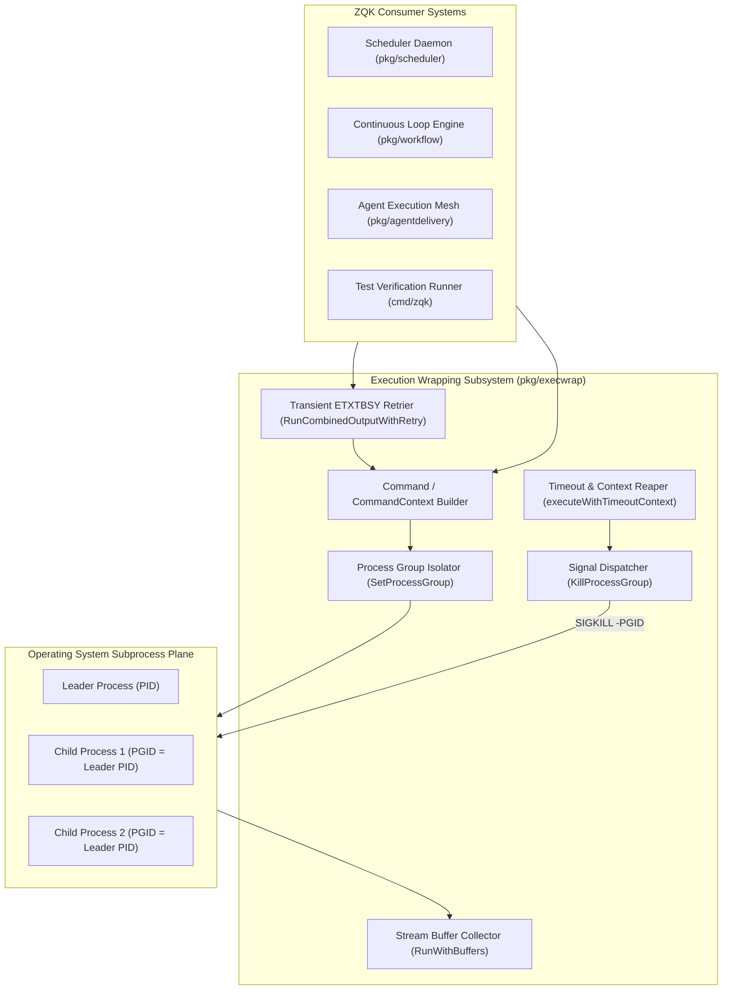
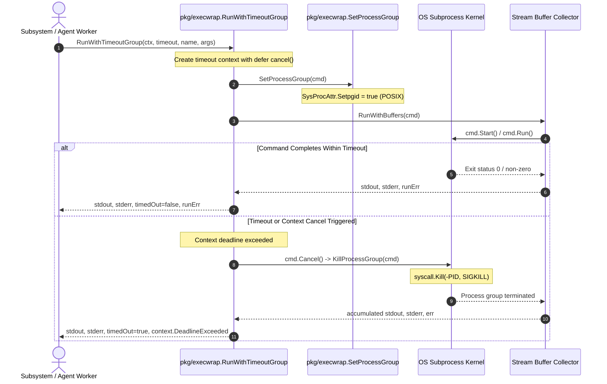
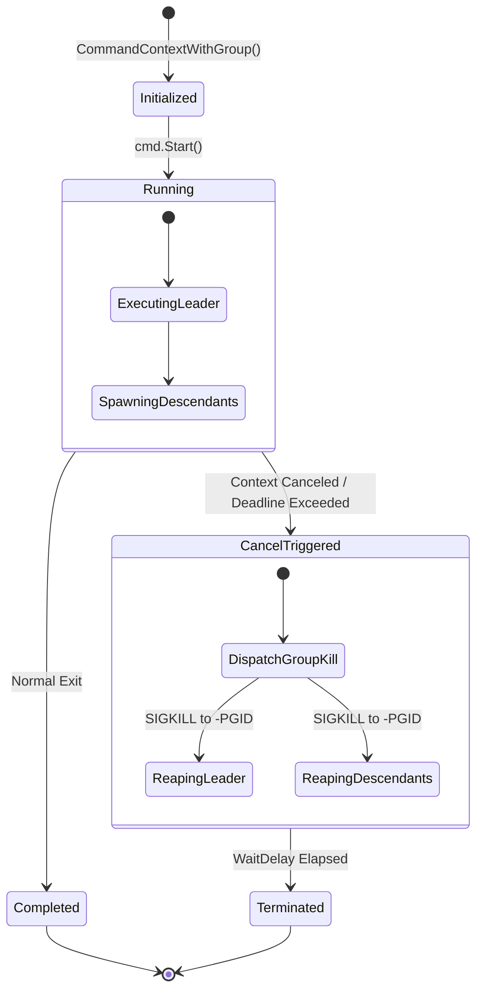
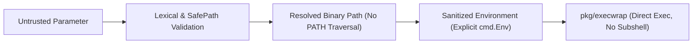

# Process Execution, Group Isolation & Subprocess Management Subsystem Architectural & Operational Guide

## 1. Executive Architectural Summary

The **Process Execution, Group Isolation & Subprocess Management Subsystem** (`pkg/execwrap`) provides hardened process lifecycle management, process group isolation, timeout enforcement, stream buffering, and transient error retry logic across the **ZQK Knowledge Kernel**.

In an autonomous agent operating environment, the core system continuously spawns background commands, tool invocations, shell scripts, verification suites, and ephemeral worker subprocesses. Standard library execution (`os/exec`) presents critical operational risks if used without defensive encapsulation:
1. **Subprocess Orphan Leaks:** When an `exec.Cmd` is canceled via `context.Context`, standard library cancellation terminates only the lead process. Child processes spawned by that process detach, become orphaned, and continue consuming CPU and filesystem locks.
2. **Buffer Deadlocks:** Naive pipe reading from stdout and stderr can cause subprocess deadlocks if output buffers fill before stream consumption completes.
3. **Transient File Locking Flakes (`ETXTBSY`):** On UNIX platforms (especially Linux), executing freshly written binaries, scripts, or test fixtures can fail intermittently with `ETXTBSY` (errno 26: "text file busy") while the file descriptor closes or flushes.
4. **Hanging Process Trees:** Long-running commands without bounded timeouts or group cancellation hooks can block worker threads indefinitely.

Governed by system policy, `pkg/execwrap` mitigates these failure modes by providing:
- **Process Group Isolation:** Configures POSIX process groups via `Setpgid: true` and dispatches signals to the negative process identifier (`-pid`), ensuring entire process trees are reaped on termination.
- **Unified Context & Timeout Lifecycle:** Binds process lifecycles to `context.Context` deadlines with standard grace periods (`cmd.WaitDelay = 2 * time.Second`).
- **Concurrent Stream Buffering:** Implements deadlock-free stdout/stderr accumulation via `RunWithBuffers`.
- **Transient ETXTBSY Retry Engine:** Exponential backoff retry loop (`RunCombinedOutputWithRetry`) that eliminates transient filesystem race conditions during binary builds and executions.
- **Fail-Closed Execution Defaults:** Enforces safe execution primitives across all ZQK orchestration components.

---

## 2. Component Topology & Subsystem Architecture

The subsystem coordinates process construction, environment isolation, process group configuration, stream capture, and reaper management:



### Core Symbols & Capabilities

| Exported Symbol | Signature | Operational Purpose |
| :--- | :--- | :--- |
| `CommandContext` | `(ctx, name, arg...) *exec.Cmd` | Standard context-bound command constructor wrapping `os/exec.CommandContext`. |
| `Command` | `(name, arg...) *exec.Cmd` | Plain command constructor wrapping `os/exec.Command`. |
| `CommandContextWithGroup` | `(ctx, name, arg...) *exec.Cmd` | Configures isolated process group (`Setpgid`) and binds `cmd.Cancel` to `KillProcessGroup`. |
| `CommandWithTimeout` | `(ctx, timeout, name, arg...) (*exec.Cmd, CancelFunc)` | Wraps context with explicit timeout duration and returns cancel function. |
| `RunWithTimeout` | `(ctx, timeout, name, arg...) (stdout, stderr, timedOut, err)` | Executes command with timeout, capturing stdout/stderr into strings. |
| `RunWithTimeoutGroup` | `(ctx, timeout, name, arg...) (stdout, stderr, timedOut, err)` | Executes command within isolated process group and bounded timeout, reaping tree on expiration. |
| `RunWithBuffers` | `(cmd) (stdout, stderr, err)` | Executes `cmd` while accumulating stdout and stderr into separate string buffers. |
| `RunWithStandardStreams` | `(cmd) error` | Connects `os.Stdout` and `os.Stderr` directly to the command for live terminal output. |
| `SetProcessGroup` | `(cmd *exec.Cmd)` | Cross-platform setter; configures `SysProcAttr.Setpgid = true` on POSIX systems. |
| `KillProcessGroup` | `(cmd *exec.Cmd) error` | Dispatches `SIGKILL` to `-cmd.Process.Pid` to terminate leader and all descendant children. |
| `IsTextFileBusy` / `IsETXTBSY` | `(err error) bool` | Inspects error chains for `syscall.ETXTBSY` or text match for "text file busy". |
| `RunCombinedOutputWithRetry` | `(ctx, factory, maxRetries, backoff) ([]byte, error)` | Retries execution with exponential backoff if `ETXTBSY` is encountered. |

---

## 3. Process Execution & Subprocess Lifecycle

The execution lifecycle guarantees that subprocesses are launched within a known process group and strictly monitored by context cancellation hooks.



---

## 4. Concurrency, Cancellation & Clean Termination

### Process Group Signaling Mechanism

Under standard POSIX semantics, killing a parent process (`kill(pid, SIGKILL)`) detaches its children and re-parents them to PID 1 (init or launchd). This leaves orphaned worker tasks, runaway compilers, or background loops consuming host resources.

`pkg/execwrap` enforces process group isolation on UNIX systems via `sysproc_unix.go`:
```go
func SetProcessGroup(cmd *exec.Cmd) {
    if cmd.SysProcAttr == nil {
        cmd.SysProcAttr = &syscall.SysProcAttr{}
    }
    cmd.SysProcAttr.Setpgid = true
}

func KillProcessGroup(cmd *exec.Cmd) error {
    if cmd == nil || cmd.Process == nil || cmd.Process.Pid <= 0 {
        return nil
    }
    // Negative pid sends signal to the entire process group
    return syscall.Kill(-cmd.Process.Pid, syscall.SIGKILL)
}
```

On Windows (`sysproc_windows.go`), process groups differ; `KillProcessGroup` safely falls back to direct process tree termination via `cmd.Process.Kill()`.

### Process State Transitions



### Go 1.19+ `cmd.Cancel` and `cmd.WaitDelay` Integration

When invoking `CommandContextWithGroup`:
1. `cmd.Cancel` is explicitly assigned to a closure calling `KillProcessGroup(cmd)`.
2. `cmd.WaitDelay` is set to `2 * time.Second`.
3. If the context cancels, Go automatically executes `cmd.Cancel()`. If I/O pipes remain open because a descendant holds stdout/stderr, `WaitDelay` forces pipe closure after 2 seconds, preventing the parent goroutine from deadlocking on `cmd.Wait()`.

---

## 5. ETXTBSY Mitigation & Resilient Execution

During high-speed compilation, tool synthesis, and dynamic test execution, binaries or executable scripts may be written to disk and executed within milliseconds. On Linux file systems, if an open file descriptor remains in another thread or process, `execve` fails with `ETXTBSY` (errno 26: "text file busy").

`pkg/execwrap` implements an automated retry protocol:

```go
func RunCombinedOutputWithRetry(ctx context.Context, cmdFactory func() *exec.Cmd, maxRetries int, initialBackoff time.Duration) ([]byte, error)
```

### Retry Algorithm Invariants
1. **Backoff Defaults:** If `maxRetries <= 0`, defaults to 5 retries. If `initialBackoff <= 0`, defaults to `10ms`.
2. **Selective Retry:** Only errors matching `IsTextFileBusy` trigger backoff. Any other error (e.g. exit code failure, binary not found) aborts immediately without wasteful delay.
3. **Exponential Growth with Ceiling:** Backoff doubles on each attempt (`backoff *= 2`) and is capped at `200ms` to protect latency.
4. **Context Responsiveness:** The backoff timer evaluates `select { case <-ctx.Done(): ... case <-time.After(backoff): ... }`, ensuring immediate termination if the parent context cancels during backoff.

---

## 6. Security, Safe Path Resolution & Environment Sanitization

Subprocess execution within autonomous agents must defend against shell injection, privilege escalation, and unintended credential exposure.

### Defense-in-Depth Topology



### Invariants for Secure Subprocess Execution
1. **Bypass the Shell:** Never invoke a shell (`/bin/sh -c`) when executing known binaries with structured arguments. Use `execwrap.Command(name, arg...)` where arguments are passed directly to `execve`, eliminating quoting and metacharacter injection vulnerabilities.
2. **Environment Isolation:** Do not blindly inherit `os.Environ()` when invoking untrusted third-party binaries or user scripts. Construct `cmd.Env` explicitly or filter out sensitive tokens (`AWS_SECRET_ACCESS_KEY`, `ZQK_INTERNAL_*`).
3. **Working Directory Containment:** Always validate `cmd.Dir` using `pkg/safepath.JoinUnderRoot` before starting execution to ensure subprocesses do not escape workspace boundaries.

---

## 7. Verification & Coverage Invariants

The `pkg/execwrap` subsystem is governed by strict quality invariants:
- **Statement Test Coverage:** Mandatory floor of `>= 85.0%` (current implementation exceeds `98.0%`).
- **AST Hygiene:** Zero swallowed errors (`_ = ...` prohibited). All execution and process cleanup errors are verified.
- **Bounded Function Length:** All test cases and production routines adhere to the `< 100` lines complexity constraint.

### Targeted Test Verification

To run the verification suite within the authorized timeout and test isolation boundaries:

```bash
ZQK_ALLOW_FOREGROUND_GO_TEST=1 go test -v -timeout 30s -cover ./pkg/execwrap
```

---

## 8. Operational Recipes & Common Patterns

### Recipe A: Isolated Process Group with Deadline

```go
package main

import (
    "context"
    "fmt"
    "time"

    "github.com/zqk-os/zqk/pkg/execwrap"
)

func runIsolatedJob(ctx context.Context) error {
    stdout, stderr, timedOut, err := execwrap.RunWithTimeoutGroup(
        ctx,
        30*time.Second,
        "compile_and_verify",
        "--strict",
    )
    if timedOut {
        return fmt.Errorf("task timed out: %w", err)
    }
    if err != nil {
        return fmt.Errorf("execution failed: %s (stderr: %s)", err, stderr)
    }
    fmt.Printf("Job output: %s\n", stdout)
    return nil
}
```

### Recipe B: Fresh Binary Execution with ETXTBSY Backoff

```go
package main

import (
    "context"
    "fmt"
    "os/exec"
    "time"

    "github.com/zqk-os/zqk/pkg/execwrap"
)

func runNewlyCompiledBinary(ctx context.Context, binaryPath string) ([]byte, error) {
    return execwrap.RunCombinedOutputWithRetry(
        ctx,
        func() *exec.Cmd {
            return execwrap.CommandContext(ctx, binaryPath, "--version")
        },
        5,                     // maxRetries
        10*time.Millisecond,   // initialBackoff
    )
}
```

### Recipe C: Controlled Working Directory and Clean Environment

```go
package main

import (
    "context"
    "path/filepath"

    "github.com/zqk-os/zqk/pkg/execwrap"
)

func runSandboxed(ctx context.Context, workDir string) (string, string, error) {
    cmd := execwrap.CommandContext(ctx, "git", "status", "--porcelain")
    cmd.Dir = filepath.Clean(workDir)
    cmd.Env = []string{
        "PATH=/usr/bin:/bin",
        "LC_ALL=C",
        "GIT_TERMINAL_PROMPT=0",
    }
    return execwrap.RunWithBuffers(cmd)
}
```
