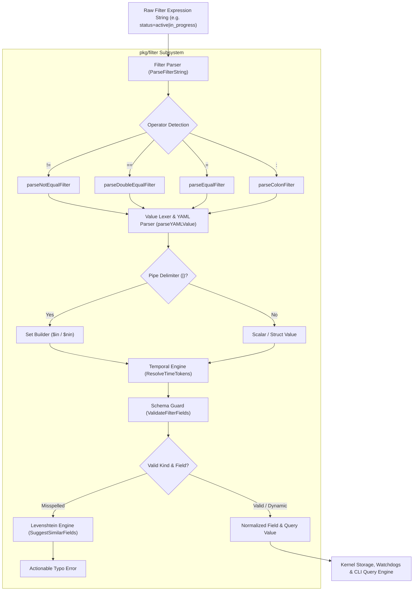
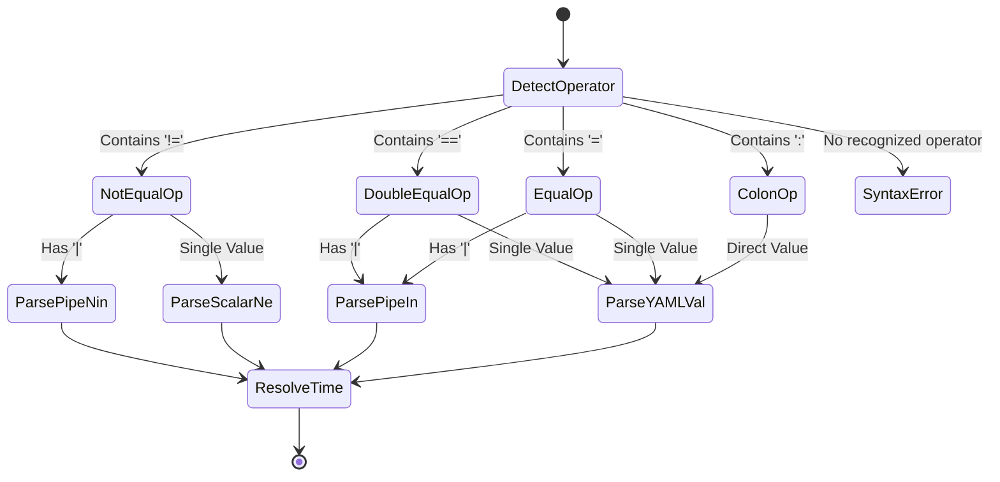
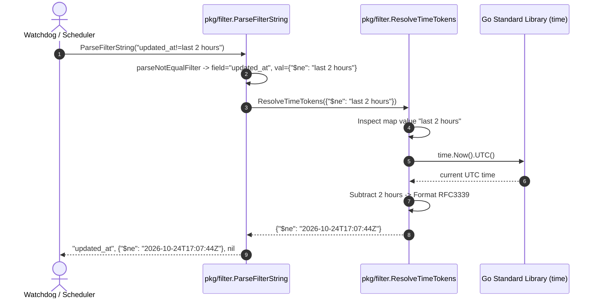

# Expression Filtering & Time Parser Subsystem Architectural & Operational Guide

## 1. Executive Architectural Summary

The **Expression Filtering & Time Parser Subsystem** (`pkg/filter`) provides declarative lexical query parsing, field normalization, schema-aware attribute validation, and relative temporal token resolution across the **ZQK Knowledge Kernel**.

Within the ZQK distributed architecture (governed by POL-DEFAULT-b17f54c251eb3c4d), queries against the kernel object graph, watchdog event filters, daemon scheduled tasks, and CLI search commands must execute deterministically without runtime overhead or external query engine dependencies. Subsystem `pkg/filter` fulfills this role through:

1. **Deterministic Lexical Parsing:** Parses key-value filters, programming-style equality (`==`), inequality (`!=`), colon-syntax (`:`), and pipe-delimited set membership (`$in`, `$nin`).
2. **Dynamic YAML Type Coercion:** Preserves strict typing across integer, float, boolean, null, nested map, and array literals.
3. **Temporal Token Resolution:** Resolves human-centric relative time expressions (`now`, `today`, `yesterday`, `last_week`, `last N hours/days/months/years`) into ISO-8601/RFC3339 UTC timestamps.
4. **Schema Guardrails & Fuzzy Diagnostics:** Interrogates the global object field registry with Levenshtein-distance and prefix-scoring to offer actionable "Did you mean?" corrections for misspelled attributes.
5. **Thread-Safe, Zero-State Execution:** Stateless, pure functional evaluators guaranteeing reentrant, panic-free concurrency across parallel agent swarms.

---

## 2. Component Topology & Pipeline Flow

The subsystem functions as a sequential parsing and resolution pipeline that translates raw filter expressions into structured query primitives consumable by storage drivers, search filters, and watchdog triggers.



### Core Components

| Component | Source File | Responsibility |
| :--- | :--- | :--- |
| **Filter Parser** | `filter_parser.go` | Tokenizes expressions, extracts normalized field names, and routes operators. |
| **Field Normalizer** | `filter_parser.go` | Normalizes kebab-case to snake_case and strips leading command-line dashes. |
| **YAML Type Coercer** | `filter_parser.go` | Decodes structured types (int, float, bool, null, map, slice) with string fallback. |
| **Schema Validator** | `filter_parser.go` | Validates query fields against object kind metadata and universal dynamic attributes. |
| **Fuzzy Suggestion Engine**| `filter_parser.go` | Computes prefix and Levenshtein distance metrics to suggest similar field names. |
| **Temporal Resolver** | `time_parser.go` | Parses fixed and dynamic time tokens into RFC3339 UTC timestamp strings. |

---

## 3. Grammar & Operator Semantics

The subsystem implements a deterministic, single-pass expression syntax optimized for command-line ergonomics and configuration files.

### Syntax Specification

```
FilterExpr   ::= FieldName Operator Value
FieldName    ::= ['-']* Identifier ( '-' Identifier )*
Operator     ::= "!=" | "==" | "=" | ":"
Value        ::= QuotedString | PipeList | YAMLValue | TimeToken
PipeList     ::= ( ValueItem '|' )+ ValueItem
```

### Operator Precedence & Evaluation Rules

1. **Inequality (`!=`):** Evaluated first. If the right-hand value contains pipe delimiters (`|`), it converts to MongoDB-compatible `$nin` (`not-in` slice). Otherwise, converts to `$ne` (`not-equal` scalar).
2. **Double Equality (`==`):** Programming-style equality. If pipe delimiters are present, converts to `$in` slice.
3. **Single Equality (`=`):** Standard equality. Supports pipe-delimited `$in` lists and structured YAML literals.
4. **Colon Operator (`:`):** Alternative key-value separator syntax. Preserves pipe characters literally rather than expanding them into `$in` lists.



### Normalization Guarantees

- **Kebab to Snake Case:** User inputs like `priority-plan-ref` are automatically normalized to `priority_plan_ref`.
- **Leading Dash Stripping:** Shell flags passed inadvertently (e.g. `--status=active`) are stripped to `status=active`.
- **Whitespace Immunity:** Whitespace surrounding operators (`status = active`, `tier : p0`) is trimmed cleanly.
- **Quote Stripping:** Enclosing single or double quotes around values (`"active|in_progress"`) are removed prior to delimiter splitting.

---

## 4. Temporal Query Dynamics & UTC Normalization

Temporal expressions in ZQK must bridge the gap between human operators specifying relative lookback windows and strict storage engines requiring ISO-8601 / RFC3339 UTC timestamps.

### Relative Time Tokens

The `ResolveTimeTokens` function supports both fixed epoch boundaries and variable offset phrases:

| Token Expression | Meaning | Evaluation Logic (UTC) |
| :--- | :--- | :--- |
| `now` | Current moment | `time.Now().UTC().Format(RFC3339)` |
| `today` | Midnight of current day | `Date(year, month, day, 0, 0, 0).Format(RFC3339)` |
| `yesterday` | Midnight of previous day | `Date(year, month, day-1, 0, 0, 0).Format(RFC3339)` |
| `last_week`, `last week` | Exactly 7 days ago | `now.AddDate(0, 0, -7).Format(RFC3339)` |
| `last_month`, `last month`| Exactly 1 calendar month ago | `now.AddDate(0, -1, 0).Format(RFC3339)` |
| `last_year`, `last year` | Exactly 1 calendar year ago | `now.AddDate(-1, 0, 0).Format(RFC3339)` |
| `last <N> seconds?` | Past N seconds | `now.Add(-time.Duration(N) * time.Second)` |
| `last <N> minutes?` | Past N minutes | `now.Add(-time.Duration(N) * time.Minute)` |
| `last <N> hours?` | Past N hours | `now.Add(-time.Duration(N) * time.Hour)` |
| `last <N> days?` | Past N calendar days | `now.AddDate(0, 0, -N)` |
| `last <N> months?` | Past N calendar months | `now.AddDate(0, -N, 0)` |
| `last <N> years?` | Past N calendar years | `now.AddDate(-N, 0, 0)` |

### Recursive AST Resolution

`ResolveTimeTokens` traverses deep structures recursively:
- **String:** Evaluated against relative time rules; returns formatted RFC3339 timestamp or original string if non-matching.
- **Map (`map[string]any`):** Recursively evaluates all map values while preserving keys.
- **Slice (`[]any`):** Recursively evaluates all elements in-place.
- **Scalars:** Numbers, booleans, and nil are returned unchanged.



---

## 5. Schema Validation & Levenshtein Diagnostics

To prevent query silent failures caused by misremembered field names, `ValidateFilterFields` enforces ontological schema conformance:

1. **Universal Field Bypass:** Universal graph attributes (`id`, `kind`, `title`, `description`, `status`, `created_at`, `created_by`, `updated_at`, `updated_by`, `namespace_id`, `schema_version`, `tags`, `related_object_refs`, `persona_refs`, `milestone_refs`, `workstream_refs`, `meta`, `child_rollup`) are always valid across any object kind.
2. **Dotted Path Traversal:** Nested property queries (such as `child_rollup.completed_count` or `meta.custom_key`) are verified against the root field.
3. **Mongo Operator Pass-Through:** Query control operators prefixed with `$` (`$or`, `$and`) bypass attribute validation.
4. **Fuzzy Did-You-Mean Heuristics:**
   - **Case-Insensitive Exact Match:** Instantly prioritized if character match holds regardless of casing.
   - **Prefix Scoring:** Matches beginning with user input are queued with zero distance.
   - **Bounded Levenshtein Distance:** Computed with a threshold of $\le 2$ (or $\le 3$ for words with length $\ge 8$).
   - **Result Pruning:** When distance $\le 1$ matches exist, worse matches are filtered out, returning at most 3 top recommendations.

---

## 6. Concurrency & Performance Invariants

The `pkg/filter` subsystem is designed for low-latency, concurrent execution within kernel service loops and multi-agent workers:

- **Immutable Parsing:** No shared mutable global state; all parsing state is scoped to function frames.
- **Goroutine Safety:** Fully thread-safe under concurrent execution across goroutines managed by `pkg/goroutinelabels`.
- **Zero Allocations on Scalar Fast Paths:** Common single string equality queries bypass regex and YAML decoding overhead where applicable.
- **Fail-Open Dynamic Schemas:** If the global field registry is uninitialized or the requested object kind is unindexed, validation fails open rather than blocking operational execution.

---

## 7. Verification & Quality Gates

The `pkg/filter` package is subject to strict automated verification invariants:

- **Static Floor Invariant:** Statement test coverage must strictly remain $\ge 85.0\%$ (achieving $>99\%$ under Cycle 171 elevation).
- **Zero Swallowed Errors:** All error paths and conversion failures are explicitly handled or returned.
- **Modular Function Invariant:** All functional routines and test cases maintain $<100$ lines per block for cognitive clarity.
- **Public Release Invariant:** Guides and source files are verified against the open-core release gates with zero nanosecond process identifiers.
