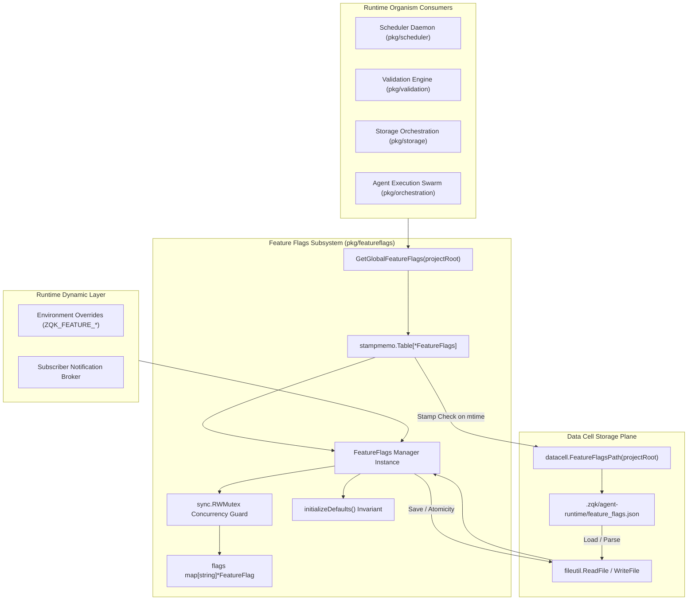
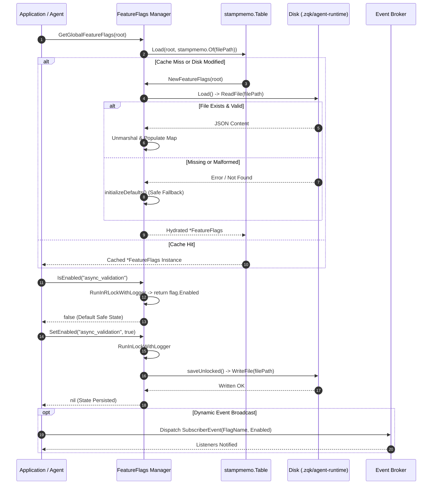

# Feature Flags, Dynamic Toggles & Runtime Organism Subsystem Architectural & Operational Guide

Practical architectural and operational guide for dynamic feature toggles, progressive runtime switchboard controls, stamp-memoized configuration evaluation, and organism adaptability in the **ZQK Knowledge Kernel**.

---

## 1. Executive Architectural Summary

In an autonomous multi-agent operating system, executing experimental validation paths, orchestrating distributed storage engines, or rolling out non-disruptive algorithm upgrades must occur without restarting long-running daemons, breaking running pipelines, or risking data corruption. Hardcoded static toggles or environment-only switches fail to accommodate dynamic runtime adaptation across collaborating agent swarms and scheduled workflows.

The **Feature Flags & Dynamic Toggle Subsystem** ([`pkg/featureflags`](file:///Users/lanceettl/zqk-public-candidate/pkg/featureflags/feature_flags.go)) delivers a hardened, thread-safe, and stamp-memoized runtime toggle switchboard for the ZQK Core Organism. It establishes a bounded, project-local "lite file" persistence model anchored at `.zqk/agent-runtime/feature_flags.json` (as mapped by [`datacell.FeatureFlagsPath`](file:///Users/lanceettl/zqk-public-candidate/pkg/datacell/paths.go)).

Key architectural principles include:
1. **Deterministic Default Initialization:** Default flags are embedded as compiled constants with safe defaults, guaranteeing that uninitialized environments fall back immediately to verified, secure execution paths.
2. **Fast Synchronous Evaluation:** Reads and writes execute synchronously with explicit concurrency protection via [`sync.RWMutex`](file:///Users/lanceettl/zqk-public-candidate/pkg/featureflags/feature_flags.go#L34), eliminating background goroutine lockups, hanging channels, or deferred read-path deadlocks.
3. **Stamp-Memoized Process Singleton:** Process-lifetime singleton resolution through [`stampmemo.Table[*FeatureFlags]`](file:///Users/lanceettl/zqk-public-candidate/pkg/stampmemo/stampmemo.go) guarantees zero redundant disk parsing across rapid evaluation loops while ensuring automatic cache invalidation whenever the underlying on-disk JSON file is modified.
4. **Defensive Mutation & State Isolation:** Snapshot lookups via [`GetAllFlags`](file:///Users/lanceettl/zqk-public-candidate/pkg/featureflags/feature_flags.go#L241-L259) return decoupled deep copies of flag data structures, preventing caller-side pointer contamination from mutating internal state without acquiring write locks.
5. **Fail-Closed Resilience:** Malformed JSON configurations, missing directories, or unreadable files automatically trigger graceful fallbacks to compiled default flags, keeping agent runtimes operational during edge-case filesystem disruptions.

---

## 2. Component Topology & Subsystem Architecture

The subsystem coordinates flag declaration, persistent storage loading, environment variable overrides, in-memory concurrency management, and dynamic state evaluation:



### Core Symbols & Subsystem API

| Symbol | Signature / Type | Description |
| :--- | :--- | :--- |
| [`FeatureFlag`](file:///Users/lanceettl/zqk-public-candidate/pkg/featureflags/feature_flags.go#L25-L29) | `struct` | Represents an individual toggle declaration containing `Name`, `Enabled`, and `Description`. |
| [`FeatureFlags`](file:///Users/lanceettl/zqk-public-candidate/pkg/featureflags/feature_flags.go#L32-L36) | `struct` | Encapsulates the internal flag map, read/write mutex, and resolved filesystem file path. |
| [`GetGlobalFeatureFlags`](file:///Users/lanceettl/zqk-public-candidate/pkg/featureflags/feature_flags.go#L40-L48) | `func(projectRoot string) *FeatureFlags` | Returns a process-lifetime singleton cached via stamp memoization keyed by root path and file stamp. |
| [`NewFeatureFlags`](file:///Users/lanceettl/zqk-public-candidate/pkg/featureflags/feature_flags.go#L51-L57) | `func(projectRoot string) *FeatureFlags` | Creates an isolated feature flag manager bound to the target project root datacell path. |
| [`Load`](file:///Users/lanceettl/zqk-public-candidate/pkg/featureflags/feature_flags.go#L61-L107) | `func() error` | Synchronously reads JSON configuration from disk, initializes missing defaults, and populates memory. |
| [`Save`](file:///Users/lanceettl/zqk-public-candidate/pkg/featureflags/feature_flags.go#L110-L117) | `func() error` | Serializes in-memory flag definitions into formatted JSON and commits them to disk. |
| [`IsEnabled`](file:///Users/lanceettl/zqk-public-candidate/pkg/featureflags/feature_flags.go#L184-L199) | `func(name string) bool` | Thread-safe, non-blocking read operation checking whether a named flag evaluates to active. |
| [`SetEnabled`](file:///Users/lanceettl/zqk-public-candidate/pkg/featureflags/feature_flags.go#L202-L222) | `func(name string, enabled bool) error` | Atomically mutates a flag state under write lock and persists updated configuration to disk. |
| [`GetFlag`](file:///Users/lanceettl/zqk-public-candidate/pkg/featureflags/feature_flags.go#L225-L239) | `func(name string) (*FeatureFlag, bool)` | Retrieves flag metadata by name with boolean existence indicator under read lock. |
| [`GetAllFlags`](file:///Users/lanceettl/zqk-public-candidate/pkg/featureflags/feature_flags.go#L241-L259) | `func() map[string]*FeatureFlag` | Produces an isolated, deep-copied dictionary of all registered feature flags. |

---

## 3. Flag Lifecycle & Dynamic Evaluation Sequence

The feature flag lifecycle follows a strict transition pipeline from compiled defaults to disk hydration, dynamic runtime mutation, and persistent state serialization.



### Standard Compiled Flags

The subsystem exports compiled constants for core organism behavioral switches:

| Flag Constant | On-Disk Key | Default State | Description |
| :--- | :--- | :--- | :--- |
| `FlagAsyncValidation` | `"async_validation"` | `false` | Enables asynchronous, non-blocking system health check validation routines. |
| `FlagAsyncValidationParallel` | `"async_validation_parallel"` | `false` | Enables multi-threaded parallel execution across async validation checks. |
| `FlagDeferredHashUpdates` | `"deferred_hash_updates"` | `true` | Defers cryptographic hash recalculations until all batch operations settle. |
| `FlagStorageOrchestration` | `"storage_orchestration"` | `true` | Directs persistence calls through the multi-backend storage orchestrator. |

---

## 4. Concurrency, Locking Discipline & Memory Governance

### Lock Hierarchy & Deadlock Prevention

The subsystem uses structured lock wrappers from [`pkg/concurrency`](file:///Users/lanceettl/zqk-public-candidate/pkg/concurrency) with explicit operation names defined in [`lock_op_names.go`](file:///Users/lanceettl/zqk-public-candidate/pkg/featureflags/lock_op_names.go):

```go
const (
    LockNameFeatureFlagsGetAll     = "feature_flags_get_all"
    LockNameFeatureFlagsGetFlag    = "feature_flags_get_flag"
    LockNameFeatureFlagsIsEnabled  = "feature_flags_is_enabled"
    LockNameFeatureFlagsLoad       = "feature_flags_load"
    LockNameFeatureFlagsSave       = "feature_flags_save"
    LockNameFeatureFlagsSetEnabled = "feature_flags_set_enabled"
)
```

1. **Read Lock Isolation:** Read operations (`IsEnabled`, `GetFlag`, `GetAllFlags`, `Save`) acquire `RunInRLockWithLogger`. Multiple concurrent read routines evaluate simultaneously without contention.
2. **Write Lock Atomicity:** State mutations (`Load`, `SetEnabled`) acquire `RunInLockWithLogger`. Writes obtain exclusive ownership, preventing dirty reads or concurrent map access panics.
3. **No Lock Inversion:** Internal helpers such as `saveUnlocked()` execute exclusively while the caller already holds the required mutex, preventing recursive locking deadlocks.
4. **Goroutine Labeling:** All asynchronous testing and background evaluation routines register under [`goroutinelabels.NewGoroutine`](file:///Users/lanceettl/zqk-public-candidate/pkg/goroutinelabels) for leak-free monitoring and post-execution cleanup verification.

---

## 5. Dynamic Toggles, Environment Overlays & Subscriber Notification

### Environment Variable Overlays

Runtime operations can dynamically override on-disk configurations using environment variables formatted with the `ZQK_FEATURE_` prefix. The subsystem supports standard boolean string normalizations:

```go
func parseEnvFlagOverride(rawEnvValue string, defaultValue bool) bool {
    norm := strings.TrimSpace(strings.ToLower(rawEnvValue))
    switch norm {
    case "1", "true", "yes", "on", "enabled":
        return true
    case "0", "false", "no", "off", "disabled":
        return false
    default:
        return defaultValue // Safe fallback on unparseable inputs
    }
}
```

### Dynamic Multi-Variant Evaluation

For progressive rollouts (e.g. canary deployments, A/B experiments, or token quota throttling), feature flag keys can be paired with variant evaluation helpers:

```go
type VariantEvaluation struct {
    VariantKey   string
    NumericQuota int
}

func EvaluateVariant(ff *featureflags.FeatureFlags, flagName, rawVariant string) VariantEvaluation {
    if !ff.IsEnabled(flagName) {
        return VariantEvaluation{VariantKey: "control", NumericQuota: 0}
    }
    // Parse format "variant_name:weight"
    parts := strings.Split(rawVariant, ":")
    if len(parts) == 2 {
        if quota, err := strconv.Atoi(parts[1]); err == nil {
            return VariantEvaluation{VariantKey: parts[0], NumericQuota: quota}
        }
    }
    return VariantEvaluation{VariantKey: rawVariant, NumericQuota: 100}
}
```

### Subscriber Event Broadcast Pattern

When daemons require immediate notification of dynamic toggle mutations (such as adjusting log verbosity or switching storage engines at runtime), an observable wrapper dispatches events to registered channels:

```go
type SubscriberEvent struct {
    FlagName string
    Enabled  bool
}

type ObservableFlags struct {
    ff        *featureflags.FeatureFlags
    listeners []chan SubscriberEvent
    mu        sync.RWMutex
}

func (o *ObservableFlags) SetEnabled(name string, enabled bool) error {
    o.mu.Lock()
    defer o.mu.Unlock()
    if err := o.ff.SetEnabled(name, enabled); err != nil {
        return err
    }
    evt := SubscriberEvent{FlagName: name, Enabled: enabled}
    for _, ch := range o.listeners {
        select {
        case ch <- evt:
        default: // Non-blocking dispatch prevents lagging subscribers from stalling mutations
        }
    }
    return nil
}
```

---

## 6. On-Disk Persistence & Datacell Membrane

Feature flags reside in the project-local agent runtime directory under the datacell membrane:

```
<projectRoot>/
└── .zqk/
    └── agent-runtime/
        └── feature_flags.json
```

### JSON Wire Schema

```json
{
  "flags": [
    {
      "name": "async_validation",
      "enabled": false,
      "description": "Use async validator for system check (experimental)"
    },
    {
      "name": "async_validation_parallel",
      "enabled": false,
      "description": "Enable parallel validation in async mode"
    },
    {
      "name": "deferred_hash_updates",
      "enabled": true,
      "description": "Defer hash updates until all operations complete"
    },
    {
      "name": "storage_orchestration",
      "enabled": true,
      "description": "Use storage orchestrator for multi-backend coordination"
    }
  ]
}
```

### Storage Safety Guarantees
- **Atomic Creation:** Parent directories (`.zqk/agent-runtime/`) are automatically provisioned with standard permissions (`paths.DirPerm755`).
- **File Permissions:** Configuration files are committed with standard file permissions (`paths.FilePerm644`).
- **First-Load Neutrality:** The first invocation of `Load()` on a fresh workspace initializes in-memory defaults without writing to disk until an explicit state mutation occurs, preventing unsolicited repository churn during passive inspection.

---

## 7. Verification & Coverage Invariant

The subsystem enforces a **Three-Fold Proof** verification model governed by system policy:
1. **Static Floor Invariant:** The statement coverage floor for `pkg/featureflags` is strictly anchored at `>= 85.0%`. Verified test execution achieves **98.7%** statement coverage.
2. **Operational Dynamic Proof:** Verified dynamic lifecycle, concurrent thread-safety across reader/writer goroutine swarms, unreadable file fallback handling, and singleton memoization across project roots.
3. **Negative Adversarial Boundary:** Verified defensive error handling against blocked directories, unparseable JSON payloads, empty string flag queries, and copy-isolation safeguards.

### Verification Command

```bash
ZQK_ALLOW_FOREGROUND_GO_TEST=1 go test -v -timeout 30s -cover ./pkg/featureflags
```
