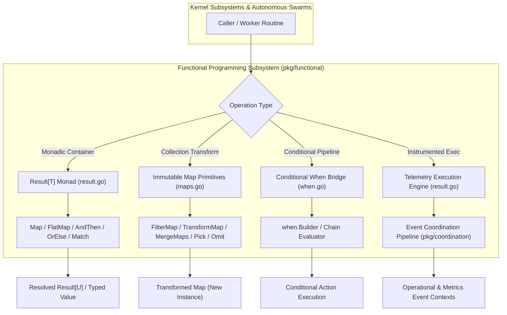
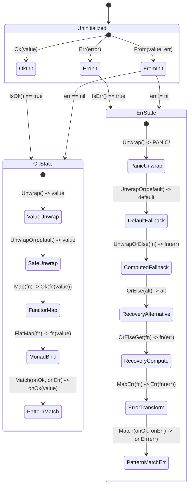
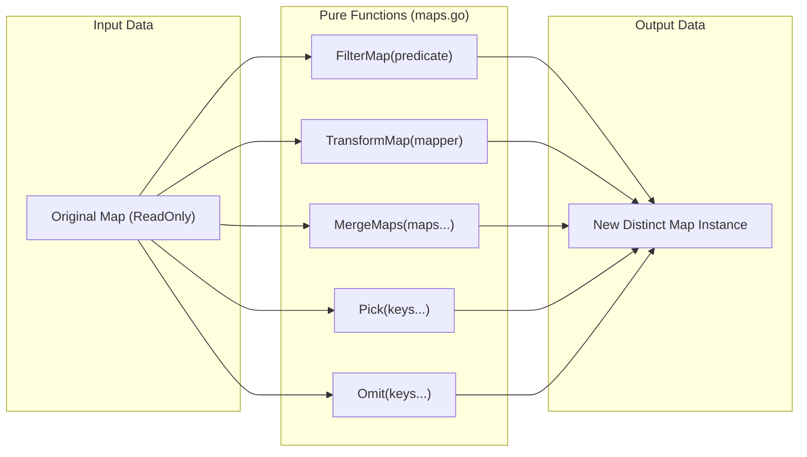
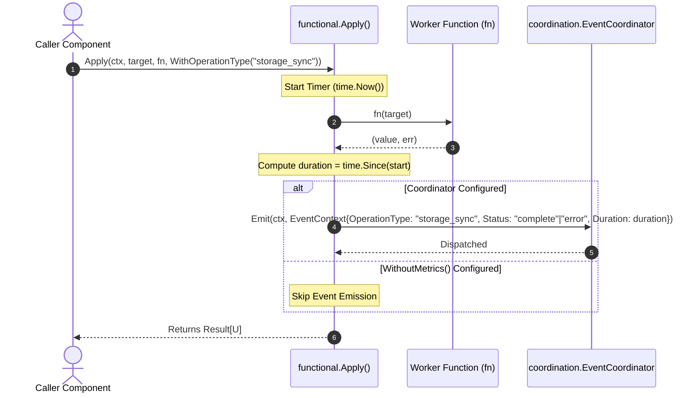

# Functional Programming Primitives & Result Monad Subsystem Architectural & Operational Guide

## 1. Executive Architectural Summary

The **Functional Programming Primitives & Result Monad Subsystem** (`pkg/functional`) provides generic, type-safe functional abstractions, monadic error-handling containers, collection transformation utilities, and telemetry-integrated execution primitives across the **ZQK Knowledge Kernel**.

In idiomatic Go codebases, the standard `(value, error)` multiple return convention frequently induces repetitive branching cascades, deeply nested `if err != nil` logic blocks, and severe risk of swallowed or mishandled errors. Governed by core system policy **POL-DEFAULT-a5e2f78b19c36d0e**, `pkg/functional` establishes a deterministic, expressive, and zero-allocation abstraction layer that unifies:

1. **`Result[T]` Monad**: A generic, type-safe algebraic data container encapsulating either a successful value (`T`) or an `error`, inspired by Rust's `Result<T, E>`.
2. **Monadic Combinators**: Composable operators (`Map`, `FlatMap`, `MapErr`, `AndThen`, `OrElse`, `OrElseGet`, `Match`, `MatchErr`) enabling declarative transformation pipelines without early returns or manual error branching.
3. **Telemetry-Integrated Execution**: Higher-order execution pipelines (`Apply`, `ApplyOrElse`, `ApplyAndThen`, `Do`, `DoOrElse`, `DoAndThen`, `Get`, `GetOrElse`, `GetOrElseGet`) that execute closures while automatically instrumenting duration, status, and error metadata into the ZQK Event Coordination spinal cord.
4. **Pure Collection Transformations**: Nil-safe, immutable map operations (`FilterMap`, `TransformMap`, `MergeMaps`, `InvertMap`, `Pick`, `Omit`, `MapKeys`, `MapValues`, `MapGetOrDefault`, `MapGetPtr`, `MapHasPtr`) guaranteeing zero mutations of input data structures.
5. **Fluent Conditional Chaining**: Seamless integration with `pkg/when` via re-exported `When` builders for expressive predicate evaluations.
6. **Immutable Concurrency Semantics**: Zero mutable shared state, enabling race-free execution across high-throughput worker pools managed by `pkg/goroutinelabels`.

---

## 2. Component Topology & Subsystem Architecture

The subsystem is organized into modular functional units engineered for zero mutable global state and optimal compiler inlineability:



### Core Components

| Component | Source File | Core Responsibility |
| :--- | :--- | :--- |
| **`Result[T]` Monad** | `result.go` | Generic algebraic container encapsulating either success (`T`) or failure (`error`). Provides constructors (`Ok`, `Err`, `From`) and safe unwrapping methods. |
| **Monadic Combinators** | `result.go` | Functional combinators (`Map`, `FlatMap`, `MapErr`, `AndThen`, `OrElse`, `OrElseGet`, `Match`, `MatchErr`) that chain transformations and handle fallbacks declaratively. |
| **Telemetry Higher-Order Functions** | `result.go` | Coordinated execution engines (`Apply`, `Do`, `Get`) integrating timing, operation labeling, and event dispatch into `pkg/coordination`. |
| **Collection Transformers** | `maps.go` | Pure, nil-safe functional operators (`FilterMap`, `TransformMap`, `MergeMaps`, `InvertMap`, `Pick`, `Omit`, `MapKeys`, `MapValues`, `MapGetOrDefault`, `MapGetPtr`, `MapHasPtr`). |
| **Conditional Combinator Bridge** | `when.go` | Re-exports `when.When` to provide lazy condition evaluation, short-circuit branching, and fallback chains without cross-package import churn. |

---

## 3. Monadic Error Handling Lifecycle & State Transitions

The `Result[T]` container models a disjoint union: a value is either present (`Ok`) or absent due to an error (`Err`). Transitions between states follow strict mathematical monadic laws:



### Unwrapping Invariants & Safe Practices

1. **`Unwrap()` Panic Guard**: `Unwrap()` panics if called on an error result. It should only be used in test assertions or after verifying `IsOk()`.
2. **`UnwrapOr(defaultValue)`**: Returns the encapsulated value if `IsOk()`, or returns `defaultValue` if `IsErr()`. Guaranteed panic-free.
3. **`UnwrapOrElse(fn)`**: Lazily computes the fallback value using the inner `error`. Evaluates `fn` only on failure.
4. **`Match(onSuccess, onFailure)`**: Exhaustive pattern match ensuring both branches are accounted for without runtime panics.

```go
// Example: Safe monadic parsing pipeline
result := functional.Apply(ctx, rawInput, parsePayload, functional.WithoutMetrics())

finalConfig := functional.Match(result,
    func(cfg Config) Config {
        return cfg.WithDefaults()
    },
    func(err error) Config {
        logger.Warn("Failed to parse config, applying fallback", "error", err)
        return DefaultConfig()
    },
)
```

---

## 4. Collection Transformations & Memory Invariants

All collection functions in `pkg/functional` adhere to pure functional programming standards:

1. **Immutability Guarantee**: Input maps are never mutated. Every transformation constructs and returns a new map instance.
2. **Nil-Safety Invariant**: Passing a `nil` map into any transformation function safely returns `nil` (or a default value for lookup operations) without panicking.
3. **Allocation Optimization**: Functions pre-allocate slice and map capacities using `len(m)` where the output size is known upfront (`TransformMap`, `InvertMap`, `MapKeys`, `MapValues`).



### Collection Transformation Operations

| Function | Signature | Semantics |
| :--- | :--- | :--- |
| `FilterMap` | `func FilterMap[K, V](m map[K]V, predicate func(K, V) bool) map[K]V` | Returns a new map containing only entries where `predicate(key, value)` is `true`. |
| `TransformMap` | `func TransformMap[K, V, U](m map[K]V, fn func(V) U) map[K]U` | Returns a new map with values transformed by `fn`. |
| `MergeMaps` | `func MergeMaps[K, V](maps ...map[K]V) map[K]V` | Merges maps left-to-right. Later maps overwrite keys from earlier ones. |
| `InvertMap` | `func InvertMap[K, V](m map[K]V) map[V]K` | Inverts keys and values. Values must satisfy `comparable`. |
| `Pick` | `func Pick[K, V](m map[K]V, keys ...K) map[K]V` | Returns a new map containing only the specified keys. |
| `Omit` | `func Omit[K, V](m map[K]V, keys ...K) map[K]V` | Returns a new map containing all entries except the specified keys. |
| `MapKeys` | `func MapKeys[K, V](m map[K]V) []K` | Returns a pre-allocated slice of all map keys. |
| `MapValues` | `func MapValues[K, V](m map[K]V) []V` | Returns a pre-allocated slice of all map values. |

---

## 5. Telemetry & Event Coordination Integration

The `Apply`, `Do`, and `Get` families integrate functional execution directly into ZQK's event coordination architecture (`pkg/coordination`).



### Telemetry Configuration Options

- `WithCoordinator(c coordination.EventCoordinator)`: Directs emitted operational events to a custom or mock coordinator.
- `WithOperationType(opType string)`: Sets the semantic operation identifier (e.g. `"query_evaluation"`, `"artifact_seal"`).
- `WithoutMetrics()`: Completely suppresses coordinator lookup and emission, eliminating telemetry overhead in tight inner loops or isolated unit tests.

---

## 6. Concurrency, Race Freedom & Thread-Safety

`Result[T]` is designed with immutable value semantics:

1. **Value Receiver Methods**: Methods (`IsOk()`, `IsErr()`, `Value()`, `Unwrap()`, `UnwrapOr()`) use value receivers (`r Result[T]`), guaranteeing that instances cannot be mutated after instantiation.
2. **Concurrent Readers**: Multiple goroutines spawned via `goroutinelabels.NewGoroutine` can safely inspect, map, and transform the same `Result[T]` instance simultaneously without mutex locks or atomic synchronization.
3. **Map Isolation**: Because collection transformers return brand-new map instances, concurrent workers processing shared data structures never encounter concurrent map write panics (`fatal error: concurrent map writes`).

```go
// Concurrent evaluation example using goroutinelabels
var wg sync.WaitGroup
sharedResult := functional.Ok(basePayload)

for i := 0; i < workerPoolSize; i++ {
    workerID := i
    wg.Add(1)
    goroutinelabels.NewGoroutine(
        fmt.Sprintf("worker_%d", workerID),
        "concurrent functional transformation",
    ).StartSimple(func() {
        defer wg.Done()
        transformed := functional.Map(sharedResult, func(p Payload) Processed {
            return processWorkerPayload(p, workerID)
        })
        consumeResult(transformed)
    })
}
wg.Wait()
```

---

## 7. Verification & Coverage Invariant

Statement test coverage for `pkg/functional` is continuously enforced at strictly **>= 85.0%** (target: 100.0%):

1. **Static Floor Invariant**: Verified via `ZQK_ALLOW_FOREGROUND_GO_TEST=1 go test -v -timeout 30s -cover ./pkg/functional`.
2. **Operational Dynamic Proof**: Validates monadic pipelines, collection transformers, lazy `When` combinators, telemetry emission, and concurrent execution under the Go race detector (`-race`).
3. **Negative Adversarial Boundary**: Tests panic behavior on invalid unwraps, nil map handling, empty key selections, nil callback safety in `Match`/`MatchErr`, and error propagation across chaining combinators.

---

## 8. Operational Recipes & Best Practices

### Recipe 1: Monadic Chaining with Safe Fallback

```go
func LoadConfig(ctx context.Context, path string) Config {
    return functional.Apply(ctx, path, readFile, functional.WithOperationType("read_config")).
        FlatMap(parseYAML).
        FlatMap(validateSchema).
        UnwrapOrElse(func(err error) Config {
            telemetry.Warn("Using default configuration due to load failure", "error", err)
            return DefaultConfig()
        })
}
```

### Recipe 2: Safe Map Filtering and Inversion

```go
func IndexActiveEndpoints(endpoints map[string]Endpoint) map[EndpointID]string {
    activeOnly := functional.FilterMap(endpoints, func(url string, ep Endpoint) bool {
        return ep.IsHealthy && !ep.IsDraining
    })

    endpointToURL := functional.TransformMap(activeOnly, func(ep Endpoint) EndpointID {
        return ep.ID
    })

    return functional.InvertMap(endpointToURL)
}
```

### Anti-Patterns to Avoid

- **Anti-Pattern 1: Unchecked `Unwrap()` in Production**: Never call `.Unwrap()` on a `Result[T]` unless guarded by `if r.IsOk()` or during test assertions. Use `UnwrapOr()`, `UnwrapOrElse()`, or `Match()` instead.
- **Anti-Pattern 2: Discarding Error Contexts**: Do not convert a `Result[T]` into a bare value while ignoring errors (`_ = r.UnwrapOr(fallback)` without logging or metrics). Utilize `Apply` or `MatchErr` to capture error telemetry.
- **Anti-Pattern 3: In-Place Map Mutation**: Do not take maps returned by `pkg/functional` and mutate them across goroutines. Treat all transformed collections as immutable snapshots.
