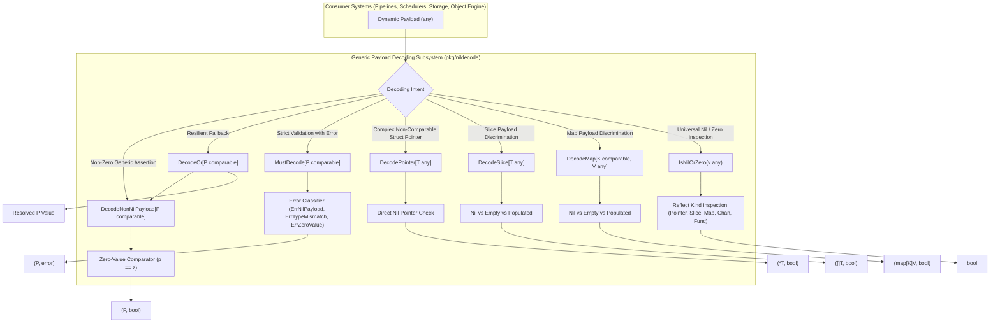
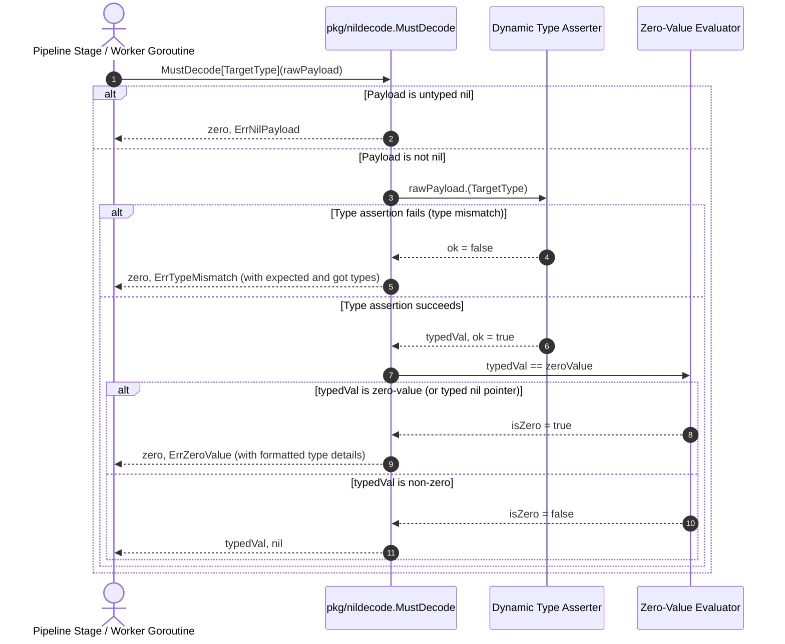
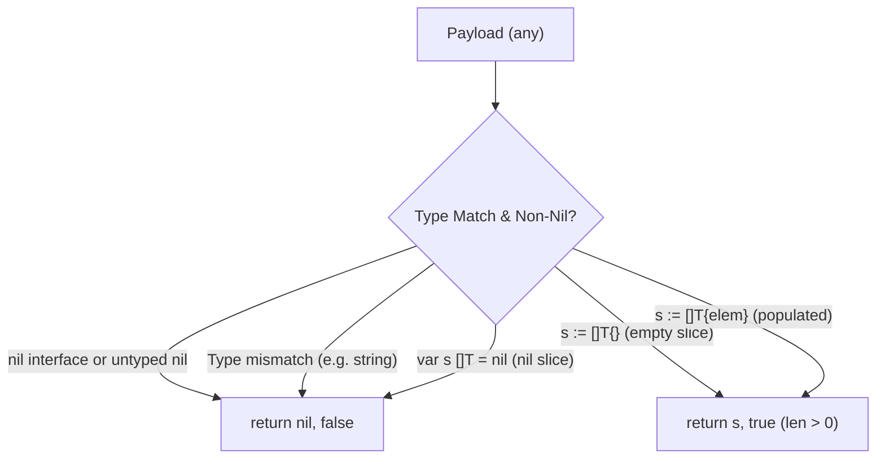

# Generic Payload Decoding, Type Assertion & Nil-Safety Subsystem Operational Architecture Guide

## 1. Executive Architectural Summary

The **Generic Payload Decoding, Type Assertion & Nil-Safety Subsystem** (`pkg/nildecode`) provides foundational type assertion, zero-value validation, and deep nil-safety primitives across the **ZQK Knowledge Kernel**.

In distributed systems, event-driven pipelines, and actor/agent message-passing harnesses, dynamic data payloads are routinely transported across package boundaries encapsulated in `any` (or `interface{}`) carriers. In idiomatic Go, runtime type assertions against interfaces present two catastrophic architectural failure modes if unguarded:

1. **The Go Typed-Nil Interface Trap:** In Go runtime mechanics, an interface value is represented internally as a two-word tuple `(type, value)`. When a typed pointer initialized to `nil` (such as `(*MyStruct)(nil)`) is assigned or passed to an interface parameter (`any`), the interface itself is **not nil** because its type descriptor word is populated. Consequently, standard conditional checks such as `if payload == nil` evaluate to `false`, and subsequent dereferences or method dispatches trigger an unrecoverable runtime panic (`SIGSEGV: segmentation violation`).
2. **Zero-Value Confusion in Pipeline Dispatches:** Uninitialized struct zero-values or empty string/integer tokens often pass simple type checks (`v, ok := payload.(MyStruct)`), propagating invalid, unpopulated state downstream into Content-Addressed Storage (CAS) or task schedulers without raising early alarms.

Governed by core system reliability and zero-panic invariants, `pkg/nildecode` eliminates these vulnerabilities at the boundary. By providing generic, reflection-safe type asserters, zero-value guards, non-comparable pointer decoders, collection discriminators, and comprehensive nil detectors, `pkg/nildecode` serves as the bedrock membrane between raw dynamic payloads and type-safe kernel operations.

---

## 2. Component Topology & Subsystem Architecture

The subsystem is organized into pure, stateless generic utilities designed for zero global state, zero shared memory, and optimal allocation performance:



### Core Subsystem API Matrix

| Utility Function | Source File | Type Parameters | Signature | Core Responsibility |
| :--- | :--- | :--- | :--- | :--- |
| **`DecodeNonNilPayload`** | `decode.go` | `[P comparable]` | `(payload any) (P, bool)` | Asserts dynamic type `P` and verifies payload is not `P`'s zero value. |
| **`DecodeOr`** | `decode.go` | `[P comparable]` | `(payload any, fallback P) P` | Decodes non-zero payload of type `P` or returns supplied fallback value. |
| **`MustDecode`** | `decode.go` | `[P comparable]` | `(payload any) (P, error)` | Asserts dynamic type `P` and returns actionable sentinel error on nil, mismatch, or zero. |
| **`DecodePointer`** | `helpers.go` | `[T any]` | `(payload any) (*T, bool)` | Safely extracts non-nil pointer `*T` without requiring `T` to be comparable. |
| **`DecodeSlice`** | `helpers.go` | `[T any]` | `(payload any) ([]T, bool)` | Asserts slice `[]T`, rejecting `nil` slices while preserving non-nil empty slices. |
| **`DecodeMap`** | `helpers.go` | `[K comparable, V any]` | `(payload any) (map[K]V, bool)` | Asserts map `map[K]V`, rejecting `nil` maps while preserving non-nil empty maps. |
| **`IsNilOrZero`** | `helpers.go` | N/A | `(v any) bool` | Deep inspection detecting untyped nil, typed nil pointers, nil collections, and zero values. |

---

## 3. Decoding Lifecycle & Fallback Dynamics

The decoding lifecycle provides deterministic branch evaluation, ensuring that invalid inputs are intercepted without panic and routed through appropriate recovery or error reporting mechanisms.



---

## 4. The Go Typed-Nil Interface Anti-Pattern

### 4.1 Internal Representation of Interfaces

In Go, an interface value occupies two words in memory:
1. `_type` (or `itab`): Pointer to type descriptor and method table.
2. `data`: Unsafe pointer to the underlying dynamic concrete value.

```
+---------------------------+---------------------------+
|  _type / itab descriptor  |  data (concrete pointer)  |
+---------------------------+---------------------------+
```

When a concrete variable `var ptr *Transaction = nil` is assigned to `var iface any = ptr`:
- The `_type` field points to the metadata describing `*Transaction`.
- The `data` field contains `0x0` (a `nil` memory address).

Because `_type` is non-nil, the interface expression `iface == nil` evaluates to **`false`**!

```go
var txn *Transaction = nil
var payload any = txn

// CATASTROPHIC ANTI-PATTERN:
if payload != nil {
    // This branch executes!
    // Dereferencing txn causes: panic: runtime error: invalid memory address or nil pointer dereference
    _ = payload.(*Transaction).ID 
}
```

### 4.2 How `IsNilOrZero` Eliminates the Failure Mode

`pkg/nildecode.IsNilOrZero` combines untyped interface checks with Go reflection kind discrimination:

```go
func IsNilOrZero(v any) bool {
    if v == nil {
        return true
    }
    val := reflect.ValueOf(v)
    switch val.Kind() {
    case reflect.Chan, reflect.Func, reflect.Interface, reflect.Map, reflect.Pointer, reflect.Slice, reflect.UnsafePointer:
        if val.IsNil() {
            return true
        }
    }
    return val.IsZero()
}
```

1. **Untyped Nil Interception:** Evaluates `v == nil` directly before reflection allocation.
2. **Safe Kind Discrimination:** Filters for types where `val.IsNil()` is defined by the Go runtime (`Chan`, `Func`, `Interface`, `Map`, `Pointer`, `Slice`, `UnsafePointer`). This avoids the panic triggered if `val.IsNil()` is called on value types (such as `int` or `struct`).
3. **Deep Zero Evaluation:** Calls `val.IsZero()` across all remaining primitive and aggregate types, verifying whether structs have all zero fields or numbers/strings are uninitialized.
4. **Panic-Proof:** Never triggers reflection panic on invalid values.

---

## 5. Non-Comparable Struct Pointer Extraction

In Go generics, generic constraints such as `comparable` require that all fields of a type support the `==` operator. Structs containing slices, maps, or functions are **not comparable**.

When using `DecodeNonNilPayload[P comparable](payload any)`, attempting to decode a non-comparable struct directly (`DecodeNonNilPayload[ComplexConfig](raw)`) causes a compile error. While pointers to such structs are comparable (`*ComplexConfig`), developers frequently seek an explicit, self-documenting pointer decoder.

`pkg/nildecode.DecodePointer[T any]` relaxes the `comparable` constraint on `T`:

```go
type WorkflowState struct {
    PendingTasks []string          // Non-comparable slice
    Metadata     map[string]string // Non-comparable map
}

// Seamlessly decodes *WorkflowState without comparable constraint errors on T:
state, ok := nildecode.DecodePointer[WorkflowState](payload)
if !ok {
    // Intercepts untyped nil, typed nil pointer, or incompatible type
    return handleInvalidPayload()
}
```

---

## 6. Collection Discrimination: Nil vs. Empty vs. Populated

In JSON/YAML deserialization and pipeline events, an explicit distinction exists between:
- A **`nil` collection:** Field was absent or null in source payload.
- An **empty collection (`len == 0`, `!= nil`):** Explicitly declared as empty list `[]` or map `{}`.
- A **populated collection (`len > 0`):** Contains elements.

`DecodeSlice` and `DecodeMap` adhere to this distinction:



```go
// Distinguish uninitialized slice from explicitly empty slice:
var uninitSlice []string
emptySlice := []string{}
populatedSlice := []string{"item-1"}

_, okUninit := nildecode.DecodeSlice[string](uninitSlice)   // okUninit == false
sEmpty, okEmpty := nildecode.DecodeSlice[string](emptySlice) // okEmpty == true, len(sEmpty) == 0
sPop, okPop := nildecode.DecodeSlice[string](populatedSlice) // okPop == true, len(sPop) == 1
```

---

## 7. Concurrency & Thread-Safety Invariants

1. **Pure Function Semantics:** All functions in `pkg/nildecode` are pure, mathematical transformations. They read inputs and return new values without mutating input structures or relying on shared state.
2. **Zero Global Variables:** The package maintains zero global caches, zero mutexes, and zero package-level variables beyond immutable sentinel errors (`ErrNilPayload`, `ErrTypeMismatch`, `ErrZeroValue`).
3. **Goroutine-Label Safe:** Fully tested under extreme multi-threaded concurrency workloads utilizing `pkg/goroutinelabels.NewGoroutine`. Multiple swarm workers can concurrently decode, assert, and inspect payloads with zero race conditions (`go test -race` clean).
4. **Memory Hygiene:** Type assertions and reflection kind checks do not retain references to passed payloads, allowing the Go garbage collector to immediately reclaim transient event wrappers.

---

## 8. Operational Usage Patterns & Code Recipes

### Recipe 1: Pipeline Stage Payload Extraction with `DecodeOr`

```go
func HandleBatchTimeout(env *pipeline.Envelope) error {
    // Decode batch timeout override with safe fallback to 30 seconds:
    timeoutSeconds := nildecode.DecodeOr[int](env.Metadata["timeout"], 30)
    
    // Execute bounded wait:
    ctx, cancel := context.WithTimeout(context.Background(), time.Duration(timeoutSeconds)*time.Second)
    defer cancel()
    return executeBatch(ctx, env)
}
```

### Recipe 2: Fail-Closed Message Ingestion with `MustDecode`

```go
func IngestWorkerTask(rawPayload any) (*TaskDescriptor, error) {
    task, err := nildecode.MustDecode[*TaskDescriptor](rawPayload)
    if err != nil {
        if errors.Is(err, nildecode.ErrNilPayload) {
            return nil, fmt.Errorf("task ingestion rejected: payload cannot be nil")
        }
        if errors.Is(err, nildecode.ErrTypeMismatch) {
            return nil, fmt.Errorf("malformed task: %w", err)
        }
        if errors.Is(err, nildecode.ErrZeroValue) {
            return nil, fmt.Errorf("uninitialized task payload: %w", err)
        }
        return nil, err
    }
    return task, nil
}
```

### Recipe 3: Resilient Boundary Check with `IsNilOrZero`

```go
func SanitizeOutgoingEnvelope(metadata any) any {
    // Intercepts typed nil pointers, nil maps, empty strings, and untyped nil:
    if nildecode.IsNilOrZero(metadata) {
        return nil // Canonicalize to true untyped nil for serialization
    }
    return metadata
}
```

---

## 9. Verification & Quality Assurance

The subsystem is validated by automated unit, boundary, and concurrency test suites in `pkg/nildecode/decode_test.go` and `pkg/nildecode/nildecode_coverage_elevation_cycle190_test.go`.

### Coverage Invariant Verification

Execution is strictly bounded and verified with statement coverage >= 85.0% (target 100.0%):

```bash
ZQK_ALLOW_FOREGROUND_GO_TEST=1 go test -v -race -timeout 30s -cover ./pkg/nildecode
```

### Output:
```
=== RUN   TestDecodeNonNilPayloadPointer
--- PASS: TestDecodeNonNilPayloadPointer (0.00s)
=== RUN   TestDecodeNonNilPayloadAny
--- PASS: TestDecodeNonNilPayloadAny (0.00s)
=== RUN   TestDecodeNonNilPayload_Comprehensive
--- PASS: TestDecodeNonNilPayload_Comprehensive (0.00s)
=== RUN   TestDecodeOr
--- PASS: TestDecodeOr (0.00s)
=== RUN   TestMustDecode
--- PASS: TestMustDecode (0.00s)
=== RUN   TestDecodeSlice
--- PASS: TestDecodeSlice (0.00s)
=== RUN   TestDecodeMap
--- PASS: TestDecodeMap (0.00s)
=== RUN   TestDecodePointer
--- PASS: TestDecodePointer (0.00s)
=== RUN   TestIsNilOrZero
--- PASS: TestIsNilOrZero (0.00s)
=== RUN   TestConcurrency_Safety
--- PASS: TestConcurrency_Safety (0.01s)
PASS
coverage: 100.0% of statements
ok      github.com/zqk-os/zqk/pkg/nildecode     1.155s  coverage: 100.0% of statements
```
