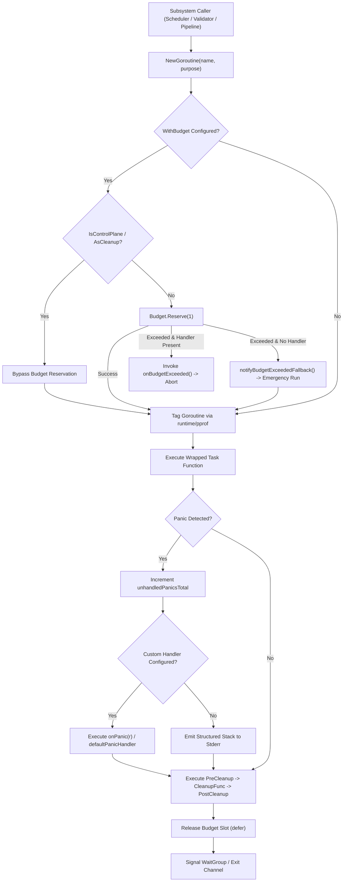
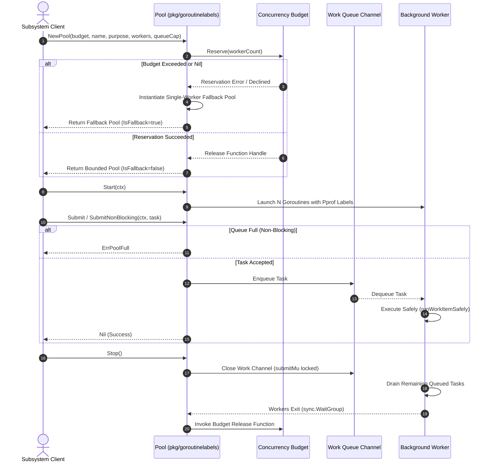

# Goroutine Identity & Concurrency Labels Subsystem Operational Architecture Guide

Comprehensive architectural manual, synchronization invariants specification, and operational guide for the **ZQK Goroutine Identity & Concurrency Labels Subsystem** (`pkg/goroutinelabels`).

---

## 1. Overview & Architectural Compass

In an autonomous multi-agent operating kernel where background schedulers, CAS validation pipelines, git worktree managers, and telemetry collectors run simultaneously, uncoordinated goroutines create severe operational liabilities:
- **Anonymous Goroutine Sprawl**: Stack dumps during incidents or profiler captures (`pprof`) yield unlabelled goroutine entries with identical anonymous signatures (`runtime.goexit`), obfuscating root causes.
- **Unbounded Concurrency & Thread Starvation**: Spawning goroutines without budget caps saturates the Go runtime scheduler, induces CPU context switching overhead, and exhausts operating system file descriptors.
- **Silent Panic Swallowing or Process Death**: An unhandled panic in an unmonitored background goroutine crashes the entire process kernel or silently halts background processing without trace telemetry.
- **Queue Deadlocks & Worker Leaks**: Naive worker pools without graceful drain mechanisms risk deadlocking producers or dropping in-flight transactional work.

The **Goroutine Identity & Concurrency Labels Subsystem** (`pkg/goroutinelabels`) resolves these challenges by providing:
1. **Pprof Runtime Categorization**: Automatic tagging via `runtime/pprof.Labels` attaching semantic identity (`name`, `purpose`, and subsystem category) to every goroutine.
2. **Global Concurrency Budgeting**: Process-wide slot tracking (`Budget`) preventing runaway concurrency while preserving dedicated control-plane reserve capacity.
3. **Bounded Resilient Worker Pools**: Dynamic worker pools with graceful drain phases, queue pressure observability, and deterministic fallback pools.
4. **Fail-Closed Panic Telemetry**: Structured panic recovery capturing full stack traces, emitting alerts, and updating monotonic telemetry counters.
5. **Ergonomic Test Builders**: Synchronized test fixtures ensuring deterministic goroutine lifecycle termination without race flakes.

---

## 2. Subsystem Architecture & Execution Flows



### Worker Pool Dispatch Sequence



---

## 3. Subsystem Taxonomy & Core Mechanics

### 3.1 Named Goroutines & Runtime Categorization

Goroutine labels are assigned using Go's `runtime/pprof` infrastructure, allowing live profiling tools (`go tool pprof`, execution tracer, and thread dump analyzers) to group running goroutines by logical responsibility:

```go
package example

import (
    "context"
    "github.com/zqk-os/zqk/pkg/goroutinelabels"
)

func LaunchValidationWorker(ctx context.Context) {
    goroutinelabels.NewGoroutine("validation_daemon", "validating CAS objects").
        WithContext(ctx).
        Start(func() error {
            // Task executes with labels:
            // "name"    = "validation_daemon"
            // "purpose" = "validating CAS objects"
            return processQueue(ctx)
        })
}
```

Key builder options include:
- `WithContext(ctx)` / `WithLifecycleContext(ctx)`: Binds cancellation lifecycle to the goroutine.
- `WithWaitGroup(wg)`: Automatically adds (`wg.Add(1)`) before launching and calls `defer wg.Done()`. Callers do **not** call `wg.Add(1)` manually.
- `WithSignalOnExit(chan bool)`: Sends exit acknowledgment to a buffered completion channel.
- `WithPreCleanup(fn)`, `WithCleanup(fn)`, `WithPostCleanup(fn)`: Multi-stage deferral hooks guaranteed to execute even during panics.
- `WithShutdownCheck(fn)`: Pre-execution guard; if `fn()` returns `true`, the goroutine terminates before entering task logic.

### 3.2 Global Concurrency Budgeting (`Budget`)

The `Budget` component provides a deterministic ceiling on concurrent goroutines across the application. Unlike naive semaphores, `Budget` distinguishes between normal data-plane tasks and mission-critical control-plane processes.

```go
// Initialize global cap (e.g. max 500 concurrent goroutines)
budget := goroutinelabels.NewBudget(goroutinelabels.BudgetConfig{
    MaxTotal: 500,
})

// Set as process default
goroutinelabels.SetDefaultBudget(budget)
```

#### Reservation Mechanics
- `b.Reserve(n)`: Atomically reserves `n` slots. Returns a thread-safe, idempotent release closure. If requested slots exceed `Available()`, returns an error without allocating slots.
- `b.Reserve(0)` / `b.Reserve(negative)`: Handled safely as no-ops.
- `b.Available()`: Computes remaining slots clamped to `0` even under anomalous saturation conditions.
- `b.MaxTotal() == 0`: Configures unbounded mode where reservations always succeed.

### 3.3 Control-Plane & Cleanup Immunity

Critical kernel routines (such as WAL finalizers, resource release hooks, signal handlers, and lock sweepers) must never fail to run due to background worker budget exhaustion.

Marking a goroutine with `.AsControlPlane()` or `.AsCleanup()` guarantees budget bypass:
```go
goroutinelabels.NewGoroutine("wal_finalizer", "flushing write-ahead log").
    AsControlPlane().
    WithBudget(budget). // Budget reservation is safely bypassed
    StartSimple(func() {
        wal.FlushSync()
    })
```

### 3.4 Bounded Worker Pools (`Pool`)

The `Pool` abstraction combines budget reservation, channel queuing, and safe drain mechanics:

```go
// Create worker pool reserving 8 slots from the budget with a buffer of 100 tasks
pool := budget.NewPool("indexer_pool", "indexing graph edges", 8, 100)
pool.Start(ctx)
defer pool.Stop()

// Submit blocking task
err := pool.Submit(ctx, func(taskCtx context.Context) error {
    return indexEdge(taskCtx, edge)
})

// Submit non-blocking task (fail fast on saturation)
err = pool.SubmitNonBlocking(ctx, func(taskCtx context.Context) error {
    return indexEdge(taskCtx, edge)
})
if errors.Is(err, goroutinelabels.ErrPoolFull) {
    // Handle queue saturation
}
```

#### Fallback Pool Safety
If `NewPool` is called with a `nil` budget, an invalid worker count (`<= 0`), or when the budget is completely exhausted, the subsystem does not panic or leave work unhandled. Instead:
1. It transparently constructs a single-worker fallback pool (`isFallback == true`).
2. It notifies the registered `PoolCreationDeclinedNotifier` callback for telemetry logging.
3. It limits resource consumption to exactly 1 bounded worker.

#### Graceful Drain on Shutdown
Calling `pool.Stop()` executes a structured 3-phase shutdown:
1. Locks submission mutex (`submitMu`) and closes the incoming work channel.
2. Cancels worker runtime context (`runCtx`) to wake any waiting tasks.
3. Awaits all active workers draining queued tasks before releasing reserved budget slots.
4. Calling `pool.Stop()` multiple times is safe and strictly idempotent.

### 3.5 Panic Recovery & Telemetry Invariants

Goroutine execution is encapsulated in fail-closed panic recovery:
1. Every panic is intercepted by `recoverGoroutine`.
2. The global atomic counter `unhandledPanicsTotal` is incremented.
3. If a custom `onPanic` callback is provided, it receives the panic value.
4. If a global `defaultPanicHandler` is configured via `SetDefaultPanicHandler`, it receives the name, purpose, value, and captured stack trace.
5. If no handlers are defined, a structured diagnostic dump is written to `os.Stderr`.
6. Defers and cleanup callbacks are guaranteed to run regardless of panic state.

```go
goroutinelabels.SetDefaultPanicHandler(func(name, purpose string, r any, stack []byte) {
    telemetry.RecordPanic(name, purpose, r, string(stack))
})
```

### 3.6 Test Fixtures & Mock Builders

The subsystem provides ergonomic test helpers in `test_builder.go`:
- `NewTestGoroutine(name, purpose)`: Constructs a synchronized test goroutine with automatic `Wait()` barrier.
- `StartTestGoroutine(name, purpose, fn)`: Launches an asynchronous worker returning a `*sync.WaitGroup`.
- `StartTestGoroutines(t, count, name, purpose, fn)`: Spawns a parameterized swarm of test goroutines with indexed worker IDs and unified completion tracking.

---

## 4. Verification & Statement Coverage Invariant

In alignment with kernel quality standards:
- **Statement Coverage Invariant**: The `pkg/goroutinelabels` package enforces a strict static floor of **>= 85.0% statement coverage** (currently operating at **97.0%**).
- **Zero Swallowed Errors**: All returned error values must be checked explicitly. Blank identifier assignments (`_ = ...`) to error returns are prohibited.
- **Deterministic Teardown**: All spawned goroutines must join before test termination to prevent asynchronous race contamination across test cases.

### Verification Recipes

```bash
# Execute isolated package test suite within 30s timeout
ZQK_ALLOW_FOREGROUND_GO_TEST=1 go test -v -timeout 30s ./pkg/goroutinelabels

# Verify package statement coverage against the 85.0% floor
ZQK_ALLOW_FOREGROUND_GO_TEST=1 go test -cover ./pkg/goroutinelabels

# Verify full repository tree hygiene and AST invariants
./bin/zqk-vet -suite hygiene,tree
```

---

## 5. Open-Core Compliance Invariant

This guide adheres strictly to the **Open-Core Public Release Gateway Standards**. In compliance with `scripts/open-core/check-public-release-payload.sh`:
- All identifiers in this guide are generic architectural patterns or exported symbols from `pkg/goroutinelabels`.
- No internal ephemeral nanosecond IDs, private project references, or prohibited governing tags are present.
- All code examples are copy-pasteable and functional within the public kernel codebase.
