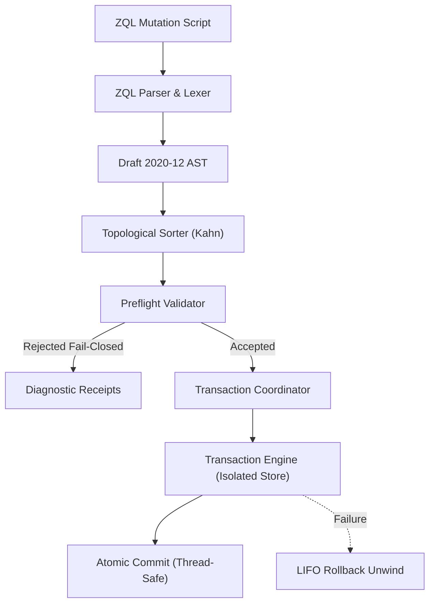
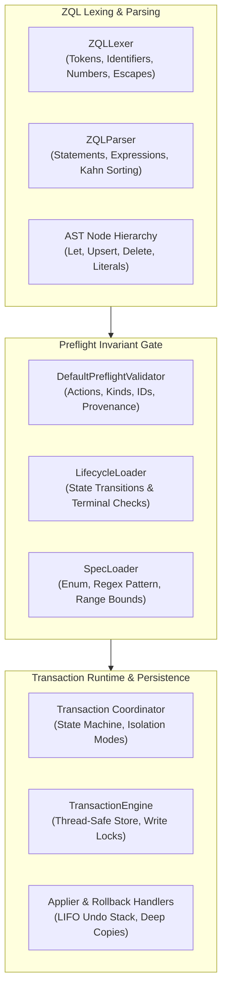
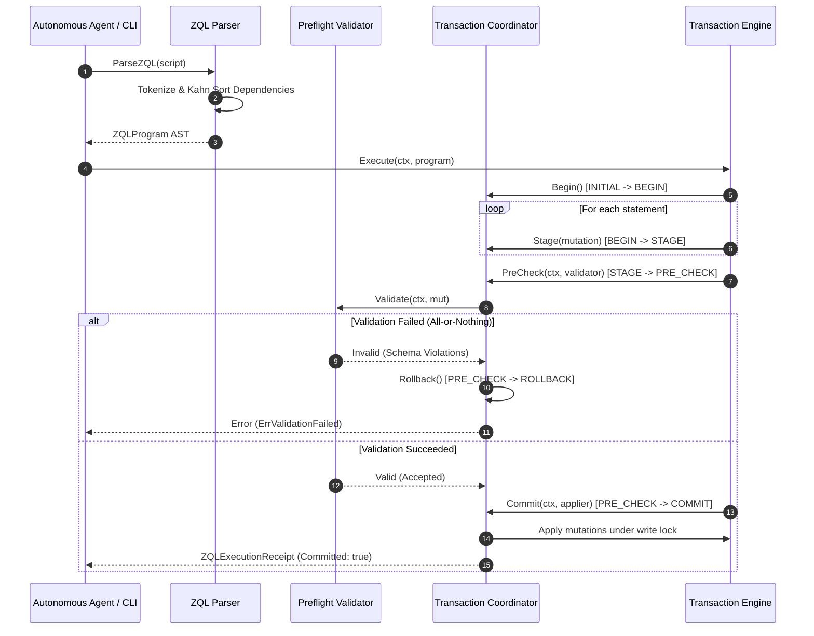
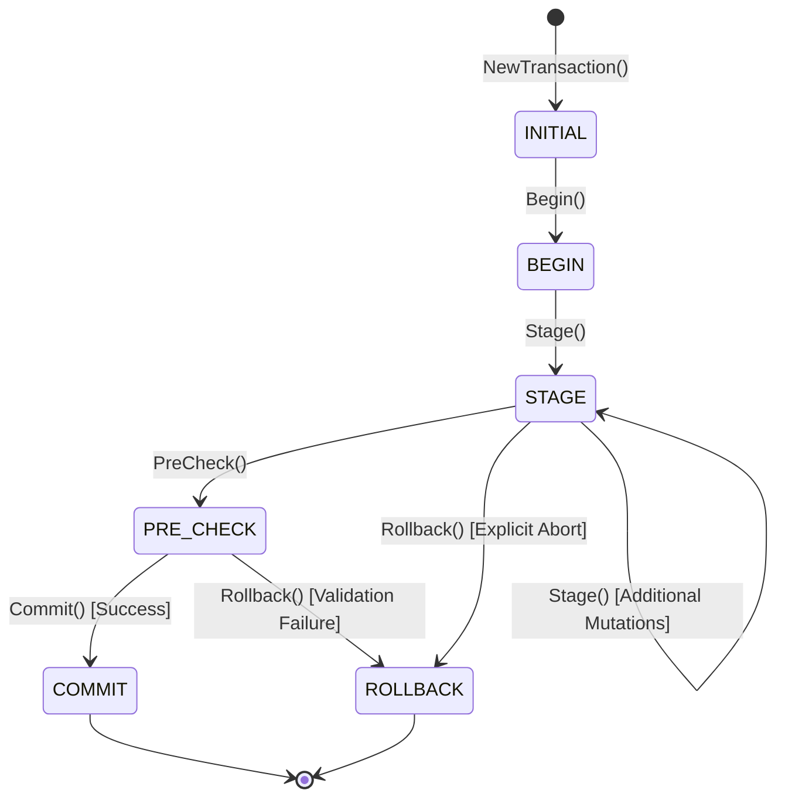
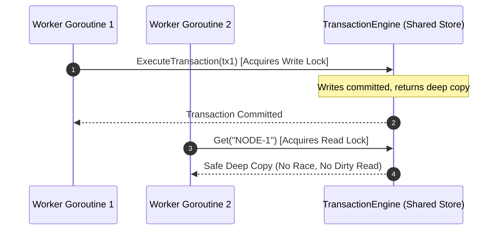

# Graph Mutation, Preflight Validation & Transaction Engine Subsystem Guide (`pkg/mutation`)

## 1. Executive Summary & Architectural Overview

The `pkg/mutation` subsystem provides the foundational declarative graph mutation compilation, preflight invariant validation, and atomic ACID transaction execution engine within the ZQK Knowledge Kernel (governed by POL-DEFAULT-142277d3).

In a high-throughput, multi-agent autonomous engineering environment, concurrent modifications to knowledge graphs—spanning goals, requirements, criteria, backlog items, test cases, and runtime architecture models—cannot rely on uncoordinated, point-in-time filesystem writes or loose in-memory object mutation. Doing so invites partial writes, dangling edge references, corrupt lifecycle transitions, and race conditions.

The `pkg/mutation` engine implements **ZQL** (ZQK Query & Mutation Language) transaction semantics, delivering three structural guarantees:

1. **Preflight Fail-Closed Invariant Validation:** All mutation operations are subjected to strict static and schema-level validation prior to transaction execution. Schema mismatches, invalid lifecycle state transitions, missing required fields, and illegal manual modifications of system provenance attributes are intercepted in memory without touching persistent storage.
2. **Atomic ACID Transactions with Rollback Unwinding:** Transactions support all-or-nothing execution, partial commit with automated failure quarantine, and dry-run validation modes. Any failure in an all-or-nothing transaction automatically triggers reverse LIFO rollback of all previously applied mutations in the batch.
3. **Write Isolation & Zero Dirty Reads:** Mutations remain confined to private transactional staging buffers and isolated execution engines until final commit under mutex synchronization, guaranteeing that uncommitted writes are never exposed to concurrent readers.

---

## 2. Component Topology & Subsystem Boundaries

The mutation subsystem is organized into distinct, decoupled components operating across clear boundaries:

### Component Roles & Responsibilities

- **`ast.go` (Draft 2020-12 AST):** Defines immutable expression nodes (`LiteralExpr`, `VariableRefExpr`, `ObjectLiteralExpr`, `ListLiteralExpr`, `UpsertExpr`) and discrete statements (`StmtBeginTransaction`, `StmtCommitTransaction`, `StmtRollbackTransaction`, `StmtLet`, `StmtUpsert`, `StmtDelete`). Includes dry-run isolation re-writing.
- **`parser.go` (ZQL Parser & Lexer):** Performs lexical analysis of ZQL scripts with support for single-line (`//`, `--`) and multi-line (`/* */`) comments, string escape decoding, variable bindings (`$var`), and punctuation. Implements Kahn's topological sorting algorithm on LET statement dependencies to ensure correct variable declaration ordering.
- **`preflight.go` (Preflight Invariant Gate):** Validates mutations completely in-memory against canonical constraints: mandatory fields, target kind format, ID regex patterns, safety classes, priority tier enums, lifecycle status transitions, system provenance protection (`created_at`, `created_by`, `updated_at`, `updated_by`, `cas_address`, `hash`), spec-driven field constraints, and reference array formats.
- **`transaction.go` (Transaction Engine & Coordinator):** Orchestrates the five-stage transaction state machine (`INITIAL -> BEGIN -> STAGE -> PRE_CHECK -> COMMIT / ROLLBACK`). Maintains staged mutations, diagnostic receipts, and LIFO rollback handlers. Implements `TransactionEngine` with thread-safe, mutex-protected storage and deep-copy read semantics to eliminate dirty read leakage.
- **`executor.go` (ZQL Execution Engine):** Compiles and evaluates `ZQLProgram` ASTs against the transaction engine. Resolves variable expressions, evaluates nested dot-notation object references, applies upserts, stages delete mutations, and returns aggregated execution receipts.
- **`validator.go` (Safety Routing & Human-in-the-Loop Gateway):** Evaluates mutation safety classes (`read`, `write`, `destructive`, `hil_required`) and routes sensitive or destructive mutations through Human-in-the-Loop (HIL) gates when required.

---

## 3. Mutation Lifecycle & Invariants

Every mutation follows a deterministic, unidirectional lifecycle from raw script string to durable committed graph state:

### The Transaction State Machine

The transaction coordinator enforces a strict, unidirectional state machine:

- **`INITIAL`:** Unstarted transaction. Cannot stage mutations or commit.
- **`BEGIN`:** Transaction initialized. Ready to accept staged mutations.
- **`STAGE`:** Staging buffer active. Mutations are appended and assigned diagnostic receipt slots.
- **`PRE_CHECK`:** Preflight validation running against all staged mutations. Further staging is barred.
- **`COMMIT`:** Terminal success state. Changes applied to persistent storage under write lock. Once committed, a transaction cannot be rolled back.
- **`ROLLBACK`:** Terminal failure or abort state. Staged mutations are discarded and registered undo handlers are executed in reverse order. Idempotent on repeated calls.

---

## 4. Preflight Validation Mechanics

The preflight validation layer enforces the **Fail-Closed Invariant**: any defect, corruption, or policy violation immediately yields a `rejected_failclosed` disposition with granular remediation metadata.

### Evaluated Invariants

1. **Mandatory Envelope Fields:** Verifies non-empty `action` (create_node, update_node, add_edge, remove_edge) and non-empty `target_kind`.
2. **Identifier Syntax:** Enforces canonical hyphenated prefix patterns (`KIND-XXXX`, e.g., `GOAL-1001`, `BLI-2045`).
3. **Safety Classification:** Enforces valid safety classes (`read`, `write`, `destructive`, `hil_required`).
4. **System Provenance Guardrails:** Prevents unauthorized manual tampering with runtime-managed attributes (`created_at`, `created_by`, `updated_at`, `updated_by`, `cas_address`, `hash`). Any attempt to mutate these fields without explicit break-glass authorization (`pkgctx.WithLifecycleBreakGlass`) triggers instant rejection.
5. **Canonical Enum Membership:** Validates `priority_tier` (`P0` through `P5`) and entity-specific lifecycle statuses.
6. **Lifecycle State Transition Validation:** Ensures that update operations adhere to valid state machine transitions (e.g., from `planned` to `in_progress`, but not from terminal states like `completed` or `cancelled`).
7. **Creation Terminal State Guard:** Prevents newly created entities from starting in a terminal status without break-glass clearance.
8. **Reference Array Integrity:** Verifies that relational reference fields (`criteria_refs`, `requirement_refs`, `goal_refs`, `milestone_refs`) are structured as string slices rather than malformed scalar values.

---

## 5. Transaction Semantics & ACID Guarantees

The `pkg/mutation` engine supports three configurable isolation levels:

| Isolation Mode | Grammar Keyword | Behavior on Failure | Use Case |
| :--- | :--- | :--- | :--- |
| **All-or-Nothing** | `ALL_OR_NOTHING`, `STAGED_SNAPSHOT`, `SERIALIZABLE`, `READ_COMMITTED` | Complete abort and reverse LIFO rollback of all applied changes upon any item failure. | Atomic graph batches where partial updates would break referential integrity. |
| **Partial Commit** | `PARTIAL_COMMIT` | Failed mutations are quarantined with error receipts; valid mutations proceed to commit. | Bulk ingestion, batch imports, and migration pipelines. |
| **Dry Run** | `DRY_RUN` | All preflight checks and validations execute; receipts are marked `dry_run_validated`; storage remains untouched. | Pre-commit audits, agent plan preview, and syntax validation. |

### Atomicity & LIFO Rollback Unwinding

When an all-or-nothing transaction encounters an application error on mutation index $N$:

1. Mutation $N$ is recorded as failed in its diagnostic receipt.
2. The engine iterates backward through all mutations from $N-1$ down to $0$, executing each registered undo callback.
3. Pre-registered rollback operations (`RegisterRollback`) are executed in reverse order.
4. All receipt statuses transition to `rolled_back`.
5. The transaction state transitions to `ROLLBACK`, leaving the underlying engine store completely intact.

---

## 6. Concurrency, Write Isolation & Thread-Safety

### Zero Dirty Read Invariant

The `TransactionEngine` separates private staging buffers from committed store memory:

- **Private Buffer:** While a transaction is in `BEGIN`, `STAGE`, or `PRE_CHECK`, its mutations exist solely within the transaction's private `staged` slice. No concurrent reader or independent transaction can see these changes.
- **Deep-Copy Store Reads:** Calls to `engine.Get(ctx, id)` acquire an `RLock()` and return an independent deep copy of the underlying map. Callers cannot mutate engine state by modifying returned maps.
- **Synchronized Commit Lock:** The commit phase acquires `engine.mu.Lock()`, writes changes atomically, generates creation/update provenance timestamps, and registers undo closures.

### Multi-Goroutine Concurrency Safety

Multi-threaded execution is verified using `goroutinelabels.NewGoroutine`. Parallel workers performing concurrent transactional writes and reads achieve complete isolation without data races or lock contention deadlocks.

---

## 7. Verification & Three-Fold Proof Invariant

In accordance with ZQK engineering standards, `pkg/mutation` is protected by the Three-Fold Proof invariant:

1. **Static Floor Invariant:** Statement test coverage across `pkg/mutation` is strictly maintained at $\ge 85.0\%$ (Cycle 168 achievement: **89.2%**), verified via `go test -cover ./pkg/mutation`.
2. **Operational Dynamic Proof:** End-to-end verification of ZQL parsing, Kahn dependency sorting, preflight validation rules, transaction lifecycle transitions, all-or-nothing rollbacks, partial commit quarantine, and concurrent multi-goroutine execution.
3. **Negative Adversarial Boundary:** Rigorous boundary testing against unclosed strings, malformed variable references, cyclic dependencies, missing required fields, illegal lifecycle status transitions, unauthorized system provenance tampering, unstarted transaction staging, and invalid state transitions.
