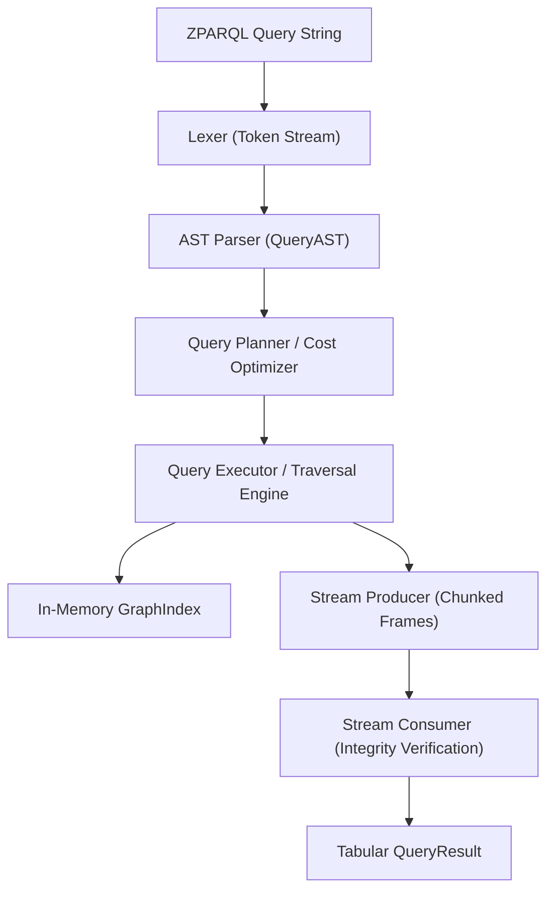
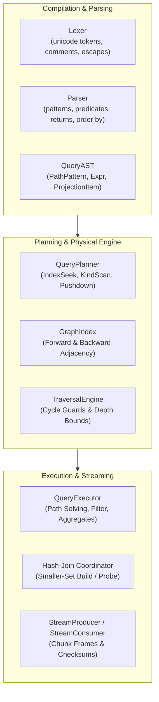
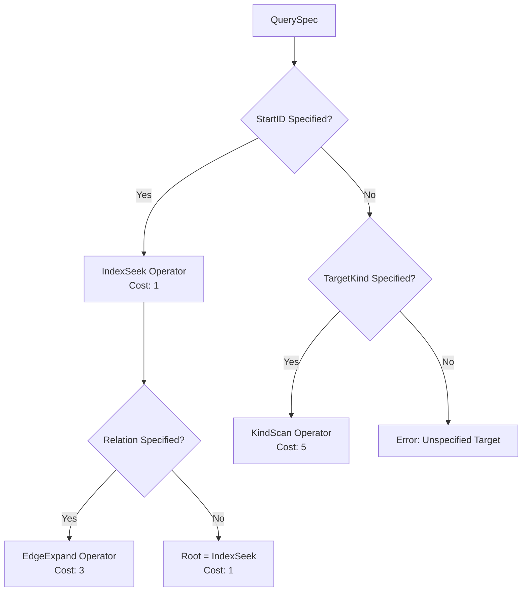
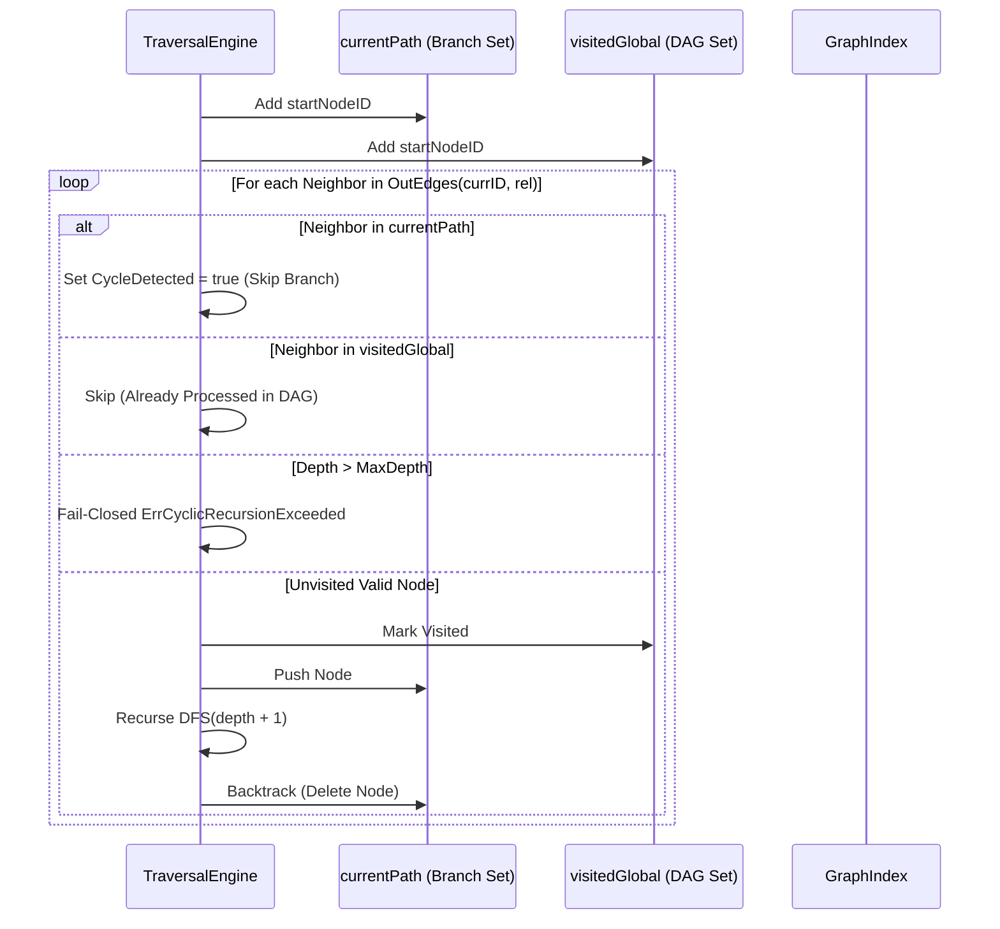
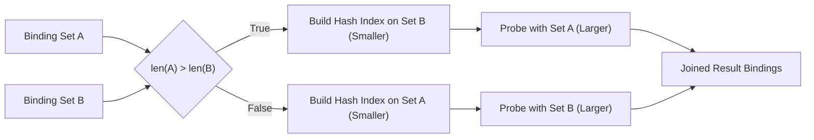
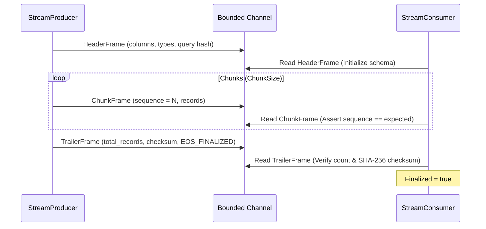

# Knowledge Graph Traversal & Query Execution Subsystem Guide (`pkg/traversal`)

## 1. Executive Summary & Architectural Overview

The `pkg/traversal` subsystem delivers the declarative graph query compilation, cost-based planning, cycle-safe graph traversal, and bounded result streaming engine within the ZQK Knowledge Kernel.

As the ZQK Knowledge Graph scales across diverse ontological planes (goals, requirements, test cases, backlog items, runtime components, and policies), human operators and autonomous AI agents require an expressive, low-overhead query language to navigate complex multi-hop relationships without writing imperative traversal loops.

The query engine implements **ZPARQL** (ZQK Pattern Action Relational Query Language)—a declarative, Cypher-inspired graph pattern matching DSL tailored for knowledge graphs. The subsystem is engineered around three foundational pillars:

1. **Cycle-Safe Graph Traversal:** In-memory, bounded depth-first search (DFS) equipped with local branch path trackers and global visited sets, preventing infinite recursion on cyclic and self-referencing relationship graphs.
2. **Cost-Based Query Optimization:** Physical execution planning that differentiates between $O(1)$ indexed key lookups (`IndexSeek`) and kind scans (`KindScan`), pushing boolean filters directly into candidate discovery.
3. **Bounded Reactive Streaming:** Streaming chunk producer-consumer pipelines that stream tabular projections across bounded channels with checksum validation and end-of-stream guarantees.



---

## 2. Component Topology & Subsystem Boundaries

The subsystem is decoupled into modular layers operating in harmony:



### Component Roles

- **Lexer (`parser.go`):** Tokenizes ZPARQL syntax, handling single-line (`//`, `--`) and multi-line (`/* */`) comments, arrow tokens (`<-`, `->`, `-`), comparison operators (`=`, `!=`, `<`, `<=`, `>`, `>=`, `CONTAINS`, `IN`), numeric literals, and escape sequences in string literals.
- **Parser (`parser.go`):** Compiles the token stream into a structured `QueryAST`. Validates clause ordering (`MATCH ... WHERE ... RETURN ... ORDER BY ... LIMIT ... OFFSET`), verifies that projected variables are bound, and enforces valid depth bounds.
- **AST Nodes (`ast.go`):** Defines immutable expression trees including `ComparisonExpr`, `LogicalExpr` (AND/OR), `NotExpr`, and `ExistsExpr` for existential sub-queries.
- **Graph Index (`planner.go`):** Read-write locked thread-safe adjacency index maintaining forward and backward edge maps by relationship name, as well as an index of entity kinds.
- **Query Planner (`planner.go`):** Generates physical execution operators (`PhysicalOperator`, `PhysicalPlan`) calculating estimated costs, selecting index seeks when start IDs are present, and pushing down predicate filters.
- **Traversal Engine (`planner.go`):** Executes depth-bounded, cycle-safe DFS traversal across the graph index with strict recursion caps.
- **Query Executor (`executor.go`):** Coordinates multi-pattern path solving, applies WHERE predicate filters, performs in-memory hash joins, runs aggregate projections (`COUNT`, `COLLECT`), handles sorting (`ORDER BY`), and enforces `LIMIT`/`OFFSET` slicing.
- **Streaming Pipeline (`streaming.go`):** Encapsulates result sets into sequenced chunks (`ChunkFrame`), prefaces them with projection headers (`HeaderFrame`), and terminates with an integrity-checked trailer (`TrailerFrame`).

---

## 3. ZPARQL Pattern Grammar & AST Transformations

### Syntax Structure

ZPARQL queries declare graph pattern topology with Cypher-like ASCII-art conventions:

```cypher
MATCH (g:Goal)-[r:rel*1..3]->(t:Task)
WHERE g.status = "active" AND NOT (t.priority < 2)
RETURN g.title AS goal_title, t.title AS task_title, t.priority
ORDER BY t.priority DESC, t.title ASC
LIMIT 25 OFFSET 0
```

### Pattern Matching Rules

1. **Node Patterns:** `(variable:Kind {property: "literal"})`
   - Variable binding is optional for anonymous nodes: `(:Kind)`.
   - Kind is optional for wildcards: `(n)`.
   - Inline property filters enforce exact equality matching during candidate discovery.

2. **Edge Patterns:** `-[variable:rel*min..max]->`
   - **Outgoing Direction:** `-[r:rel]->` (target must be child/successor).
   - **Incoming Direction:** `<-[r:rel]-` (target must be parent/predecessor).
   - **Undirected / Bidirectional:** `-[r:rel]-` (traverses both incoming and outgoing edges).
   - **Variable Depth Quantifier:** `*min..max` (e.g. `*1..3`), fixed depth `*depth`, or open lower bound `*..max`.

3. **Filter Expressions (WHERE):**
   - Supports binary comparisons: `=`, `!=`, `<`, `<=`, `>`, `>=`, `CONTAINS`, `IN [literal_list]`.
   - Supports composite boolean logic: `AND`, `OR`, parenthesized grouping, and unary `NOT`.
   - Supports structural existential subqueries: `EXISTS ((a)-[:rel]->(b))`.

4. **Projection & Aggregation (RETURN):**
   - Supports raw variables `RETURN a`, field dereferences `RETURN a.title`, and aliases `RETURN a.title AS name`.
   - Supports `RETURN DISTINCT` for deduplicating result rows.
   - Aggregate functions: `COUNT(*)`, `COUNT(var.field)`, `COLLECT(var.field)`, `MIN(var.field)`, `MAX(var.field)`.

---

## 4. Query Planning & Physical Execution

The query planner inspects the input query spec and selects the optimal physical operator path to minimize memory allocations and node evaluations.



### Cost Optimization Heuristics

1. **Indexed Key Seeks ($O(1)$):** When `StartID` is provided, the planner anchors traversal at a single node ID using direct hash-table retrieval, avoiding full node enumeration.
2. **Predicate Pushdown:** Field filters declared in `FieldFilters` or inline node pattern filters are evaluated during candidate discovery (`findCandidateNodes`), pruning unviable branches before edge expansion occurs.
3. **Edge Expand Optimization:** Forward (`forwardEdges[sourceID][relation]`) and backward (`backwardEdges[targetID][relation]`) adjacency lookups run in constant time ($O(1)$), allowing rapid degree evaluation.

---

## 5. Traversal Mechanics & Cycle Safety Invariants

Knowledge graphs frequently feature mutual dependencies, bidirectional links, and circular references. Without explicit safeguards, recursive DFS or BFS traversals can cause stack overflow crashes or infinite loops.



### Invariants Enforced During Traversal

1. **Cycle Detection Invariant:** The traversal engine tracks the active call branch using an in-memory set (`currentPath`). If a neighbor is encountered that already exists in `currentPath`, `CycleDetected` is flagged, and the cyclic edge is safely skipped without recursing.
2. **DAG Deduplication:** Nodes already visited in other branches are recorded in `visitedGlobal`. This guarantees linear time complexity across Directed Acyclic Graphs (DAGs) rather than exponential tree-expansion paths.
3. **Fail-Closed Depth Bound:** If recursion depth exceeds `MaxDepth` (defaulting to 16 if unspecified), traversal immediately aborts and returns `ErrCyclicRecursionExceeded`, protecting host resources against malicious queries.
4. **Context Cancellation Propagation:** Every traversal step and pattern matching iteration checks `ctx.Done()`, yielding control immediately upon timeout or operator abort.

---

## 6. Hash Join Coordinator & Streaming Pipelines

### Indexed Hash Joins

When multiple path patterns are joined (e.g. `MATCH (a)-[:rel1]->(b), (b)-[:rel2]->(c)`), the subsystem uses an indexed hash join:



- **Linear Complexity:** Building the hash index on the smaller set and probing with the larger set ensures $O(|A| + |B|)$ performance rather than $O(|A| \times |B|)$ Cartesian degradation.
- **Compound Join Keys:** When multiple variables are shared across patterns, keys are serialized with a null byte delimiter (`\0`) to avoid collision between distinct field boundaries.
- **Cartesian Fallback:** If two patterns share zero variables, a cross-product is generated.

### Reactive Streaming Protocol

The streaming subsystem (`pkg/traversal/streaming.go`) streams large query results without accumulating full datasets in memory:



### Stream Integrity Invariants

- **Fail-Closed Sequence Validation:** If a chunk arrives out of order or with a sequence gap, consumption fails with `ErrStreamSequenceGap`.
- **Premature Channel Closure:** If the channel closes before receiving the `TrailerFrame`, the stream is rejected with `ErrStreamTruncated`.
- **End-to-End Cryptographic Checksum:** The `TrailerFrame` computes a deterministic SHA-256 digest over sorted record identifiers. The consumer verifies the checksum and record count against received records; any mismatch returns `ErrStreamChecksumMismatch`.

---

## 7. Operational CLI Recipes

The traversal subsystem powers the primary query commands in the ZQK CLI:

### 1. Basic Graph Traversal
Query all active tasks linked to a high-level goal:
```bash
zqk query "MATCH (g:goal)-[r:child_of]->(t:task) WHERE g.status = 'active' RETURN g.title, t.title, t.status"
```

### 2. Multi-Hop Traversal with Depth Quantifiers
Traverse up to 3 hops of dependency relationships:
```bash
zqk query "MATCH (a:task)-[r:depends_on*1..3]->(b:task) RETURN a.title AS blocker, b.title AS blocked"
```

### 3. Aggregations & Group Summaries
Compute task distributions per status category:
```bash
zqk query "MATCH (t:task) RETURN t.status, COUNT(t.id) AS total ORDER BY total DESC"
```

### 4. Interactive Console & Path Visualization
Launch the interactive ZPARQL REPL with ASCII edge path visualization:
```bash
zqk query --interactive --visualize
```

---

## 8. Verification & Subsystem Quality Invariants

The `pkg/traversal` package adheres to strict quality metrics enforced in automated continuous integration:

- **Statement Coverage Floor:** Minimum 85.0% statement test coverage across all package routines.
- **Zero Swallowed Errors:** All error channels and return values are explicitly asserted; unhandled error assignments (`_ = ...`) are prohibited.
- **AST Verification:** Every grammar specification change must conform to `SPEC-ZPARQL-GRAPH-TRAVERSAL-GRAMMAR` validated via `zparql_spec_test.go`.
- **Cycle Safety Proofs:** Unit test suites verify terminating behavior on 3-node cycles, self-loops, and deep hierarchy trees.
