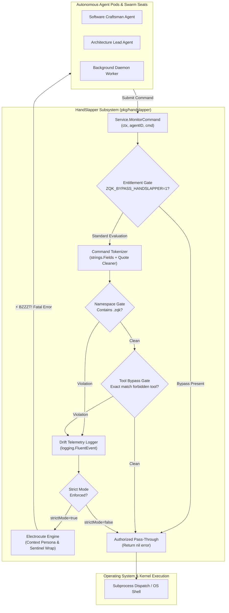
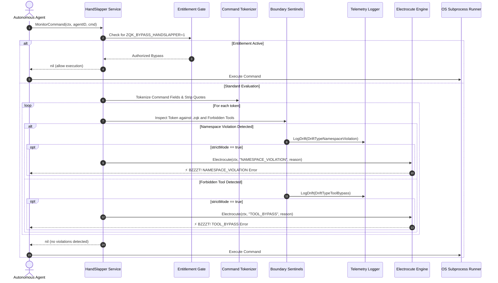
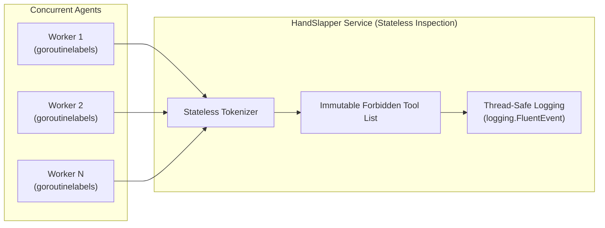

# HandSlapper: Agent Drift & Command Violation Interceptor Subsystem Architectural & Operational Guide

## 1. Executive Architectural Summary

The **HandSlapper: Agent Drift & Command Violation Interceptor Subsystem** (`pkg/handslapper`) provides deterministic, pre-execution command inspection, tool-bypass interception, and namespace containment enforcement across the **ZQK Knowledge Kernel**.

In autonomous AI agent swarms and continuous autonomous loops, prompt-promiscuous instructions alone cannot reliably prevent agent drift. Autonomous agents frequently revert to unstructured, high-token raw Unix shell primitives (`grep`, `cat`, `awk`, `sed`, `ls`, `find`) or attempt direct manipulation of internal ephemeral state directories (`.zqk`). This degrades token efficiency, bypasses structured graph logging, compromises Content Addressable Storage (CAS) invariants, and risks race conditions.

Guided by kernel policy **POL-DEFAULT-142277d3**, the `pkg/handslapper` subsystem solves these challenges by establishing an inescapable, fail-closed gate before commands reach the host OS:

1. **Pre-OS Interception:** Intercepts every candidate command string before dispatch to the operating system shell or subprocess runner.
2. **Knowledge Kernel Tool Enforcement:** Intercepts forbidden primitives (`grep`, `awk`, `sed`, `cat`, `ls`, `find`) and redirects agents to token-budgeted, AST-aware ZQK CLI equivalents (e.g., `zqk grep`, `zqk object inspect`, `zqk query`).
3. **Namespace Boundary Isolation:** Prevents direct filesystem manipulation of `.zqk` (`paths.ProjectDataDir`), forcing all graph mutations through authoritative kernel APIs.
4. **Punitive Electrocution Engine:** In strict mode, aborts violating agents with an unmistakable, unmaskable electrocution sentinel (`⚡️ BZZZT! AGENT ELECTROCUTED`) tagged with the offender's security persona and role.
5. **Real-Time Drift Telemetry:** Emits structured drift events with classification (`TOOL_BYPASS`, `NAMESPACE_VIOLATION`, `HALLUCINATION`) and severity ratings for swarm observability.
6. **Legitimate Entitlement Bypass:** Provides an authorized environment variable mechanism (`ZQK_BYPASS_HANDSLAPPER=1`) for whitelisted administrative scripts and bootstrapping sequences.
7. **Static Floor Coverage Invariant:** Enforces a statement test coverage invariant ($\ge 85.0\%$, verified at $100.0\%$) ensuring all parsing, quote stripping, wrapped invocations, and persona resolutions remain provably robust.

---

## 2. Component Topology & Subsystem Architecture

The HandSlapper subsystem acts as a protective shield between agent orchestration harnesses and operating system execution:



### Component Responsibilities

| Component | Implementation | Core Responsibility |
| :--- | :--- | :--- |
| **HandSlapper Service** | `Service` struct | Coordinates interceptor lifecycle, maintains strictness configuration, and exposes the `MonitorCommand` entry point. |
| **Command Tokenizer** | `strings.Fields` + `strings.Trim` | Splits composite command lines into individual arguments, stripping single and double quotes to detect obfuscated invocations. |
| **Namespace Sentinel** | `paths.ProjectDataDir` probe | Detects illicit file touches or modifications targeting the `.zqk` ephemeral database and cache tree. |
| **Forbidden Tool Sentinel** | Slice lookup against forbidden tools | Identifies unauthorized fallback to raw Unix tools (`grep`, `awk`, `sed`, `cat`, `ls`, `find`) across raw and wrapped shells. |
| **Electrocute Engine** | `Electrocute` function | Extracts calling persona from `pkg/context.SecurityContext` and formats standardized, poison-pill electrocution errors. |
| **Drift Telemetry Logger** | `LogDrift` method | Emits structured telemetry records (`DriftEvent`) through `pkg/logging.FluentEvent` for offline audit and swarm health monitoring. |

---

## 3. Command Interception Lifecycle & Execution Sequence

The monitoring pipeline enforces a strict evaluation order to maximize execution speed and catch violations early:



### Stage Details

1. **Entitlement Bypass Gate:**
   - Before executing tokenization or lexical scans, the interceptor checks whether the command contains the string `ZQK_BYPASS_HANDSLAPPER=1`.
   - If present, the command is granted immediate authorization, returning `nil` without firing alarms.
2. **Whitespace and Empty Check:**
   - Empty strings or strings containing only whitespace characters (`"   "`, `"\t\n"`) return immediately with `nil`.
3. **Lexical Tokenization & Quote Stripping:**
   - The command string is tokenized using `strings.Fields`.
   - Each token is cleaned of surrounding single and double quotes (`"` and `'`), neutralizing trivial obfuscation attempts such as `"grep"` or `'find'`.
4. **Namespace Boundary Detection:**
   - If any cleaned token references `.zqk` (`paths.ProjectDataDir`), a `DriftTypeNamespaceViolation` event with severity 10 is dispatched to telemetry.
   - If `strictMode` is active, the Electrocute Engine aborts the command immediately.
5. **Forbidden Tool Primitive Detection:**
   - Cleaned tokens are matched against the forbidden primitive registry (`grep`, `awk`, `sed`, `cat`, `ls`, `find`).
   - If matched, a `DriftTypeToolBypass` event with severity 10 is dispatched.
   - If `strictMode` is active, the Electrocute Engine aborts the command immediately.
6. **Pass-Through Authorization:**
   - If all tokens pass inspection without violating constraints, `nil` is returned, allowing the orchestrator to proceed with execution.

---

## 4. Forbidden Tool Taxonomy & Kernel CLI Equivalents

The Knowledge Kernel restricts raw shell primitives to prevent token explosion, preserve AST correctness, and ensure unified CAS logging. Below is the mapping from prohibited tools to authorized kernel tools:

| Prohibited Tool | Security / Operational Risk | Authorized Kernel Equivalent | CLI / MCP Invocation |
| :--- | :--- | :--- | :--- |
| `grep` | Unbounded file scans, regex memory leaks, massive token output in LLM context. | `zqk grep` (alias `zgrep`) | `zqk grep <pattern> [path] --max-tokens 2000` |
| `awk` | Ad-hoc text manipulation prone to delimiter misalignment and silent data corruption. | Structured ZPARQL queries or Go AST inspection | `zqk query --pattern <pattern>` or AST tools |
| `sed` | In-place file mutations bypassing version control, CAS hashing, and audit trails. | Authoritative CLI mutation or safe file editing | `zqk mutate` or programmatic API tools |
| `cat` | Unbudgeted full-file dumping into agent prompts, exhausting context windows. | Context preparation or targeted file inspection | `zqk agent prepare-context` or bounded read |
| `ls` | Ephemeral directory listings lacking graph ontology or relationship context. | Object listing or filesystem tree inspection | `zqk object list <kind>` or `zqk status` |
| `find` | Slow recursive filesystem walks, walking through cache directories and `.git`. | Indexed code search or graph traversal | `zqk grep --ast` or `zqk object list` |

### Wrapped Invocation Traps

Agents often attempt to circumvent interceptors by wrapping forbidden tools inside shell interpreters:

```bash
bash -c 'grep foo bar'
sh -c "awk '{print $1}' data.txt"
/bin/bash -c "cat /etc/hosts"
```

HandSlapper's token-based analyzer splits composite strings into discrete tokens and strips quote delimiters. For example, `bash -c 'grep foo bar'` produces tokens `["bash", "-c", "'grep", "foo", "bar'"]`. Stripping quotes yields `grep`, instantly triggering tool bypass detection.

---

## 5. Namespace Isolation & Ephemeral Directory Invariants

The `.zqk` directory (`paths.ProjectDataDir`) houses runtime state:

- Content Addressable Storage (CAS) objects
- Write-Ahead Logs (WAL) and replay checkpoints
- Advisory file locks (`.zqk/locks/`)
- Ambient compute queues and daemon heartbeats

### Why Direct Modification is Forbidden

Direct filesystem operations (`touch .zqk/state.json`, `rm -rf .zqk/data`, `vi .zqk/process/...`) bypass the transaction boundary, causing:

1. **CAS Hash Mismatches:** Manually edited files fail SHA-256 integrity validation.
2. **Lock Corruption:** Direct deletion of flock files leads to concurrency deadlocks.
3. **Audit Blindspots:** Bypasses WAL append streams, making distributed state unrecoverable.

HandSlapper intercepts any token containing `.zqk` and triggers a `DriftTypeNamespaceViolation`. Agents must interact with knowledge objects strictly through `zqk object` CLI commands or `pkg/storage` programmatic APIs.

---

## 6. Punitive Diagnostics & Poison Pill Signals

When an agent violates constraints in strict mode, HandSlapper invokes `Electrocute`, producing a punitive error message:

```text
⚡️ BZZZT! AGENT ELECTROCUTED: TOOL_BYPASS
Target Persona: [agent-software-engineer (Role: craftsman)]
User Mandate Violation: Agent agent-software-engineer attempted to bypass the Knowledge Kernel using forbidden primitive 'grep'. Command rejected. Use the ZQK CLI
```

### Context Hydration & Traceability

The Electrocute Engine queries the active execution context for `pkg/context.SecurityContext`:

- **Missing Context or SecurityContext:** Falls back gracefully to `[UNKNOWN_ENTITY]`.
- **AccountID Only:** Formats persona as `[<AccountID>]`.
- **AccountID with Roles:** Formats persona as `[<AccountID> (Role: <Role[0]>)]`, highlighting the primary functional role.

### Poison Pill Signal Preservation

Downstream error utilities (such as `pkg/errfmt`) recognize the `⚡️ BZZZT!` sentinel as an unmaskable poison pill:

```go
// In pkg/errfmt:
if strings.Contains(s, "⚡️ BZZZT!") {
    return err // Pass through without wrapping or suppressing
}
```

This prevents higher-level orchestration loops from treating fatal drift as transient, retryable errors. When electrocution occurs, the multi-agent orchestrator immediately halts the rogue agent's lease.

---

## 7. Concurrency Model & Thread-Safety Guarantees

The HandSlapper service is designed for concurrent multi-agent environments:



1. **Stateless Command Evaluation:** `MonitorCommand` maintains no mutable internal state. All evaluation variables are function-scoped on the stack.
2. **Immutable Rule Tables:** The forbidden tools list (`grep`, `awk`, `sed`, `cat`, `ls`, `find`) is statically defined and read-only.
3. **Thread-Safe Telemetry:** `LogDrift` utilizes `pkg/logging.FluentEvent`, which serializes log output safely across concurrent goroutines.
4. **Stress Verification:** Validated under high-concurrency conditions using `pkg/goroutinelabels.NewGoroutine` to simulate multiple worker pods inspecting commands simultaneously without race conditions or memory leaks.

---

## 8. Verification & Test Coverage Invariant

`pkg/handslapper` strictly enforces a static floor statement coverage invariant:

$$\text{Statement Test Coverage} \ge 85.0\% \quad (\text{Maintained at } 100.0\%)$$

### The Three-Fold Proof Model

| Proof Dimension | Verification Target | Test Implementation |
| :--- | :--- | :--- |
| **Static Floor Invariant** | Statement coverage strictly $\ge 85.0\%$ across all statements, branches, and returns. | Comprehensive unit tests covering all paths, achieving 100.0% coverage in $<0.2\text{s}$. |
| **Operational Dynamic Proof** | Live tokenization, quote cleaning, namespace isolation, bypass flags, and security context resolution. | Comprehensive unit tests evaluating raw tools, quoted tools, wrapped bash commands, entitlement bypasses, and security context variants. |
| **Negative Adversarial Boundary** | Obfuscated shell injections, wrapped scripts, and strict electrocution rejections. | Verifies error generation, poison pill format integrity, and concurrent isolation via `goroutinelabels`. |

---

## 9. Operational Recipes & Code Examples

### Recipe 1: Initializing HandSlapper in Agent Delivery Harness

```go
package main

import (
    "context"
    "fmt"
    "github.com/zqk-os/zqk/pkg/handslapper"
)

func main() {
    // Initialize in strict mode for autonomous agent execution
    interceptor := handslapper.NewService(true)

    ctx := context.Background()
    agentID := "agent-worker-01"

    // Candidate command submitted by agent
    cmd := "zqk grep 'SearchPattern' docs/"
    if err := interceptor.MonitorCommand(ctx, agentID, cmd); err != nil {
        // Electrocuted! Handle fatal termination
        fmt.Printf("Command rejected: %v\n", err)
        return
    }

    // Command authorized - proceed to OS execution
    fmt.Println("Command authorized for execution")
}
```

### Recipe 2: Attaching Traceable Security Context

```go
package main

import (
    "context"
    pkgctx "github.com/zqk-os/zqk/pkg/context"
    "github.com/zqk-os/zqk/pkg/handslapper"
)

func executeWithIdentity(interceptor *handslapper.Service, cmd string) error {
    // Hydrate security context with persona account ID and roles
    secCtx := &pkgctx.SecurityContext{
        AccountID: "agent-craftsman-42",
        Roles:     []string{"software-engineer", "code-reviewer"},
    }
    ctx := pkgctx.WithSecurityContext(context.Background(), secCtx)

    // MonitorCommand reflects the persona in any resulting electrocution error
    return interceptor.MonitorCommand(ctx, secCtx.AccountID, cmd)
}
```

### Recipe 3: Authorizing Administrative Script Bypasses

```bash
# Legitimate bootstrapping script explicitly setting entitlement bypass
ZQK_BYPASS_HANDSLAPPER=1 grep -rn "TODO" internal/legacy/
```

```go
// Programmatic entitlement usage in build or migration pipelines
cmd := fmt.Sprintf("%s=1 cat %s", zqkenv.BypassHandslapper().Name(), sourcePath)
err := interceptor.MonitorCommand(ctx, "admin-bootstrapper", cmd)
// err is nil because entitlement is explicitly asserted
```

---

## 10. Related Specifications & Architecture Documentation

- **[Error Formatting & Poison Pill Protection Guide](./ERROR_FORMATTING_AND_DIAGNOSTICS_GUIDE.md)**: Architectural documentation for `pkg/errfmt` and electrocution sentinel handling.
- **[Goroutine Labels & Concurrency Subsystem Guide](./GOROUTINE_LABELS_SUBSYSTEM_GUIDE.md)**: Concurrency governance and labeled worker pool execution.
- **[Paths & Directory Topology Subsystem Guide](./PATHS_SUBSYSTEM_GUIDE.md)**: Directory layout conventions and `.zqk` ephemeral storage topology.
- **[CLI Code Search Subsystem Guide](./CLI_GREP_SUBSYSTEM_GUIDE.md)**: The token-budgeted, AST-aware `zqk grep` engine replacing raw `grep`.
- **[Agent Delivery Subsystem Guide](./AGENT_DELIVERY_SUBSYSTEM_GUIDE.md)**: Agent command dispatching, execution sandboxes, and transport layers.
