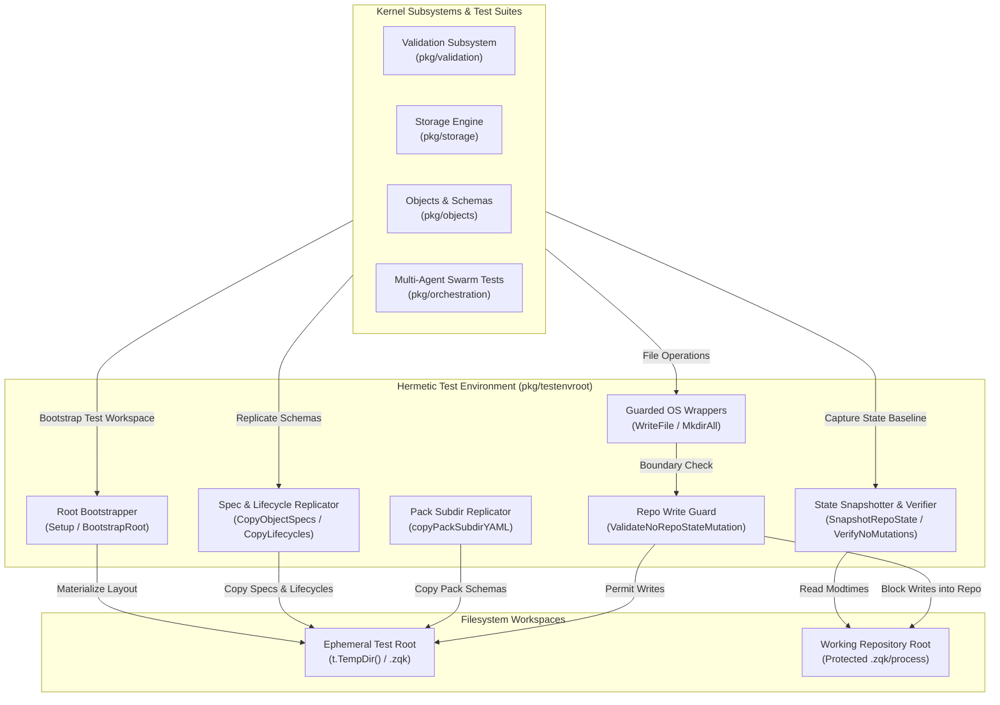
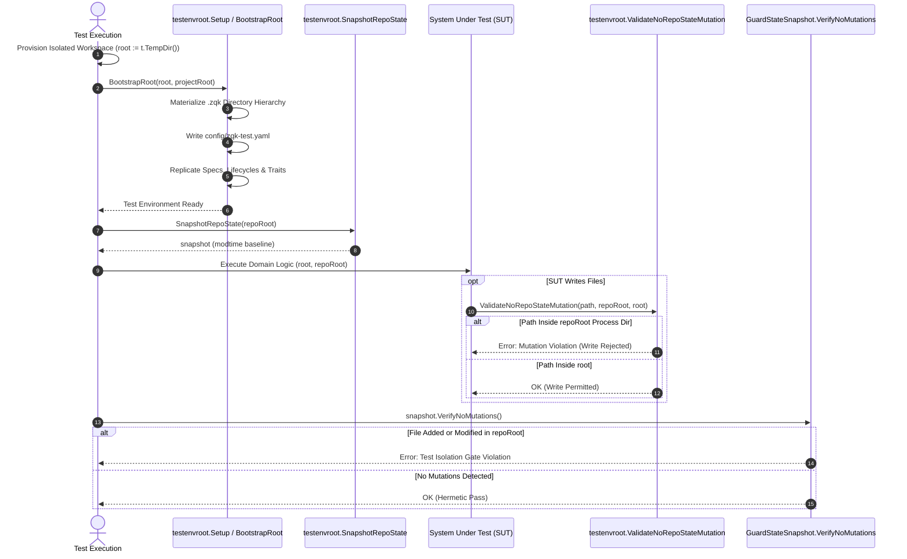
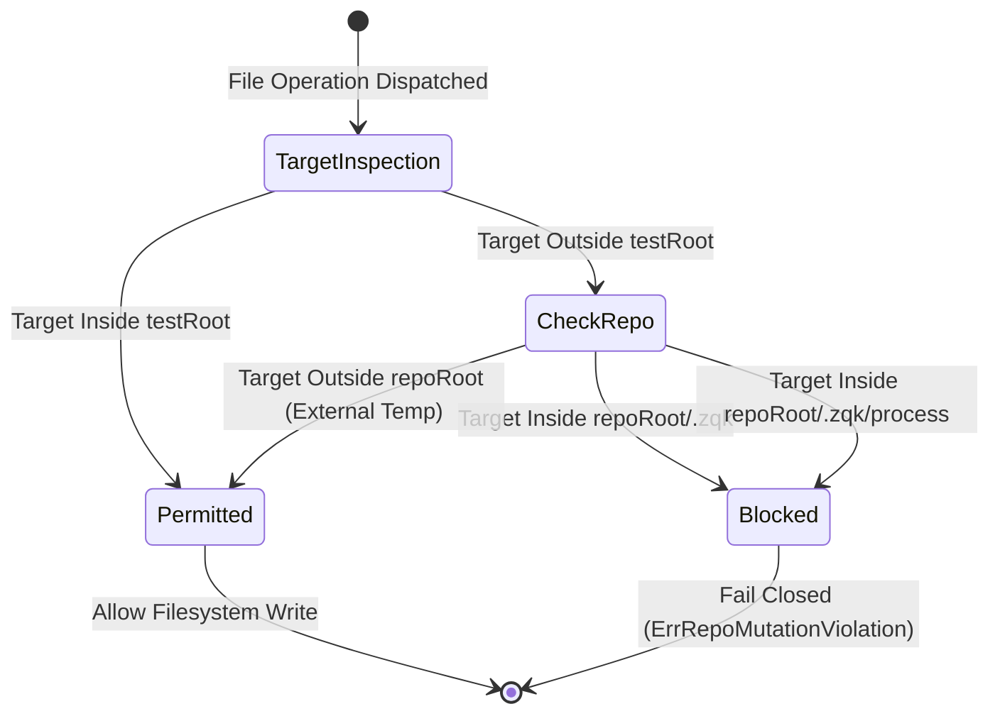

# Hermetic Test Environment & Repo Mutation Guard Subsystem Operational Architecture Guide

## 1. Executive Architectural Summary

The **Hermetic Test Environment & Repository Mutation Guard Subsystem** (`pkg/testenvroot`) provides isolated test workspace materialization, Content-Addressed Storage (CAS) schema replication, and fail-closed repository state protection across the **ZQK Knowledge Kernel**.

When autonomous AI agents, multi-agent swarms, or continuous integration runners execute tests across kernel subsystems, unit tests frequently require realistic directory layouts, object specifications, lifecycle definitions, and configuration files. Without rigorous isolation, test executions risk mutating the developer's working directory or contaminating `.zqk/process`, leading to corrupted kernel graphs, dirty git worktrees, and false-positive pre-commit gate failures. Furthermore, importing testing utilities from high-level packages (like `pkg/testing`) into core packages (like `pkg/validation` or `pkg/storage`) induces circular Go package dependencies.

`pkg/testenvroot` resolves these challenges through four foundational architectural principles:

1. **Hermetic Root Materialization:** Seeds a minimal, fully functional `.zqk` project layout (`.zqk/process`, `.zqk/specs`, and `config/zqk-test.yaml`) under an ephemeral test root directory (typically provisioned via `t.TempDir()`).
2. **Import-Cycle Hygiene:** Decouples core test bootstrapping from `pkg/testing`, enabling low-level subsystems such as validation, storage, and file utilities to set up hermetic test workspaces without cyclical import graphs.
3. **Fail-Closed Write Protection:** Validates that file creation and directory operations never target protected repository paths outside the allocated test root.
4. **State Modtime Snapshotting & Invariant Verification:** Records nanosecond timestamps of all protected process files before test execution, asserting post-test that no files were created, modified, or deleted within the working repository.
5. **Static Floor Coverage Invariant:** A strict statement test coverage invariant ($\ge 85.0\%$, maintained at $>94.0\%$) ensuring boundary conditions, error handling, asset replication, and concurrency safety are continuously verified.

---

## 2. Component Topology & Subsystem Architecture

The subsystem operates as a foundational testing harness at the base of the kernel dependency tree:



### Component Responsibilities

| Component | Function / Interface | Core Architectural Responsibility |
| :--- | :--- | :--- |
| **Root Bootstrapper** | `Setup(testRoot string)` | Creates the canonical directory structure under `testRoot` (`.zqk/process/*`, `.zqk/specs/*`, `.zqk/config`) and generates valid `config/zqk-test.yaml`. |
| **Complete Bootstrapper** | `BootstrapRoot(testRoot, projectRoot string)` | Invokes `Setup` and recursively replicates object specifications, lifecycles, traits, configurations, pack schemas, and `spec_index.json` from `projectRoot` into `testRoot`. |
| **Asset Replicators** | `CopyObjectSpecsFromProject`, `CopyLifecyclesFromProject`, `CopyTraitsFromProject`, `CopyConfigsFromProject`, `CopySpecIndexFromProject` | Granular copying utilities replicating specific schema planes from the host project into the isolated test directory without creating symlinks that could lead to mutation leakage. |
| **Pack Replicator** | `copyPackSubdirYAML` | Scans `projectRoot/packs/*/specs` and `projectRoot/packs/*/lifecycles` to seed pack-owned schema definitions into the test root's internal schema plane. |
| **Repository Write Guard** | `ValidateNoRepoStateMutation(targetPath, repoRoot, testRoot string)` | Validates whether a file write target falls strictly inside `testRoot` or dangerously inside `repoRoot/.zqk`, returning a descriptive error on violation. |
| **State Snapshotter** | `SnapshotRepoState(repoRoot string)` | Traverses `repoRoot/.zqk/process` and captures a memory map of file paths to nanosecond modification timestamps. |
| **Mutation Verifier** | `(*GuardStateSnapshot).VerifyNoMutations()` | Traverses `repoRoot/.zqk/process` and verifies that no baseline files were modified and no new files were created during test execution. |
| **Protected OS Wrappers** | `WriteFile(name, data, perm)`, `MkdirAll(path, perm)` | Thin delegates to `fileutil` that trigger repository write protection guards on every invocation. |

---

## 3. Hermetic Isolation Lifecycle

Every test requiring a kernel environment executes within a strict six-stage hermetic isolation lifecycle:



### Execution Lifecycle Stages

1. **Stage 1: Ephemeral Workspace Allocation**
   - The test harnesses Go's `t.TempDir()` to allocate a clean, thread-isolated filesystem root.
   - Operating in isolated temp directories prevents cross-test state pollution and enables safe parallel execution (`t.Parallel()`).
2. **Stage 2: Canonical Layout Provisioning**
   - `Setup(testRoot)` initializes the 14 process directories under `.zqk/process` (e.g. `goals`, `requirements`, `backlog_items`, `scheduler_jobs`, `test_bundles`).
   - Generates `config/zqk-test.yaml` containing the canonical brand settings version and empty path overrides.
3. **Stage 3: Schema Plane Replication**
   - When `projectRoot` is provided, `BootstrapRoot` copies all internal specifications, lifecycles, traits, configurations, and pack definitions into the test root.
   - Direct file copies ensure tests can validate against authoritative schemas while preventing writes from bubbling up to the repository sources.
4. **Stage 4: Baseline State Snapshotting**
   - `SnapshotRepoState(repoRoot)` traverses `repoRoot/.zqk/process` and indexes every existing file against its nanosecond modification time (`info.ModTime().UnixNano()`).
   - If the repository process directory does not exist, the snapshot safely records an empty map.
5. **Stage 5: Test Execution & Write Interception**
   - The test executes subsystem routines using the provisioned `testRoot`.
   - Any write dispatched via guarded filesystem utilities passes through `ValidateNoRepoStateMutation`, preventing rogue modifications to `repoRoot/.zqk` or `repoRoot/.zqk/process`.
6. **Stage 6: Mutation Gate Verification**
   - Post-test cleanup or assertions call `snapshot.VerifyNoMutations()`.
   - The verifier re-traverses `repoRoot/.zqk/process`. If an original file's timestamp has altered, or if an unrecognized file path is discovered, the verification fails closed with:
     `test isolation gate violation: file modified in repo process dir: <path>` or
     `test isolation gate violation: new file created in repo process dir: <path>`.

---

## 4. Repository Contamination Defense & Guard Mechanics

The repository write guard provides a critical defense line preventing test suites from creating dirty git worktrees or mutating production process items.



### Guard Decision Matrix

The `ValidateNoRepoStateMutation(targetPath, repoRoot, testRoot string)` predicate applies three boundary checks:

| Target Path Location | Evaluated Condition | Result | Justification |
| :--- | :--- | :--- | :--- |
| Inside `testRoot` | `rel(testRoot, targetPath)` does not escape | **ALLOWED** | The target is fully confined within the ephemeral test directory. |
| Inside `repoRoot/.zqk/process` | `rel(repoRoot/paths.ProcessDir, targetPath)` does not escape | **REJECTED** | Writing to the authoritative process directory mutates the active kernel process state. |
| Inside `repoRoot/.zqk` | `rel(repoRoot/paths.ProjectDataDir, targetPath)` does not escape | **REJECTED** | Writing to repository cache or internal state corrupts the host workspace. |
| Outside both `repoRoot` and `testRoot` | Unrelated filesystem location (e.g. system temp) | **ALLOWED** | Permitted as long as it does not collide with the protected repository root. |

---

## 5. Concurrency & Thread-Safety Guarantees

In multi-agent swarm environments, multiple agents and test suites execute concurrent test cycles across varied subsystem layers. `pkg/testenvroot` guarantees complete thread safety through:

1. **Independent Ephemeral Directories:** Every test caller allocates its own distinct `testRoot` via `t.TempDir()`. No filesystem paths are shared across concurrent test runs.
2. **Pure Read-Only Schema Ingestion:** Project asset replication (`CopyObjectSpecsFromProject`, `CopyLifecyclesFromProject`, etc.) opens source files exclusively in read-only mode (`os.O_RDONLY`), avoiding file descriptor contention or locking.
3. **Immutable Snapshot Instances:** `GuardStateSnapshot` structs are immutable once created by `SnapshotRepoState`. Multiple goroutines may call `VerifyNoMutations()` concurrently without data races.
4. **Isolated OS Environment Wrappers:** Guard predicates perform stateless lexical and filesystem path computations without package-level mutable state or global locks.

---

## 6. Verification & Test Coverage Invariant

The subsystem enforces a strict static floor test coverage invariant:

$$\text{Statement Test Coverage} \ge 85.0\% \quad (\text{Maintained at } \ge 94.0\%)$$

### Verification Matrix

The test suite exercises all operational flows, error branches, and edge conditions:

| Target Component | Covered Behaviors | Test Functions |
| :--- | :--- | :--- |
| **Root Bootstrapper** | Directory materialization, schema layout, config generation, file path collisions, directory target errors | `TestSetup`, `TestSetup_ErrorBranches` |
| **Complete Bootstrapper** | Full asset copying, packs schema integration, empty project root handling, blocked target paths | `TestBootstrapRootCopiesLifecycles`, `TestBootstrapRoot_ErrorBranches` |
| **Asset Replicators** | Object specs, lifecycles, traits, configs, spec index replication, target directory creation failures | `TestCopyObjectSpecsAndLifecycles_ErrorBranches`, `TestCopySpecIndexFromProject_TargetDirError` |
| **Pack Subdirectory Replicator** | Directory recursion, non-directory file entries, empty pack handling | `TestCopyPackSubdirYAML_Variations` |
| **YAML Copy Engine** | File copying, unreadable subdirectories, permission errors, target creation failure | `TestLinkOrCopyYAML`, `TestLinkOrCopyYAML_TargetWriteError`, `TestCopyYAMLFiles_WalkErrors` |
| **Write Guard** | Target inside testRoot (allowed), target inside repoRoot (rejected), target inside process dir (rejected) | `TestValidateNoRepoStateMutation` |
| **State Snapshotter** | Empty directories, missing process directories, unreadable subdirectories | `TestRepoWriteGuard_UnwatchedAndModifications`, `TestRepoWriteGuard_UnreadableSubdirDuringWalk` |
| **Mutation Verifier** | Unmutated baseline pass, file modification detection, new rogue file detection, short-circuit validation | `TestSnapshotRepoState_DetectsDeliberateViolation`, `TestRepoWriteGuard_UnwatchedAndModifications` |
| **OS Wrappers** | Guarded write operations, directory creation, panic on repo process directory write | `TestOSWrappers_Operations`, `TestOSWrappersPanicOnRepoWrite` |
| **Concurrency** | Concurrent multi-worker Setup and SnapshotRepoState execution across parallel goroutines | `TestConcurrent_SetupAndSnapshots` |

### Running the Subsystem Test Suite

To run tests in the isolated package environment with foreground execution permissions:

```bash
ZQK_ALLOW_FOREGROUND_GO_TEST=1 go test -v -timeout 30s -cover ./pkg/testenvroot
```
