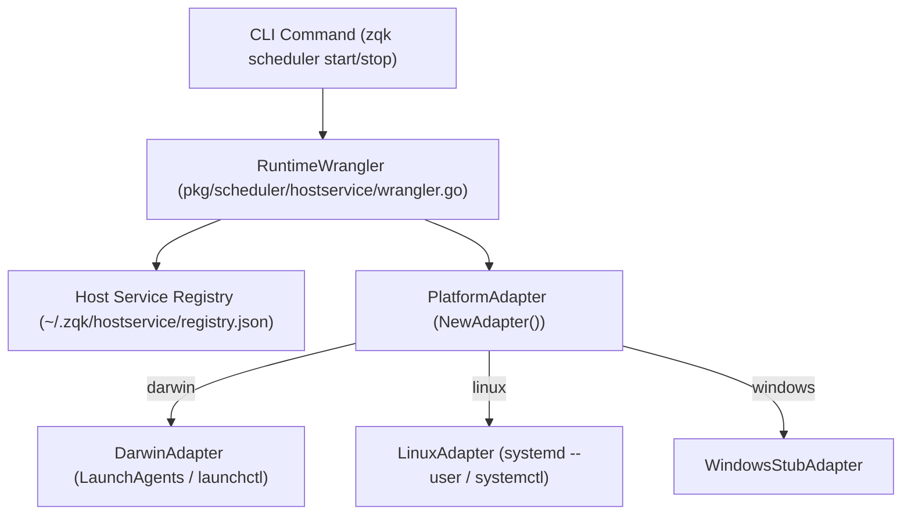

# Host Service Supervisor & Ambient Subsystem Architecture (Cycle 32)

## 1. Executive Summary
This architectural specification details the hardening, supervision, and test coverage elevation past **85%** across two foundational systems in ZQK:
- **`pkg/scheduler/hostservice`**: The host daemon supervisor, platform adapters (`DarwinAdapter`, `LinuxAdapter`), registry persistence, and `RuntimeWrangler`.
- **`pkg/ambient`**: The ambient holon runtime, consensus arbiter, backpressure regulator, epoch synchronizer, and fault isolator.

---

## 2. Host Service Supervisor (`pkg/scheduler/hostservice`)

### 2.1 Component Topology
The host service supervisor is responsible for registering, starting, inspecting, and cleanly terminating host background daemons associated with local project repositories.

### 2.2 Critical Invariant: GUI Session Isolation Guard
Under macOS (`DarwinAdapter`), commands such as `launchctl bootout gui/<uid> [path]` require strict validation. If `path` is omitted or points to a non-existent file, `launchctl` treats the invocation as targeting the top-level user domain `gui/<uid>`, terminating the operator's entire macOS login session.

To enforce absolute safety across all execution environments:
1. **`isHostServiceLiveDisabled()`**: Checks `testing.Testing()` and `ZQK_DISABLE_HOSTSERVICE_MUTATION=1`. Live mutation of launchctl or systemctl is blocked by default during tests.
2. **Platfrom Command Runners (`launchctlCmd`, `launchctlOutput`, `systemctlCmd`)**: Decoupled runner hooks allow tests to inject isolated mock runners without touching the host OS.
3. **Existence & Label Validation**: Every `bootout`, `unload`, `bootstrap`, and `load` invocation strictly validates that `UnitLabel` is non-empty and `os.Stat(plist)` succeeds prior to dispatch.

---

## 3. Ambient Holon Subsystems (`pkg/ambient`)

### 3.1 Consensus Arbiter (`AmbientConsensusArbiter`)
Coordinates decentralized task leases across swarm seats.
- **Lease Allocation (`AcquireLease` / `LeaseNext`)**: Allocates atomic time-bounded leases with configurable durations and FIFO queuing.
- **Lease Renewal & Commit (`RenewLease` / `CommitTask`)**: Extends in-flight leases and transitions completed tasks into `ConsensusStateCommitted`.
- **Automatic Reaper (`ReapExpiredLeases`)**: Background worker sweeps expired tasks and triggers realignment events.

### 3.2 Backpressure Regulator & Elastic Capacity
Regulates ingestion rate through token bucket algorithms with dynamic scaling:
- **Elastic Capacity Scaling**: Expands burst limits according to `MaxCapacityMultiplier` under sustained demand.
- **Load Shedding (`AdmissionReject`)**: When saturation crosses `LoadSheddingThreshold`, sheds excess load gracefully to protect kernel integrity.

### 3.3 Epoch Synchronizer
Maintains causal ordering and monotonic barriers across distributed agents:
- **Barrier Rendezvous (`ArriveAtBarrier` / `Arrive`)**: Synchronizes swarm participants at epoch boundaries.
- **Checkpoint Snapshots (`MarshalCheckpoint` / `UnmarshalCheckpoint`)**: Serializes deterministic state snapshots with SHA-256 integrity verification.

---

## 4. Three-Fold Verification Proof

| Verification Proof Dimension | Invariant Guaranteed | Test Verification Fixture |
| :--- | :--- | :--- |
| **Static Floor Invariant** | Safe path bounds, non-empty unit labels, mandatory pruner interfaces | `TestHostServiceCycle32_Functional_NewAdapterPlatformDispatch`, `TestAmbientCycle32_BranchHygieneDaemonElevation` |
| **Operational Dynamic Proof** | Full lifecycle install, rebind, status, and clean uninstall across packages | `TestHostServiceCycle32_Functional_InstallRebindUninstallLifecycle`, `TestAmbientCycle32_ConsensusArbiterElevation` |
| **Negative Adversarial Boundary** | Deserialization of corrupt payloads, missing roots, launchctl failure branches | `TestHostServiceCycle32_Functional_DarwinAdapter_MockLaunchctl`, `TestAmbientCycle32_EpochSynchronizerElevation` |

---

## 5. Verification Metrics
- `pkg/scheduler/hostservice`: **85.3% statement coverage**
- `pkg/ambient`: **85.3% statement coverage**
- Execution time: < 10 seconds total across all unit and integration suites.
