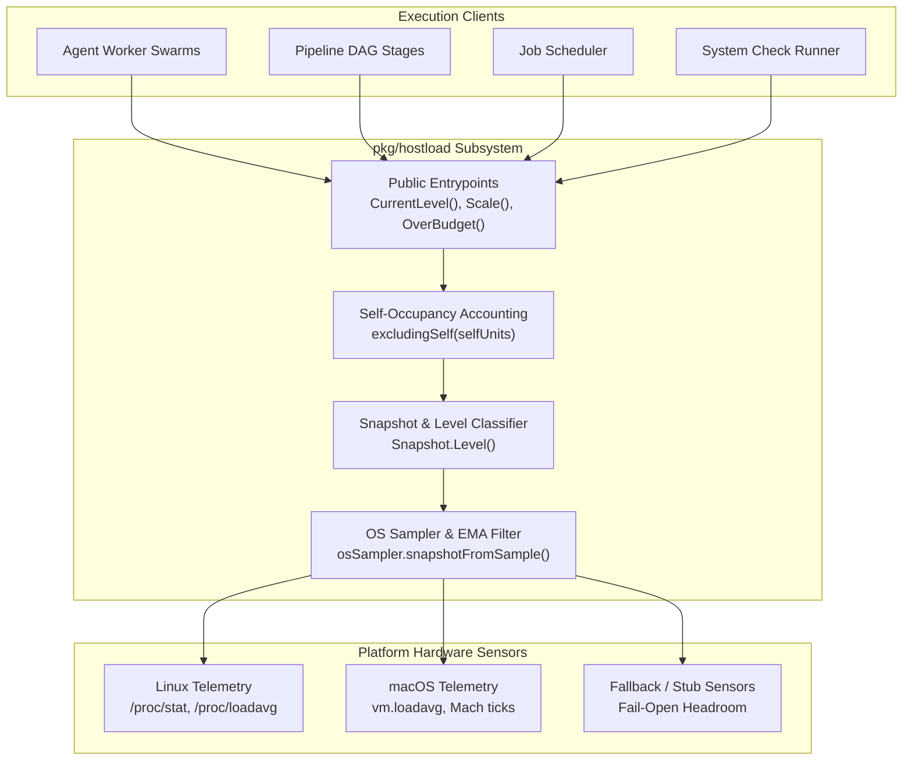
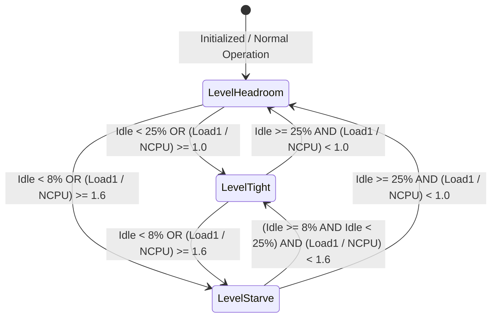
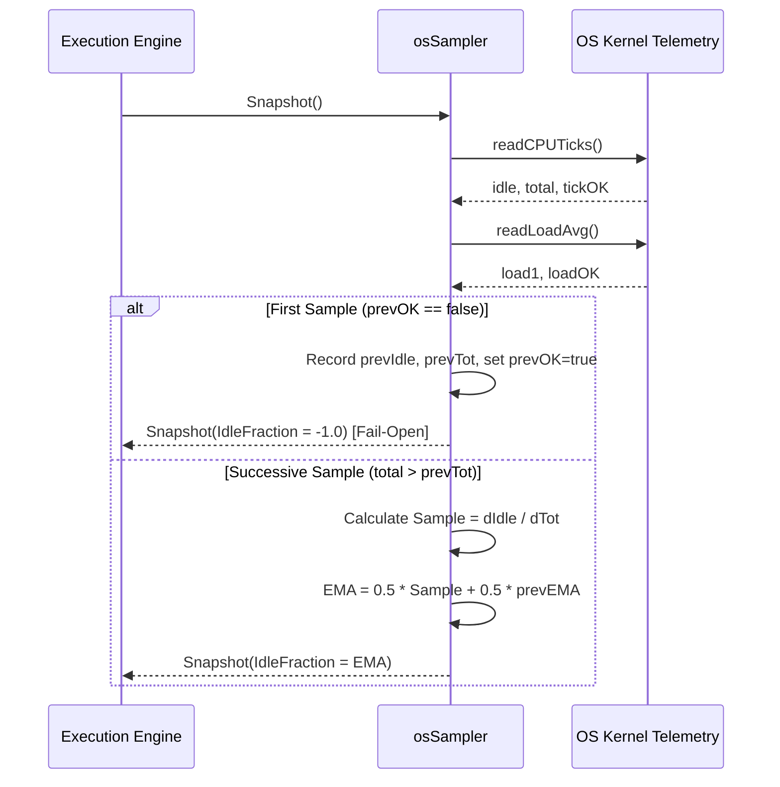

# Host Load Sampling & Adaptive Concurrency Subsystem Architectural Guide (`pkg/hostload`)

## 1. Executive Summary & Design Philosophy

The **Host Load Sampling & Adaptive Concurrency Subsystem** (`pkg/hostload`) provides real-time CPU saturation telemetry, dynamic pressure classification, and adaptive concurrency throttling across the ZQK Knowledge Kernel execution plane.

In modern multi-agent systems, autonomous execution loops, parallel test runners, and DAG pipelines can easily overwhelm workstation or CI environments if concurrency is calculated solely as a static multiple of `runtime.NumCPU()`. If background agents, compilation jobs, or external system processes (such as antivirus or IDE indexing) spike CPU consumption, static worker budgets lead to CPU starvation, high latency, context-switching thrashing, and test timeouts.

The `pkg/hostload` subsystem solves this through dynamic telemetry and adaptive throttling:
- **Real-Time Telemetry Sampling:** Continuous, lightweight sampling of 1-minute load averages and CPU tick ratios (user, system, idle, iowait).
- **EMA (Exponential Moving Average) Smoothing:** Low-pass filtering ($50\%$ weight) prevents momentary CPU spikes or GC pauses from inducing thrashing in concurrency budgets.
- **Three-Tier Pressure Classification:** Maps continuous telemetry into discrete operational tiers: `LevelHeadroom`, `LevelTight`, and `LevelStarve`.
- **Self-Heat Compensation:** `OverBudgetExcludingSelf` prevents self-inflicted backpressure by subtracting an agent's or worker's own held core occupancy from observed host load.
- **Fail-Open Non-Blocking Guarantee:** When platform hardware telemetry is unavailable, incomplete, or disabled, the subsystem fails open to `LevelHeadroom`, ensuring execution never stalls due to missing sensors.
- **Zero-CGO & Cross-Platform Support:** Native telemetry collection on Linux via `/proc` and macOS via `SysctlRaw`/Mach statistics, with graceful no-CGO and OS stub fallbacks.

---

## 2. Component Topology & Architecture

The subsystem is organized into modular layers separating hardware sensing, mathematical smoothing, pressure evaluation, and client throttling decisions:



### Component Roles

1. **`Sampler` Interface:**
   Defines the hardware sampling contract:
   ```go
   type Sampler interface {
       Snapshot() Snapshot
   }
   ```
2. **`osSampler`:**
   Process-wide singleton maintaining historical tick counters and the moving average accumulator (`idleEMA`). Thread-safe via internal mutex protection.
3. **`Snapshot`:**
   Immutable capture of point-in-time system state (`NCPU`, `Load1`, `IdleFraction`, `SampledAt`).
4. **`Level` Classifier:**
   Evaluates CPU ticks and load average against strict thresholds, electing the more conservative (higher pressure) rating.

---

## 3. Pressure Classification & Threshold Semantics

Host pressure is classified into three discrete operational states:



### Threshold Constants

| Metric Boundary | LevelTight Threshold | LevelStarve Threshold | Behavior |
| :--- | :--- | :--- | :--- |
| **Idle Fraction (`IdleFraction`)** | $< 0.25$ ($25\%$ idle) | $< 0.08$ ($8\%$ idle) | Leaves $\approx 1$ core of slack on a 10-core workstation. |
| **Normalized Load (`Load1 / NCPU`)** | $\ge 1.0$ ($100\%$ capacity) | $\ge 1.6$ ($160\%$ capacity) | Host run-queue is substantially overloaded. |

### Evaluation Rules:
1. **Worst-Case Wins:** If `IdleFraction` indicates `LevelTight` but `Load1 / NCPU` indicates `LevelStarve`, the snapshot evaluates to `LevelStarve`.
2. **Missing Sensor Fallback:** Negative values for `IdleFraction` or `Load1` indicate missing data. If both are negative, the subsystem yields `LevelHeadroom`.
3. **Zero Core Protection:** If `NCPU <= 0`, load average calculations are ignored, and pressure relies exclusively on idle tick fraction.

---

## 4. Exponential Moving Average (EMA) Smoothing

Raw CPU tick counters can fluctuate drastically from millisecond to millisecond due to thread scheduling, garbage collection, and short command executions. To prevent high-frequency oscillations in concurrency limits, `pkg/hostload` applies Exponential Moving Average smoothing on consecutive tick samples.

### Mathematical Formulation

Given successive tick samples with delta total ticks $\Delta \text{Tot} = \text{Tot}_t - \text{Tot}_{t-1}$ and delta idle ticks $\Delta \text{Idle} = \text{Idle}_t - \text{Idle}_{t-1}$:

$$\text{Sample}_t = \frac{\Delta \text{Idle}}{\Delta \text{Tot}}$$

When an existing moving average exists ($haveEMA = true$):

$$\text{EMA}_t = 0.5 \times \text{Sample}_t + 0.5 \times \text{EMA}_{t-1}$$

When uninitialized, the initial sample seeds the baseline: $\text{EMA}_0 = \text{Sample}_0$.



---

## 5. Adaptive Concurrency Throttling & Self-Exclusion

### Dynamic Scaling (`Scale`)

The `Scale(n int, level Level) int` function dynamically adjusts a desired concurrency count $n$:
- `LevelHeadroom`: Returns $n$ unchanged.
- `LevelTight`: Returns $\lfloor n / 2 \rfloor$ (minimum $1$).
- `LevelStarve`: Returns $1$.
- **Invariant:** When $n \le 1$, `Scale` always returns $n$, ensuring forward progress is never completely halted.

### Budget Checking (`OverBudget` vs `OverBudgetExcludingSelf`)

```go
// OverBudget checks raw host pressure (including current process load)
func OverBudget(inUse, capacity int) bool

// OverBudgetExcludingSelf subtracts held self-occupancy from host pressure
func OverBudgetExcludingSelf(want, capacity int) bool
```

### Self-Occupancy Accounting (`excludingSelf`)

When a high-concurrency job (e.g. parallel AST linting or compilation) consumes substantial CPU, live host sensors will naturally observe high load and low idle time. If the subsystem did not account for this, the worker would detect its own resource usage as foreign pressure and erroneously throttle or kill its own tasks.

`excludingSelf(selfUnits)` adjusts the snapshot before level evaluation:
1. Calculates self-fraction: $\text{frac} = \frac{\text{selfUnits}}{\text{NCPU}}$
2. Adds $\text{frac}$ back to `IdleFraction` (clamped to a maximum of $1.0$).
3. Subtracts $\text{selfUnits}$ from `Load1` (clamped to a minimum of $0.0$).

This ensures that only foreign host contention (external daemons, other developer tasks) causes the worker to yield slots.

---

## 6. Cross-Platform Hardware Telemetry

The subsystem provides cross-platform hardware telemetry implementations using Go build tags:

| Platform | Build Tags | Telemetry Source | Implementation Notes |
| :--- | :--- | :--- | :--- |
| **Linux** | `//go:build linux` | `/proc/loadavg`<br/>`/proc/stat` | Direct zero-allocation parsing with `fileutil.ReadFile` and `bytes.Fields`. Extracts `user`, `nice`, `system`, `idle`, and `iowait`. |
| **macOS (Darwin) with CGO** | `//go:build darwin && cgo` | `vm.loadavg`<br/>`gopsutil/v3/cpu` | `unix.SysctlRaw("vm.loadavg")` extracts load average. Mach `host_processor_info` via `gopsutil` extracts tick millisecond counters. |
| **macOS (Darwin) without CGO** | `//go:build darwin && !cgo` | `vm.loadavg` | Load average via Sysctl remains active; CPU tick sampling returns `ok = false` (fails open to Headroom unless load average indicates pressure). |
| **Windows / Other Stubs** | `//go:build !darwin && !linux` | Stub implementations | Returns `0, false` for both sensors; transparently fails open to `LevelHeadroom`. |

### Test Scoping & CI Isolation

To prevent test flakes on noisy developer workstations or multi-tenant CI runners, `underGoTest()` inspects test flags (`test.v`). When executing under `go test`, live hardware polling is bypassed, returning a synthetic `Snapshot{IdleFraction: 1.0, Load1: 0.0}` unless explicit mock samplers (`setSamplerForTest`) are injected.

### Administrative Opt-Out

Telemetry sampling can be completely disabled process-wide by setting the environment variable:
```bash
export ZQK_HOSTLOAD_DISABLE=1
```
When disabled, `Disabled()` returns `true`, and all calls to `CurrentLevel()` and `CurrentLevelExcluding()` unconditionally return `LevelHeadroom`.

---

## 7. Verification, Testing & Statement Coverage Invariant

The subsystem enforces a strict statement test coverage invariant ($\ge 85.0\%$).

### Coverage Verification Command

```bash
ZQK_ALLOW_FOREGROUND_GO_TEST=1 go test -v -timeout 30s -cover ./pkg/hostload
```

### Key Verification Scenarios
1. **Dynamic Scaling Limits:** Exhaustive verification of `Scale()` under negative, zero, single-core, and multi-core bounds across all levels.
2. **Matrix Threshold Tests:** Verifying all permutations of `IdleFraction` and `Load1` transitions, boundary inclusiveness ($0.25, 0.08, 1.0, 1.6$), and fail-open fallbacks.
3. **EMA Blending Proof:** Verifying multi-sample decay, initialization seeding, stagnant tick handling, and sensor error isolation.
4. **Concurrent Thread Safety:** Multi-goroutine concurrent execution against `osSampler` and `activeSampler` under thread contention.
5. **Self-Heat Exemption Proof:** Verifying that worker slots are preserved under self-inflicted load but correctly throttled under foreign load spikes.
