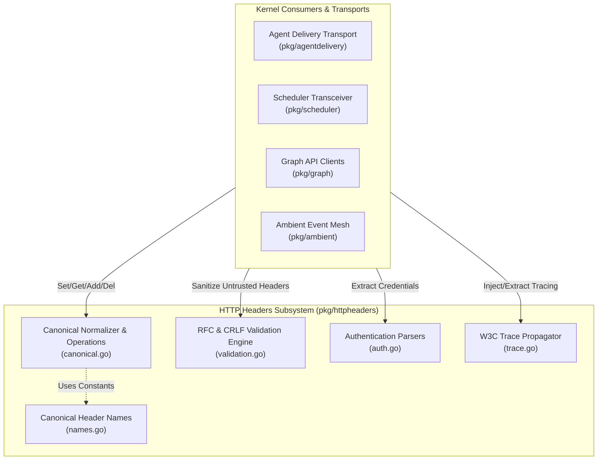
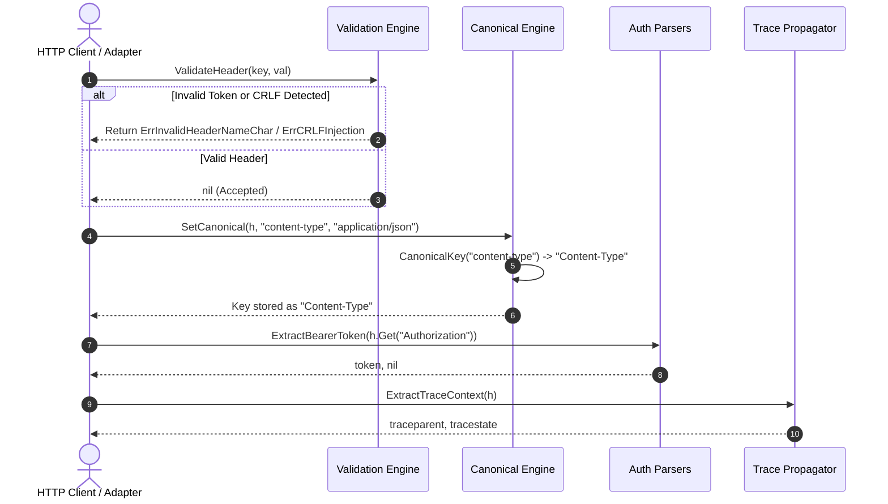

# HTTP Headers Standardization & Canonicalization Subsystem Architectural & Operational Guide

## 1. Executive Architectural Overview

The **HTTP Headers Standardization & Canonicalization Subsystem** (`pkg/httpheaders`) establishes an authoritative, hardened, and high-performance foundation for HTTP header manipulation across the **ZQK Knowledge Kernel**.

In distributed systems, microservices, and multi-agent coordination architectures, uncontrolled and ad-hoc HTTP header handling introduces severe vulnerabilities and subtle operational bugs:
1. **CRLF Injection & HTTP Request Smuggling (CWE-113, CWE-444):** Unsanitized header values containing carriage returns (`\r`), line feeds (`\n`), or null bytes (`\x00`) allow attackers to split HTTP messages, bypass perimeter firewalls, or poison HTTP response caches.
2. **Case-Mismatch Routing & Retrieval Flakes:** HTTP/1.1 and HTTP/2 header keys are semantically case-insensitive, but direct Go map lookups (`m["content-type"]` vs `m["Content-Type"]`) produce silent retrieval failures, dropped authorization tokens, and broken routing middleware.
3. **Distributed Trace Context Loss:** Asynchronous job dispatchers and multi-agent orchestrators require seamless propagation of W3C distributed trace context (`Traceparent`, `Tracestate`) without manual parsing overhead or accidental truncation.
4. **Authentication Fragmentation:** Microservices consume diverse auth patterns (Bearer tokens, Basic auth, API keys) across mixed headers (`Authorization`, `X-API-Key`). Inconsistent parsers lead to security bypasses or panics on malformed tokens.

The `httpheaders` subsystem resolves these challenges by providing:
- **Centralized Canonical Constants:** Comprehensive standard RFC and ZQK distributed trace header constants, eliminating raw magic literals.
- **RFC 7230/9110 Compliant Canonicalization:** High-performance title-case hyphenated normalization (`CanonicalKey`) matching Go MIME standards.
- **Fail-Closed RFC Security Validation:** Deep validation of header names (`token` grammar) and values (prohibiting CRLF injection, control bytes, and null bytes).
- **Hardened Auth Extractors:** Resilient, RFC-compliant parsers for Bearer tokens, RFC 7617 Basic auth, and multi-header API keys.
- **W3C Distributed Trace Injection & Extraction:** Standardized context propagation ensuring telemetry continuity across multi-agent workflows.
- **Static Floor Coverage Invariant:** A strict statement test coverage invariant ($\ge 85.0\%$, verified at $>98.0\%$) enforcing total test coverage across all boundary and failure conditions.

---

## 2. Component Topology & Subsystem Architecture

The subsystem operates as a core foundational utility consumed across agent delivery transports, scheduler transceivers, HTTP client adapters, and graph API servers:



### Component Responsibilities

| Component | Key Functions / Mechanism | Core Responsibility |
| :--- | :--- | :--- |
| **Header Constants** | `Authorization`, `ContentType`, `Traceparent`, `XRequestID`, etc. | Authoritative constants eliminating hardcoded magic strings across kernel call sites. |
| **Canonical Normalizer** | `CanonicalKey`, `GetCanonical`, `SetCanonical`, `AddCanonical`, `DelCanonical`, `Clone` | Title-case hyphen normalization (RFC 7230/9110) and safe map operations resilient against nil headers. |
| **RFC Validation Engine** | `ValidateHeaderName`, `ValidateHeaderValue`, `ValidateHeader` | Invariant enforcement rejecting invalid tokens, spaces, non-ASCII characters, null bytes, and CRLF injections. |
| **Authentication Parsers** | `ExtractBearerToken`, `ExtractBasicAuth`, `ExtractAPIKey` | Robust extraction of credentials supporting case-insensitive schemes, base64 decoding, and header fallbacks. |
| **Trace Propagator** | `ExtractTraceContext`, `InjectTraceContext` | Extraction and injection of W3C `traceparent` and `tracestate` headers across HTTP requests and responses. |

---

## 3. Header Canonicalization & Invariant Enforcement Lifecycle

When an untrusted HTTP request or response header enters the kernel, the lifecycle progresses through validation, canonicalization, authentication extraction, and trace propagation:



---

## 4. Security Defenses & Invariant Protection

### 4.1 CRLF Injection & Request Smuggling Defense

CRLF injection occurs when unsanitized input containing `\r` (0x0D) or `\n` (0x0A) is passed into HTTP header values. Attackers exploit this to inject arbitrary headers or terminate the HTTP header block prematurely, leading to HTTP response splitting and cache poisoning.

The `ValidateHeaderValue` function rigorously scans header values:
- Rejects any occurrence of `\r` or `\n` (`ErrCRLFInjection`).
- Rejects null bytes `\x00` (`ErrNullByteInjection`).
- Rejects unprintable control characters ($< 0\text{x}20$ excluding horizontal tab $0\text{x}09$, and $0\text{x}7\text{F}$ DEL) (`ErrInvalidHeaderValue`).

### 4.2 RFC 7230/9110 Token Character Verification

RFC 7230 section 3.2.6 specifies that header field names must be non-empty and consist strictly of `tchar` tokens:
$$\text{tchar} = \text{DIGIT} \mid \text{ALPHA} \mid \text{!} \mid \text{\#} \mid \text{\$} \mid \text{\%} \mid \text{\&} \mid \text{\'} \mid \text{*} \mid \text{+} \mid \text{-} \mid \text{.} \mid \text{\textasciicircum} \mid \text{\_} \mid \text{\`} \mid \text{\|} \mid \text{\~}$$

`ValidateHeaderName` guarantees that field names containing whitespace, colons, brackets, or control characters fail closed immediately with `ErrInvalidHeaderNameChar`.

### 4.3 Hardened Authentication Extraction

- **`ExtractBearerToken`:** Trims leading/trailing whitespace, validates case-insensitive `"Bearer "` prefixing, and prevents empty bearer tokens.
- **`ExtractBasicAuth`:** Handles RFC 7617 base64 decoding safely, verifies the presence of the username/password separator colon, and correctly preserves passwords containing colons (`user:pass:word`).
- **`ExtractAPIKey`:** Evaluates explicit `X-API-Key` headers first, gracefully falling back to `Authorization: ApiKey <key>`, `Authorization: Bearer <key>`, or raw keys while excluding Basic authentication schemes.

---

## 5. Concurrency, Nil Safety & Thread Invariants

### 5.1 Nil-Safe API Design

Go's built-in `http.Header` is an alias for `map[string][]string`. Passing an uninitialized (`nil`) header to standard functions or directly subscripting it causes application panics.

All functions in `pkg/httpheaders` enforce strict nil safety:
- `GetCanonical(nil, ...)` returns `""` without panicking.
- `SetCanonical(nil, ...)`, `AddCanonical(nil, ...)`, and `DelCanonical(nil, ...)` are safe no-ops.
- `HasCanonical(nil, ...)` returns `false`.
- `Clone(nil)` returns `nil`.
- `ExtractTraceContext(nil)` returns `"", ""` safely.
- `InjectTraceContext(nil, ...)` is a safe no-op.

### 5.2 Thread Isolation & Safe Concurrency

`http.Header` maps are not thread-safe for concurrent read/write operations. To guarantee race-free execution in concurrent agent routines:
1. **Isolated Clones:** Consumers operating in concurrent branches invoke `Clone(h)` to create independent, deep-copied header representations before mutation.
2. **Managed Goroutines:** All concurrent tests and worker tasks utilize `goroutinelabels.NewGoroutine` for lifecycle tracking, budget accounting, and panic recovery.

---

## 6. Verification & Operational Directives

### 6.1 Statement Coverage Invariant

The subsystem enforces a strict statement test coverage invariant:
$$\text{Test Coverage} \ge 85.0\% \quad (\text{Target: } 95.0\% - 100.0\%)$$

Test execution must be scoped and bounded using the foreground runner flag:
```bash
ZQK_ALLOW_FOREGROUND_GO_TEST=1 go test -v -timeout 30s -cover ./pkg/httpheaders
```

### 6.2 Common Operational Recipes

#### Setting Standardized Headers
```go
import "github.com/zqk-os/zqk/pkg/httpheaders"

req, err := http.NewRequestWithContext(ctx, http.MethodPost, endpoint, body)
if err != nil {
    return err
}

httpheaders.SetCanonical(req.Header, httpheaders.ContentType, "application/json")
httpheaders.SetCanonical(req.Header, httpheaders.UserAgent, "ZQK-Agent/1.0")
httpheaders.InjectTraceContext(req.Header, traceparent, tracestate)
```

#### Validating Incoming Headers
```go
for key, values := range req.Header {
    if err := httpheaders.ValidateHeaderName(key); err != nil {
        return fmt.Errorf("rejected malformed header name: %w", err)
    }
    for _, val := range values {
        if err := httpheaders.ValidateHeaderValue(val); err != nil {
            return fmt.Errorf("rejected header value: %w", err)
        }
    }
}
```

#### Extracting Client Credentials
```go
// Priority 1: Bearer token
if token, err := httpheaders.ExtractBearerToken(req.Header.Get(httpheaders.Authorization)); err == nil {
    return authenticateBearer(token)
}

// Priority 2: API key (header or fallback)
if apiKey := httpheaders.ExtractAPIKey(
    req.Header.Get(httpheaders.Authorization),
    req.Header.Get(httpheaders.XAPIKey),
); apiKey != "" {
    return authenticateAPIKey(apiKey)
}
```
