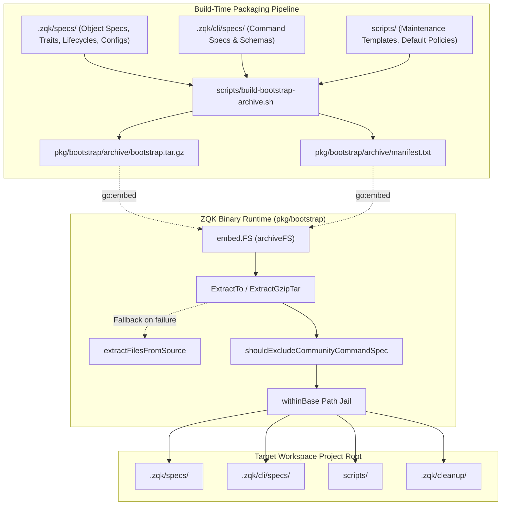

# Kernel Bootstrap, Template Extraction & Greenfield Project Initialization Operational Architecture Guide

## 1. Executive Architectural Summary

The **Kernel Bootstrap & Template Packaging Subsystem** ([`pkg/bootstrap`](file:///Users/lanceettl/zqk-worktree-cycle-264/pkg/bootstrap/extract.go)) is responsible for seeding, extracting, and verifying foundational Knowledge Kernel specifications, command schemas, lifecycles, and configuration templates during greenfield project initialization and system bootstrapping.

When initializing a new workspace or upgrading an existing project via `zqk system init`, the subsystem provisions the complete operational surface required for autonomous AI agents and human engineers—without requiring network calls, external registry dependencies, or git clones.

The `pkg/bootstrap` package guarantees:
1. **Dual-Path Bootstrap Architecture:** Executes production extraction from an embedded gzip-tar archive ([`ExtractTo`](file:///Users/lanceettl/zqk-worktree-cycle-264/pkg/bootstrap/extract.go)), falling back to localized source-tree extraction ([`ExtractFiles`](file:///Users/lanceettl/zqk-worktree-cycle-264/pkg/bootstrap/extract_from_source.go)) when operating in local development environments.
2. **Defensive Decompression & Path Jail Containment:** Enforces strict anti-traversal validation, bounded file sizes (50 MiB ceiling against decompression bombs), and jail boundary validation ([`withinBase`](file:///Users/lanceettl/zqk-worktree-cycle-264/pkg/bootstrap/extract.go)) to eliminate security vulnerabilities during archive unpacking.
3. **AppleDouble & Filesystem Hygiene:** Automatically strips macOS resource forks and Finder metadata sidecars (`._*`) during both archive compilation and extraction cycles.
4. **Open-Core Community Denylist Filtering:** Dynamically purges internal or developer-only command specifications when running within the open-core community binary distribution.
5. **High Statement Test Coverage Invariant:** Maintains comprehensive automated verification with statement test coverage exceeding the strict >= 85.0% threshold (achieving 93.9%).

---

## 2. Component Topology & Extraction Architecture

The bootstrap subsystem bridges the build-time archive packaging workflow and runtime project initialization:



---

## 3. Subsystem Mechanics & Prefix Routing

When unpacking the bootstrap archive via `ExtractGzipTar`, entries are routed deterministically based on their path prefixes to establish the workspace layout:

| Archive Entry Prefix | Destination Project Path | Description |
| :--- | :--- | :--- |
| `cli_specs/` | `.zqk/cli/specs/` | Cobra command specifications, argument schemas, and CLI DNA descriptors. |
| `scripts/` | `scripts/` | Maintenance job templates, default policy packs, personas, and agent skills. |
| `cleanup_config/` | `.zqk/cleanup/` | Config-driven maintenance and scheduled retention rules. |
| *(default)* | `.zqk/specs/` | Core object specs, trait definitions, lifecycle state machines, and configuration manifests. |

### Source-Tree Fallback Extraction

In development environments where binaries are compiled without embedded archives or when testing unbundled builds, [`ExtractFiles`](file:///Users/lanceettl/zqk-worktree-cycle-264/pkg/bootstrap/extract_from_source.go) detects the missing embedded assets and invokes [`extractFilesFromSource`](file:///Users/lanceettl/zqk-worktree-cycle-264/pkg/bootstrap/extract_from_source.go).

The fallback engine:
1. Walks upward from the current working directory to locate the source repository root via [`FindSourceProjectRoot`](file:///Users/lanceettl/zqk-worktree-cycle-264/pkg/bootstrap/extract_from_source.go).
2. Copies mandatory configuration files (`id_prefixes_config.yaml`, `kind_mappings_config.yaml`, `namespaces_config.yaml`, `paths_config.yaml`, `blocking_check_config.yaml`, `scanner_config.yaml`).
3. Recursively synchronizes core object specifications ([`copyBootstrapSpecs`](file:///Users/lanceettl/zqk-worktree-cycle-264/pkg/bootstrap/extract_from_source.go)) and state machine lifecycles ([`copyBootstrapLifecycles`](file:///Users/lanceettl/zqk-worktree-cycle-264/pkg/bootstrap/extract_from_source.go)).
4. Recursively provisions CLI command specs, default policies, default personas, default agent skills, and prompt evaluation templates.

---

## 4. Security Invariants & Defensive Boundary Controls

The bootstrap engine is hardened against malicious or corrupted input vectors:

### 1. Path Traversal Defense & Jail Containment
- **Lexical Inspection:** Every archive entry is inspected for path traversal tokens (`..`). Entries containing `..` are immediately rejected with an explicit error before any disk interaction.
- **Path Jail Guard ([`withinBase`](file:///Users/lanceettl/zqk-worktree-cycle-264/pkg/bootstrap/extract.go)):** Every destination path is resolved to an absolute path and validated via `filepath.Rel` to confirm it resides strictly inside one of the authorized project directory trees (`internalDir`, `cliSpecsDir`, `scriptsDir`, `cleanupConfigDir`). Any entry resolving outside these trees is aborted.

### 2. Decompression Bomb Protection (Denial-of-Service Defense)
- **Size Bounds:** The per-file extraction ceiling is enforced at `maxFileSize = 50 MiB` (`50 << 20`).
- **Bounded Stream Reading:** In [`ReadEmbeddedFile`](file:///Users/lanceettl/zqk-worktree-cycle-264/pkg/bootstrap/embed.go), reads are clamped via `io.LimitReader(tr, maxFileSize)`, preventing runaway memory consumption.

### 3. AppleDouble & Resource Fork Pruning
- macOS Finder and SMB shares frequently synthesize hidden resource fork sidecars (`._*`).
- Both the archive packaging script and runtime extractors invoke [`appledouble.SkipPathInTreeWalk`](file:///Users/lanceettl/zqk-worktree-cycle-264/pkg/appledouble/appledouble.go) and [`appledouble.SkipNameInReadDir`](file:///Users/lanceettl/zqk-worktree-cycle-264/pkg/appledouble/appledouble.go) to prune these non-spec payloads from entering projects.

### 4. Community Edition Command Spec Denylist
- To preserve open-core boundaries and prevent accidental execution of internal-only commands, the community binary enforces [`shouldExcludeCommunityCommandSpec`](file:///Users/lanceettl/zqk-worktree-cycle-264/pkg/bootstrap/community_denylist.go).
- Any archive entry under `cli_specs/` matching denylisted fragments is skipped during community bootstrap extraction.

### 5. File & Directory Permission Invariants
- Extracted directories are provisioned with `0755` permissions (`paths.DirPerm755`).
- Extracted files are provisioned with restrictive `0600` permissions (`paths.FilePerm600`), ensuring least-privilege access out of the box.

---

## 5. Traceability & Manifest Verification

Every generated bootstrap archive includes an embedded cryptographic manifest (`archive/manifest.txt`).

```go
// ManifestPaths returns the list of file paths bundled in the bootstrap archive.
paths := bootstrap.ManifestPaths()
```

The manifest serves two operational objectives:
1. **Build Verification:** CI release gates verify that every required specification, schema, and lifecycle file is present in the manifest before binary distribution.
2. **Runtime Drift Detection:** Diagnostics tools compare workspace filesystem assets against the embedded manifest to identify accidental drift, missing specs, or corrupted installations.

---

## 6. Operational Runbook & Engineering Recipes

### Recipe 1: Rebuilding the Bootstrap Archive
When adding or modifying core specifications, lifecycles, or command schemas in the repository, regenerate the embedded archive before compiling binaries:

```bash
# Generate archive and manifest
sh scripts/build-bootstrap-archive.sh .

# Rebuild product binary with embedded archive
go build -o bin/zqk ./cmd/zqk
```

### Recipe 2: Initializing a Greenfield Project
Initialize a fresh workspace for any polyglot application (Go, Python, TypeScript, Rust, Docs):

```bash
# Navigate to project directory
cd /path/to/my-project

# Run system initialization
zqk system init

# Verify extracted kernel specification directory
ls -la .zqk/specs
```

### Recipe 3: Forcing a Clean Re-Extraction
If specifications or lifecycles have drifted or require an authoritative reset:

```bash
# Overwrite existing bootstrap files with embedded originals
zqk system init --force
```

### Recipe 4: Running Subsystem Verification Tests
Run the unit test suite and verify statement test coverage:

```bash
# Run unit and edge-case tests with coverage profile
go test -v -cover ./pkg/bootstrap/...

# View function-level statement coverage
go test -coverprofile=coverage.out ./pkg/bootstrap && go tool cover -func=coverage.out
```

### Recipe 5: Verifying Public Release Payload Integrity
Before cutting a release or publishing branches, verify that no private or internal artifacts leaked into the repository:

```bash
sh scripts/open-core/check-public-release-payload.sh .
```
