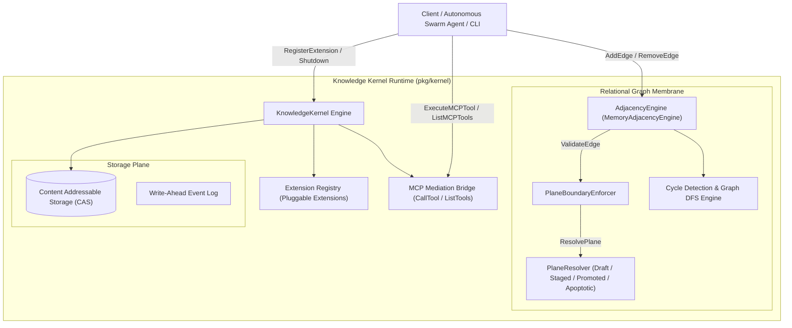
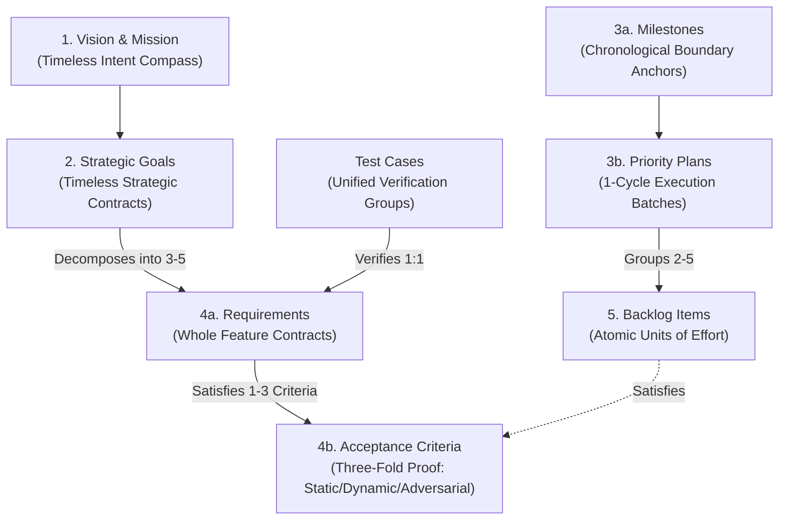
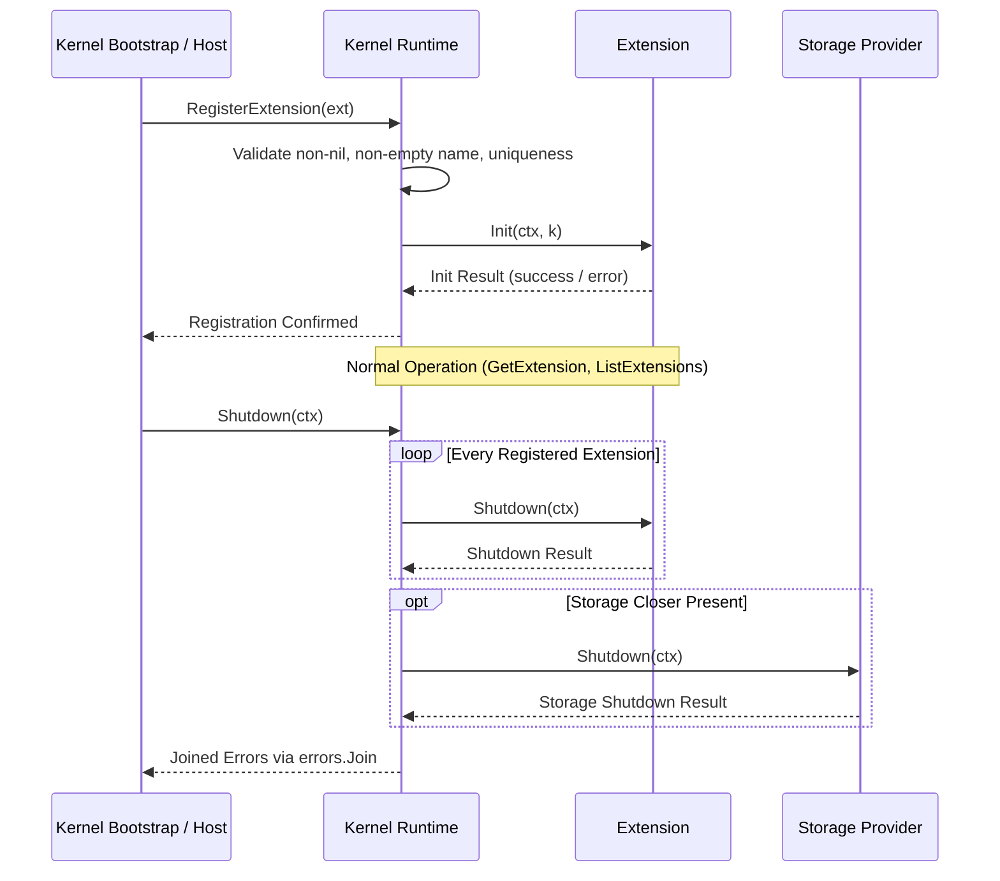

# Kernel Subsystem Operational & Architectural Guide

## Overview

The ZQK Kernel Subsystem (`pkg/kernel`) implements the foundational cellular microkernel architecture, relational graph membrane, transactional plane isolation, and extensible runtime host for the **Zen Quantum Knowledge Kernel**.

Unlike conventional flat-file task systems or transient chat harness contexts where goals and execution state evaporate, ZQK anchors all system entities—from timeless strategic goals down to atomic backlog items and cryptographic verification proofs—into an immutable, relational graph. The kernel subsystem governs object containment, edge validation across transactional isolation planes, cyclic graph analysis, Model Context Protocol (MCP) tool execution, and pluggable runtime extension lifecycles.

---

## Architectural Taxonomy & Component Layout

```
pkg/kernel/
├── kernel.go                     # Concrete Kernel runtime, MCP mediation, extension registry, and shutdown
├── knowledge_kernel.go           # Core KnowledgeKernel interface contract
├── adjacency.go                  # AdjacencyEngine, Edge relations, PlaneBoundaryEnforcer, and cycle detection
├── extension.go                  # Pluggable Extension interface contract
├── intake/                       # Intake membrane, clustering, and candidate validation
├── mutation/                     # Mutation gates, shockwave enforcers, and CAS boundary transitions
├── steward/                      # Runway steward daemons and lifecycle supervisors
└── verification/                 # Verification engine, execution organizers, and criteria attestation
```

---

## Subsystem Architecture & Interaction Flow



---

## 1. Knowledge Kernel Core Principles

The kernel subsystem adheres to four foundational architecture invariants:

1. **Immutable CAS Persistence**: Every domain entity exists as an immutable, content-addressed object in `.zqk/process/`. Mutations produce discrete cryptographic revisions rather than in-place overwrites.
2. **Relational Graph Membrane**: Relationships between entities (causal dependencies, semantic references, implementations) are first-class directed edges governed by deterministic validation invariants.
3. **Decoupled Cellular Architecture**: The kernel acts as a minimal microkernel, delegating domain-specific processing to modular subsystems (`intake`, `mutation`, `steward`, `verification`) and pluggable extensions.
4. **Transactional Plane Isolation**: Objects operate across discrete lifecycle planes with strict boundary validation preventing unpromoted contamination of authoritative state.

---

## 2. The 5-Layer Relational Cascade

The Knowledge Kernel orchestrates work across a formal five-layer ontological hierarchy:



### Layer Roles and Relational Rules

1. **Vision & Mission (Level 1)**: Defines the foundational purpose, values, and operating principles of the organization or project.
2. **Strategic Goals (Level 2)**: Timeless strategic contracts anchoring high-level intent. Goals decompose into 3–5 child `requirement` contracts (`requirement.goal_refs`). Goals do not declare sprint constraints or priority plan links.
3. **Chronological Anchors & Execution Cycles (Level 3)**:
   - **Milestones**: Time-bounded anchors representing release events or roadmap targets.
   - **Priority Plans**: Time-bounded execution batches (sprints or kanban iterations) grouping 2–5 atomic backlog items toward a milestone. Priority plans lock scope upon entering `in_progress`.
   - **Epics**: Thematic containers providing human-legible semantic structure across multi-plan initiatives.
4. **Functional Contracts & Three-Fold Proof (Level 4)**:
   - **Requirements**: Whole feature contracts owning verifiable `criteria_refs`. Requirements exist outside calendar time and decompose into criteria.
   - **Criteria**: The Three-Fold Proof model requiring a **Static Floor Invariant**, an **Operational Dynamic Proof**, and a **Negative Adversarial Boundary**.
   - **Test Cases**: Linked 1:1 to requirements, wrapping and verifying all criteria in a single execution.
5. **Backlog Items (Level 5)**: Atomic, token-budgeted units of effort assigned to engineering agents. Each backlog item directly satisfies 1 to 3 specific criteria.

---

## 3. Transactional Isolation Planes & Boundary Enforcer

Entities in the Knowledge Kernel belong to one of four transactional planes:

| Plane | Constant | Description | Permitted Inbound Causal Source |
| :--- | :--- | :--- | :--- |
| **Draft** | `PlaneDraft` (0) | Gestation phase; speculative, unverified, or in-flight objects. | Draft |
| **Staged** | `PlaneStaged` (1) | Metabolism & Attestation; active execution under verification gates. | Draft, Staged |
| **Promoted** | `PlanePromoted` (2) | Equilibrium; complete, verified, authoritative baseline state. | Staged, Promoted |
| **Apoptotic** | `PlaneApoptotic` (3) | Apoptosis; archived, quarantined, or tombstoned objects. | None (Strictly Isolated) |

### Boundary Enforcement Rules (`PlaneBoundaryEnforcer`)

The `PlaneBoundaryEnforcer` intercepts all edge creation requests before mutations are committed to the graph:

```mermaid
flowchart TD
    EdgeReq["AddEdge Request (Source -> Target, Kind)"] --> ChkResolver{"Resolver Available?"}
    ChkResolver -->|No| Allow["Allow Edge (Unchecked)"]
    ChkResolver -->|Yes| ResolvePlanes["Resolve Source & Target Planes"]
    
    ResolvePlanes --> ChkApoptosis{"Either Node in PlaneApoptotic?"}
    ChkApoptosis -->|Yes| RejectApop["Reject: Apoptotic objects cannot participate in active edges"]
    
    ChkApoptosis -->|No| ChkCausal{"Kind is causal or depends_on?"}
    ChkCausal -->|No (Informational)| Permit["Permit Edge"]
    
    ChkCausal -->|Yes| ChkDraftToPromoted{"Source = Draft AND Target = Promoted?"}
    ChkDraftToPromoted -->|Yes| RejectDraft["Reject: Draft cannot link causal to Promoted without staging"]
    
    ChkDraftToPromoted -->|No| ChkPromotedToUnpromoted{"Source = Promoted AND Target = Draft or Staged?"}
    ChkPromotedToUnpromoted -->|Yes| RejectContam["Reject: Promoted cannot depend on unpromoted object"]
    
    ChkPromotedToUnpromoted -->|No| Permit
```

1. **Apoptotic Isolation**: Neither the source nor target entity may reside in `PlaneApoptotic`. Quarantined or deleted entities cannot participate in active edges.
2. **Draft Causal Isolation**: Entities in `PlaneDraft` cannot form `causal` or `depends_on` dependencies to `PlanePromoted` entities without first advancing through `PlaneStaged`. Informational references (e.g. `references`, `relates_to`) are permitted.
3. **Upstream Contamination Guard**: Entities in `PlanePromoted` cannot declare causal dependencies on unpromoted entities (`PlaneDraft` or `PlaneStaged`), guaranteeing that the authoritative baseline remains closed and self-consistent.

---

## 4. Graph Mechanics & Memory Adjacency Engine

The `AdjacencyEngine` interface governs directed relations across the system:

```go
type AdjacencyEngine interface {
    AddEdge(ctx context.Context, edge Edge) error
    RemoveEdge(ctx context.Context, source, target dna.URN, kind string) error
    GetOutbound(ctx context.Context, source dna.URN) ([]Edge, error)
    GetInbound(ctx context.Context, target dna.URN) ([]Edge, error)
    DetectCycles(ctx context.Context) ([][]dna.URN, error)
    HasCycle(ctx context.Context) (bool, error)
}
```

### Implementation Details (`MemoryAdjacencyEngine`)

- **Dual-Map Indexing**: Outbound edges (`map[string][]Edge`) and inbound edges (`map[string][]Edge`) are indexed simultaneously under a reader-writer mutex (`sync.RWMutex`), enabling $O(1)$ lookup for both upstream and downstream neighbors.
- **Defensive Slice Cloning**: Inbound and outbound queries return decoupled slices via `cloneEdges()`. Callers cannot mutate internal kernel adjacency collections.
- **Idempotent Addition**: Attempting to add an edge identical in `Source`, `Target`, and `Kind` succeeds idempotently without duplicating edge slices.
- **Kind-Specific & Wildcard Pruning**: `RemoveEdge` supports targeting a specific `Kind` or providing an empty string `""` to remove all relations between source and target nodes.

### Cycle Detection Algorithm

The `DetectCycles` algorithm executes depth-first traversal with path tracking:
1. Iterates all nodes in deterministic lexicographical order.
2. Maintains a `visited` set and an active `recStack` (recursion stack).
3. If an edge leads to an unvisited node, DFS recurses.
4. If an edge leads to a node currently in `recStack`, a directed cycle is identified and sliced from `currentPath`.
5. Returns all elementary cycles as slices of `dna.URN`.

---

## 5. Pluggable Extension Registry & Lifecycle

The Knowledge Kernel provides an extension membrane allowing custom subsystems, analyzers, or daemon workers to register cleanly:

```go
type Extension interface {
    Name() string
    Init(ctx context.Context, k KnowledgeKernel) error
    Shutdown(ctx context.Context) error
}
```

### Extension Lifecycle Sequence



- **Thread-Safe Registry**: Protected by `sync.RWMutex`.
- **Lexicographical Enumeration**: `ListExtensions()` returns sorted names for deterministic inspection and CLI formatting.
- **Fault-Tolerant Shutdown**: Kernel shutdown invokes `Shutdown(ctx)` on all registered extensions and the underlying `ObjectStorageProvider`. Any errors encountered are collected and joined via `errors.Join`, ensuring that failure in one extension does not abort teardown of remaining extensions or storage resources.

---

## 6. Model Context Protocol (MCP) Integration

The `Kernel` struct embeds native support for the Model Context Protocol:
- `ExecuteMCPTool(ctx, secCtx, toolName, params)`: Routes tool execution directly to the bound `mcp.MCPServer`, packaging parameters into standard `ToolCallParams`.
- `ListMCPTools(ctx, secCtx)`: Queries the tool registry, returning available tools and parameter schemas for LLM agent discovery.

---

## 7. Verification & Statement Coverage Invariant

To ensure reliability across concurrent agent swarms and mission-critical execution loops, the Kernel Subsystem enforces a strict verification standard:

- **Statement Coverage Floor**: `pkg/kernel` statement coverage must be maintained at **>= 85.0%** at all times.
- **AST Quality Standards**:
  - Zero swallowed errors: All error return values must be explicitly checked and asserted (`require.NoError`, `assert.Error`).
  - Modular function sizing: Test and production functions must not exceed 100 lines.
  - Managed concurrency: All background goroutines in tests and production must use `goroutinelabels.NewGoroutine(...)` or `goroutinelabels.Pool`.
  - Hermetic testing: Tests must allocate isolated temporary environments via `testkit.PrepareIsolatedTempProject` or `t.TempDir()`.
  - Bounded test execution: Test suites must complete reliably within `-timeout 30s`.

### Running Kernel Verification Commands

```bash
# Execute focused Cycle test suite
ZQK_ALLOW_FOREGROUND_GO_TEST=1 go test -v -timeout 30s ./pkg/kernel -run 'TestCycle'

# Run statement coverage report
ZQK_ALLOW_FOREGROUND_GO_TEST=1 go test -short -cover ./pkg/kernel

# Run codebase hygiene and tree validation
./bin/zqk-vet -suite hygiene,tree

# Run public release payload verification
sh scripts/open-core/check-public-release-payload.sh .
```
