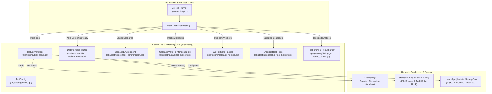
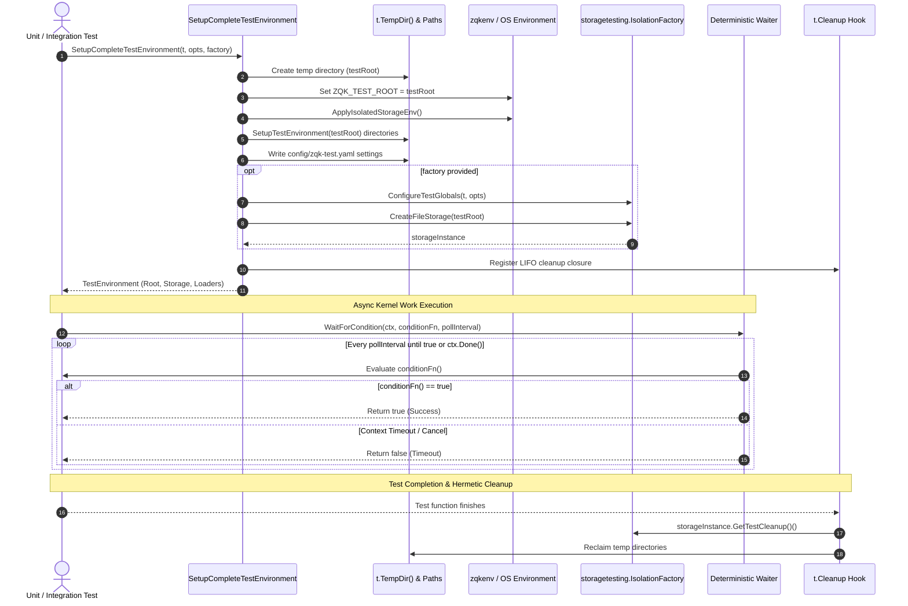
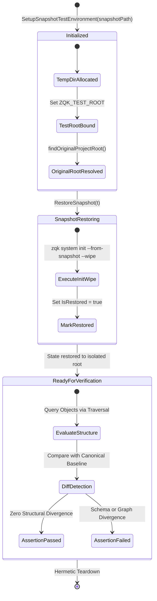
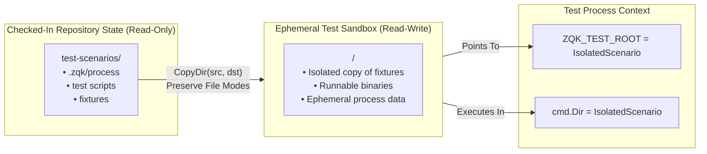

# Kernel Test Scaffolding, Deterministic Waiting & Scenario Test Harness Subsystem Operational Architecture Guide

## 1. Executive Architectural Summary & Purpose

The **Kernel Test Scaffolding, Deterministic Waiting & Scenario Test Harness Subsystem** ([`pkg/testing`](file:///Users/lanceettl/zqk-public-candidate/pkg/testing)) provides the authoritative foundation for hermetic, deterministic, and isolated testing across all layers of the ZQK Knowledge Kernel.

Testing high-concurrency event-driven kernel architectures introduces critical failure modes when relying on standard test paradigms:
- **Flaky Sleep Invariants:** Arbitrary `time.Sleep()` calls lead to non-deterministic race conditions, test flakes, CI timeouts, or unnecessarily inflated test suite execution times.
- **Filesystem Cross-Contamination:** Tests executing directly against repository trees risk corrupting `.zqk/process`, polluting git worktrees, or causing state collisions across parallel test workers.
- **Unmanaged Background Goroutines:** Orphaned goroutines that outlive individual test runs leak file descriptors, mutate shared memory, and trigger race detectors.
- **Fragile Snapshot Assertions:** Snapshot tests that fail to normalize dynamic timestamps, absolute paths, or machine-specific environments produce false positives in CI environments.

Governed by core platform mandates (including **POL-DEFAULT-142277d3** for deterministic test verification and test data isolation), `pkg/testing` establishes an integrated suite of architectural primitives:

1. **Hermetic Environment Isolation:** Automatically provisions per-test temporary working directories via `t.TempDir()`, redirecting `ZQK_TEST_ROOT` and suppressing external state leaks.
2. **Deterministic Waiting & Polling:** Replaces arbitrary sleeps with condition polling ([`WaitForCondition`](file:///Users/lanceettl/zqk-public-candidate/pkg/testing/deterministic_wait.go#L11), [`CallbackWaiter`](file:///Users/lanceettl/zqk-public-candidate/pkg/testing/callback_helpers.go#L11), [`WorkerStateTracker`](file:///Users/lanceettl/zqk-public-candidate/pkg/testing/callback_helpers.go#L178)) bounded by explicit context timeouts and small tick intervals.
3. **Scenario Sandboxing & Virtualization:** Virtualizes checked-in scenario environments ([`ScenarioTestEnvironment`](file:///Users/lanceettl/zqk-public-candidate/pkg/testing/scenario_environment.go#L22)), creating executable isolated copies while preserving file permissions and directory hierarchies.
4. **Snapshot Agnostic Verification:** Provides structured snapshot restoration and validation patterns ([`SnapshotTestHelper`](file:///Users/lanceettl/zqk-public-candidate/pkg/testing/snapshot_test_helpers.go#L17)), enabling tests to verify system state against canonical baseline snapshots.
5. **Thread-Safe Concurrency & Labeling:** Guarantees parallel test safety across goroutines using explicit read-write synchronization and named execution labels via `goroutinelabels.NewGoroutine`.
6. **Strict Statement Coverage Floor:** Enforces a static floor invariant of statement test coverage strictly $\ge 85.0\%$ across the subsystem.

---

## 2. Component Topology & Subsystem Architecture

The testing subsystem is structured into modular components that coordinate to provide complete test lifecycle isolation and verification:



### Component Responsibilities

| Component | Architecture Role | Key Responsibilities | Source Reference |
| :--- | :--- | :--- | :--- |
| **`TestEnvironment`** | Complete Test Harness | Manages test temporary root creation, spec copying and generation, isolated storage factory instantiation, security context creation, and clean teardown. | [`test_setup.go#L29-L49`](file:///Users/lanceettl/zqk-public-candidate/pkg/testing/test_setup.go#L29-L49) |
| **`TestConfig`** | Configuration Membrane | Evaluates `ZQK_TEST_ROOT` and `ZQK_TEST_DATA_DIR`, overriding project root paths and ensuring commands resolve to isolated test sandboxes. | [`config.go#L20-L31`](file:///Users/lanceettl/zqk-public-candidate/pkg/testing/config.go#L20-L31) |
| **`WaitForCondition`** | Deterministic Poller | Executes polling over condition predicates with short interval ticks and context cancellation awareness, eliminating `time.Sleep`. | [`deterministic_wait.go#L11-L29`](file:///Users/lanceettl/zqk-public-candidate/pkg/testing/deterministic_wait.go#L11-L29) |
| **`CallbackWaiter`** | Event Synchronization | Provides thread-safe callback notification tracking with fast-path checks and channel waiting for asynchronous callbacks. | [`callback_helpers.go#L11-L22`](file:///Users/lanceettl/zqk-public-candidate/pkg/testing/callback_helpers.go#L11-L22) |
| **`WorkerStateTracker`** | Lifecycle State Monitor | Tracks worker startup and shutdown states deterministically, with non-blocking event dispatch and timeout-bounded condition waiting. | [`callback_helpers.go#L178-L190`](file:///Users/lanceettl/zqk-public-candidate/pkg/testing/callback_helpers.go#L178-L190) |
| **`ScenarioTestEnvironment`**| Scenario Virtualizer | Copies checked-in test scenario trees from `test-scenarios/` into ephemeral test roots, preserving file modes and binaries. | [`scenario_environment.go#L22-L35`](file:///Users/lanceettl/zqk-public-candidate/pkg/testing/scenario_environment.go#L22-L35) |
| **`SnapshotTestHelper`** | Snapshot Verifier | Handles test environment preparation and baseline snapshot evaluation, decoupling tests from static entity IDs. | [`snapshot_test_helpers.go#L17-L23`](file:///Users/lanceettl/zqk-public-candidate/pkg/testing/snapshot_test_helpers.go#L17-L23) |
| **`ParseGoTestOutput`** | Test Output Parser | Parses `go test` stdout into structured [`TestRunSummary`](file:///Users/lanceettl/zqk-public-candidate/pkg/testing/result_parser.go#L9) structs with status breakdowns and data race detection. | [`result_parser.go#L12-L14`](file:///Users/lanceettl/zqk-public-candidate/pkg/testing/result_parser.go#L12-L14) |

---

## 3. Test Lifecycle & Deterministic Wait Sequence

The following sequence illustrates the complete lifecycle of a hermetic test run: initializing the sandbox, applying environment isolation, waiting deterministically for asynchronous operations, and executing teardown.



---

## 4. Snapshot Testing & State Verification State Machine

Snapshot verification ensures that storage states, graph models, and process data structures match expected baseline representations without coupling tests to non-deterministic factors (like absolute machine paths or wall-clock timestamps).



### Snapshot Agnostic Principles
1. **Dynamic ID Decoupling:** Tests never assert literal object IDs minted at runtime. Comparison relies on structural properties, relationship types, and semantic payloads.
2. **Environment Variable Redirection:** All snapshot restorations are pinned to `ZQK_TEST_ROOT`, guaranteeing that developer checkouts or production databases are never touched.
3. **Idempotent Restoration:** Restorations can be replayed repeatedly within the isolated temporary folder without residual side-effects.

---

## 5. Scenario Environment Isolation & Filesystem Sandboxing

When verifying multi-command CLI behaviors or complex workflows, checked-in scenarios stored under `test-scenarios/` provide rich starting states. The `pkg/testing` subsystem virtualizes these directories cleanly:



### Sandboxing Mechanics
- **Recursive Directory Copying:** [`CopyDir`](file:///Users/lanceettl/zqk-public-candidate/pkg/testing/scenario_environment.go#L86) walks the scenario directory tree using `filepath.WalkDir`, ensuring subdirectories are created with `fileutil.EnsureDir` and files are cloned with `io.Copy`.
- **Mode Preservation:** Source file permissions (including POSIX executable bits `0o755`) are preserved so that scenario initialization binaries remain executable in sandbox copies.
- **Fail-Safe Missing Directory Handling:** If a scenario directory is not present, `SetupScenarioTestEnvironment` calls `t.Skipf` rather than failing, preventing local configuration variations from breaking test suites.

---

## 6. Concurrency Safety & Thread-Safe Test Harnesses

To support parallel test execution (`t.Parallel()`) and multi-agent swarm testing, all synchronization primitives in `pkg/testing` enforce strict concurrency guarantees:

### 1. `CallbackWaiter` Mutex Isolation
The [`CallbackWaiter`](file:///Users/lanceettl/zqk-public-candidate/pkg/testing/callback_helpers.go#L11) coordinates asynchronous callbacks across arbitrary goroutines using an atomic counter (`atomic.Int64`) combined with a `sync.Mutex` guarding the waiter channel slice:
```go
// Atomic fast-path avoids lock acquisition when already invoked:
if cw.invocations.Load() > 0 {
    return true
}
```

### 2. `WorkerStateTracker` Read-Write Locking
[`WorkerStateTracker`](file:///Users/lanceettl/zqk-public-candidate/pkg/testing/callback_helpers.go#L178) tracks worker status maps using `sync.RWMutex`, allowing concurrent read operations (`IsRunning`) while serializing state updates (`SetState`) and broadcasting state change notifications through non-blocking channel sends.

### 3. Named Goroutine Labels
When tests launch asynchronous support routines, they must not invoke raw unmonitored `go func()`. Tests utilize `goroutinelabels.NewGoroutine`:
```go
goroutinelabels.NewGoroutine("testing", "concurrent worker").StartSimple(func() {
    // Isolated worker logic
})
```

---

## 7. Verification & Coverage Invariant

In conformance with **POL-DEFAULT-142277d3**, the `pkg/testing` package enforces a strict statement test coverage invariant:
- **Static Floor Invariant:** Total package statement coverage must remain strictly $\ge 85.0\%$.
- **Target Threshold:** Maintenance target of $\ge 90.0\% - 100.0\%$.
- **Verification Command:**
  ```bash
  ZQK_ALLOW_FOREGROUND_GO_TEST=1 go test -v -timeout 30s -cover ./pkg/testing
  ```

### AST Quality & Clean Code Invariants
- **Zero Swallowed Errors:** All error returns must be explicitly asserted or handled. `_ = ...` pattern assignments on error returns are strictly prohibited.
- **Function Line Boundaries:** Functions must not exceed 100 lines; complex test setups are factored into modular subtests and test helpers.
- **Hermetic Storage Isolation:** Test cases must never touch `.zqk/process` in the actual repository; all filesystem mutations occur within `t.TempDir()`.
- **Open-Core Payload Integrity:** Documentation guides and test files must not contain literal nanosecond kernel IDs.
