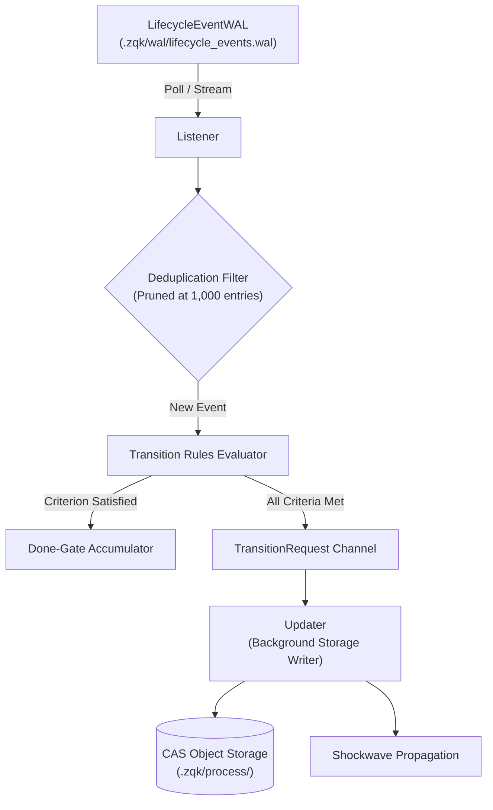

# Lifecycle Subsystem Architectural Guide

## Overview

The ZQK Lifecycle Subsystem (`pkg/lifecycle`) provides the core distributed state machine, write-ahead event logging, reactive trigger evaluation, and dependency shockwave propagation for the ZQK Knowledge Kernel platform. It ensures deterministic, auditable, and content-addressed lifecycle transitions across all kernel entities—from strategic goals and milestones to requirements, criteria, priority plans, and atomic backlog items.

The subsystem encapsulates eight primary architectural capabilities:
1. **Durable Write-Ahead Logging (`LifecycleEventWAL`)**: Appends structured, immutable lifecycle event records to disk (`.zqk/wal/lifecycle_events.wal`) with checkpointing and atomic state recovery.
2. **Global WAL Registry & Polling (`registry.go`, `event_wal.go`)**: Manages project-scoped WAL instances, deduplicated event ingestion, cache reset lifecycles, and asynchronous polling routines.
3. **Reactive Listener & Transition Rules Engine (`Listener`, `TransitionRule`)**: Evaluates forward-looking transition conditions against incoming WAL events, executing automated state advancement and callback dispatching.
4. **Asynchronous Job Waker Registry (`JobWakerRegistry`)**: Provides deterministic goroutine synchronization, notification channels, and wildcard event subscriptions for autonomous agent workers and scheduler daemons.
5. **Background Updater & Storage Convergence (`Updater`)**: Continuously drains transition requests from listeners and writes CAS-compliant state changes to durable storage backends.
6. **Shockwave Propagation & Dependency Cascades (`DependencyPropagationSubscriber`)**: Propagates hierarchical status transitions upstream and downstream (e.g. child completion unblocking parent milestones, epic shockwaves, or failure halts).
7. **Criterion Satisfaction & Done-Gate Cascades (`criterion.go`)**: Evaluates Three-Fold Proof criteria, automatically satisfying parent requirements and backlog items upon verification.
8. **Remaining Open Child Counting & CAS Invariants (`remaining_open_count.go`)**: Tracks uncompleted children under plans and containers using atomic compare-and-swap decrements to eliminate race conditions and avoid unbounded listing.

---

## Architectural Taxonomy & Component Layout

```
pkg/lifecycle/
├── event_wal.go                   # Write-Ahead Log implementation, replay cursors, and checkpoints
├── registry.go                    # Global project-scoped WAL registry and event factory helpers
├── listener.go                    # Reactive event processor, dedup maps, and rule firing loop
├── rules.go                       # Transition rule definitions, catalysts, and pattern matchers
├── waker.go                       # Job waker registry, wildcard subscriptions, and channel cleanup
├── updater.go                     # Storage writer draining transition requests from listeners
├── dependency_propagation.go      # Upstream/downstream status shockwave coordinator
├── shockwave_resolve.go           # Shockwave policy resolution (prune, cluster, line)
├── criterion.go                   # Acceptance criteria satisfaction and done-gate evaluation
├── remaining_open_count.go        # Atomic CAS tracking of active child counts
├── stage_membrane.go              # Draft plane to CAS membrane qualification rules
├── rollback_graph.go              # Scope-bounded reference recomputation on rollback
├── hooks.go                       # Custom lifecycle compute hook invocations
└── constants.go                   # Canonical event types, status strings, and reason codes
```

---

## 1. Durable Write-Ahead Event Logging (`LifecycleEventWAL`)

Every mutation within the Knowledge Kernel produces a structured `LifecycleEvent` appended to a local WAL before storage confirmation.

### Event Structure & Schema
```go
type LifecycleEvent struct {
    ID           string                 `json:"id"`
    EventType    string                 `json:"event_type"`    // status_transition, criterion_satisfied, reference_linked
    ObjectType   string                 `json:"object_type"`   // goal, requirement, backlog_item, priority_plan
    OldStatus    string                 `json:"old_status"`
    NewStatus    string                 `json:"new_status"`
    Data         map[string]interface{} `json:"data,omitempty"`
    Ts           time.Time              `json:"ts"`
    CheckpointID string                 `json:"checkpoint_id,omitempty"`
}
```

### WAL Storage & Checkpointing
- Events are appended sequentially in JSON Lines format to `.zqk/wal/lifecycle_events.wal`.
- Checkpoints are saved periodically to `.zqk/wal/lifecycle_events.wal.checkpoint` using atomic file renaming (`fileutil.WriteFileAtomic`).
- When a process restarts or recovers, `LifecycleEventWAL.ReplayFromCheckpoint` scans only unacknowledged entries, guaranteeing O(1) restart latency without scanning historical event logs.

---

## 2. Reactive Listener & Transition Rules Engine

The `Listener` acts as the sensory organ of the lifecycle package, monitoring incoming events from the WAL and matching them against registered `TransitionRule` specifications.



### Transition Rule Types & Triggers
- `criterion_satisfied`: Fired when a unit test or verification pass certifies a criterion.
- `all_criteria_complete`: Evaluated when all child criteria for a requirement or backlog item are satisfied.
- `all_backlog_complete`: Fired when `remaining_open_count` drains to zero on a priority plan.
- `status_transition`: Triggered when an object moves through its defined lifecycle hops (e.g. `planned` -> `in_progress`).

---

## 3. Asynchronous Job Waker Registry

The `JobWakerRegistry` coordinates autonomous execution agents, CLI wait loops, and scheduler daemons by waking waiting goroutines when matching lifecycle events occur.

### Registration Topology
- **Direct Wakers (`Register(jobID)`):** Return a buffered `chan *LifecycleEvent` and an unregister closure for a specific target identifier.
- **Wildcard Wakers (`RegisterWildcard()`):** Subscribe to all scheduler callbacks and callback events across any job identifier.
- **Clean Teardown:** Invoking `Close()` closes all active waker channels and unblocks listening goroutines safely, eliminating goroutine leaks.

---

## 4. Shockwave Propagation & Dependency Cascades

When an entity undergoes a status transition, the event ripples through its semantic hierarchy:

### Shockwave Modes
- **Prune Mode:** When an object transitions to `archived` or `cancelled`, dependent children are pruned or transitioned concurrently to maintain membrane consistency.
- **Cluster Mode:** Sibling and parent objects within a priority plan cluster move together across the CAS membrane.
- **Occupancy Lock:** When a priority plan transitions to `in_progress`, its linked backlog items lock execution scope, preventing lateral modification without administrative review.

---

## 5. Remaining Open Child Counting & CAS Invariants

To avoid scanning thousands of content-addressed files on disk to determine whether a priority plan or epic is finished, the lifecycle engine maintains an atomic `remaining_open_count` field:
- **Initialization:** Set to the number of planned backlog items when the plan enters `in_progress`.
- **Decrement:** When a child transitions to a terminal state (`complete`, `archived`), `casDecrementRemainingOpenCount` atomically decrements the counter.
- **Drain Trigger:** When the counter hits 0, `TryEmitRemainingOpenDrained` automatically signals completion of the container.

---

## 6. Verification and Testing Patterns

Subsystem tests in `pkg/lifecycle/lifecycle_coverage_elevation_cycle142_test.go` enforce:
- **TDD Invariants:** Statement coverage $\ge 85.0\%$.
- **AST Hygiene:** All test functions strictly $\le 80$ lines with zero swallowed error returns (`_ = ...`).
- **Resource Hygiene:** WAL file descriptors, channels, and temporary test directories are cleanly closed via `t.Cleanup`.
- **Process Isolation:** Clean state isolation per test invocation with dedicated project roots.
