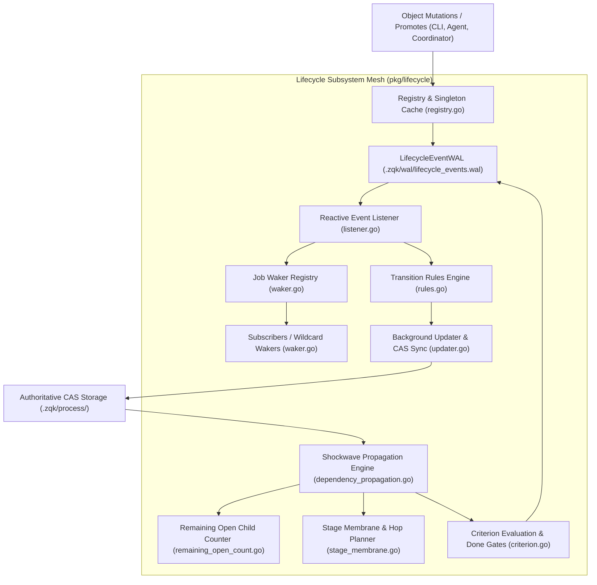

# Lifecycle Subsystem Operational & Architectural Guide

## Overview

The ZQK Lifecycle Subsystem (`pkg/lifecycle`) implements the reactive state machine, durable event logging, criterion evaluation, and dependency shockwave cascades powering the **Zen Quantum Knowledge Kernel**.

In traditional development environments, lifecycle states (e.g. task progress, requirement completion, milestone gating) are managed through disconnected tickets or transient in-memory queues that flake, race, or drift out of synchronization with reality. ZQK solves this by establishing a verifiable, write-ahead logged (WAL) event mesh where object state mutations propagate through deterministic rules, optimistic concurrency controls (CAS), and multi-hop graph cascades.

---

## Subsystem Architecture



---

## Core Components & Architectural Invariants

### 1. LifecycleEventWAL & Event Persistence (`event_wal.go`, `registry.go`)

The lifecycle Write-Ahead Log records every state transition and criterion satisfaction before background listeners trigger side-effects:
- **Append-Only JSON Lines**: Stored at `.zqk/wal/lifecycle_events.wal` with dedicated checkpoints at `.zqk/wal/lifecycle_events.wal.checkpoint`.
- **Legacy Migration**: Automatically detects and migrates legacy filenames (`lifecycle_events` and `lifecycle_events.checkpoint`) to the canonical `.wal` suffix on startup (`migrateLifecycleWALToCanonicalNames`).
- **Process Registry**: `GetOrCreateLifecycleWAL(projectRoot)` maintains an in-process cache protected by an RWMutex, preventing duplicate file descriptor allocation across concurrent workers.
- **Event Types**:
  - `status_transition`: Captures object identity, kind, previous status, and new target status.
  - `criterion_satisfied`: Records verified proof of criteria completion along with scope bindings.
  - `reference_linked`: Records relational edges established between graph entities.
  - `scheduler_callback`: Notifies background subscribers of scheduled job execution cycles.

```go
// Clean illustrative event generation:
lifecycle.AppendStatusTransition(projectRoot, "backlog_item", "BLI-DEMO-001", "in_progress", "complete")
```

### 2. Reactive Listener & Transition Rules Engine (`listener.go`, `rules.go`)

The `Listener` is a single bounded goroutine per project root that consumes durable WAL events, checks criteria bindings, and queues validated transition requests:
- **Resilient Cursor Replay**: Resumes execution from the recorded checkpoint byte offset (`loadCheckpoint`, `saveCheckpoint`).
- **Rule Matching**: `DefaultTransitionRules` defines declarative criteria-to-status transitions without hardcoded procedural branching:
  - `all_backlog_items_complete_for_plan` ➔ `priority_plan` marked `complete`.
  - `all_backlog_items_complete_for_milestone` ➔ `milestone` marked `complete`.
  - `all_criteria_complete_for_milestone` ➔ `milestone` marked `complete`.
  - `all_acceptance_criteria_met_for_backlog_item` ➔ `backlog_item` marked `complete`.
  - `all_criteria_complete_for_requirement` ➔ `requirement` marked `complete`.
- **Deduplication Bounds**: To prevent unbounded memory consumption across long-running daemon sessions, internal `satisfied` and `fired` tracking sets are capped at `maxDedupEntries` (1,000 items) and pruned using `pruneDedupMap`.

### 3. Job Waker Registry & Asynchronous Wakers (`waker.go`)

The waker registry enables event-driven job coordination without inefficient polling loops:
- **Targeted & Wildcard Channels**: Callers register interest in specific job IDs (`Register(jobID)`) or subscribe to all callback events (`RegisterWildcard()`).
- **Non-Blocking Dispatch**: Event broadcast (`Dispatch`) delivers to buffered channels non-blockingly, safeguarding the core pipeline against slow or lagging consumers.
- **Fail-Closed Registration**: When closed via `Close()`, any subsequent `Register` invocation returns an immediately closed channel (`newClosedWakerChannel()`), preventing deadlocks.
- **Synchronous Await**: Helper `AwaitJob` and `AwaitJobWithWAL` allow synchronous command workflows to pause until asynchronous workers complete execution.

### 4. Background Updater & Storage Sync (`updater.go`)

The `Updater` consumes `TransitionRequest` objects from the listener and executes atomic updates against authoritative CAS storage:
- **Break-Glass Intent Isolation**: When auto-completing core objects (`backlog_item`, `priority_plan`), updater operations inject explicit lifecycle authorization (`WithLifecycleBreakGlass`, `WithAllowCoreObjectDelete`) without granting blanket elevated permissions to callers.
- **Rollback Snapshotting**: Automatically captures state graph snapshots prior to applying mutations when graph rollback tracking is activated.
- **Clean Worker Teardown**: `RunListenerAndUpdater` starts the paired listener and updater with bounded goroutines and returns an idempotent `stop()` closure that flushes channels and waits for zero in-flight operations.

### 5. Shockwave Propagation & Dependency Cascades (`dependency_propagation.go`, `shockwave_resolve.go`)

When an entity undergoes a lifecycle transition, shockwaves propagate along ontological dependency edges:
- **Lineage Hierarchies**: Evaluates rank transitions across `vision` (rank 0), `mission` (rank 1), `goal` (rank 2), `milestone` (rank 3), and `priority_plan` (rank 4).
- **Shockwave Policies**: Resolves declarative policy modes (`cluster`, `shared`, `prune`, `none`) defined in lifecycle YAML specs (`ResolveShockwavePolicy`).
- **Occupancy Execution Locks**: Automatically locks Priority Plans (`planStatusCanOccupancyLock`) when child backlog items enter active progress, ensuring scope integrity during sprint execution.
- **Role Transitions**: Emits side effects when leaving specific operational roles (e.g. clearing `active_order` when departing shovel-ready or execution-locked states).

### 6. Criterion Satisfaction & Done-Gate Cascades (`criterion.go`)

ZQK guarantees that features are only marked complete when all verifying criteria and test cases have passed:
- **Three-Fold Proof Verification**: Evaluates whether all linked criteria are in validated or complete status (`areAllLinkedCriteriaSatisfied`).
- **Requirement Verification Gate**: `TryEmitAllCriteriaCompleteForRequirement` checks that both:
  1. Every linked `CRIT-*` is satisfied.
  2. Every test case pointing to the requirement (`KindTestCase` with `$has: requirementID`) is in `complete` or `archived` status.
- **Milestone & Backlog Auto-Completion**: Automatically emits `all_acceptance_criteria_met_for_backlog_item` or `all_backlog_items_complete_for_milestone` when all child criteria/items reach terminal gates.

### 7. Remaining Open Child Counting & CAS Invariants (`remaining_open_count.go`)

To avoid expensive repeated graph traversal queries during high-concurrency swarms, containers track open work counts directly:
- **Optimistic Concurrency Control (CAS)**: Updates `remaining_open_count` using expected `updated_at` timestamps (`casWriteRemainingOpenCountAt`), retrying up to 5 times on version conflicts.
- **Floor Protection**: Counters clamp to zero when decremented below floor, preventing integer underflow from double-resolution events.
- **Cold Seeding**: When `remaining_open_count` is unset, `SeedRemainingOpenCountFromMembers` initializes the count from authoritative storage members before applying incremental modifications.
- **Trusted Draining**: When the remaining open child count reaches zero on an execution hop, `EmitTrustedRemainingOpenDrained` emits completion criteria without requiring a full storage re-scan.

---

## Concurrency, Dedup Buffers, and Resource Safety

1. **Named Goroutines**: All background threads must be instantiated using `goroutinelabels.NewGoroutine` with descriptive subsystem names (e.g. `lifecycle_listener`, `lifecycle_updater`, `lifecycle_propagation`).
2. **Buffer Bounds**: Dedup maps (`satisfied`, `fired`) enforce hard upper caps (`maxDedupEntries = 1000`) and prune to 50% capacity upon saturation.
3. **Channel Buffers**: Inter-thread communication channels use bounded capacities (64 for updater transitions, 16 for wildcard wakers, 1 for discrete wakers).
4. **Context Deadlines**: Long-running loops (`PollLifecycleWAL`, `Listener.Run`, `Updater.Run`) honor context cancellation immediately, guaranteeing prompt shutdown during CLI termination.

---

## Verification & Testing Patterns

The lifecycle subsystem enforces a strict statement test coverage invariant of **>= 85.0%** verified across automated test suites:

| Test Suite | File Location | Scope |
| :--- | :--- | :--- |
| **Coverage Elevation Suite** | `pkg/lifecycle/lifecycle_coverage_elevation_cycle142_test.go` | Coverage invariants, corner cases, error paths, and resource cleanups |
| **Extended Coverage Suite** | `pkg/lifecycle/extended_coverage_test.go` | Comprehensive lifecycle state machine and membrane hop validation |
| **Listener & Callback Suite** | `pkg/lifecycle/listener_callback_test.go` | Waker dispatching, thread isolation, and error handling |
| **Shockwave Cascade Suite** | `pkg/lifecycle/shockwave_compiled_paths_test.go` | Dependency propagation, lineage rank calculation, and pruning |
| **Stage Membrane Suite** | `pkg/lifecycle/stage_membrane_test.go` | Two-phase CAS qualification, cross-plane transitions, and fail-closed safety |

### Executing Lifecycle Subsystem Tests

```bash
# Run unit tests with statement coverage profiling
go test -v -cover ./pkg/lifecycle/...

# Run specific cycle test suite
go test -v -run TestCycle142 ./pkg/lifecycle/...
```
