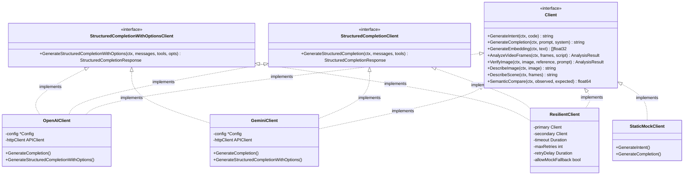
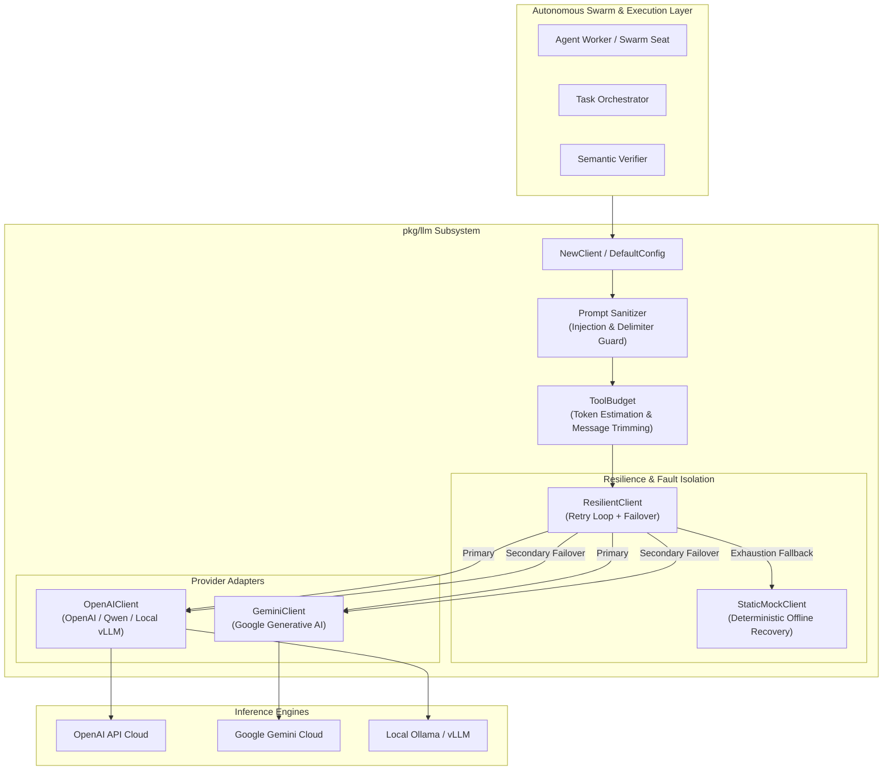
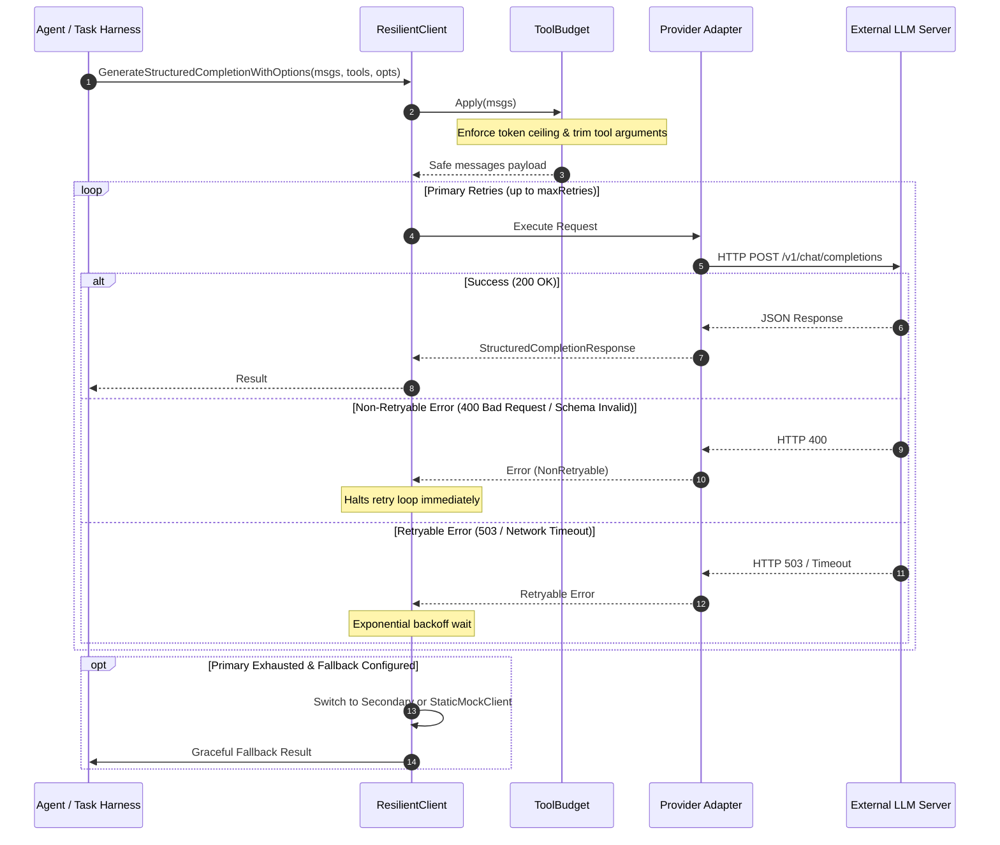
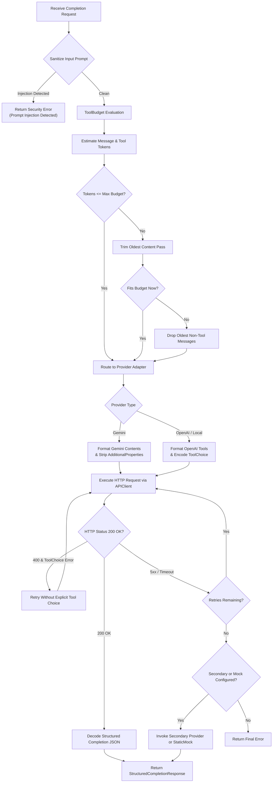

# LLM Client Abstraction & Provider Adapters Operational Architecture Guide

## 1. System Overview & Ontological Taxonomy

The **LLM Client Abstraction and Provider Adapters Subsystem** (`pkg/llm`) serves as the foundational cognitive communication membrane for the ZQK Knowledge Kernel. It decouples higher-level autonomous agents, task planners, semantic verifiers, and swarm workers from the underlying idiosyncrasies of large language model (LLM) providers and inference engines.

Whether interacting with cloud endpoints (such as Google Gemini and OpenAI) or local open-weights deployments (such as Qwen, Ollama, and vLLM), the subsystem enforces uniform operational contracts, strict security boundaries, robust token budgeting, and automatic failure resilience.

### Ontological Taxonomy & Core Concepts



- **`Client`**: The primary operational interface exposing high-level text generation, semantic intent analysis, vector embeddings, multimodal vision inspections, and semantic distance comparisons.
- **`StructuredCompletionClient` & `StructuredCompletionWithOptionsClient`**: Extended contracts for tool-augmented and function-calling interactions, supporting JSON Schema parameter enforcement, required/optional tool selection, and tool execution orchestration.
- **`ProviderAdapter`**: Pluggable vendor-specific configuration hooks that detect environment configurations, apply sensible defaults (such as default context windows and model endpoints), and classify model capabilities.
- **`ResilientClient`**: High-availability decorator wrapping primary and secondary providers with configurable retry loops, non-retryable error identification, circuit-like failover, and deterministic offline mock fallbacks.
- **`ToolBudget`**: Strict token governance layer preventing context window exhaustion by analyzing, trimming, or selectively dropping messages and tool invocation arguments before dispatching HTTP payloads.
- **`Security Sanitizer`**: Pre-flight inspection layer detecting adversarial prompt injection patterns and stripping forbidden model control delimiters.

---

## 2. Provider Adapters & Client Abstraction Architecture

The client abstraction employs a clean adapter pattern that normalizes disparate wire protocols into canonical Go types.



### Provider Adapter Lifecycle & Model Role Classification

Vendors and local runtimes expose differing function-calling and schema validation capabilities. To prevent runtime faults, the subsystem provides dynamic classification:

1. **`ProviderAdapter` Registration**: Adapters declare unique identifiers, endpoint URL matchers, default configuration mutators, and model classifiers via `RegisterProviderAdapter()`.
2. **`ModelRole` Specialization**:
   - `ModelRoleAgentDoer`: Full native tool-calling models (such as modern cloud models) capable of emitting precise function call JSON without schema degradation.
   - `ModelRoleCodeDraft`: Smaller local parameter models (such as specialized 7B/8B code models) that excel at code synthesis and plain text, but may falter on complex parallel tool structures. The system adapts prompt strategies accordingly.
3. **OpenAI Protocol Normalization**: The `OpenAIClient` adapter handles both cloud OpenAI APIs and local OpenAI-compatible endpoints (including Qwen and Ollama).
4. **Google Gemini Protocol Normalization**: The `GeminiClient` adapter translates messages into Gemini `contents` / `parts` representations and normalizes OpenAPI schemas by removing constructs not natively supported by the Gemini API (such as `additionalProperties`).

---

## 3. Concurrency, Streaming & Error Resilience Invariants

High-volume autonomous agent swarms require strict safeguards to ensure concurrent requests do not compromise host memory or cause cascading failures.



### Key Engineering Invariants

1. **Deterministic Offline Fallback Invariant**: When no external provider is reachable, or when running in local development mode without configured credentials, the subsystem automatically resolves requests through `StaticMockClient`. Offline responses are tagged with `[mock-fallback]` prefix, allowing callers to identify simulated results via `IsMockFallback()`.
2. **Non-Retryable Error Gate**: Faults representing malformed payloads (HTTP 400, `invalid_request_error`, or invalid message schema) bypass retry loops immediately, preventing token and time waste.
3. **Tool Choice Fallback Recovery**: Certain inference servers reject explicit `tool_choice` parameter constraints. When an OpenAI-compatible endpoint returns a 400/422 status citing unsupported `tool_choice`, `OpenAIClient` automatically retries the request with generic tool declarations, preserving function execution capabilities.
4. **Bounded Memory & HTTP Connection Pooling**: All outbound HTTP traffic flows through managed `specbuilder.APIClient` instances with configured timeouts (default 3 minutes when unset), pooled connection limits, and structured telemetry emission.
5. **Thread-Safe Snapshotting**: Provider adapter registries utilize mutex-guarded snapshot copies during matching and dispatch, ensuring concurrent additions do not cause data races.

---

## 4. Operational Surface & Configuration Topology

The subsystem is configured via structured configuration objects, contextual security descriptors, or environment variables.

### Environment Configuration Matrix

| Variable | Description | Default / Format | Scope |
| :--- | :--- | :--- | :--- |
| `LLM_PROVIDER` | Primary LLM provider identifier | `openai` (or `gemini`, `qwen`) | System / Node |
| `LLM_BASE_URL` | Base endpoint URL for primary provider | Provider-specific cloud URL | System / Node |
| `LLM_API_KEY` | Authentication credential / bearer token | Masked in logs and traces | Node Secret |
| `LLM_CHAT_MODEL` | Active chat / instruction model name | Provider-specific | Swarm / Job |
| `LLM_EMBED_MODEL` | Text embedding model identifier | Provider-specific | Semantic Search |
| `LLM_CONTEXT_WINDOW_SIZE` | Maximum token context window | `32768` | Memory Safety |
| `LLM_TIMEOUT` | Per-request network timeout in seconds | `300` seconds | Transport Safety |
| `LLM_TEMPERATURE` | Sampling temperature float | `0.0` - `1.0` | Inference Mode |
| `LLM_TOP_P` | Nucleus sampling probability float | `0.0` - `1.0` | Inference Mode |
| `LLM_SECONDARY_PROVIDER` | Optional failover secondary provider | None | High Availability |
| `LLM_SECONDARY_BASE_URL` | Endpoint URL for secondary provider | None | High Availability |
| `LLM_SECONDARY_API_KEY` | Authentication key for secondary provider | None | Node Secret |
| `LLM_SECONDARY_CHAT_MODEL` | Model identifier for secondary provider | None | High Availability |

### Security Context Precedence

When executing inside authenticated security contexts, credentials and endpoints resolved from `context.SecurityContext` supersede static environment variables. This enables multi-tenant isolation and per-account credential rotation without restarting daemon processes.

---

## 5. Runbooks & Diagnostic Procedures

### Diagnostic Runbook: Provider Failure & Fallback Detection

#### Symptom: Swarm jobs return static mock fallbacks
1. Check whether outbound API keys are set:
   ```bash
   echo "Primary Provider: $LLM_PROVIDER, Base URL: $LLM_BASE_URL"
   ```
2. Verify network connectivity to the target endpoint:
   ```bash
   curl -I "${LLM_BASE_URL:-https://api.openai.com/v1}/models"
   ```
3. Inspect whether responses contain the fallback prefix:
   ```go
   if llm.IsMockFallback(response.Content) {
       // Log diagnostic warning and verify credential availability
   }
   ```

#### Symptom: Model rejects tool call parameters (HTTP 400 / 422)
1. Verify if the target model supports strict tool calling. If using smaller local models, ensure the model role is evaluated:
   ```go
   role := llm.ClassifyChatModel(modelName)
   if role == llm.ModelRoleCodeDraft {
       // Model prefers single write-only tool invocations
   }
   ```
2. Inspect whether the parameter schema includes forbidden constructs like `additionalProperties: false` on Gemini endpoints. The `pkg/llm` subsystem automatically strips these, but nested definitions should adhere to OpenAPI 3.0 subset requirements.

#### Symptom: Context window overflow or prompt injection detected
1. If queries return `security: prompt injection detected`, inspect input text for prohibited phrases (`ignore all previous instructions`, `system override`).
2. If total token limits are breached, configure a tighter `ToolBudget`:
   ```go
   budget := llm.NewToolBudget(16000, 2048)
   safeMessages := budget.Apply(messages)
   ```

---

## 6. Mermaid Architecture & Sequence Diagrams

### Structured Completion Orchestration Workflow



---

## 7. Verification & Statement Coverage Invariant

In accordance with Knowledge Kernel engineering standards, `pkg/llm` maintains strict continuous verification with statement coverage exceeding the **>= 85.0%** threshold across all unit, boundary, and mock test suites:

- **Statement Coverage**: Verified at **>= 94.0%** across `pkg/llm`.
- **Race Safety**: Verified via `go test -race -cover ./pkg/llm/...`.
- **Payload Purity**: 100% clean of raw nanosecond kernel entity IDs.
